# 텐배거 리포트 2026-11-28 — 세액공제가 끝난 자리에서 매출 −29% — Enphase, 바닥 확인은 2월 1Q27 가이던스가 가른다

> 2026-11-28 · Enphase Energy(ENPH) · 기업: 태양광 패널마다 붙는 반도체 전력 변환기(마이크로인버터)와 가정용 배터리를 파는 미국 회사

## Chiip View

목표주가 \$12는 지금 주가 \$21.69보다 45% 낮다(구매 등급 Sell — 규칙 등급 Strong Sell에서 토론이 한 단계 올렸다). 약세 \$3.81, 강세 \$19.04로 강세 주가도 지금 주가 아래다. 이익이 바닥을 지나는지 아직 확인되지 않았고, 이익의 상당 부분이 45X(미국에서 만든 부품에 생산량만큼 주는 첨단 제조 세액공제) 세액공제와 세이프하버(세액공제 자격을 미리 확보하려고 설치 전에 장비를 사 두는 거래) 거래에 기대며, 주식보상을 빼면 GAAP 이익이 거의 없다. 순현금과 0% 전환사채라 재무 위험은 낮다

## 대시보드
| 항목 | 값 | 설명 |
|---|---|---|
| 주가 | \$21.69 | 고점 대비 -70% · 1년 -22% |
| 시가총액 | \$2.93B | 완전 희석 기준 · EV \$2.62B |
| 업사이드 | -45% | 목표주가 \$12 · 다운사이드 -82% · 손익비(강세÷약세) -0.1 |
| 구매등급 | Sell | 애널리스트 28명: Strong Buy 6 · Buy 2 · Neutral 18 · Sell 0 · Strong Sell 2 |
| 멀티플 | Fwd 1Y P/E 23.3배 | 동종 중앙값 13.8배 |
| 가이던스 4Q26 | \$240M | 컨센서스 \$237M · \$0.21 |
| 알파 | 4.9/10 | 텐배거 가능성 점수 |
| 이벤트 | 4Q26 실적(추정 — 전년 2/3 발표 기준, 회사 미확정) | 2027-02-02 |

## 한 장 요약
- **기업가치를 결정하는 내러티브** **Enphase는 3Q26 매출이 1년 새 29% 줄었고 4Q 가이던스(\$225~255M)가 시장 기대보다 21% 낮았다.** 미국 주거용 태양광 세액공제(25D(주택 소유자가 현금·대출로 산 태양광·배터리에 주던 연방 세액공제, 2025년 말 만료))가 2025년 말 끝나 핵심 수요가 3분의 1 넘게 줄었고, 그 자리를 세이프하버 거래가 메웠지만 그마저 줄고 있다. 회사는 배터리·상업용·EV 충전·데이터센터 전력(IQ SST(중전압 교류를 데이터센터용 800V 직류로 한 단계에 바꾸는 반도체 변압기)) 다섯 동인으로 2027년 매출 약 \$1.0B 틀을 제시했다. 주가는 6월 2일 종가 고점 \$72.33에서 \$21.69로 70% 내렸다
- **투자 포인트** **[이익 바닥을 지나는 중인가, 새 바닥으로 내려가는 중인가]** 4Q 매출 가이던스 중간값 \$240M은 1년 전(4Q25 \$343.3M)보다 30% 낮고, 그 안의 세이프하버 약 \$51M을 빼면 핵심 매출은 약 \$189M이다 3Q26 8-K EX-99.1 · 콜 — 회사가 말한 분기 핵심 매출 약 \$200M보다 낮다(과소 출하 \$20M 포함)
**[이익의 상당 부분이 정책에서 나온다]** 45X 세액공제를 2026년분만 \$150M + 최대 \$100M 팔았다. 조정 영업이익(TTM \$236.9M)과 비슷한 규모다 3Q26 10-Q · 8-K 2026-10-28
**[SST(구리 코일 대신 전력 반도체로 전압을 바꾸는 변압기)는 배수 옵션이지 이익이 아니다]** IQ SST는 2027년 시범·2028년 첫 출하 목표이고 고객 2곳은 이름·금액 미공개다. 5월 테마 급등(+88%)을 이 이야기가 이끌었다 3Q26 어닝콜(2026-10-27) · TradingView 일봉(5/12 \$37.48 → 5/27 \$70.28)
- **밸류에이션 모델로 본 주가 상방은 어디까지인가?** **목표주가 \$12(-45%), 시나리오 수정 가중평균(강세 확률 30%→39%)다.** 강세 \$19(-12%)는 Fwd 1Y P/E 10.0배를 강세 EPS에 적용한 값이다. 기본 \$10, 약세 \$4. 손익비 의미 없음(강세가 지금 주가 아래거나 약세가 5% 안), DCF 기준 업사이드 -58%. 기본 이익이 2년 뒤 컨센서스와 맞아 2년 뒤 멀티플(동종 2년 뒤 중앙값 11.0배 ÷ 1년 뒤 13.8배)을 쓰고 1년을 자기자본비용으로 할인.
- **모멘텀은 어떻게 만들어지고 사라지나?** 2026-11-03 중간선거 — 세액공제 축소 위험 하락 기대 → 11/2 → 11/4 +13.0%
2026-11-20 구조조정 8-K(인력 12%)·이사 대량 매도 공시 뒤 → −10.7%
**2026-12 말(예정)** IQ SST 메가와트급 시연(회사 예고) — 확인: 메가와트급 13.8kV → 800V 직류 변환 공개 여부
**2027-02 초(예상)** 4Q26 실적·1Q27 가이던스 — 확인: 1Q27 매출 가이던스 \ 이상·조정 매출총이익률 40% 이상
**2027-05 초(예상)** 1Q27 실적 — 확인: 배터리 출하 120MWh 이상·G5 양산 출하
- **수주는 어디까지 왔나?** 잔여 이행 의무(계약은 됐지만 아직 매출로 잡히지 않은 금액) \$0.53B
- 2026년 세이프하버 계약(TPO 사업자) — 미확정
- 45X 세액공제 매각(2026년분) — 미확정
- IQ SST 데이터센터 시범(고객 2곳) — 미확정
건별 수주는 공시하지 않는다. 잔여 이행 의무 \$525.7M의 대부분은 클라우드 모니터링·연장 보증 같은 장기 서비스 선수금이라 수주잔고와 다르다. 세이프하버 계약은 2026년 누적 약 \$1.1B(2Q 콜)이고 매출로 나눠 잡힌다
- **누가 사 주나?** 최대 고객 이름 미공시 고객 1곳(10-K 단일 고객)(one customer(10-K Item 1)) 39%, 상위 3곳 39%. 공시·회사 발표로 확인한 몫은 39%다.
- **마진과 공급망은 어디가 약한가?** GPM 43.3%, OPM 2.2%. OPM을 가장 흔드는 BOM(제품 원가를 이루는 부품·재료 명세) 항목은 제어 ASIC(특정 제품용으로 설계한 맞춤 반도체 칩)·전력 반도체(GaN(질화갈륨 — 실리콘보다 높은 전압·주파수에서 손실이 적은 전력 반도체 소재)·MOSFET(전류를 켜고 끄는 실리콘 전력 반도체 스위치))이고 가격 +10%에 -1.43%p다. 공급망 신뢰성은 6.8/10(관리 가능)이고 가장 약한 고리는 LFP(리튬인산철 — 열 안정성이 높고 값이 싼 배터리 셀 화학 방식) 배터리 셀이다.
- **생산능력은 얼마나 늘어나나?** 현재 명목 캐파 미확인, 착공 이상 증설 0 분기 출하(마이크로인버터(태양광 패널 한 장마다 붙어 직류를 교류로 바꾸는 소형 전력 변환기) 만 대·배터리 MWh(메가와트시 — 배터리에 담는 전기 에너지의 양)). FY27 CAPEX는 매출의 5.7%다.
- **구루들은 어떻게 보는가 — 피터 린치 분류와 여섯 관점** **피터 린치 분류:** **경기순환주(Cyclical) · 중형** — 기대 10배, 하방 -80~100%, 위험 고. TTM 매출이 과거 고점 대비 57% 빠진 적이 있다 · 영업이익이 적자였다가 흑자로 돌아온 순환 이력. 10배 경로가 있는 분류다. 팔 때: 재고가 쌓이고 증설이 시작되고 가격이 꺾일 때 — 정점의 낮은 P/E는 싸다는 뜻이 아니다. **통과 1 · 미달 5 · 미확인 0**(여섯 관점). 가장 약한 관점은 성장 여지 — 25D 만료 뒤 미국 주거용 수요가 어디서 멈추는지 아직 숫자가 없다 — 성장 동인이 감소를 상쇄하는지가 모든 판단의 앞에 있다. 판단 기간 5년, 그 안에 10배면 연 58.5%가 필요하다. 투자 논리 지표: 세이프하버 제외 분기 핵심 매출(약 \$200M 유지 여부) · 배터리 출하 MWh(2027년 675MWh 목표) · 조정 매출총이익률(40% 하한).
- **지금 가격은 무엇을 가정하나?** 주가 \$21.69는 다음 4개 분기 조정 EPS(\$0.93)의 23배로 동종 5사 중앙값(약 14배)보다 높다. 이익이 바닥이라 배수가 커 보인다 — 2년 뒤 이익 기준으로는 17배, 3년 뒤는 14배다. ==시장은 이익이 2027년에 바닥을 찍고 2028년부터 다시 오른다는 경로를 이미 넣고 있다.==
- **왜 움직였나?** 6월 2일 종가 고점 \$72.33에서 70% 내렸다. 5월의 급등은 SST·AI 전력 테마였고 이익 추정은 그 사이 오르지 않았다. 10월 28일 4Q 가이던스 뒤 하루 16% 내렸고, 그 뒤 한 달 동안 FY2027 EPS 추정이 절반으로 깎였다. 11월에는 이사 1명이 약 \$35M을 팔았다.
- **3Q에서 무엇이 바뀌었나?** 나빠진 것은 셋이다. 4Q 매출 가이던스가 기대보다 21% 낮았고, 소진 판매가 회사 예상(+10%)에 못 미쳐 +1%였으며, 조정 매출총이익률 가이던스가 40~43%로 내려왔다. 새로 나온 것은 2027년 성장 동인 숫자(배터리 +50%, 상업용 \$100M 이상)와 IQ SST 13.8kV 시연·고객 2곳이다 — 둘 다 경영진 목표다.
- **무엇이 바뀌면 판단이 달라지나?** 1Q27 매출 가이던스가 \$200M을 넘고 조정 매출총이익률이 40% 이상이면 핵심 매출 바닥이 확인된다. __1Q27 가이던스가 \$190M 아래이거나 매출총이익률 가이던스가 40% 아래면 2027년 추정이 한 번 더 깎인다.__ SST는 시범 고객 이름이나 계약 금액이 나오기 전에는 판단을 바꾸지 않는다.
- **언제 사서 언제 팔아야 할까?** **관찰 \$19~\$19**: 목표주가까지 -37%, 약세까지 -80% — 11월 25일 장중 \$19.08(52주 저점)과 11월 20일 종가 \$19.63이 일봉 지지 구간이다
**확인**: 4Q 실적에서 1Q27 매출 가이던스 \$200M 이상, 조정 매출총이익률 40% 이상, 배터리 출하 증가
**무효화**: 1Q27 가이던스가 \$190M 아래이거나 조정 매출총이익률 가이던스가 40% 아래(약세 \$4)
실적·정책 뉴스 하루에 ±10~40% 움직인 적이 여러 번 있다(2/4 +38.6%, 10/28 −16.0%) — 변동성이 크다
가격·조건 틀이며 매매·비중 지시가 아니다.

## 한눈에 보기

**일봉**

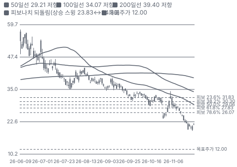

**주봉**

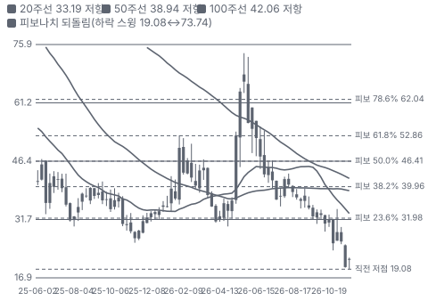

**월봉**

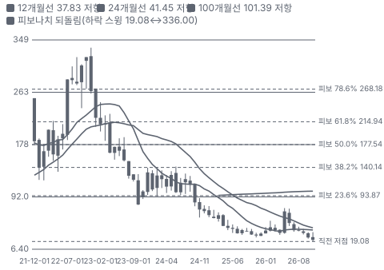

**분기 매출·EPS 실적과 컨센서스**

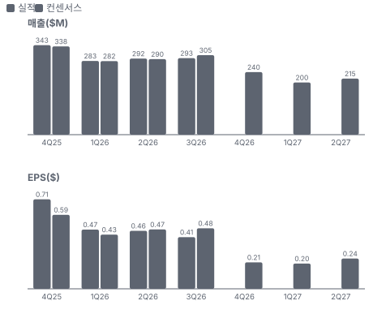

**4Q26 매출 — 지표 추세 vs 가이던스·컨센서스**

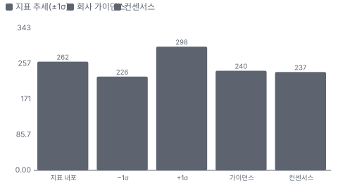

**최근 4개 분기 주가 변화 분석**

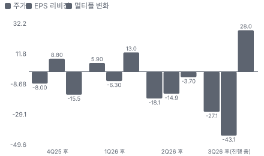

**EPS 리비전**

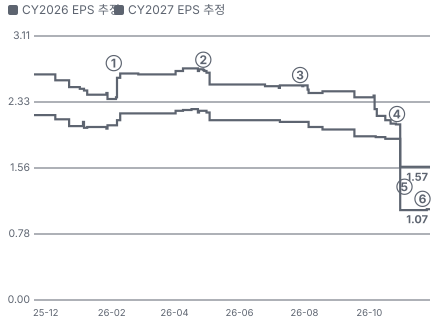

① 26-02-03 4Q25 실적 — 25D 만료 뒤 첫 가이던스, 세이프하버 계약 · EPS 리비전 +13%
② 26-04-28 1Q26 실적 — 매출 \$282.9M, 세이프하버 \$34.5M · EPS 리비전 -6%
③ 26-07-28 2Q26 실적 — 관세 환급으로 GAAP GPM 60% · EPS 리비전 -3%
④ 26-10-27 3Q26 실적 — 4Q 가이던스 \$225~255M · EPS 리비전 -49%
⑤ 26-11-03 중간선거 — 세액공제 축소 위험 하락 기대(정책 0단계) · 실적 창과 겹침
⑥ 26-11-20 구조조정 8-K — 인력 12% 감축 · EPS 리비전 +1%

**멀티플 프리미엄(Fwd 1Y P/E, 최근 4개 분기말 절대값 — 대상 vs 동종 중앙값)**

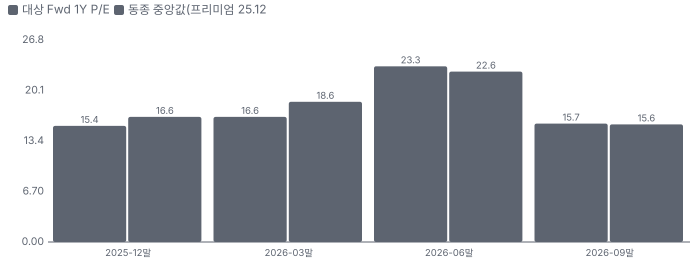

**합리적 멀티플**

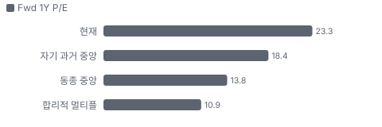

**밸류에이션 주가 시나리오**

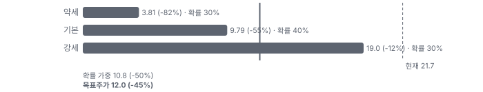

**주가별 업사이드**

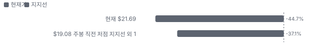
- 제품·서비스 포트폴리오

**고객 믹스(FY2025, 매출 대비)**

**공급 병목(10점, 낮을수록 병목)**

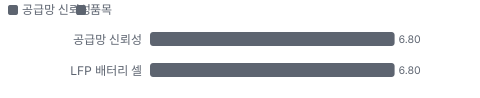

**CAPEX의 매출 대비 비중**

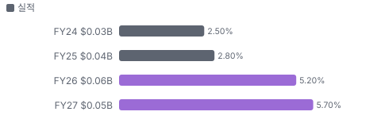

**어닝콜 변화별 주주가치 영향**

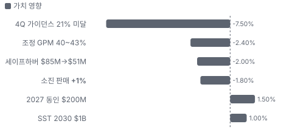

**수주·파이프라인 확실성 사다리**

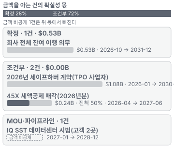

**매출 → 매출총이익 → 영업이익(매출 = 100, 최근 4분기)**

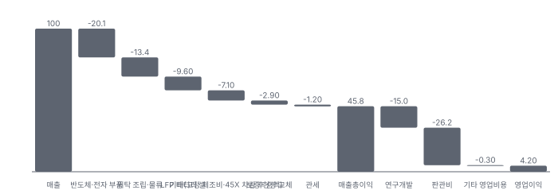

**분기 비용 비중 추이(매출 대비, 공시)**

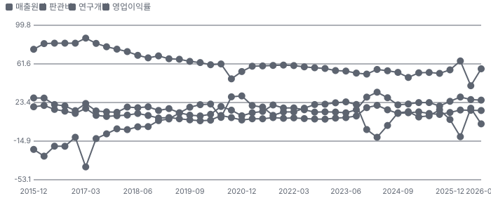

**비용 요인별 매출 대비 비중 1년 변화**

**마이크로인버터·태양광 시스템 BOM 원가 몫**

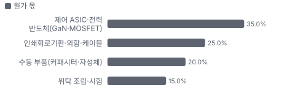

**가정용 배터리(IQ Battery) BOM 원가 몫**

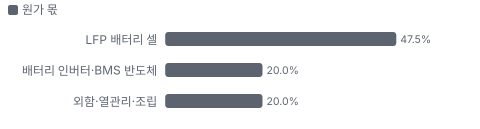

**BOM 항목 가격 +10% 시 OPM 변화**

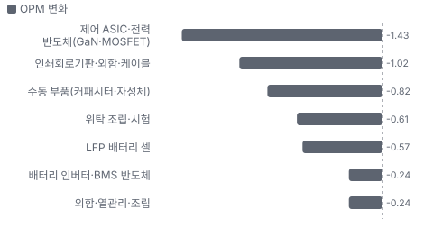

**재고 일수 — 분기별 — 재고 일수가 늘고 마진이 -1.5%p: 안 팔린 재고 경고(최근 재고 증가율 − 매출 증가율 +49.1%p)**

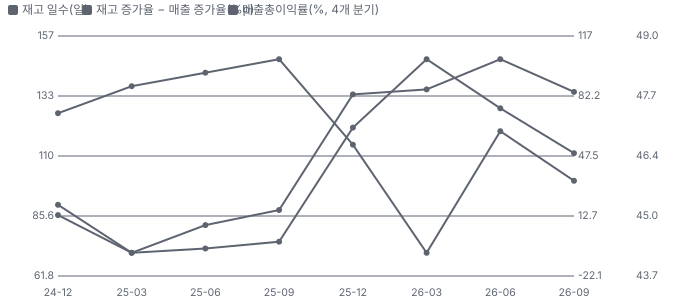

**자산 구성 — 3Q26 분기말 투하자본 \$1,157.1M**

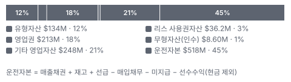

**자산별 변화율 — 최근 12개 분기(4Q23 = 0%) + 다음 4개 분기 추정**

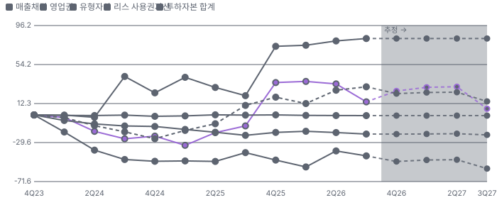

**ROIC 추이 — TTM, 최근 12개 분기 + 다음 4개 분기 추정(컨센서스 NOPAT)**

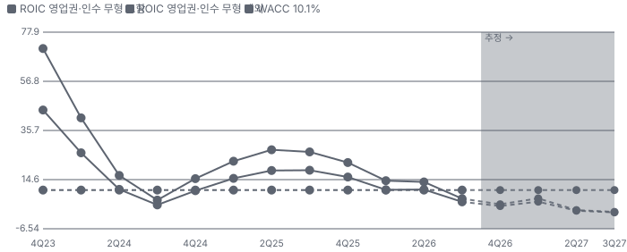

**매출 vs PPI·수출입 — 4Q22 = 100(변화율, 로그 눈금)**

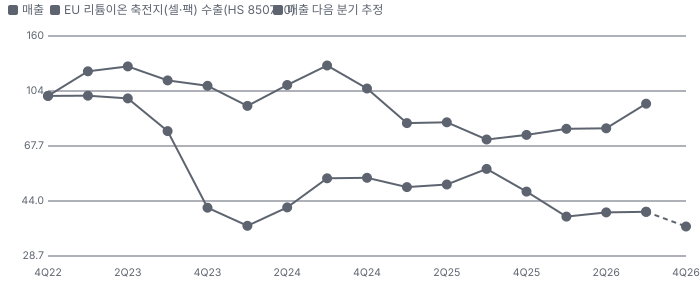

**매출 증가율의 가격·물량 분해와 8분기 전망(전년 대비)**

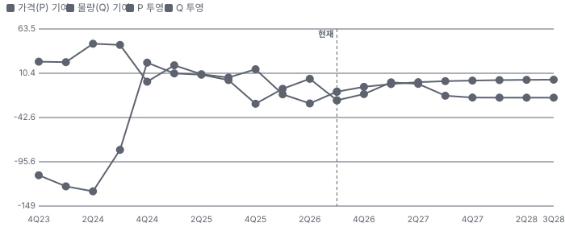

**목표주가 산정 — 시나리오 수정 가중평균(강세 확률 30%→39%), 도달 확률 약 42%**

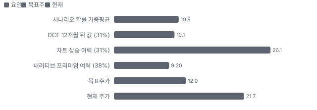

**PEG — 성장 대비 멀티플(낮을수록 성장 대비 쌈)**

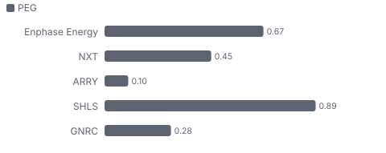

**커뮤니티 언급 수(최근 30일, 채널별)**

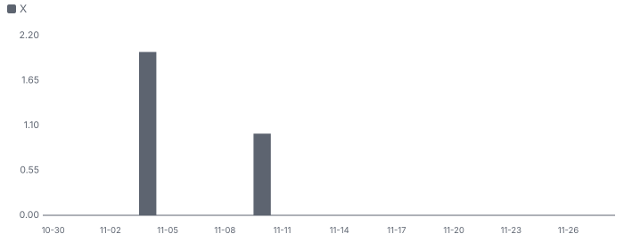

**커뮤니티 게시 수(월, 최근 6개월 — 이번 달은 진행 중)**

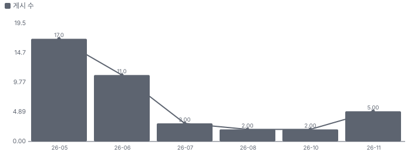

**일별 거래량 분해**

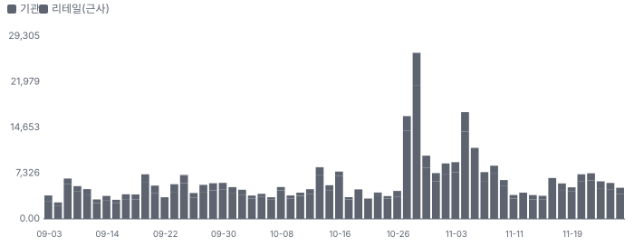

**기관 자금 흐름**

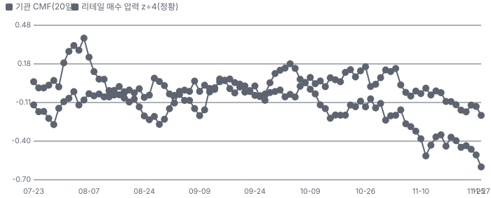

**몬테카를로**

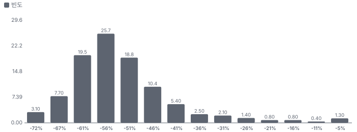

해석: 3,000번 중 25번(1%)에서 가치가 지금 주가 이상이었다. 가정을 흔들어도 지금 주가를 뒷받침하지 못하는 경우가 더 많다. 가운데 값은 0.45배이고, 열 번 중 여덟 번은 0.36~0.61배 사이에 든다.

## 내러티브

> **기업가치를 결정하는 이야기:** 값을 정하는 것은 세 가지다. ① 미국 주거용 핵심 매출이 분기 약 \$200M에서 멈추는가(TPO 전환) ② 배터리·상업용이 약 \$200M을 더하면서 조정 매출총이익률 40%를 지키는가 ③ 45X 세액공제가 유지되는가. IQ SST는 2028년 전에는 매출이 없어 이익이 아니라 배수에만 영향을 준다

> **멀티플·EPS 프리미엄**
> **멀티플:** Fwd 1Y P/E 23.3배는 동종 5사 중앙값(약 14배)보다 높다. 이익이 바닥(다음 4개 분기 EPS \$0.93)이라 배수가 커 보인다 — 2Y는 17.3배, 3Y는 13.9배로 내려간다
> **EPS:** FY2027 EPS 추정은 3Q 콜 직전 \$2.07에서 \$1.07로 48% 깎였다. 이익 프리미엄은 사라졌다

### 투자자들은 왜 열광했나

5월 12일 \$37.48에서 27일 \$70.28(+88%)까지 SST·AI 전력 테마로 올랐다 — 리테일·테마 매수가 주도했고 이익 추정은 그 사이 오르지 않았다. 지금은 식었다: 4Q 가이던스 쇼크(10/28 −16%), 이사 매도, 구조조정. 11월 초 중간선거 반등(11/2 → 11/4 +13.0%)도 2주 만에 되돌렸다

### 무엇이 기업가치를 바꾸나

> **구조적 체질 변화**
> **변화:** 11월 20일 인력 약 12%(320명) 감축과 생산·시설 통합을 발표했다. 비용 \$25~28M(현금 \$13M), 대부분 4Q에 잡힌다. 매출이 30% 줄어든 데 맞춰 고정비를 낮추는 단계다
> **증거:** 8-K 2026-11-20 https://www.sec.gov/Archives/edgar/data/1463101/000146310126000112/enph-20261120.htm
> **반증:** 1Q27 조정 영업비용이 \$76M(4Q 가이던스 하단) 위에 머문다

> **고부가 믹스 확장**
> **변화:** 2026년 매출 비중은 주거용 태양광 72%·주거용 배터리 21%·상업용·EV 충전·기타 7%(회사 예상)다. 배터리·상업용 비중이 커지지만 배터리는 가격을 내려 매출총이익률이 낮아진다
> **증거:** 3Q26 어닝콜(2026-10-27)
> **반증:** 2027년 배터리 출하가 600MWh 아래

> **기술 혁신**
> **변화:** GaN 기반 상업용 마이크로인버터(IQ9(Enphase의 GaN 기반 상업용 마이크로인버터 제품군), 548W)·5세대 배터리(G5, 최대 30kWh)·상업용 배터리 C80·양방향 EV 충전(전기차 배터리 전기를 집이나 전력망으로 되돌려 보낼 수 있는 충전)·IQ SST(13.8kV → 800V 직류)를 내놓는다. SST는 시연 단계다
> **증거:** 3Q26 10-Q 사업 개요 · 3Q26 어닝콜(2026-10-27)
> **반증:** SST 메가와트급 시연이 2026년 말을 넘긴다

> **실행 속도**
> **변화:** 해당 없음(납품 리드타임을 공시하지 않는다) — 4Q 가이던스의 약 70%가 이미 주문으로 잡혀 있고(콜), 유통 재고를 줄이려 소진 판매보다 약 \$20M 덜 출하한다
> **증거:** 3Q26 어닝콜(2026-10-27)
> **반증:** 1Q27에도 소진 판매보다 덜 출하한다

> **M&A**
> **변화:** 해당 없음(최근 3년 큰 인수 없음 — 최근 4개 분기 인수 지출 \$0). 2026년 7월 SunPower 전환사채를 주식으로 바꿔 지분 약 87만 주를 받았다
> **증거:** 3Q26 10-Q 투자 주석
> **반증:** —

> **정책·입법 연관성**
> **재정정책:** OBBBA(2025년 7월 법)가 25D를 2025-12-31에 끝냈고 48E(제3자가 소유해 임대하는 발전 설비에 주는 투자 세액공제)·45X에 FEOC(세액공제 대상에서 빠지는 금지 외국 기업 — 중국 기업 소유·부품 비중을 따진다) 요건을 붙였다. 45X는 2030년부터 단계적으로 줄어든다. 회사는 2026년분 45X를 \$150M + 최대 \$100M 매각했다 3Q26 10-Q 위험 요인 · 8-K 2026-10-28 https://www.sec.gov/Archives/edgar/data/1463101/000146310126000104/enph-20261028.htm 반증: 48E 주거용 TPO 자격이 추가로 좁아진다 의회 동의 10/10 — 하원 5/5(OBBBA(2025년 미국 세제·재정 법안) 하원 본회의 통과(2025-07) — 세액공제 축소 방향) · 상원 5/5(OBBBA 상원 본회의 통과(2025-07)).
> **행정명령:** 섹션 122(무역적자 대응으로 최대 15%·150일 임시 수입 부과금을 매길 수 있는 조항) 임시 부과금(15%, 2026-02-24~07-24)과 섹션 301(무역대표부 조사 뒤 상대국 관행에 보복 관세를 매기는 조항) 관세 10~12.5%(7/24 시행)가 수입 부품 원가를 올린다. 3Q 관세 영향 −1.3%p. 대법원이 IEEPA(대통령이 비상 권한으로 관세를 매길 때 쓴 법 — 대법원이 관세를 무효로 했다) 관세를 무효로 해 2Q에 환급을 받았다 3Q26 10-Q 관세 주석 반증: 섹션 301 관세가 중국산 배터리 셀까지 넓어진다 의회 동의 2/10 — 하원 1/5(관세는 행정부 단독 조치 — 의회 논의 확인 못 함) · 상원 1/5(같음).
> **연관입법:** 해당 없음(25D 부활이나 45X 연장 법안을 1차 자료로 확인하지 못했다) 3Q26 10-Q

> **고객의 지출 예산**
> **변화:** 주택 소유자의 가계 지출(현금·대출 구매)이 25D 만료로 줄고, TPO 사업자의 설비투자(48E 세액공제)로 옮겨 간다. 상업용은 건물주 설비투자, SST는 데이터센터 설비투자다
> **사업별 예산:** **매출의 72%**: 주거용 태양광(마이크로인버터) — 고객 혼합(주택 소유자 가계 지출 + TPO 사업자의 발전 설비투자(48E)) · 동인: 주택 금리, 25D 만료, TPO 금융 조달
**매출의 21%**: 주거용 배터리 — 고객 혼합(주택 소유자 지출 + 전력회사 VPP(흩어진 가정용 배터리를 묶어 전력망에 전기를 대주는 가상 발전소) 보상 프로그램) · 동인: 넷미터링(남는 태양광 전기를 전력망에 팔 때 소매가로 쳐주는 제도) 축소(네덜란드 2027년), 전기 요금
**매출의 7%**: 상업용·EV 충전·SST — 고객 CAPEX(건물주·데이터센터 사업자의 전력 설비투자) · 동인: 상업용 ITC(태양광·저장 설비 투자액에 주는 연방 투자 세액공제), AI 데이터센터 전력
> **증거:** 3Q26 어닝콜(2026-10-27) · 3Q26 10-Q
> **반증:** TPO 개통이 2027년 상반기에 늘지 않는다

### 내러티브 근거

> 미국 주거용 태양광이 25D 세액공제 만료로 줄어든 자리를 배터리·상업용·데이터센터 전력(IQ SST)으로 메우겠다는 이야기다. 5~6월 SST·전력 테마로 \$72(6/2 종가)까지 올랐다가 4Q 가이던스 쇼크와 이사 매도로 \$21대까지 내려왔다. 동종 대비 멀티플 차이 +69% 중 회사 고유 몫은 +114%다. 단계는 소멸, 쏠림은 낮음이다.

> **25D 만료 뒤 미국 주거용 수요 바닥** · 약화
> **논리:** 현금·대출 구매 수요가 사라진 자리를 TPO(48E)가 얼마나 빨리 메우느냐가 핵심 매출을 정한다
> **숫자:** 3Q 미국 소진 판매 −35% YoY, 업계 인허가 −35%, Propel(Enphase 장비로 짓는 선불 리스형 제3자 소유 상품) 주간 300건 이상
> **반증:** 1Q27 미국 소진 판매가 전 분기 대비 늘어난다
> **출처:** 3Q26 어닝콜(2026-10-27)

> **배터리·상업용 성장 동인** · 유지
> **논리:** 배터리 450 → 675MWh, 상업용 \$30M → \$100M 이상이면 2027년 매출 약 \$1.0B로 시장 추정(\$0.88~0.99B)보다 높다
> **숫자:** 2027 성장 동인 약 \$200M(경영진 목표)
> **반증:** 1Q27 배터리 출하가 120MWh 아래
> **출처:** 3Q26 어닝콜(2026-10-27)

> **IQ SST — AI 데이터센터 전력** · 강화
> **논리:** 중전압 → 800V 직류 직변환이 데이터센터 전력 구조를 바꾸면 2030년 연 \$1B 사업이 된다(경영진 목표)
> **숫자:** 고객 2곳 맞춤 개발, 2027 시범·2028 첫 출하 — 매출 0
> **반증:** 2027년 말까지 시범 고객 발표나 계약이 없다
> **출처:** 3Q26 어닝콜(2026-10-27)

> **정책 — 세액공제·관세** · 유지
> **논리:** 민주당 의회가 세액공제 추가 축소를 막으면 45X·48E가 유지되고, 관세는 중국산 경쟁자를 막는다
> **숫자:** 11/2 → 11/4 +13.0%, 2026년 45X 매각 계약 최대 \$250M
> **반증:** OBBBA 일정대로 45X가 2030년부터 줄고 추가 연장 법안이 없다
> **출처:** 8-K 2026-10-28 · 3Q26 10-Q

> **반대 — 가격 경쟁과 마진 하락** · 강화
> **논리:** 배터리 가격을 내렸고 4Q 조정 매출총이익률 가이던스가 40~43%로 내려왔다. 물량이 늘어도 이익은 덜 는다
> **숫자:** 조정 GPM 46.8% → 45.0% → 40~43%(가이던스)
> **반증:** 조정 GPM이 43% 위로 돌아온다
> **출처:** 3Q26 어닝콜(2026-10-27)

### 투자 포인트

> **이익 바닥을 지나는 중인가, 새 바닥으로 내려가는 중인가**
> **명제:** 4Q 매출 가이던스 중간값 \$240M은 1년 전(4Q25 \$343.3M)보다 30% 낮고, 그 안의 세이프하버 약 \$51M을 빼면 핵심 매출은 약 \$189M이다
> **숫자:** 3Q26 8-K EX-99.1 · 콜 — 회사가 말한 분기 핵심 매출 약 \$200M보다 낮다(과소 출하 \$20M 포함)
> **시장과 다른 점:** 시장은 2027년 매출을 \$0.88~0.99B로 본다. 회사 틀(\$1.0B)이 맞으려면 성장 동인 \$200M이 거의 다 실현돼야 한다
> **증명:** 4Q26 실적(2027년 2월 초 예상) — 1Q27 가이던스가 \$200M 이상인지
> **출처:** 8-K EX-99.1(2026-10-27) · 3Q26 어닝콜(2026-10-27)

> **이익의 상당 부분이 정책에서 나온다**
> **명제:** 45X 세액공제를 2026년분만 \$150M + 최대 \$100M 팔았다. 조정 영업이익(TTM \$236.9M)과 비슷한 규모다
> **숫자:** 3Q26 10-Q · 8-K 2026-10-28
> **시장과 다른 점:** 45X는 OBBBA 일정대로 2030년부터 줄어든다. 정책 해자는 시한부다
> **증명:** FEOC 세부 규정(재무부 추가 지침) · 2027년분 45X 매각 계약 조건
> **출처:** 3Q26 10-Q · 8-K(2026-10-29)

> **SST는 배수 옵션이지 이익이 아니다**
> **명제:** IQ SST는 2027년 시범·2028년 첫 출하 목표이고 고객 2곳은 이름·금액 미공개다. 5월 테마 급등(+88%)을 이 이야기가 이끌었다
> **숫자:** 3Q26 어닝콜(2026-10-27) · TradingView 일봉(5/12 \$37.48 → 5/27 \$70.28)
> **시장과 다른 점:** 시장은 이미 한 번 이 옵션에 값을 매겼다가 지웠다 — 다시 매기려면 계약·시범 발표가 필요하다
> **증명:** 2026년 말 메가와트급 시연, 2027년 시범 고객 발표
> **출처:** 3Q26 어닝콜(2026-10-27)

### 모멘텀 생성·소멸 타임라인

**카탈리스트 달력 — 지난 사건의 주가 반응과 앞으로 확인할 숫자**
| 날짜 | 상태 | 구분 | 사건 | 반응·확인 | 결과에 따라 |
|---|---|---|---|---|---|
| 2026-02-04 | 완료 | 생성 | 4Q25 실적 다음 날 — 매출 \$343.3M, 세이프하버 계약 공개 | +38.6% |  |
| 2026-04-29 | 완료 | 소멸 | 1Q26 실적 다음 날 — 매출 \$282.9M | −9.1% |  |
| 2026-05-27 | 완료 | 생성 | SST·AI 전력 테마 급등(원인 1차 자료 미확인 — 커뮤니티 설명) | 5/12 → 5/27 +87.5% |  |
| 2026-06-05 | 완료 | 소멸 | 종가 고점 6/2 \$72.33 뒤 급락(원인 미확인) | −18.0% |  |
| 2026-07-29 | 완료 | 소멸 | 2Q26 실적 다음 날 — 관세 환급으로 GAAP GPM 60% | −3.4% |  |
| 2026-10-28 | 완료 | 소멸 | 3Q26 실적 다음 날 — 4Q 가이던스 \$225~255M | −16.0% |  |
| 2026-11-03 | 완료 | 생성 | 중간선거 — 세액공제 축소 위험 하락 기대 | 11/2 → 11/4 +13.0% |  |
| 2026-11-20 | 완료 | 소멸 | 구조조정 8-K(인력 12%)·이사 대량 매도 공시 뒤 | −10.7% |  |
| 2026-12 말(예정) | 예정 | 확인 | IQ SST 메가와트급 시연(회사 예고) | 메가와트급 13.8kV → 800V 직류 변환 공개 여부 | 공개되면 2027년 시범 일정 신뢰도가 오르고, 미루면 SST 배수 옵션이 더 줄어든다 |
| 2027-02 초(예상) | 예정 | 확인 | 4Q26 실적·1Q27 가이던스 | 1Q27 매출 가이던스 \ 이상·조정 매출총이익률 40% 이상 | 넘으면 핵심 매출 바닥 확인, \ 아래면 2027년 추정 추가 하향 |
| 2027-05 초(예상) | 예정 | 확인 | 1Q27 실적 | 배터리 출하 120MWh 이상·G5 양산 출하 | 2027년 675MWh 목표의 첫 분기 검증 |

### 언제 사서 언제 팔아야 할까?

**가격·조건 틀 — 가격은 밸류에이션(약세·기본·강세·목표주가)과 차트 지지 구간에서, 조건은 이벤트에서**
| 구간 | 가격 | 목표주가까지 | 약세까지 | 조건·근거 |
|---|---|---|---|---|
| 관찰 구간 | \$19~\$19 | -37% | -80% | 11월 25일 장중 \$19.08(52주 저점)과 11월 20일 종가 \$19.63이 일봉 지지 구간이다 |
| 확인 뒤 | 지금 \$22 이상에서 조건 확인 | -45% | -82% | 4Q 실적에서 1Q27 매출 가이던스 \$200M 이상, 조정 매출총이익률 40% 이상, 배터리 출하 증가 |
| 무효화 | 약세 시나리오 \$4 | - | -82% | 1Q27 가이던스가 \$190M 아래이거나 조정 매출총이익률 가이던스가 40% 아래 |

실적·정책 뉴스 하루에 ±10~40% 움직인 적이 여러 번 있다(2/4 +38.6%, 10/28 −16.0%) — 변동성이 크다 가격·조건 틀이며 매매·비중 지시가 아니다(투자 권유 아님).

## 포트폴리오

| 제품·서비스 | 구분 | 무엇 | 쓰는 곳 | 돈 버는 방식 | Mix | Mix 변화(전 분기 대비) |
|---|---|---|---|---|---|---|
| 마이크로인버터·태양광 시스템 | 제품·서비스 | 패널마다 붙는 반도체 전력 변환기(IQ8(Enphase의 주거용 마이크로인버터 8세대 제품군)·IQ9)와 게이트웨이·모니터링 앱 | 주택·소형 상업용 지붕 태양광 | 2026년 매출의 약 72%(회사 예상), 3Q 142만 대 | 72% | 미확인 |
| 가정용 배터리(IQ Battery(Enphase의 가정용 배터리 제품군)) | 제품·서비스 | LFP 셀과 배터리용 마이크로인버터를 넣은 AC 결합(배터리가 자체 인버터를 갖고 교류 쪽에 붙는 방식 — 기존 태양광 집에 달기 쉽다) 가정용 저장 장치(5P·G5) | 주택 자가 소비·정전 대비·VPP | 2026년 매출의 약 21%, 3Q 129.9MWh(텍사스산 63.8MWh) | 21% | 미확인 |
| 상업용·EV 충전·SST | 제품·서비스 | 3상 상업용 마이크로인버터, 상업용 배터리 C80, 양방향 EV 충전기, 데이터센터용 반도체 변압기(개발 중) | 소형 상업 건물, 전기차, AI 데이터센터 | 2026년 매출의 약 7%, 상업용 약 \$30M(회사 예상) | 7% | 미확인 |

**Mix 변화가 가장 큰 쪽은 해외(-1.9%p, 전 분기 대비).** 계절성 판정: 분기 매출 계절 지수 기준 없음 → 직전 분기와 비교.

## 고객

> **FY2025 최대 고객 이름 미공시 고객 1곳(10-K 단일 고객)(one customer(10-K Item 1)) 39%, 상위 3곳 39%, 집중도 보통.** 공시·회사 발표로 확인한 몫은 매출의 39%이고, 나머지 고객 몫은 추정이거나 미분해다. 매출의 39%를 유통사 1곳(이름 미공시)이 차지한다(2024년 48%, 2023년 40%). 판매는 태양광 유통사·대형 설치 회사·TPO 사업자를 거친다. 지역은 미국 80%·해외 20%(3Q26)

**고객별 매출 몫(FY2025)**
| 고객 | 몫 | 변화 | 근거 |
|---|---|---|---|
| 이름 미공시 고객 1곳(10-K 단일 고객)(one customer(10-K Item 1)) | 39% | -9%p | 공시 |
| 기타·미분해 | 61% | - | - |

> **이름 미공시 고객 1곳(10-K 단일 고객)(one customer(10-K Item 1))** · 공시
> **사는 것:** 마이크로인버터·배터리·액세서리 — 판매 경로상 대형 유통사로 보인다(가설, 회사 미공시)

## 수주·파이프라인

> **2026-09-30 기준 4건.** 확정 \$0.53B. 공시 잔여 이행 의무 \$0.53B. 서로 겹치는 항목은 합계에서 뺐다.

**수주 목록**
| 상태 | 계약 | 계약 총액 | 진척 | 기간 | 비고 |
|---|---|---|---|---|---|
| 확정 | 회사 전체 잔여 이행 의무 | \$0.53B | - | 2026-10 → 2031-12 | - |
| 조건부 | 2026년 세이프하버 계약(TPO 사업자) | \$1.08B | - | 2026-01 → 2030-12 | 계약은 맺었지만 매출 인식이 설치 일정·세액공제 규정에 달려 있다 — 확정 합계에서 뺀다 (다른 항목과 겹칠 수 있어 합계에서 뺌) |
| 조건부 | 45X 세액공제 매각(2026년분) | \$0.24B | 50% | 2026-04 → 2027-06 | 매출이 아니라 세액공제 현금화이고 지급에 조건(진술·보장)이 붙는다 — 확정 합계에서 뺀다 (다른 항목과 겹칠 수 있어 합계에서 뺌) |
| 파이프라인 | IQ SST 데이터센터 시범(고객 2곳) | 금액 비공개 | - | 2027-01 → 2028-12 | - |

**실행 속도와 방해 요인**
| 항목 | 상태 | 실행 속도 | 방해 요인 |
|---|---|---|---|
| 회사 전체 잔여 이행 의무 | 확정 | 미확인 | 서비스 매출로 나눠 인식(2026년 남은 3개월 \$83.6M, 2027년 \$115.3M) |
| 2026년 세이프하버 계약(TPO 사업자) | 조건부 | 세이프하버 매출 1Q \$34.5M → 2Q \$84.3M → 3Q \$85.0M → 4Q 약 \$51.2M | 설치 일정(2028~2030년) · 세액공제 규정 변경 |
| 45X 세액공제 매각(2026년분) | 조건부 | 앞섬(계획 36%, +14%p), 이대로면 2027-02 완료 | 지급 조건(진술·보장) |
| IQ SST 데이터센터 시범(고객 2곳) | 파이프라인 | 미확인 | 메가와트급 시연 · OCP 사양 · 신뢰성 인증 |

## 마진 구조

> **GPM 43.3%, OPM 2.2%.** 3Q25 대비 GPM -4.5%p, OPM -13.9%p. 변동비는 매출의 57%이고, 매출이 10% 늘면 OPM은 +3.7%p 움직인다. 3Q26 GAAP 매출총이익률은 43.3%(1년 전 47.8%), 조정 45.0%다. 가격 인하, 물량 감소에 따른 고정 제조비 부담, 45X 공정가치 조정(−1.9%p), 관세(−1.3%p)가 내렸다. 4Q 조정 가이던스는 40~43%

> **매출 100 중 매출원가 54.2, 매출총이익 45.8(최근 4분기, 공시).** 매출원가 요인 중 반도체·전자 부품이 매출의 21.0%로 가장 무겁고, 단가가 +10% 오르면 GPM이 -2.10%p 움직인다. 분기 회귀로 매출 1이 늘 때 매출원가는 0.53 늘고, 매출원가의 고정비 몫은 9%다. 매출원가 요인 비중은 요인별 공시 기간 값이라 합이 최근 4분기 매출원가를 넘어, 그림에서는 0.96배로 비례 조정했다.

**비용 요인 강도 — 비중·추세·충격(+10%)·탄력**
| 비용 | 구분 | 매출 대비 | 1년 변화 | 마진 기여 | 충격 시 마진 | 매출 탄력 | 고정비 몫 |
|---|---|---|---|---|---|---|---|
| 반도체·전자 부품 | 매출원가 요인 | 21.0% | 미확인 | 미확인 | -2.10%p | 미확인 | 0% |
| 위탁 조립·물류 | 매출원가 요인 | 14.0% | 미확인 | 미확인 | -1.40%p | 미확인 | 30% |
| LFP 배터리 셀 | 매출원가 요인 | 10.0% | 미확인 | 미확인 | -1.00%p | 미확인 | 0% |
| 기타(고정 제조비·45X 차감 후 순액) | 매출원가 요인 | 7.4% | 미확인 | 미확인 | -0.74%p | 미확인 | 60% |
| 보증·현장 교체 | 매출원가 요인 | 3.0% | 미확인 | 미확인 | -0.30%p | 미확인 | 50% |
| 관세 | 매출원가 요인 | 1.3% | 미확인 | 미확인 | -0.13%p | 미확인 | 0% |
| 매출원가 | 공시 항목 | 54.2% | +2.7%p | -2.7%p | -5.42%p | 0.53 | 9% |
| 판관비 | 공시 항목 | 26.2% | +4.2%p | -4.2%p | 미확인 | 0.15 | 17% |
| 연구개발 | 공시 항목 | 15.0% | +2.2%p | -2.2%p | 미확인 | 0.08 | 23% |
| 기타 영업비용 | 공시 항목 | 0.3% | -0.8%p | +0.8%p | 미확인 | -0.00 | 100% |

매출 탄력 = 분기 비용을 매출에 회귀한 기울기(매출 1당 변동비), 고정비 몫 = 절편 ÷ 평균 비용. 표본이 8분기 미만이면 미확인. 매출원가 요인 비중은 margin 재료의 추정이 섞여 있고, 공시 매출원가와의 차이는 '기타 매출원가'로 둔다.

**GPM에서 OPM까지(GAAP — 10-Q 3개월 손익, 아래는 최근 4개 분기)**
| 기간 | GPM | 연구개발 | 판관비 | 기타 | OPM |
|---|---|---|---|---|---|
| 3Q25 | 47.8% | 11.5% | 19.9% | 0.3% | 16.1% |
| 3Q26 | 43.3% | 15.4% | 25.7% | -0.0% | 2.2% |
| 2025-12 | 44.3% | - | - | - | 6.5% |
| 2026-03 | 35.5% | - | - | - | -10.5% |
| 2026-06 | 60.0% | - | - | - | 17.7% |
| 2026-09 | 43.3% | - | - | - | 2.2% |

**비용을 움직이는 요인**
| 비용 | 요인 |
|---|---|
| 판매·관리비(판관비) | 주식보상(\$39.4M 포함), 영업 인력 · 근거 공시 |
| 반도체·전자 부품(매출원가) | ASIC·GaN 스위치·커패시터 단가, 출하량 · 근거 추정 |
| 연구개발(연구개발) | SST·G5·IQ9·EV 충전 개발 인력 · 근거 공시 |
| 위탁 조립·물류(매출원가) | 위탁 생산 단가(분기 합의), 미국 공장 가동률 · 근거 추정 |
| LFP 배터리 셀(매출원가) | 배터리 출하 MWh, 셀 가격, 대중국 관세 · 근거 추정 |
| 기타(고정 제조비·45X 차감 후 순액, 매출원가) | 공장 고정비, 45X 세액공제 공정가치 조정(−1.9%p 포함) · 근거 추정 |
| 보증·현장 교체(매출원가) | 누적 설치 기반, 배터리 현장 교체 · 근거 추정 |
| 관세(매출원가) | 섹션 301·122 관세 · 근거 공시 |

**마이크로인버터·태양광 시스템 BOM — 매출의 72%, GPM 43%(제품별 매출총이익 미공시 — 회사 3Q26 GAAP 매출총이익률 43.3%를 대용(배터리는 이보다 낮다고 콜에서 정성 언급)), 항목 가격 +10% 시**
| 항목 | 원가 몫 | 전가 | 제품 GPM | OPM |
|---|---|---|---|---|
| 제어 ASIC·전력 반도체(GaN·MOSFET) | 30~40% | 미확인 | -2.0%p | -1.43%p |
| 인쇄회로기판·외함·케이블 | 20~30% | 미확인 | -1.4%p | -1.02%p |
| 수동 부품(커패시터·자성체) | 15~25% | 미확인 | -1.1%p | -0.82%p |
| 위탁 조립·시험 | 10~20% | 미확인 | -0.9%p | -0.61%p |
| 미분해 | 5% | - | - | - |

**가정용 배터리(IQ Battery) BOM — 매출의 21%, GPM 43%(제품별 매출총이익 미공시 — 회사 3Q26 GAAP 매출총이익률 43.3%를 대용(배터리는 이보다 낮다고 콜에서 정성 언급)), 항목 가격 +10% 시**
| 항목 | 원가 몫 | 전가 | 제품 GPM | OPM |
|---|---|---|---|---|
| LFP 배터리 셀 | 40~55% | 미확인 | -2.7%p | -0.57%p |
| 배터리 인버터·BMS(배터리 셀의 전압·온도를 감시·제어하는 관리 장치) 반도체 | 15~25% | 미확인 | -1.1%p | -0.24%p |
| 외함·열관리·조립 | 15~25% | 미확인 | -1.1%p | -0.24%p |
| 미분해 | 12% | - | - | - |

제어 ASIC·전력 반도체(GaN·MOSFET) 가격이 +10% 오르면 영업이익은 -64.5% 움직인다. 판매가 전가를 모르는 항목은 전가 0%로 계산했다.

**BOM 항목 가격을 움직이는 것**
| 항목 | 요인 |
|---|---|
| 제어 ASIC·전력 반도체(GaN·MOSFET) | 칩 하나가 모든 마이크로인버터에 들어가고 반도체 단가가 원가를 정한다 · 근거 추정 |
| 수동 부품(커패시터·자성체) | 25년 보증을 지키려고 고온용 필름 커패시터를 쓴다(통상 구조) · 근거 추정 |
| 인쇄회로기판·외함·케이블 | 지붕 위 방수 외함과 교류 케이블 묶음이 들어간다 · 근거 추정 |
| 위탁 조립·시험 | Flex·Salcomp·Sunwoda와 분기마다 가격을 정한다(10-K) · 근거 추정 |
| LFP 배터리 셀 | 배터리 원가의 가장 큰 몫 — 중국 2개 업체 전량 공급(10-K) · 근거 추정 |
| 배터리 인버터·BMS 반도체 | 배터리마다 마이크로인버터가 들어가는 AC 결합 구조 · 근거 추정 |
| 외함·열관리·조립 | 가정용 설치 규격에 맞춘 외함과 열관리 · 근거 추정 |

**투입 물가 — 미국 PPI 3·6·12개월(2026-10, 개정 반영)과 해외 전년비**
| 항목 | 미국 3개월 | 6개월 | 12개월 | 전가 못 할 때 OPM | 일본 | 한국 | 대만 |
|---|---|---|---|---|---|---|---|
| 배터리 인버터·BMS 반도체 | -0.7% | -5.7% | -2.7%* | - | +1.6%* | 미확인 | 미확인 |
| 수동 부품(커패시터·자성체) | 미확인 | 미확인 | 미확인 | - | 미확인 | 미확인 | 미확인 |
| 인쇄회로기판·외함·케이블 | +0.0% | +24.0% | +46.4% | - | +11.5% | +1.7% | +12.1% |
| LFP 배터리 셀 | 미확인 | 미확인 | 미확인* | - | 미확인 | 미확인 | 미확인 |

별표는 품목보다 넓은 업종 지수다. 연결한 투입 원가의 미국 PPI(생산자물가지수)는 1년 새 가중 -2.7%이고, 판매가로 넘기지 못하면 GPM +0.6%p·OPM +0.6%p가 움직인다. 물가 지수를 붙이지 못한 매출원가 항목은 LFP 배터리 셀, 위탁 조립·물류, 관세, 보증·현장 교체다(미연결).

## 자산 구성

> **3Q26 분기말 투하자본 \$1.16B** — 운전자본 45%, 기타 영업자산 21%. 최근 12개 분기(4Q23 → 3Q26) 가장 크게 늘어난 자산은 리스 사용권자산(+82%), 투하자본 합계 +30%. 3Q27 추정 투하자본 \$1.02B(-12%, 컨센서스 매출과 회전 일수·CAPEX 강도 유지 가정). 연율 감가 비율(순액 기준)은 직전 4분기 57.11% → 최근 4분기 59.89%.

**자산·운전자본 항목별 분기말 잔액 — 최근 12개 분기와 다음 4개 분기 추정**
| 항목 | 4Q23 | 3Q25 | 3Q26(최근) | 3Q27 추정 | 12개 분기 변화 | 다음 4개 분기 변화 |
|---|---|---|---|---|---|---|
| 매출채권 | \$446.0M | \$265.5M | \$249.9M | \$189.2M | -44% | -24% |
| 재고자산 | \$213.6M | \$188.7M | \$243.7M | \$227.9M | +14% | -6% |
| 선급·기타 유동자산 | \$88.9M | \$459.7M | \$457.3M | \$375.1M | +414% | -18% |
| 매입채무 | \$116.2M | \$188.6M | \$100.6M | \$109.1M | -13% | +8% |
| 미지급비용 | \$261.9M | \$207.9M | \$161.9M | \$151.3M | -38% | -7% |
| 선수수익(계약부채) | \$118.3M | \$111.5M | \$170.6M | \$143.2M | +44% | -16% |
| 유형자산 | \$168.2M | \$131.3M | \$133.7M | \$132.3M | -21% | -1% |
| 리스 사용권자산 | \$19.9M | \$24.0M | \$36.2M | \$36.2M | +82% | +0% |
| 영업권 | \$214.6M | \$214.4M | \$213.1M | \$213.1M | -1% | +0% |
| 무형자산(인수) | \$68.5M | \$27.3M | \$8.6M | \$0.0M | -87% | -100% |

**자산 추정 동인 — 최근 4개 분기 평균(재무상태표 동인 모형)**
| 동인 | 값 | 곱하는 기준 |
|---|---|---|
| 매출채권 | 72일 | 매출 |
| 재고자산 | 160일 | 매출원가 |
| 선급·기타 유동자산 | 143일 | 매출 |
| 매입채무 | 77일 | 매출원가 |
| 미지급비용 | 58일 | 매출 |
| 선수수익(계약부채) | 54일 | 매출 |
| CAPEX 강도 | 4.6% | 매출(최근 4개 분기 합) |
| 분기 감가율 | 11.56% | 기초 유형자산 순액(무형 상각 제외 감가상각) |
| 매출원가율 | 54.2% | 매출(최근 4개 분기) |
| 영업권·리스 사용권·기타 | 유지 | 인수·새 리스는 공시 전 모름 |
| 인수 무형자산 | 분기 \$4.7M 상각 | 최근 4개 분기 평균 상각 |

**추정 방법:** 증권사 3표 모델(손익·재무상태표·현금흐름)의 재무상태표 동인 방식이다. 운전자본은 항목별 회전 일수(매출채권·선급·미지급·선수는 매출, 재고·매입채무는 매출원가 기준)를 최근 4개 분기 평균으로 두고 컨센서스 매출에 곱한다. 유형자산은 기초 + CAPEX − 감가상각으로 굴린다(Koller·Goedhart·Wessels 『Valuation』 재무상태표 추정). 매출 경로는 ROIC 절의 컨센서스와 같다.

**유형·무형자산 항목별 가치(2025-12-31 vs 2024-12-31)**
| 구분 | 항목 | 총액 2025-12-31 | 누적상각 | 순액 | 총액 2024-12-31 | 총액 1년 변화 | 공시 내용연수 |
|---|---|---|---|---|---|---|---|
| 유형 | 유형자산 합계(항목 미분해) | \$370.7M | 총계만 공시 | 총계만 공시 | \$330.8M | +12.1% | 미확인 |
| 영업권 | 영업권 | \$214.8M | \$0.0M | \$214.8M | \$211.6M | +1.5% | 비상각 |
| 무형 | 무형자산 합계(항목 미분해) | \$136.8M | \$114.5M | \$22.3M | \$140.3M | -2.5% | 미확인 |
| 유형 합계 | 유형자산 | \$370.7M | \$233.9M | \$136.8M | \$330.8M | +12.1% | 경과율 63%(상각 대상 기준) |

**내용연수 산식(상각 대상 유형자산 = 총액 − 토지 − 건설중)**
| 기준일 | 연 감가상각 | 상각 대상 총액 | 평균 내용연수 | 경과 연수 | 잔여 연수 | 경과율 |
|---|---|---|---|---|---|---|
| 2025-12-31 | \$52.8M | \$370.7M | 7.0년 | 4.4년 | 2.6년 | 63% |
| 2024-12-31 | \$51.5M | \$330.8M | 6.4년 | 3.6년 | 2.9년 | 55% |

산식 평균 내용연수는 7.0년. 1년 전 6.4년 → 지금 7.0년.

**분기 감가 비율(감가상각 ÷ 평균 유형자산 순액)**
| 분기 | 감가상각 | 평균 유형자산(순액) | 분기 비율 | 연율 | 연율의 역수 |
|---|---|---|---|---|---|
| 4Q24 | \$20.7M | \$148.0M | 13.96% | 55.86% | 1.8년 |
| 1Q25 | \$19.9M | \$144.9M | 13.75% | 54.99% | 1.8년 |
| 2Q25 | \$20.1M | \$139.6M | 14.39% | 57.57% | 1.7년 |
| 3Q25 | \$20.2M | \$134.1M | 15.08% | 60.30% | 1.7년 |
| 4Q25 | \$20.4M | \$134.1M | 15.24% | 60.95% | 1.6년 |
| 1Q26 | \$20.8M | \$137.8M | 15.10% | 60.40% | 1.7년 |
| 2Q26 | \$20.2M | \$137.7M | 14.67% | 58.68% | 1.7년 |
| 3Q26 | \$20.1M | \$135.1M | 14.88% | 59.53% | 1.7년 |

감가상각 기준: 손익계산서 감가상각·상각비(SEC 공시 데이터, 4분기 = 연간 − 1~3분기).

최근 4분기 연율 감가 비율 59.89%, 직전 4분기 57.11%(+5%) — 경고 문턱(-10%) 안이다.

미공시·미분해: 유형자산 항목별 총액·내용연수(10-K 주석에서 모델이 채움) · 무형자산 항목(10-K 주석에서 모델이 채움) — 이 칸은 비우고 나머지로 계산했다.

### 해석 — 자산이 어디에 쌓이고 있나

- 같은 기간 4개 분기 매출은 -3% — 매출보다 빨리 늘어난 자산: 재고자산 +14%, 리스 사용권자산 +82%. 이 자산의 회전율이 떨어지면 ROIC를 희석한다.
- 다음 4개 분기 CAPEX \$50.8M vs 감가상각 \$61.9M(최근 4개 분기 CAPEX 강도·감가율 유지) — 유형자산 3Q26 \$133.7M → 3Q27 \$132.3M. 투자가 감가보다 작아 자산이 줄어드는 국면이다.

## ROIC

> **TTM 3Q26 ROIC는 영업권·인수 무형 포함 5.0%, 제외 6.4%**(NOPAT 마진 4.4% × 투하자본 회전율 1.13회). 최근 12개 분기 4Q23 44.5% → 3Q26 5.0%(고점 4Q23 44.5%). 컨센서스 NOPAT으로 굴리면 3Q27 0.5%(제외 0.7%) — WACC 10.1% 대비 -9.5%p. 1년 변화의 가장 큰 요인은 NOPAT 마진(-9.0%p).

**ROIC 추이(TTM)와 다음 4개 분기 추정 — NOPAT ÷ 평균 투하자본(이번 분기말·4개 분기 전)**
| 분기 | 구분 | TTM 매출 | TTM NOPAT | NOPAT 마진 | 평균 투하자본 | ROIC 포함 | ROIC 제외 |
|---|---|---|---|---|---|---|---|
| 4Q23 | 실적 | \$2,290.8M | \$355.8M | 15.5% | \$799.7M | 44.5% | 70.9% |
| 1Q24 | 실적 | \$1,828.1M | \$207.6M | 11.4% | \$796.8M | 26.1% | 41.1% |
| 2Q24 | 실적 | \$1,420.4M | \$80.6M | 5.7% | \$776.9M | 10.4% | 16.4% |
| 3Q24 | 실적 | \$1,250.2M | \$28.7M | 2.3% | \$775.7M | 3.7% | 5.8% |
| 4Q24 | 실적 | \$1,330.4M | \$76.1M | 5.7% | \$775.0M | 9.8% | 15.0% |
| 1Q25 | 실적 | \$1,423.1M | \$121.3M | 8.5% | \$802.0M | 15.1% | 22.5% |
| 2Q25 | 실적 | \$1,482.8M | \$147.0M | 9.9% | \$795.8M | 18.5% | 27.4% |
| 3Q25 | 실적 | \$1,512.4M | \$159.1M | 10.5% | \$853.6M | 18.6% | 26.5% |
| 4Q25 | 실적 | \$1,473.0M | \$134.8M | 9.2% | \$860.2M | 15.7% | 21.9% |
| 1Q26 | 실적 | \$1,399.8M | \$88.5M | 6.3% | \$869.1M | 10.2% | 14.1% |
| 2Q26 | 실적 | \$1,328.5M | \$99.0M | 7.5% | \$964.4M | 10.3% | 13.6% |
| 3Q26 | 실적 | \$1,211.4M | \$53.8M | 4.4% | \$1,068.4M | 5.0% | 6.4% |
| 4Q26 | 추정 | \$1,151.0M | \$34.3M | 3.0% | \$1,075.6M | 3.2% | 4.0% |
| 1Q27 | 추정 | \$1,160.0M | \$54.0M | 4.7% | \$1,050.6M | 5.1% | 6.5% |
| 2Q27 | 추정 | \$1,161.4M | \$13.1M | 1.1% | \$1,115.3M | 1.2% | 1.5% |
| 3Q27 | 추정 | \$1,108.1M | \$5.7M | 0.5% | \$1,087.4M | 0.5% | 0.7% |

**다음 4개 분기 NOPAT — 컨센서스(세율 25%, 리스 이자 별도)**
| 분기 | 매출 | EBITA 마진 | EBITA | NOPAT(분기) | 근거 |
|---|---|---|---|---|---|
| 4Q26 | \$282.9M | 0.5% | \$1.3M | \$1.0M | 컨센서스 매출 × EBIT 마진 FY2026(조정 − 주식보상 15.6%) |
| 1Q27 | \$291.9M | 0.5% | \$1.3M | \$1.0M | 컨센서스 매출 × EBIT 마진 FY2026(조정 − 주식보상 15.6%) |
| 2Q27 | \$293.3M | 0.5% | \$1.3M | \$1.0M | 컨센서스 매출 × EBIT 마진 FY2026(조정 − 주식보상 15.6%) |
| 3Q27 | \$240.0M | 0.5% | \$1.1M | \$0.8M | 컨센서스 매출 × EBIT 마진 FY2026(조정 − 주식보상 15.6%) |

**추정 방법:** NOPAT은 컨센서스(분기 매출 추정 × 회계연도 EBIT 마진 추정)로 잡고, 조정(비 GAAP) 마진이면 주식보상 몫을 빼서 과거 실적과 같은 기준(영업이익 + 인수 무형 상각)으로 맞췄다. 이미 발표했지만 분기 보고서(10-Q)가 아직 없는 분기는 발표 실적을 쓴다. 투하자본은 자산 구성 절의 재무상태표 동인으로 굴렸다. ROIC는 4개 분기 NOPAT을 이번 분기말과 4개 분기 전 투하자본의 평균으로 나눈다 — 추정 분기의 ROIC에는 이미 나온 실적 분기가 섞여 있다.

**투하자본 항목별 회전율과 ROIC 기여(TTM 3Q26, 평균 잔액)**
| 항목 | 투하자본 | 매출 1달러당 자본 | 회전율(매출 ÷ 항목) | 자본 몫 | 이 항목을 빼면 ROIC |
|---|---|---|---|---|---|
| 운전자본 | \$461.9M | 0.38 | 2.62회 | 43% | 9.0% |
| 유형자산 | \$132.5M | 0.11 | 9.14회 | 12% | 5.9% |
| 리스 사용권자산 | \$30.1M | 0.02 | 40.20회 | 3% | 5.3% |
| 영업권 | \$213.7M | 0.18 | 5.67회 | 20% | 6.4% |
| 무형자산(인수) | \$18.0M | 0.01 | 67.42회 | 2% | 5.2% |
| 기타 영업자산 | \$212.1M | 0.18 | 5.71회 | 20% | 6.4% |

**ROIC 세 가지 판**
| 판 | NOPAT | 투하자본 | ROIC | 무엇을 재나 |
|---|---|---|---|---|
| 영업권·인수 무형 포함 | \$54.9M | \$1,068.4M | 5.1% | 인수 웃돈까지 낸 돈에 대한 수익률 |
| 영업권·인수 무형 제외 | \$54.9M | \$836.7M | 6.6% | 본업 운영 수익률(동종 비교용) |
| 무형 자본화 조정(판관비 20%·5년, 연구개발 6년) | \$110.7M | \$1,705.7M | 6.5% | 비용으로 처리한 무형 투자를 자산으로 본 판 |
| 경제적 이익(포함판) | −\$52.5M | \$1,068.4M | 자본비용 10.1% | (ROIC − 자본비용) × 투하자본 |

NOPAT = (영업이익 \$50.8M + 인수 무형 상각 + 리스 내재 이자 \$2.2M) × (1 − 세율 25%). 리스 사용권자산을 투하자본에 넣었으므로 임차료 속 이자 몫을 영업이익에 되더했다. 현금은 영업에 필요한 몫을 따로 알 수 없어 투하자본에서 뺐다. SEC 공시 데이터 자동 초안 — 운전자본 = 매출채권 + 재고 + 선급 − (매입채무 + 미지급비용 + 선수수익), 현금 제외. 손상 누계는 공시 데이터 수록분.

**ROIC 1년 변화 분해(포함판, TTM 3Q25 → TTM 3Q26)**
| 요인 | ROIC 기여 |
|---|---|
| NOPAT 마진 | -9.00%p |
| 운전자본 | -2.87%p |
| 유형자산 | -0.25%p |
| 리스 사용권자산 | -0.11%p |
| 영업권 | -0.51%p |
| 무형자산(인수) | +0.16%p |
| 기타 영업자산 | -1.13%p |
| 합계 | -13.70%p |

**무형 자본화 가정별 ROIC(2025년 지출 기준, 포함판에 더함)**
| 투자로 보는 몫 | 상각 연수 | 무형 자산 | NOPAT 조정 | 조정 ROIC |
|---|---|---|---|---|
| 판관비 20% | 2년 | \$637.3M | \$55.9M | 6.5% |
| 판관비 20% | 5년 | \$637.3M | \$55.9M | 6.5% |
| 판관비 30% | 2년 | \$637.3M | \$55.9M | 6.5% |
| 판관비 30% | 5년 | \$637.3M | \$55.9M | 6.5% |

### 해석 — 무엇이 수익성을 끌어올리고 희석하나

- 운전자본: 투하자본의 43% — 빼면 ROIC 5.1% → 9.0%. 이 자산의 회전율(2.62회)이 수익성을 희석하는 주된 자리다.
- 영업권: 투하자본의 20% — 빼면 ROIC 5.1% → 6.4%. 이 자산의 회전율(5.67회)이 수익성을 희석하는 주된 자리다.
- 영업권·인수 무형을 빼면 ROIC가 +1.4%p 오른다 — 과거 인수에 치른 웃돈이 주주 수익률을 그만큼 낮춘다(본업 수익률은 제외판, 인수까지 포함한 가치 창출은 포함판으로 본다).
- 1년 ROIC 개선의 최대 요인은 무형자산(인수, +0.2%p). 반대로 깎은 최대 요인은 NOPAT 마진(-9.0%p).
- 비용으로 처리한 무형 투자를 자산으로 보면 ROIC가 +1.4%p 움직인다(무형 자산 \$637.3M). 투자를 늘리는 중이라 NOPAT이 더 커지는 쪽이다.
- 추정 경로 3Q26 5.0% → 3Q27 0.5%: NOPAT 마진 -3.9%p, 투하자본 회전율 -0.11회 — 컨센서스 매출·마진이 맞고 회전 일수·CAPEX 강도가 유지된다는 가정이다. 마진 추정이 내려가거나 재고 일수가 늘면 이 경로가 먼저 틀린다.
- ROIC(포함) − WACC = -5.0%p(3Q26) — 양수면 투하자본을 늘릴수록 가치가 쌓인다.

## 공급망 병목

> **공급망 신뢰성 6.8/10, 관리 가능.** 가장 약한 고리는 LFP 배터리 셀 6.8점이고, 품목 평균은 6.8점이다. 근거가 부족한 2건(제어 ASIC·전력 반도체(GaN·MOSFET) · 위탁 조립·시험)은 점수에서 뺐다. 병목은 두 품목이다. 배터리용 LFP 셀은 중국 2개 업체가 전량 공급하고(FEOC·관세 위험), ASIC는 단일·제한 공급원이다. 조립은 Flex·Salcomp·Sunwoda 위탁과 텍사스 자체 공장으로 나뉘어 있다

**병목과 마진 — 품목 가격 +10% 시 OPM**
| 품목 | 점수 | 판정 | 구분 | OPM |
|---|---|---|---|---|
| LFP 배터리 셀(필수) | 6.8 | 관리 가능 | 가격 위험 | -0.57%p |

> **LFP 배터리 셀** · 6.8/10
> **왜:** FEOC 비중 기준이 해마다 올라 중국 셀로는 세액공제 자격을 잃을 수 있다. 회사는 중국 밖 공급사를 찾는 중이라고 했다
> **병목 요인:** 인증 공급사 2곳 · 캐파 여유 · 리드타임 미확인 · 재인증 미확인 · 1위 점유율 미확인 · 중국 집중 100% · 물량 확보 복수구매
> **풀리는 조건:** 중국 밖 셀 공급사 인증 공시 — 시점 미확인

**공급사**
| 품목 | 공급사 | 몫 | 근거 |
|---|---|---|---|
| LFP 배터리 셀 | 중국 셀 업체 2곳(이름 미공시, 가정용·상업용 배터리 셀) | 미확인 | 공시 |
| 제어 ASIC·전력 반도체(GaN·MOSFET) | ASIC 공급사(이름 미공시, 마이크로인버터 제어 칩) | 미확인 | 공시 |
| 위탁 조립·시험 | Flex(마이크로인버터·배터리 조립(미국 사우스캐롤라이나·해외)) | 미확인 | 공시 |
| 위탁 조립·시험 | Salcomp(인도 조립) | 미확인 | 공시 |
| 위탁 조립·시험 | Sunwoda(배터리 조립(중국)) | 미확인 | 공시 |

**무역 통계로 본 공급 지역**
| 품목 | EU 수입처 | 일본 수입처 | EU 1위 전년비 |
|---|---|---|---|
| LFP 배터리 셀 | CN(중국) 92% · US 3% · KR(한국) 2% | 中華人民共和国 94% · 大韓民国 2% | +39.8% |
| 제어 ASIC·전력 반도체(GaN·MOSFET) | CN 33% · MY(말레이시아) 30% · JP 21% | マレーシア 25% · 中華人民共和国 19% | -0.5% |

## 생산능력

> **현재 명목 캐파 미확인, 가동률 미확인.** FY25 CAPEX는 \$0.04B로 매출의 2.8%다. 회사는 생산능력과 가동률을 공시하지 않는다. 자체 공장은 텍사스 Arlington 한 곳(임차, 2025년 11월부터 직접 운영)이고 나머지는 위탁 생산이다. 3Q 미국산 출하는 약 140만 대·배터리 63.8MWh다. 11/20 구조조정에서 생산·시설을 통합한다고 했다

**생산시설 1곳**(FY2025 10-K Item 2 Properties — 회사가 보유·임차한 제조 시설은 Arlington 한 곳. 사우스캐롤라이나·인도·중국 공장은 위탁 생산사 시설), 임차 1곳. 시설별 생산능력은 공개되지 않았다 — 회사 전체 캐파만 위에 적었다.

**생산시설 1곳 — 명칭·위치·생산능력**
| 시설 | 위치 | 용도 | 생산능력 | 소유·상태 |
|---|---|---|---|---|
| Arlington 제조·물류 시설 | 미국 텍사스 Arlington | 제조(마이크로인버터·배터리)·창고 | 미확인 — 시설별 캐파 미공시 — 3Q 텍사스산 배터리 63.8MWh 출하(콜) | 임차 · 가동 |

공개된 증설 계획은 확인되지 않았다.

**CAPEX와 매출 대비**
| 기간 | CAPEX | 매출 | 매출 대비 | 구분 |
|---|---|---|---|---|
| FY24 | \$0.03B | \$1.33B | 2.5% | 실적 |
| FY25 | \$0.04B | \$1.47B | 2.8% | 실적 |
| FY26 | \$0.06B | \$1.11B | 5.2% | 컨센서스 |
| FY27 | \$0.05B | \$0.88B | 5.7% | 컨센서스 |

## 구루 교차 점검

> **여섯 관점 중 통과 1 · 미달 5 · 미확인 0.** 가장 약한 관점은 성장 여지 — 25D 만료 뒤 미국 주거용 수요가 어디서 멈추는지 아직 숫자가 없다 — 성장 동인이 감소를 상쇄하는지가 모든 판단의 앞에 있다.

판정은 자체추론이고 숫자는 계산값이다.

> **성장 여지** · 미달
> **질문:** 5년 안에 매출이 2배가 될 자리가 있나, 10년 뒤에도 커지나
> **이유:** 매출 경로가 FY2026→FY2028 연 −4.5%이고 5년 2배(연 14.9%)에 못 미친다. 배터리·상업용·SST가 크지만 주거용 핵심 매출 감소를 아직 넘지 못한다
> **계산한 숫자:** 매출 경로 연 -4.5%
> **근거:** 컨센서스 매출 추정(2026-11-23) · 3Q26 어닝콜(2026-10-27)

> **해자와 자본수익률** · 미달
> **질문:** 경쟁우위가 무엇이고, 투하자본수익률(ROIC)이 자본비용보다 높으며 유지·상승하나
> **이유:** GAAP 기준 투하자본수익률 4.5%로 자본비용(약 10%) 아래다. 조정 기준으로는 높지만 주식보상(매출의 15.6%)을 빼면 남는 것이 거의 없다
> **계산한 숫자:** ROIC 4.5% · 자본비용 10.1%
> **근거:** Enphase 3Q26 10-Q · 출처 목록

> **재투자 복리** · 미달
> **질문:** 번 돈을 높은 수익률로 다시 넣을 곳이 있나 — 자본 배분(재투자·인수·자사주·희석) 이력은
> **이유:** 연구개발 \$181.9M(매출의 15%)을 SST·G5·EV 충전에 쓰지만 매출이 줄고 있어 재투자가 아직 수익으로 돌아오지 않는다. 설비 재투자율은 0%에 가깝다
> **계산한 숫자:** 설비 재투자율 0%(설비투자가 감가상각 이하 — 연구개발·인수로 하는 재투자는 이 숫자에 없다) · 넓은 재투자율 81.4%(설비 + 인수 + 연구개발) · 연구개발 매출의 15.0% · 소유주 이익 수익률 -5.1%(근사)
> **근거:** Enphase FY2025 10-K · 출처 목록

> **사람과 문화** · 통과
> **질문:** 경영진이 주주와 같은 배를 탔나 — 창업자·내부자 지분, 기회형 내부자 매수, 문화가 경쟁우위에 기여하나
> **이유:** CEO가 2017년부터 회사를 맡아 2018~2022년 회생을 이끌었고 2026년 5월·11월 두 차례 자기 돈으로 주식을 샀다. 반대로 이사 T.J. Rodgers는 11월에 약 \$35M을 팔았다 — 무게는 경영진 쪽에 둔다
> **계산한 숫자:** 최근 12개월 Form 4 32건 — 장내 매수 7건 \$0.9M · 매도 13건 \$46.2M(사전 계획 1건) · 위임장 2026-04-01 · 연차보고서 2026-02-17
> **근거:** 2026년 위임장  · Form 4(2026-05-26·11-02) · 출처 목록

> **변화의 방향** · 미달
> **질문:** 18~24개월 뒤 이익 그림이 지금과 얼마나 다른가, 유동성 국면은 그 변화를 받쳐 주나
> **이유:** 가이던스·매출총이익률·이익 추정이 모두 아래를 향한다 — FY2027 EPS 추정이 한 달 새 48% 깎였다. 2년 뒤 EPS가 다음 12개월보다 높다는 계산은 바닥 효과다
> **계산한 숫자:** 2년 뒤 EPS +34.5%(다음 12개월 대비) · 유동성 국면 긴축
> **근거:** Enphase 3Q26 실적 보도자료(8-K) · 출처 목록

> **5배 경로와 시장이 모르는 이유** · 미달
> **질문:** 어떻게 5배 이상이 되나(이익 성장 × 배수 변화), 시장은 왜 아직 값을 안 매기나
> **이유:** 5배는 매출 약 \$5.4B이 필요해 근거가 없다. 2배도 2022~2023년 정점 매출 회복이 조건이다
> **계산한 숫자:** 5년에 5배 = 연 38.0% · 10배 = 연 58.5% · Fwd P/E 23.3배
> **근거:** 이 리포트의 2·3·5·10배 경로 계산

### 피터 린치 분류 — 크기·이야기 유형·기대 수익

> **경기순환주(Cyclical), 중형.** 린치 표의 기대 수익 10배, 하방 -80~100%, 위험 고. 10배 경로가 있는 분류다(고성장주·회생주·경기순환주).

**분류 근거 — 크기 먼저, 다음은 이야기 유형**
| 항목 | 값 |
|---|---|
| 크기 | 중형(시가총액 \$2.9B) |
| 장기 성장 | -8.4%(컨센서스 EPS 2년 CAGR) |
| 린치 비율((성장% + 배당%) ÷ P/E) | -0.36 — 2 이상 매력, 1 미만 비싸다 |
| PEG(P/E ÷ 성장%) | 미확인 |
| 근거 | TTM 매출이 과거 고점 대비 57% 빠진 적이 있다 · 영업이익이 적자였다가 흑자로 돌아온 순환 이력 |
| 반대 근거 | 없음 |

- 점검: 재고·공급과 수요(가격)의 방향
- 점검: 경쟁사의 증설
- 점검: 이익 정점에서 P/E가 낮아 보이는 함정
- 점검: 부채가 바닥을 견딜 수 있나
- 팔 때(점검 조건, 매매 지시 아님): 재고가 쌓이고 증설이 시작되고 가격이 꺾일 때 — 정점의 낮은 P/E는 싸다는 뜻이 아니다

분류 = 피터 린치·존 로스차일드 『One Up On Wall Street』(1989)·『Beating the Street』(1993)의 6분류와 위험·보상 표를 숫자 규칙으로 옮긴 자체추론이다(config/lynch.yaml).

**배수별로 필요한 연 성장률 — 이익 성장과 배수 변화를 합친 속도**
| 목표 | 5년 | 7년 | 10년 |
|---|---|---|---|
| 2배 | 14.9% | 10.4% | 7.2% |
| 5배 | 38.0% | 25.8% | 17.5% |
| 10배 | 58.5%(희소) | 38.9% | 25.9% |

### 보유 규율 — 가격이 아니라 지표로 유지·종료를 가른다

- 투자 논리 지표: 세이프하버 제외 분기 핵심 매출(약 \$200M 유지 여부) · 배터리 출하 MWh(2027년 675MWh 목표) · 조정 매출총이익률(40% 하한)
- 규칙: 핵심 매출이 \$200M 근처에서 멈추고 배터리 출하가 분기마다 늘면 투자 논리가 살아난다 — 핵심 매출이 \$180M 아래로 내려가거나 조정 매출총이익률이 40% 아래면 다시 본다
- 지금 주가는 일봉 760개 기간의 고점 대비 -84.2%, 그 기간 최대 낙폭은 -85.7%다 — 고점 대비 −50%를 넘어 재심사 구간이다. 가격이 아니라 위 지표로 유지·종료를 가른다.

여섯 관점은 베일리 기포드(성장 여지·5배 경로), 워렌 버핏(해자·재투자), 론 바론(사람), 피터 린치(분류·내부자), 스탠리 드러켄밀러(변화의 방향·유동성)의 질문을 옮긴 점검 틀이다. 유동성 국면은 긴축(10년물 20일 -14bp · 하이일드 스프레드 20일 +51bp). 설비 재투자율은 설비투자에서 감가상각을 뺀 몫만 본 근사이고(연구개발·인수·운전자본은 빠진다), 소유주 이익 수익률은 유지 설비투자를 감가상각과 같다고 본 근사다. 점검 틀이며 매매·비중 지시가 아니다.

## 해자

> 해자는 셋이고 모두 '보통' 이하다. 설치 회사 채널과 누적 설치 기반, 미국 생산과 FEOC 적합(세액공제 자격), 패널 단위 전력 변환 반도체 설계다. 마이크로인버터 가격이 내려가고 스트링 인버터(여러 패널을 직렬로 묶어 한 대로 직류를 교류로 바꾸는 큰 인버터)·중국 업체와의 격차가 줄면 셋 다 약해진다

> **설치 회사 채널·누적 설치 기반** · 보통
> **해자:** 누적 마이크로인버터 약 9,080만 대, 시스템 530만 곳이 165개국에 깔려 있고 미국 태양광 인버터 점유율이 약 50%라고 회사가 말한다. 기존 고객에게 배터리를 붙이는 개조 시장이 열린다
> **근거:** 3Q26 10-Q 사업 개요(누적 출하) · 3Q26 어닝콜(미국 점유율 약 50%, 네덜란드 기존 고객 약 50만 곳)
> **숫자:** 네덜란드 기존 고객 약 50만 곳 = 배터리 개조 약 \$2B 기회(경영진 추정)
> **깨지는 조건:** 배터리 개조가 2027년에도 분기마다 늘지 않거나 미국 점유율이 SolarEdge·Tesla 쪽으로 옮겨 간다

> **미국 생산·FEOC 적합(세액공제 자격)** · 보통
> **해자:** 텍사스·사우스캐롤라이나에서 만든 마이크로인버터·배터리로 45X 세액공제를 받고, 고객(TPO)이 48E 국산 부품 가산 자격을 맞추는 데 쓴다. 중국 업체가 쉽게 따라오지 못하는 정책 해자다
> **근거:** 3Q26 어닝콜(미국산 약 140만 대 출하·45X 계상) · 8-K 2026-10-28(45X 최대 \$100M 매각)
> **숫자:** 2026년 45X 매각 계약 \$150M + 최대 \$100M, 2024년분 환급 약 \$108M(4Q 예정)
> **깨지는 조건:** 45X·48E가 축소되거나 FEOC 기준을 못 맞춰 자격을 잃는다(LFP 셀은 중국 2개 업체 의존)

> **패널 단위 전력 변환 반도체 설계** · 약함
> **해자:** 자체 ASIC와 GaN 스위치로 패널마다 전력을 바꾸는 설계를 20년 넘게 쌓았고, 같은 전력 모듈을 SST·EV 충전으로 넓힌다
> **근거:** FY2025 10-K(ASIC 단일 공급원) · 3Q26 10-Q(IQ9 GaN 상업용) · 3Q26 어닝콜(SST 전력 모듈 생산 라인)
> **숫자:** 조정 매출총이익률 45.0%(3Q26) — 스트링 인버터 경쟁사 SolarEdge의 GAAP 영업이익률 −9.2%(TTM)보다 높다
> **깨지는 조건:** 조정 매출총이익률이 2개 분기 연속 40% 아래로 내려간다

## 경영진·네트워크

> CEO Badri Kothandaraman이 2017년부터 회사를 맡아 2018~2022년 회생과 성장을 이끌었다. 공동 창업자 Raghu Belur가 제품을 맡는다. 이사 T.J. Rodgers(Cypress Semiconductor 창업자)는 11월에 약 147만 주를 팔았다

> **Badri Kothandaraman** · 사장·CEO, 이사 · 2017-09
> **프로필:** Cypress Semiconductor 데이터통신 부문 총괄 등 반도체 경영 경력
> **비즈니스:** 원가 구조 개편과 반도체 기반 제품 확장(배터리·EV 충전·SST)
> **정계:** 미확인
> **동문:** 미확인
> **사모임:** 미확인

> **Mandy Yang** · 부사장·CFO · 미확인
> **프로필:** 미확인
> **비즈니스:** 세액공제 매각·세이프하버 계약 현금화
> **정계:** 미확인
> **동문:** 미확인
> **사모임:** 미확인

> **T.J. Rodgers** · 이사 · 미확인
> **프로필:** Cypress Semiconductor 창업자·전 CEO
> **비즈니스:** 11월 9~24일 약 147만 주 매도(Form 4, 약 \$35M)
> **정계:** 미확인
> **동문:** 미확인
> **사모임:** 미확인

**네트워크 정량화**
| 연결 | 강도 | 닿는 매출 | 가중 노출 | 매출 대비 | 근거 |
|---|---|---|---|---|---|
| 비즈니스: TPO 사업자·금융사(SolSource 등)와 세이프하버·Propel 제휴 | 3/5 | \$0.29B | \$0.17B | 14% | 3Q 세이프하버 매출 \$85.0M ÷ \$293.3M = 29%(계산) — 관계가 매출을 만든 것이 아니라 정책 거래다 3Q26 어닝콜(2026-10-27) |

가중 노출은 연결이 닿는 매출의 크기다. 연결이 그 매출을 만들었다는 뜻이 아니며, 인과는 공개 자료로 입증하지 못한다.

## 약세 논리 및 셀온 조건

| 약세 논리 | 근거 | 가를 자료 |
|---|---|---|
| 미국 주거용 수요가 아직 바닥이 아니다 | 3Q 미국 소진 판매 −35% YoY, 업계 인허가 −35%. 4Q 소진 판매 −10% QoQ 예상. 증권사 한 곳은 2027년 주거용 시장 역성장 가능성을 물었다 | 1Q27 매출 가이던스(2027년 2월 초 예상) · 업계 분기 설치 통계 |
| 이익의 질 | TTM 조정 영업이익 \$236.9M, GAAP \$50.8M — 차이의 대부분이 주식보상 \$188.7M이다. 2026년 45X 매각 계약은 최대 \$250M으로 조정 영업이익과 비슷한 규모다 | 4Q 10-K(2027년 2월 예상)의 45X 계상액 · 1Q27 주식보상 금액 |
| 세이프하버 절벽 | 세이프하버 매출 3Q \$85.0M → 4Q 약 \$51.2M. 3Q 매출의 29%였다. 2027년 세이프하버 매출 숫자는 없다 | 4Q 실적의 세이프하버 매출 · 2027년 세이프하버 계약 공시 |
| 가격 경쟁·마진 | 배터리 유통 가격을 내렸고(증권사 질문) 조정 매출총이익률이 46.8% → 45.0% → 40~43%(가이던스)로 내려간다 | 4Q 조정 매출총이익률 실적 · 1Q27 가이던스 |
| 공급망 원산지 | LFP 셀을 중국 2개 업체에서만 산다(10-K). FEOC 비중 기준이 해마다 오른다 | 재무부 FEOC 추가 지침 · 중국 밖 셀 공급사 공시 |

**변이 관점.** 셀사이드 28명 중 중립이 18명이고 목표가 평균 \$32.6은 3Q 전 숫자에서 덜 내린 값이다. 그래서 '시장이 못 봤다'고 말할 자리가 아니다. 제 판단은 반대쪽이다 — 지금 가격은 2027년 바닥 뒤 회복을 이미 넣고 있고, 그 회복의 첫 숫자(1Q27 가이던스)가 아직 나오지 않았다.

쟁점에 대한 회사 답변: 2027년 매출을 묻자 '세이프하버 제외 분기 핵심 약 \$200M에 성장 동인 약 \$200M을 더하는 틀'이라고 답했다. 마진은 '회사 목표는 늘 40%'라고 했다. SST 고객의 약속 수준은 '지금은 기술 검증 단계이고 사업 조건 논의도 있다'고만 했다.

> **셀온 조건**
> **조건 1:** 1Q27 매출 가이던스가 \$190M 아래로 나온다(2027년 2월 초 예상) — 핵심 매출 바닥이 더 아래라는 뜻이다.
> **조건 2:** 조정 매출총이익률 가이던스가 40% 아래로 내려간다 — 회사가 스스로 둔 목표선이다.
> **조건 3:** 1Q27 배터리 출하가 120MWh 아래 — 2027년 675MWh 목표의 첫 분기 확인이 실패한다.
> **조건 4:** 2027년 말까지 SST 시범 고객 발표나 계약이 없다 — 배수 옵션이 사라진다.
> **조건 5:** 45X·48E가 추가로 축소되거나 FEOC 기준으로 세액공제 자격을 잃는다.

## 어닝콜 변화

**직전 콜 대비 새로 나오거나 바뀐 내용 → 가치 영향**
| 항목 | 내용 | 직전 콜 | 최신 콜 | 모델 동인 이동 | 확신도 | 가치 영향 |
|---|---|---|---|---|---|---|
| 부정 | 4Q 매출 가이던스 | 4Q26 매출 컨센서스 약 \$302.7M(10/26) | 가이던스 \$225~255M(중간 \$240M) | 기준연도 매출 -\$0.12B | 0.8 | -7.5% |
| 부정 | 소진 판매 성장 | 3Q 소진 판매 +10% 기대(2Q 콜) | +1% QoQ, 4Q −10% 예상 | 1년차 성장률 -5.0% | 1.0 | -1.8% |
| 부정 | 매출총이익률 | 2Q 조정 46.8% | 3Q 45.0%, 4Q 가이던스 40~43% | 출발 이익률 -4.0% | 0.8 | -2.4% |
| 신규 | 2027년 성장 동인 | 구체 숫자 없음 | 배터리 +50%, 상업용 \$100M 이상, EV 충전 \$15~20M — 합계 약 \$200M(경영진 목표) | 장기 성장 수렴값 +3.0% | 0.5 | +1.5% |
| 업데이트 | IQ SST 데이터센터 | 개발 중(2Q 콜) | 13.8kV → 800V 직류 시연, 고객 2곳 맞춤 개발, 2028년 첫 출하, 2030년 연 \$1B 가능성 | 장기 성장 수렴값 +2.0% | 0.3 | +1.0% |
| 부정 | 세이프하버 매출 감소 | 3Q \$85.0M | 4Q 약 \$51.2M | 기준연도 매출 -\$0.03B | 0.8 | -2.0% |
| **합계** | 단독 합 |  |  | 동시 적용 -10.7% |  | **-11.2%** |

**사건별 EPS 리비전**
| # | 날짜 | 구분 | 사건 | CY2026 EPS 전→후 | CY2027 EPS 전→후 | 리비전 | 주가 반응 |
|---|---|---|---|---|---|---|---|
| ① | 26-02-03 | 실적 | 4Q25 실적 — 25D 만료 뒤 첫 가이던스, 세이프하버 계약 | \$2.06 → \$2.20 | \$2.37 → \$2.67 | +12.9% | +38.6% |
| ② | 26-04-28 | 실적 | 1Q26 실적 — 매출 \$282.9M, 세이프하버 \$34.5M | \$2.23 → \$2.12 | \$2.72 → \$2.54 | -6.4% | -9.1% |
| ③ | 26-07-28 | 실적 | 2Q26 실적 — 관세 환급으로 GAAP GPM 60% | \$2.10 → \$2.04 | \$2.53 → \$2.44 | -3.3% | -3.4% |
| ④ | 26-10-27 | 실적 | 3Q26 실적 — 4Q 가이던스 \$225~255M | \$1.90 → \$1.57 | \$2.07 → \$1.06 | -48.8% | -16.0% |
| ⑤ | 26-11-03 | 내러티브 | 중간선거 — 세액공제 축소 위험 하락 기대(정책 0단계) | \$1.57 → \$1.57 | \$1.06 → \$1.06 | 실적 창과 겹침 | +3.7% |
| ⑥ | 26-11-20 | 내러티브 | 구조조정 8-K — 인력 12% 감축 | \$1.57 → \$1.57 | \$1.06 → \$1.07 | +1.1% | -10.7% |

**추정치 수정 폭:** 최근 30일 EPS 추정은 상향 1건·하향 1건으로 **표본 적음**(순 비율 -), 90일은 상향 2건·하향 9건으로 하향 우세(-0.64)이다. 평균이 몇 % 움직였나(리비전 크기)와 달리 몇 번 같은 방향으로 고쳤나를 본다 — 수정 1건은 애널리스트 수가 그대로인 채 컨센서스가 움직인 날(지표별 하루 1건)이라 같은 날 여러 명이 고치면 1건으로 합쳐지고, 상향 + 하향이 3건 미만이면 순 비율을 쓰지 않는다.

**추정치 수정 폭 — 열린 기간(다음 분기들·올해·내년) 컨센서스 수정 건수, 최근 30·90일**
| 지표 | 30일 상향/하향 | 30일 순 비율 | 90일 상향/하향 | 90일 순 비율 | 90일 커버리지 변화 |
|---|---|---|---|---|---|
| EPS | 1 / 1 | - | 2 / 9 | -0.64 | 1 |
| 매출 | 0 / 2 | - | 0 / 14 | -1.00 | 1 |
| EBITDA | 0 / 0 | - | 0 / 6 | -1.00 | 0 |
| EBIT | 1 / 1 | - | 2 / 8 | -0.60 | 1 |
| 전체 | 2 / 4 | -0.33 | 4 / 37 | -0.80 | 3 |

**실적 발표 예상 변동폭:** 지난 4번 실적 발표 때 주가는 하루에 평균 ±16.8%(최대 38.6%, 오른 날 1번) 움직였다.

**실적 발표 예상 변동폭 — 과거 실적 발표 다음 거래일 주가 변화**
| 분기 | 발표일 | 주가 변화 |
|---|---|---|
| 4Q25 | 2026-02-03 | +38.6% |
| 1Q26 | 2026-04-28 | -9.1% |
| 2Q26 | 2026-07-28 | -3.4% |
| 3Q26 | 2026-10-27 | -16.0% |

**해석:** 4개 구간(누적) 주가 -42% = EPS 리비전 -51% × 멀티플 +18%. 더 크게 움직인 쪽은 **EPS 리비전**이다.

## 거시 지표 싱크로율

> **EU 리튬이온 축전지(셀·팩) 수출(HS(국제 통일 상품 분류 코드) 850760)와 전사 매출 싱크로율 76%(0분기 = 약 0개월 선행, 전년 대비, 표본 35개·t 6.8·유의·신뢰 보통).** 이 지표가 내포하는 4Q26 전사 매출은 262M(±1σ 226M~298M, 지표 자기회귀 추정)다. 표본 밖 검증(최근 6개 분기)에서 지표 모델 오차는 34.3%p, 기준선(직전 증가율 지속)은 10.9%p다 — **지표가 기준선을 이기지 못해(예측력 없음) 추정은 대부분 기준선이다(지표 가중 8%).** 기준선은 인수·환율 효과의 소멸을 모르므로 회사 가이던스와 차이가 크면 가이던스 쪽 설명을 먼저 본다. 가이던스는 이보다 -8.3%(범위 안), 컨센서스는 -9.5%(범위 안)다. 가정용 배터리 원가는 리튬이온 셀 가격을, 마이크로인버터 원가는 전력 반도체 가격을 따른다 — 둘 다 원가 쪽 지표다. 판매 쪽 무역 지표(인버터 HS 850440)는 등록부에 없다

**지표별 싱크로율(상관계수 × 100) — 위 두 줄이 제품 연관성 × 싱크로율로 고른 PPI·수출입 세부 지표**
| 지표 | 비교 대상 | 증가율 기준 | 지표 선행 | 매출(t값) | 영업이익 | 방향 일치 | 표본·신뢰 | 표본 밖 오차(지표/기준선) | 4Q26 추정 매출 |
|---|---|---|---|---|---|---|---|---|---|
| EU 리튬이온 축전지(셀·팩) 수출(HS 850760) | 전사 매출 | 전년 대비 | 0분기(0개월) | 76%(t 6.8) | -29%(0분기) | 71% | 35·보통 | 34.3/10.9%p ✘ | -23.8% → 262M(지표 자기회귀 추정) |
| 미국 개별 반도체 PPI | 전사 매출 | 전년 대비 | 4분기(12개월) | -39%(t -2.6) | 23%(1분기) | 35% | 40·보통 | 53.4/10.9%p ✘ | -25.8% → 255M(확정) |

**지표 후보 25개 — 연관성(제품 품목 일치 × 대용 감점 × 매출 비중) × 싱크로율로 고른다. 후보가 많을수록 최대 상관은 우연히 부풀 수 있다**
| 후보 | 종류 | 연관성 | 매출 분기 일치 | 싱크로율(선행) | 점수 | 출처 |
|---|---|---|---|---|---|---|
| EU 리튬이온 축전지(셀·팩) 수출(HS 850760) ✔ | 수출입 | 0.50 | 100% | 76%(0분기) | 0.38 | 자동 |
| EU 리튬이온 축전지(셀·팩) 수입(HS 850760) | 수출입 | 0.50 | 100% | 51%(0분기) | 0.26 | 자동 |
| 미국 개별 반도체(MOSFET·트랜지스터·다이오드) 수출(HS 854129) | 수출입 | 0.50 | 100% | 48%(2분기) | 0.24 | 자동 |
| 미국 리튬이온 축전지(셀·팩) 수입(HS 850760) | 수출입 | 0.50 | 100% | 48%(1분기) | 0.24 | 자동 |
| EU 개별 반도체(MOSFET·트랜지스터·다이오드) 수입(HS 854129) | 수출입 | 0.50 | 100% | 47%(0분기) | 0.23 | 자동 |
| EU HS 850720 수출(리튬이온 축전지과 같은 4자리 품목군) | 수출입 | 0.35 | 100% | 66%(0분기) | 0.23 | 자동 |
| EU HS 850710 수출(리튬이온 축전지과 같은 4자리 품목군) | 수출입 | 0.35 | 100% | 60%(1분기) | 0.21 | 자동 |
| EU HS 850790 수입(리튬이온 축전지과 같은 4자리 품목군) | 수출입 | 0.35 | 100% | 58%(3분기) | 0.20 | 자동 |
| EU HS 850720 수입(리튬이온 축전지과 같은 4자리 품목군) | 수출입 | 0.35 | 100% | 58%(2분기) | 0.20 | 자동 |
| 미국 개별 반도체(MOSFET·트랜지스터·다이오드) 수입(HS 854129) | 수출입 | 0.50 | 100% | 39%(3분기) | 0.16 | 자동 |
| EU HS 850740 수출(리튬이온 축전지과 같은 4자리 품목군) | 수출입 | 0.35 | 0% | 56%(3분기) | 0.16 | 자동 |
| EU HS 850710 수입(리튬이온 축전지과 같은 4자리 품목군) | 수출입 | 0.35 | 100% | 40%(2분기) | 0.11 | 자동 |

**선행 지표로 본 향후 분기 매출 전망(이미 나온 지표 값 기준, ±1σ)**
| 지표 | 대상 | 분기 | 지표 증가율 | 내포 매출 증가율 | 내포 매출 |
|---|---|---|---|---|---|
| 미국 개별 반도체 PPI | 전사 매출 | 4Q26 | -3.3% | +34.6% | 462M(294M~630M) |
| 미국 개별 반도체 PPI | 전사 매출 | 1Q27 | -0.8% | +14.1% | 323M(185M~461M) |
| 미국 개별 반도체 PPI | 전사 매출 | 2Q27 | +0.6% | +3.0% | 301M(158M~443M) |
| 미국 개별 반도체 PPI | 전사 매출 | 3Q27 | -2.5% | +27.8% | 375M(232M~518M) |
| 미국 리튬이온 축전지(셀·팩) 수출(HS 850760) | 전사 매출 | 4Q26 | -37.0% | +77.7% | 610M(430M~790M) |
| 미국 리튬이온 축전지(셀·팩) 수출(HS 850760) | 전사 매출 | 1Q27 | -34.9% | +76.0% | 498M(350M~646M) |
| 미국 리튬이온 축전지(셀·팩) 수출(HS 850760) | 전사 매출 | 2Q27 | -2.3% | +51.2% | 441M(288M~594M) |
| 미국 리튬이온 축전지(셀·팩) 수출(HS 850760) | 전사 매출 | 3Q27 | +6.8% | +44.3% | 423M(269M~577M) |
| 미국 리튬이온 축전지(셀·팩) 수입(HS 850760) | 전사 매출 | 4Q26 | -3.8% | -5.9% | 323M(154M~492M) |
| EU 개별 반도체(MOSFET·트랜지스터·다이오드) 수출(HS 854129) | 전사 매출 | 4Q26 | +18.7% | +36.7% | 469M(284M~655M) |
| 미국 개별 반도체(MOSFET·트랜지스터·다이오드) 수출(HS 854129) | 전사 매출 | 4Q26 | +16.0% | +48.6% | 510M(340M~681M) |
| 미국 개별 반도체(MOSFET·트랜지스터·다이오드) 수출(HS 854129) | 전사 매출 | 1Q27 | +6.1% | +34.5% | 380M(240M~521M) |
| 미국 개별 반도체(MOSFET·트랜지스터·다이오드) 수입(HS 854129) | 전사 매출 | 4Q26 | -15.1% | +13.4% | 389M(208M~570M) |
| 미국 개별 반도체(MOSFET·트랜지스터·다이오드) 수입(HS 854129) | 전사 매출 | 1Q27 | +9.9% | +39.2% | 394M(245M~543M) |
| 미국 개별 반도체(MOSFET·트랜지스터·다이오드) 수입(HS 854129) | 전사 매출 | 2Q27 | +23.8% | +53.5% | 448M(294M~602M) |
| EU HS 850710 수출(리튬이온 축전지과 같은 4자리 품목군) | 전사 매출 | 4Q26 | +1.0% | +33.0% | 457M(304M~610M) |
| EU HS 850730 수출(리튬이온 축전지과 같은 4자리 품목군) | 전사 매출 | 4Q26 | +1.6% | +33.5% | 458M(278M~639M) |
| EU HS 850730 수출(리튬이온 축전지과 같은 4자리 품목군) | 전사 매출 | 1Q27 | -11.7% | +63.6% | 463M(314M~612M) |
| EU HS 850730 수출(리튬이온 축전지과 같은 4자리 품목군) | 전사 매출 | 2Q27 | +0.2% | +36.6% | 399M(245M~552M) |
| EU HS 850730 수출(리튬이온 축전지과 같은 4자리 품목군) | 전사 매출 | 3Q27 | +15.0% | +3.0% | 302M(148M~456M) |
| EU HS 850780 수출(리튬이온 축전지과 같은 4자리 품목군) | 전사 매출 | 4Q26 | -6.3% | +39.0% | 477M(290M~664M) |
| EU HS 850780 수출(리튬이온 축전지과 같은 4자리 품목군) | 전사 매출 | 1Q27 | +104.9% | -46.4% | 151M(-3M~306M) |
| EU HS 850780 수출(리튬이온 축전지과 같은 4자리 품목군) | 전사 매출 | 2Q27 | +140.8% | -74.1% | 76M(-83M~235M) |
| EU HS 850780 수출(리튬이온 축전지과 같은 4자리 품목군) | 전사 매출 | 3Q27 | +122.7% | -60.1% | 117M(-43M~277M) |
| EU HS 850790 수출(리튬이온 축전지과 같은 4자리 품목군) | 전사 매출 | 4Q26 | +18.4% | +36.8% | 470M(291M~648M) |
| EU HS 850710 수입(리튬이온 축전지과 같은 4자리 품목군) | 전사 매출 | 4Q26 | -6.0% | +13.9% | 391M(213M~569M) |
| EU HS 850710 수입(리튬이온 축전지과 같은 4자리 품목군) | 전사 매출 | 1Q27 | +4.2% | +30.6% | 369M(223M~516M) |
| EU HS 850720 수입(리튬이온 축전지과 같은 4자리 품목군) | 전사 매출 | 4Q26 | -4.5% | +17.1% | 402M(243M~561M) |
| EU HS 850720 수입(리튬이온 축전지과 같은 4자리 품목군) | 전사 매출 | 1Q27 | +15.8% | +58.2% | 447M(317M~578M) |
| EU HS 850730 수입(리튬이온 축전지과 같은 4자리 품목군) | 전사 매출 | 4Q26 | -27.9% | +88.5% | 647M(469M~825M) |
| EU HS 850730 수입(리튬이온 축전지과 같은 4자리 품목군) | 전사 매출 | 1Q27 | -29.0% | +90.6% | 539M(392M~686M) |
| EU HS 850730 수입(리튬이온 축전지과 같은 4자리 품목군) | 전사 매출 | 2Q27 | -13.2% | +62.6% | 474M(323M~626M) |
| EU HS 850730 수입(리튬이온 축전지과 같은 4자리 품목군) | 전사 매출 | 3Q27 | -2.0% | +42.8% | 419M(267M~571M) |
| EU HS 850750 수입(리튬이온 축전지과 같은 4자리 품목군) | 전사 매출 | 4Q26 | +4.7% | +37.9% | 473M(289M~657M) |
| EU HS 850780 수입(리튬이온 축전지과 같은 4자리 품목군) | 전사 매출 | 4Q26 | +6.5% | +31.3% | 451M(267M~634M) |
| EU HS 850790 수입(리튬이온 축전지과 같은 4자리 품목군) | 전사 매출 | 4Q26 | +4.8% | +13.6% | 390M(230M~550M) |
| EU HS 850790 수입(리튬이온 축전지과 같은 4자리 품목군) | 전사 매출 | 1Q27 | +30.2% | +29.3% | 366M(234M~498M) |
| EU HS 850790 수입(리튬이온 축전지과 같은 4자리 품목군) | 전사 매출 | 2Q27 | +28.8% | +28.5% | 375M(239M~511M) |
| 일본 HS 8507 수출(리튬이온 축전지과 같은 4자리 품목군) | 전사 매출 | 4Q26 | +2.5% | -0.2% | 293M(253M~332M) |

지표가 k분기 앞서면 이미 발표된 지표로 k분기 뒤까지의 매출 증가율을 회귀식으로 읽는다. 표본이 작거나 t값이 2 미만이면 전망은 참고용이다.

**지표를 고른 이유**
| 지표 | 이유 |
|---|---|
| EU 리튬이온 축전지(셀·팩) 수출(HS 850760) | 리튬이온 축전지 품목 일치 |
| 미국 개별 반도체 PPI | 마이크로인버터 전력 반도체 원가 흐름(업종 지수) |

다음 분기 추정 = 지표 회귀와 기준선(직전 증가율 지속)을 표본 밖 오차의 역제곱으로 가중 결합한 값이다(예측 결합). 지표가 회귀에 쓴 범위를 벗어나면 범위 끝으로 자르고(외삽 제한), 세그먼트 추정은 나머지 사업을 기준선으로 더해 전사로 바꾼다. 싱크로율은 증가율의 상관계수이며 인과가 아니다. 지표 단위·통화는 원자료 그대로이고 나라끼리 더하지 않는다(EU 수입만 상대국 합계). ±1σ는 회귀 잔차 표준편차이고, 지표를 예측한 분기는 지표 예측 오차까지 더해 넓혔다.

## P·Q 사이클

> **동반 하강 — 최근 4분기 평균 가격 기여 -9.2%, 물량 기여 -13.1%(전년 대비 로그 증가율).** P 강도 3.2/10, Q 강도 5.9/10. 전망으로는 2분기 뒤(1Q27) Q 사이클로 전환(물량은 컨센서스를 섞었다). 회사가 분기 마이크로인버터 출하 대수를 공시한다 — 매출 ÷ 대수로 대당 매출(배터리 포함 혼합 가격)을 잰다

**P·Q 사이클 정량**
| 항목 | 가격(P) | 물량(Q) |
|---|---|---|
| 최근 4분기 평균 기여 | -9.2% | -13.1% |
| 강도(0~10, 자기 이력 z) | 3.2 | 5.9 |
| 고유 주기(자기회귀모델 과거 2개 시점일 때) | 미확인 | 미확인 |
| 다음 4분기 투영 평균 | -1.9% | -8.4% |
| 4분기 뒤 투영(80% 범위) | +1.0% (-30.4%~+32.3%) | -16.5% (-52.7%~+19.8%) |
| 장기 평균(표본 → 기저율 수축) | +5.2% → +3.0% | -10.5% → -1.1% |
| 투영 모형 | 자기회귀모델(과거 1개 시점) | 자기회귀모델(과거 1개 시점) + 컨센서스(분기 컨센서스 4개 + 연간 컨센서스 성장률 FY2026→FY2027 -21%) |

가격 근거: 출하량 공시. PPI를 쓰면 회사 판매가가 아니라 업종 가격 대용이다. 로그 증가율이라 가격·물량 기여의 합이 매출 증가율이다. 전망: 가격은 BIC(모형 차수를 고르는 정보 기준)로 차수를 고른 자기회귀모델에 이미 발표된 월간 가격을 먼저 넣고(나우캐스트), 물량은 자기회귀모델과 '컨센서스 매출 증가율 − 가격 전망'을 분산 역수로 섞는다. 장기 평균은 표본 평균을 장기 기저율(가격 연 2%·물량 연 4%) 쪽으로 줄인다 — 고성장 구간만 담긴 표본이 그 성장을 끝없이 잇지 않게. 범위는 4분기 겹친 표본의 자기상관을 반영한다. 모형 산출이며 가이던스가 아니다.

10년 위치·프리미엄: TTM 표본 13개로 20개에 못 미친다 — quarters.js로 분기 44개를 다시 받으면 나온다.

## 밸류에이션

> **목표주가 \$12, 업사이드 -45%.** 자리는 시나리오 수정 가중평균(강세 확률 30%→39%)이고 도달 확률은 약 42%다. 기본 \$10, 강세 \$19(-12%), 약세 \$4(-82%). DCF 기준 업사이드는 기본 -58%, 강세 -49%, 약세 -55%다(WACC 10.1%). DCF 주의: 가치 순서가 입력과 다르다(약세 0.45 · 기본 0.42 · 강세 0.51배) — 투하자본수익률이 자본비용보다 낮으면 성장이 가치를 깎는다.

기본 EPS \$1.35는 컨센서스 두 값(\$1.30·5명 집계, \$1.54)의 아래쪽이다. 회사 2027년 틀(약 \$1.0B)은 성장 동인 \$200M이 거의 다 실현된다는 전제라 기본에 다 넣지 않았다. 시나리오 확률은 다음 해 매출 성장 분포로 계산한 값에서 강세를 10%p 낮춰 기본에 더했다 — 강세 경계(매출 −2.5% 위)가 회사 틀(−10%)보다도 높아서다.

**DCF와의 차이.** DCF는 주식보상(매출의 15.6%)을 비용으로 넣어 1~3년차 영업이익률을 0% 근처에서 출발시키고 장기 15%로 수렴시킨다. 그래서 DCF 가치는 시가총액의 절반 아래로 나온다. 시나리오 주가는 FY2028 조정 EPS에 배수를 곱한 값이라 주식보상을 빼지 않은 이익을 쓴다. 두 값의 차이는 주식보상 처리에서 나온다 — 11/20 구조조정 뒤 주식보상이 얼마나 줄지는 회사가 밝히지 않았다.

시나리오 확률: 다음 해 매출 성장 분포로 계산 — 약세 -28.7% 아래·강세 -2.5% 위 확률. 내부 관점(컨센서스 -20.6%, σ 26.5%: 범위 52.4% ÷ d2(9) × 1.5) 70% + 외부 관점(같은 규모 \$1~10B 실제 1년 성장, 중앙값 +5.0%) 30% · 모델 조정: 강세 경계(다음 해 매출 −2.5% 위)는 회사 2027년 틀(약 .0B, FY2026 대비 −10%)보다도 높다. 4Q 소진 판매가 −10% 줄고 미국 주거용 시장 역성장 전망(Roth 질문)이 있어 강세를 10%p 낮추고 기본에 더했다

> **약세 \$4 (-82%)** · 확률 30%
> **가정:** 6.0배 × EPS \$0.70
> **근거:** 미국 주거용 수요가 2027년에도 줄고 배터리 가격 경쟁이 이어진다. FY2028 매출 약 \$0.85B, 조정 영업이익률 약 9%. 45X는 유지되지만 물량이 줄어 혜택도 준다

> **기본 \$10 (-55%)** · 확률 40%
> **가정:** 8.0배 × EPS \$1.35
> **근거:** 핵심 매출이 분기 약 \$200M에서 멈추고 배터리·상업용이 늘어 FY2028 매출 약 \$1.05B, 조정 영업이익률 약 15%. 컨센서스 두 값(\$1.30·\$1.54)의 아래쪽

> **강세 \$19 (-12%)** · 확률 30%
> **가정:** 10.0배 × EPS \$2.10
> **근거:** 금리 하락과 TPO 확산으로 주거용이 돌아오고 배터리가 2027년 675MWh를 넘는다. SST 첫 출하가 2028년에 시작된다. FY2028 매출 약 \$1.3B, 조정 영업이익률 약 20%

**멀티플 선정 — Fwd 1Y P/E**
| 단계 | 조정 | 근거 |
|---|---|---|
| 동종 중앙값 | 13.8배 | 범위 6.2~16.2배, 5곳 |
| 펀더멘털 | -11% | 성장·이익률·ROIC로 본 합리적 멀티플 10.9배와의 차이의 일부만 인정(로그 차이 × 0.5, 상한 ±20%에 부드럽게 수렴) |
| 해자 | -4% | 설치 회사 채널·누적 설치 기반 보통 · 미국 생산·FEOC 적합(세액공제 자격) 보통 · 패널 단위 전력 변환 반도체 설계 약함 — 점수 1.5%에서 동종 기준 5.5%를 뺌 |
| 반복 매출 | -3% | 반복 매출 10%(동종 20%) · 서비스·유지보수(클라우드 모니터링·연장 보증·Enphase Care) · 이미 반복 단계 · 기반 누적 마이크로인버터 약 9,080만 대·시스템 530만 곳(2026-09-30, 10-Q) |
| 수주 전환·가시성 | +0% | 가시성 재료 없음 |
| 내러티브 | -10% | 단계 소멸 |
| 사이클·실행 판단 | +0% | 판단 조정 없음. 이익 감소·정책 의존·고객 집중은 펀더멘털(−11%)·해자(−4%)·반복 매출(−3%)·내러티브 단계(−10%)와 시나리오 확률에 이미 들어 있어 한 번 더 깎으면 같은 위험을 두 번 센다. 반대로 이익 바닥이라 배수를 올려 줄 근거(1Q27 가이던스)도 아직 없다 |
| **선정** | **10.0배** | 지금 23.3배 |

**동종 레인지**
| 회사 | Fwd 1Y P/E | Fwd 2Y P/E | Fwd 3Y P/E | 성장 | 영업이익률 | ROIC |
|---|---|---|---|---|---|---|
| NXT | 15.8 | 11.7 | 9.9 | 23% | 19% | 37% |
| ARRY | 6.5 | 4.0 | 5.0 | -16% | 1% | - |
| SHLS | 13.8 | 11.9 | 10.4 | 13% | 15% | 10% |
| GNRC | 16.2 | 10.3 | 8.7 | 34% | 16% | 15% |
| FSLR | 6.2 | - | - | 8% | 25% | 11% |
| **Enphase Energy** | 23.3 | 17.3 | 13.9 |  |  |  |

> **PEG 0.67** — Fwd 1Y P/E 23.3배를 다음 해 EPS 성장 35%로 나눈 값, 동종 중앙 0.37(성장 대비 비싸다). 성장률은 Fwd 1Y·2Y P/E에서 역산한 컨센서스라 다음 해 한 해 성장만 반영하고, 성장 지속 기간은 담지 않는다.

**PEG — Fwd 1Y P/E ÷ 다음 해 EPS 성장률**
| 회사 | Fwd 1Y P/E | 다음 해 EPS 성장 | PEG |
|---|---|---|---|
| **Enphase Energy** | 23.3 | +35% | 0.67 |
| SEDG | - | - | - |
| NXT | 15.8 | +35% | 0.45 |
| ARRY | 6.5 | +63% | 0.10 |
| SHLS | 13.8 | +15% | 0.89 |
| GNRC | 16.2 | +57% | 0.28 |
| FSLR | 6.2 | - | - |

지금 주가가 요구하는 5년 매출 CAGR 39%, 기본 시나리오 -9%. 몬테카를로 중앙값 업사이드 -55%.

> 의사결정 보조(투자자문 아님): ① 매수 매력: 5년 보유 가정 연 기대수익 -7.2% — 주주가 요구하는 수익률(자기자본비용) 10.1%보다 -17.2%p · 요구수익률을 넘을 확률 1% · 안전마진 없음(비관적 경우(하위 10%) 가치가 시총의 36%) → 정량 신호 약함 / ② 위험 예산 지표(이론): 0% — 기대수익이 요구수익률에 못 미친다(켈리 기준 — 수익·손실 확률로 계산한 이론상 최대 노출 — 0%는 참고) · 5년 뒤 나쁜 경우(하위 10%) -50% · 30% 넘게 잃을 확률 68% / ③ 상방(5년): 평균 0.69배 · 2배 이상 확률 0% · 3배 이상 0% · 10배 이상 0% · 잘 풀린 경우(상위 10%) 0.95배 이상

투입 물가 점검: 지난 1년 PPI를 BOM에 넣으면 OPM -2.70%p다(매출원가의 62% 기준).

## 매수 위치(일봉)

> **현재가 \$21.69는 '지지선 미확인'.** 이 자리에서 목표주가까지 -44.7%, 첫 일봉 저항까지 +9.9%, 다음 지지까지 하방 미확인.

**가격대별 업사이드(일봉 기준)**
| 가격대 | 가격 | 목표주가까지 | 첫 저항까지 | 다음 지지까지 | 손익비 | 근거 기법(강도) |
|---|---|---|---|---|---|---|
| 현재가 | \$21.69 | -44.7% | +9.9% | 미확인 | 미확인 | - |

**일봉 저항**
| 저항 | 가격 | 현재가 대비 | 근거 기법(강도) |
|---|---|---|---|
| 저항 1 | \$23.83 | +9.9% | 120일 지그재그 저점 · 스윙 저점(1.8) |
| 저항 2 | \$25.35 | +16.9% | 20일선(0.5) |
| 저항 3 | \$26.07 | +20.2% | 피보 78.6%(1.0) |

일봉만 쓴다(주봉·월봉 제외). 손익비 = 목표주가까지 업사이드 ÷ 다음 지지까지 하방. 가격대별 기대값 참고표이며 매수·매도 시점 지시가 아니다.

## 애널리스트 토론

> **토론 결론 Sell(규칙 등급 Strong Sell).** 규칙 등급 Strong Sell에서 한 단계 올린 Sell이다. 살아남은 반박은 둘이다 — 주식보상을 빼면 GAAP 이익이 거의 없다는 점, 핵심 매출 약 \$200M이 4Q 가이던스에서 아직 확인되지 않는다는 점. 한 단계를 올린 이유는 순현금 약 \$315M과 이자 0% 전환사채(2028년 만기)라 약세 주가(\$3.81)까지 가는 재무 경로가 보이지 않기 때문이다

**패널 — 등급별 자리**
| 자리 | 핵심 논리 | 틀리는 조건 | 최종 투표 |
|---|---|---|---|
| Strong Buy | 순현금 \$315M 회사가 주가 고점 대비 70% 빠졌고, 이익 바닥에서 2년 뒤 EPS가 35% 높다. SST 옵션은 공짜다 | 1Q27 가이던스가 \$190M 아래 | Neutral |
| Buy | 회사 2027년 틀 약 \$1.0B은 컨센서스(\$0.88~0.99B)보다 높다. 배터리 +50%가 맞으면 추정이 다시 오른다 | 1Q27 배터리 출하 120MWh 아래 | Neutral |
| Neutral | 바닥 신호와 하락 신호가 섞여 있다. 4Q 실적에서 1Q27 가이던스를 보기 전에는 어느 쪽도 숫자가 없다 | 1Q27 가이던스가 \$200M을 크게 넘거나 \$180M 아래 | Sell |
| Sell | 이익이 정책(45X)과 일회성 거래(세이프하버)에 기대고, 주식보상을 빼면 GAAP 이익이 거의 없다. 지금 23배는 비싸다 | GAAP 영업이익률이 2개 분기 연속 10% 위 | Sell |
| Strong Sell | 주거용 수요는 2027년에도 줄 수 있고(Roth 질문), 배터리 가격 인하로 마진이 무너진다. 이사가 \$35M을 팔았다 | 조정 GPM 43% 위 회복 | Strong Sell |

**투표**
| Strong Buy | Buy | Neutral | Sell | Strong Sell |
|---|---|---|---|---|
| 0 | 0 | 2 | 2 | 1 |

> **개회 · Strong Buy**
> **발언:** 시가총액 \$2.87B 중 순현금이 \$0.32B다. 고점 대비 70% 빠진 뒤 이사 매도가 끝나면 수급이 가벼워진다.

> **개회 · Buy**
> **발언:** 회사가 준 2027년 틀은 약 \$1.0B이다. 컨센서스 하단 \$0.88B과의 차이 \$120M이 상향 여지다.

> **개회 · Neutral**
> **발언:** 4Q는 과소 출하 \$20M을 넣은 가이던스다. 실제 수요는 1Q27 가이던스에서 처음 보인다.

> **개회 · Sell**
> **발언:** TTM GAAP 영업이익 \$50.8M에 주식보상이 \$188.7M이다. 조정 이익으로 배수를 매기면 비용을 빼먹는 셈이다.

> **개회 · Strong Sell**
> **발언:** 핵심 매출이 분기 \$200M이라는 것도 회사 말이다. 4Q 가이던스에서 세이프하버를 빼면 \$189M이다.

> **반박1 · Strong Buy → Sell**
> **발언:** 주식보상은 11/20 구조조정으로 줄어든다. 인력 12%를 줄이면 비용 비중도 내려간다.

> **반박1 · Buy → Strong Sell**
> **발언:** \$189M에는 과소 출하 \$20M이 들어 있다. 이를 되돌리면 약 \$209M이다.

> **반박1 · Neutral → Strong Buy**
> **발언:** 구조조정 비용 \$25~28M 중 주식보상 절감액은 회사가 밝히지 않았다. 줄어든다는 것은 추정이다.

> **반박1 · Sell → Buy**
> **발언:** 배터리 +50%는 가격을 내린 결과다. 물량이 늘어도 매출총이익률 가이던스가 40~43%로 내려왔다.

> **반박1 · Strong Sell → Strong Buy**
> **발언:** 순현금 대부분은 2028년 전환사채 \$575M을 갚을 돈이다. 공짜 옵션이 아니다.

> **반박2 · Strong Buy → Strong Sell**
> **발언:** 전환사채는 이자 0%이고 만기가 2028년이다. 4Q에 45X 환급 \$108M이 들어온다.

> **반박2 · Buy → Sell**
> **발언:** 회사 매출총이익률 목표는 40%다. 40~43%는 목표 안이다.

> **반박2 · Neutral → Strong Buy**
> **발언:** SST는 2028년 전 매출이 0이다. 지금 가치에 넣으면 5월처럼 다시 지워질 수 있다.

> **반박2 · Sell → Strong Buy**
> **발언:** 45X 환급은 이미 받은 세액공제의 현금화다. 이익이 새로 생기는 것이 아니다.

> **반박2 · Strong Sell → Buy**
> **발언:** Roth는 2027년 주거용 시장 역성장을 냈다. 회사도 2027년 시장은 보기 어렵다고 했다.

> **최종 · Strong Buy**
> **발언:** 하방 지지는 순현금과 바닥 배수다. 다만 바닥 확인은 1Q27 가이던스가 필요하다는 점은 인정한다.

> **최종 · Buy**
> **발언:** 성장 동인 숫자는 경영진 목표라 확신도가 낮다. 등급 한 단계를 올릴 근거로는 부족하다.

> **최종 · Neutral**
> **발언:** 규칙 등급 Strong Sell은 강세 주가(\$19)마저 지금 주가 아래라는 계산이다. 순현금·0% 전환사채로 파산형 하락은 아니어서 한 단계만 올린다. 2027년 2월 실적이 방향을 정한다.

> **최종 · Sell**
> **발언:** 주식보상과 정책 의존을 빼면 23배가 비싸다는 주장은 남는다.

> **최종 · Strong Sell**
> **발언:** 마진 하락과 내부자 매도는 사실이다. 규칙 등급을 지지하지만, 순현금 때문에 약세 주가까지의 하락은 시간이 걸린다는 점은 인정한다.

남은 반대 의견: Strong Buy 쪽 — 이익 바닥에서 2Y·3Y 배수가 17배·14배로 내려가고 SST 옵션이 있다는 주장은 1Q27 가이던스가 나오기 전에는 가를 수 없다

패널은 등급별 논리를 대표하는 자리이고 실존 IB의 의견이 아니다.

## 커뮤니티 반응

통계: 관심 급증 0.0/10(결합 Z -0.6).

> **최근 24시간·7일 추적 글 없음. 관심은 5~6월 'SST·AI 전력' 테마 때 정점(5월 17건·월간 82점)이었고 11월은 내부자 거래 공시와 중간선거 글 몇 건뿐이다**

언급 적음 — 풀이할 만한 논지가 모이지 않았다.

**강세** — 전력 반도체·SST 혁명 수혜주로 묶어 Infineon·Wolfspeed와 함께 언급 근거로 드는 것: 업계 개요 글 공유. (X, 2026-05-29) [사실관계 미확인]

**강세** — 민주당이 의회를 가져가면 청정에너지 세액공제 추가 축소 위험이 크게 준다 근거로 드는 것: 선거 결과. (X, 2026-11-04) [사실관계 미확인]

**약세** — 실적 뒤 시간외 하락 종목 목록에 포함 근거로 드는 것: 시간외 시세. (X, 2026-10-27)

**새 쟁점** — 중국산 인버터 수입 제한이면 미국 생산 업체(Enphase·SolarEdge)가 수혜 근거로 드는 것: 행정부 조치 보도. (X, 2026-07-28) [사실관계 미확인]

**기대가 바뀐 시점:** 6월 초 \$72 고점 뒤 6월 5일 −18% 급락이 첫 전환점이었고, 10월 28일 4Q 가이던스(−16%) 뒤 커뮤니티 글이 거의 사라졌다

커뮤니티 의견은 시장 기대의 증거이지 사실이 아니며, 관심 급증은 주가·펀더멘털 변화가 아니다.

## 수주·출하·재고 사이클

> **수주 미공시 — 재고만 본다.** 재고 일수 135일(2024-12 86일에서) · 재고 전년 대비 +29% vs 매출(4개 분기) -20%. 재고 일수가 늘고 마진이 -1.5%p: 안 팔린 재고 경고(최근 재고 증가율 − 매출 증가율 +49.1%p).

**수주/출하 비율 × 재고 — 분기별**
| 분기 말 | B/B(분기) | B/B(4분기) | 재고 일수 | 재고 전년 대비 | 매출 전년 대비(4분기) |
|---|---|---|---|---|---|
| 2024-12 | - | - | 86 | -23% | -42% |
| 2025-03 | - | - | 71 | -31% | -22% |
| 2025-06 | - | - | 82 | -2% | +4% |
| 2025-09 | - | - | 88 | +19% | +21% |
| 2025-12 | - | - | 134 | +75% | +11% |
| 2026-03 | - | - | 136 | +102% | -2% |
| 2026-06 | - | - | 148 | +65% | -10% |
| 2026-09 | - | - | 135 | +29% | -20% |

B/B가 1을 넘으면 받은 주문이 내보낸 물건보다 많아 잔고가 쌓이고, 재고가 매출보다 빨리 늘면 수요보다 생산이 앞선다는 뜻이다. 둘을 함께 봐야 '주문이 많아 쌓이는 재고'와 '안 팔려 쌓이는 재고'를 가른다.

## 섹터 핵심 지표

> **에너지·소재 틀로 본 구조적 우위 4.0/10.** 투하자본이 작아(순현금) 자본수익률은 높지만, 이익의 상당 부분이 45X 세액공제와 세이프하버 같은 정책 거래에서 나와 지속성이 낮다

**섹터 핵심 지표(3Q26, 판단 틀 질문 번호 순)**
| 판단 틀 질문 | 지표 | 이 회사 | 동종 | 기간 | 출처 |
|---|---|---|---|---|---|
| 단위 원가가 업계 원가 곡선의 어디인가 | 조정 매출총이익률 | 45.0% | — | 3Q26 | 3Q26 어닝콜(2026-10-27) |
| 물량 성장의 근거 | 2027 배터리 출하 목표 | 675MWh | — | FY2027 | 3Q26 어닝콜(2026-10-27) — 2026년 약 450MWh × 1.5(경영진 목표) |
| 가격 노출 | 세이프하버 매출 비중 | 29.0% | — | 3Q26 | 3Q26 10-Q — \$85.0M ÷ \$293.3M(계산) |
| 자본 규율 | CAPEX/영업현금흐름(TTM) | 29.1% | — | TTM 3Q26 | 현금흐름표 \$55.5M ÷ \$190.9M(계산) |
| 규제·정책 | 45X 세액공제 매각 계약(2026년분) | 250\$M(최대) | — | 2026 | 3Q26 10-Q · 8-K 2026-10-28 |
| 동종보다 나은 숫자 1~2개 | TTM 투하자본수익률(조정 영업이익 기준, 세전) | 25.6% | — | TTM 3Q26 | \$236.9M ÷ \$926.6M(계산) |

반증: 1Q27 매출(2027년 5월 초 발표)이 \$200M 아래이거나 조정 매출총이익률이 40% 아래

## 시장 평가

> **셀사이드(IB 애널리스트)**
> **한 줄:** 3Q 뒤 2027년 EPS 추정이 절반으로 깎였다. 목표가 평균 \$32.6은 지금 주가보다 50% 높지만 대부분 실적 전 숫자에서 덜 내렸다. 중립이 18명으로 다수다
> **3Q 콜 질문 증권사:** 12곳 — Goldman Sachs·Roth·Craig-Hallum·Oppenheimer·JPMorgan·Wolfe·Deutsche Bank·Jefferies·Bernstein·Daiwa·Mizuho 등
> **의견 분포:** 강력 매수 6·매수 2·중립 18·강력 매도 2 — 28명(10월 28일)
> **목표가:** 평균 \$32.6(범위 \$13.92~55) — 25명, 11월 27일
> **FY2027 EPS 추정:** \$2.07 → \$1.07 — 10/26 → 11/24, −48%
> **FY2027 매출 추정:** \$1.23B → \$0.99B — 10/23 → 11/2

> **바이사이드(기관 투자자)**
> **한 줄:** 3분기 기관 보유는 거의 그대로였고 헤지펀드 일부가 늘렸다. 그러나 11월 이사 T.J. Rodgers가 \$35M 넘게 팔았고 CEO는 \$270K어치 샀다 — 사람 신호가 엇갈린다
> **13F 보유 기관(3Q26):** 478곳 — 보유 1억 1,796만 주, 순변동 −20만 주
> **늘린 기관 · 줄인 기관:** 166 · 150 — 새로 산 기관 0
> **가장 많이 늘린 곳:** Slate Path +331만 주 — 지분 4.5%
> **내부자 장내:** 매수 14건 · 매도 18건 — 11월 이사 Rodgers 약 147만 주 매도, CEO 1만 주 매수
> **펀드 서한:** Guinness 강세(비중 0.5%) · Essex 전량 매도 — 2026년 3·4분기

> **언론·업계**
> **한 줄:** 언론은 주가를 정책(중간선거·관세)과 주택 금리에 연결해 설명한다. 실적 다음 날 하락의 원인은 4Q 가이던스로 특정된다
> **10/28 주가:** −16.0% — 4Q 가이던스 발표 다음 날
> **11/3~4:** +8.9%·+3.7% — 중간선거 결과
> **11/20 8-K:** 인력 12% 감축 — 비용 \$25~28M

## 체크리스트

| 시점 | 무엇 | 의미 |
|---|---|---|
| 2026-12 말 | SST 메가와트급 시연(회사 예고) | 기술 검증 일정이 지켜지는지 — 매출과는 무관 |
| 2027-02 초(예상) | 4Q26 실적·1Q27 가이던스 | 1Q27 매출 \$200M 이상, 조정 매출총이익률 40% 이상, 4Q 45X 환급 약 \$108M 수령 |
| 2027-02(예상) | FY2026 10-K | 최대 고객 몫(2025년 39%), 구매 약정(\$262.4M), 45X 계상액, 셀 공급사 수 |
| 2027-05 초(예상) | 1Q27 실적 | G5 배터리 양산 출하, C80 상업용 배터리 시범, Propel 개통 증가가 매출로 이어지는지 |
| 2027년 중 | 재무부 FEOC 추가 지침 | LFP 셀 중국 의존이 세액공제 자격에 닿는지 |

## 출처
- 타일 대조: 목표주가 \$12·업사이드 −45%·다운사이드 −82%·손익비 −0.1·구매 등급 Sell(규칙 Strong Sell)·Fwd 1Y P/E 23.3배(동종 중앙값 13.8배)·약세 \$3.81·강세 \$19.04·선정 멀티플 10.0배 — 대시보드·시나리오 표와 같은 값. 시가총액은 본문에 쓰지 않았다
- 산식 대조: \$21.69 ÷ \$72.33 − 1 = −70.0%(6/2 종가 고점), FY2027 EPS 추정 \$2.069(10/26) → \$1.07(11/24) = −48.3%, 4Q 가이던스 중간 \$240M ÷ 컨센서스 \$302.7M − 1 = −20.7%, 순현금 \$931.8M − \$616.4M = \$315.4M, TTM 조정 영업이익 79.4 + 47.3 + 56.7 + 53.6 = \$236.9M
- 일봉 대조: TradingView NASDAQ:ENPH 일봉 — 6/2 종가 \$72.33(종가 고점), 5/29 장중 \$73.74, 10/27 \$29.76 → 10/28 \$24.99(−16.0%), 11/2 \$27.93 → 11/4 \$31.55(+13.0%), 11/20 종가 \$19.63, 11/25 장중 \$19.08, 11/27 \$21.69
- Enphase 3Q26 10-Q(2026-10-27) https://www.sec.gov/Archives/edgar/data/1463101/000146310126000102/enph-20260930.htm
- Enphase 3Q26 실적 8-K(Item 2.02, 2026-10-27) https://www.sec.gov/Archives/edgar/data/1463101/000146310126000101/enph-20261027.htm
- Enphase FY2025 10-K(2026-02-17) https://www.sec.gov/Archives/edgar/data/1463101/000146310126000013/enph-20251231.htm
- 8-K 45X 세액공제 매각(Item 8.01, 2026-10-29) https://www.sec.gov/Archives/edgar/data/1463101/000146310126000104/enph-20261028.htm
- 8-K 구조조정(Item 2.05, 2026-11-20) https://www.sec.gov/Archives/edgar/data/1463101/000146310126000112/enph-20261120.htm
- 3Q26 어닝콜(2026-10-27) · 2Q26 어닝콜(2026-07-28)
- 마스터 노션 자료: 미확인 HSBC - Global Memory - European Roadshow Feedback, Demand Worries Rise, Supply Stays Tight.pdf (요지만, 외부 공유 금지)
- 마스터 노션 자료: 미확인 Bernstein - Global Semis - Power Discretes Primer, Powering the World.pdf (요지만, 외부 공유 금지)
- 마스터 노션 자료: 미확인 JP Morgan INIO Innio Strong 3Q Beat and Raise, Increasing Estimates; M.pdf (요지만, 외부 공유 금지)
- FY2025 10-K Item 1 https://www.sec.gov/Archives/edgar/data/1463101/000146310126000013/enph-20251231.htm
- 2Q26 어닝콜(2026-07-28) — 5% 방식 \$202.0M + 물리적 착공 방식 \$878.6M
- 3Q26 10-Q · 8-K 2026-10-28
- 3Q26 10-Q 매출 주석 https://www.sec.gov/Archives/edgar/data/1463101/000146310126000102/enph-20260930.htm
- 3Q26 어닝콜(2026-10-27)
- 3Q26 10-Q 보증 주석 — 몫은 추정
- 3Q26 10-Q 손익 — \$45.2M ÷ \$293.3M
- 3Q26 10-Q 손익 — \$75.5M ÷ \$293.3M
- 3Q26 어닝콜(2026-10-27) — 3Q 관세 영향 1.3%p
- FY2025 10-K — Flex·Salcomp·Sunwoda 위탁, 분기마다 가격 합의
- FY2025 10-K — 중국 2개 업체가 전량 공급
- FY2025 10-K 제조 절 — 몫은 미공시
- FY2025 10-K(ASIC 단일·제한 공급원) — 몫은 미공시
- 매출원가 56.7% − 위 항목 합(계산)
- 회사 미공시
- 회사 미공시 — 마이크로인버터 BOM 구조로 나눈 추정
- 회사 미공시 — 배터리 매출 비중 21% × 셀 몫으로 나눈 추정
- 회사 미공시 — 전력 변환기의 통상 구조
- SEC 공시 데이터(10-K·10-Q) 자동 초안 — scripts/tenbagger/asset_pack.py
- FY2025 10-K
- FY2025 10-K · 3Q26 10-Q
- FY2025 10-K · 8-K 2026-11-20
- FY2025 10-K — ASIC는 단일·제한 공급원
- FY2025 10-K 위험 요인 https://www.sec.gov/Archives/edgar/data/1463101/000146310126000013/enph-20251231.htm
- FY2025 10-K 제조 절
- https://www.sec.gov/Archives/edgar/data/1463101/000146310126000013/enph-20251231.htm
- 회사 미공시 — 3Q 출하 142만 대·129.9MWh가 실측
- https://www.sec.gov/Archives/edgar/data/1463101/000146310126000102/enph-20260930.htm
- https://www.sec.gov/Archives/edgar/data/1463101/000146310126000026/enph-20260401.htm
- https://www.sec.gov/Archives/edgar/data/1463101/000146310126000101/enph-20261027.htm

_구매 등급·목표주가 모두 규칙이 계산한 모델 값으로, 개인의 보유 종목·자금 사정을 반영하지 않는다 · 공개 자료 기반 분석이며 투자 권유가 아님 · 1차 판정, 미검증 · Chiip ten-bagger_