# 텐배거 리포트 2026-11-28 — 이익 추정은 두 달 새 10% 올랐는데 주가는 39% 내렸다 — Micron, 다음 12개월 이익의 3.6배가 묻는 것은 2028년이다

> 2026-11-28 · Micron Technology(MU) · 기업: DRAM·NAND 메모리 반도체와 SSD를 설계·생산해 데이터센터·모바일·PC·자동차용으로 파는 미국 회사

## Chiip View

목표주가 \$548은 지금 주가 \$646.95보다 15% 낮다(구매 등급 Neutral). 약세 \$276, 기본 \$482, 강세 \$711이고 손익비는 0.2다. 실적은 흠잡을 데가 없다 — 분기 매출 \$54.2B, FCF \$33.2B, 다음 분기 가이던스도 추정을 넘었다. **그런데 두 가지 자가 서로 다른 답을 낸다.** 동종 배수로 재면 비싸다. 한국 메모리 2사와 SanDisk가 Fwd 1Y P/E 3배 안팎인데 Micron은 3.6배이고, 선정 배수 3.2배를 FY2028 컨센서스 이익에 적용한 기본 주가가 지금 주가 아래다. 현금흐름으로 재면 싸다. FY2028 정점 뒤 3년 하강을 넣은 기본 가치가 주가보다 약 34% 높고 약세도 약 21% 낮은 데 그친다. 목표주가는 앞의 자에 무게가 더 실린 규칙 계산값이다. 제 판단은 이렇다. ① 하락은 이익이 아니라 배수에서 왔고 메모리 주식 전체가 같이 내렸다 — Micron만 따로 배수가 돌아올 근거는 아직 없다. ② 의무 구매 계약 26건과 잔여 이행 의무 \$134B는 과거 사이클에 없던 바닥이지만 하한 가격이 공시되지 않아 높이를 모른다. ③ 3사와 중국이 함께 증설하고 애널리스트 평균도 FY2029부터 매출 감소를 넣었다. 판단을 가를 자료는 12월 17일 1Q 실적이다 — 2Q 매출총이익률 가이던스가 1Q(약 86.25%)를 넘고 자사주 집행 규모가 숫자로 나오면 기본~강세 쪽으로, 못 넘으면 약세 쪽으로 기운다.

## 대시보드
| 항목 | 값 | 설명 |
|---|---|---|
| 주가 | \$646.95 | 고점 대비 -47% · 1년 +181% |
| 시가총액 | \$743.99B | 완전 희석 기준 · EV \$675.72B |
| 업사이드 | -15% | 목표주가 \$548 · 다운사이드 -57% · 손익비(강세÷약세) 0.2 |
| 구매등급 | Neutral | 애널리스트 43명: Strong Buy 33 · Buy 5 · Neutral 5 · Sell 0 · Strong Sell 0 |
| 멀티플 | Fwd 1Y P/E 3.6배 | 동종 중앙값 3.0배 |
| 가이던스 1Q FY27 | \$61.50B · \$38.15 | 컨센서스 \$62.04B · \$38.22 |
| 알파 | 4.9/10 | 텐배거 가능성 점수 |
| 이벤트 | 1Q FY27 실적(장 마감 뒤, 확정) | 2026-12-17 |

## 한 장 요약
- **기업가치를 결정하는 내러티브** **Micron은 FY2026 매출이 \$133.2B로 1년 새 3.6배가 되고 다음 분기 매출을 \$61.5B로 냈는데, 주가는 6월 25일 종가 고점 \$1,213.56에서 47% 내린 \$646.95다.** 같은 기간 FY2027 EPS 추정은 66% 올랐다. 시장이 묻는 것은 2027년 실적이 아니라 2028년 뒤에도 이 이익이 남느냐이고, 그 답을 가르는 것은 26건의 장기 계약이 불황기에 실제로 지켜지느냐다.
- **투자 포인트** **[이익 추정은 올랐고 배수만 빠졌다]** 9월 말 콜 뒤 두 달 동안 FY2027 EPS 추정은 10.5% 올랐는데 주가는 39% 내렸다 — 하락의 전부가 배수 축소다 FY2027 EPS 평균 \$158.8(9/28) → \$175.5(11/24), 종가 \$1,065.08(9/29) → \$646.95(11/27), Fwd 1Y P/E 6.7배(9월 말) → 3.6배
**[계약이 바닥을 만든다 — 높이는 모른다]** 의무 구매 계약 26건과 잔여 이행 의무 \$134B는 과거 사이클에 없던 것이다. 다만 하한 가격이 공시되지 않아 바닥의 높이는 아직 숫자가 아니다 잔여 이행 의무 \$134B(9/3, 10-K) → 콜 시점 약 \$150B, 고객 예치금 \$12.75B·신용장 \$7B, 12개월 안 인식은 약 4분의 1(\$33.5B)
**[현금이 시가총액의 8%, 환원이 12월 9일부터 열린다]** 예치금을 뺀 순현금이 약 \$55.6B이고 분기 FCF가 \$33B를 넘는다. 자사주 한도는 \$35.16B로 늘었다 4Q FCF \$33.2B, 현금·투자 \$73.5B, 차입 \$5.2B, 예치금 \$12.7B. 이사회가 10월 8일 총 한도 \$35.16B 승인, 12월 9일부터 집행 가능(10-K)
- **밸류에이션 모델로 본 주가 상방은 어디까지인가?** **목표주가 \$548(-15%), 시나리오 수정 가중평균(강세 확률 30%→51%)다.** 강세 \$711(+10%)는 Fwd 1Y P/E 3.1배를 강세 EPS에 적용한 값이다. 기본 \$482, 약세 \$276. 손익비 0.2, DCF 기준 업사이드 +34%. 기본 이익이 2년 뒤 컨센서스와 맞아 2년 뒤 멀티플(대상 지금 배수 2년 뒤 2.8 ÷ 1년 뒤 3.6)을 쓰고 1년을 자기자본비용으로 할인.
- **모멘텀은 어떻게 만들어지고 사라지나?** 2026-11-05 반도체 업종 동반 급락 — 회사 고유 원인은 확인되지 않았다 → −17.5%
2026-11-24 증권사 한 곳의 중립 하향·목표가 대폭 인하 보도 → −11.0%
**2026-12-09** 자사주 매입 확대 가능일(CHIPS(미국 반도체지원법) 계약 2주년) — 확인: 회사가 매입 규모·방식(가속 매입 여부)을 밝히는지
**2026-12-17** 1Q FY27 실적·2Q 가이던스(장 마감 뒤) — 확인: 1Q 매출 \$61.5B 이상·매출총이익률 86.25% 이상, 2Q 매출 가이던스가 1Q 실적 이상이고 매출총이익률이 1Q보다 높은지
**2027-01 말(예상)** 대형 클라우드 4분기 실적 — 2027년 설비투자 가이던스 — 확인: 주요 4사 합산 설비투자 가이던스가 2026년보다 느는지, 서버 대수 전망
- **수주는 어디까지 왔나?** 잔여 이행 의무 \$134B + 회계연도 말 뒤 콜 시점(9/30)까지 늘어난 약(콜 약 \$150B − 주석 \$134B, 계산) \$16.00B
- 2027 HBM(DRAM 다이를 수직으로 쌓아 AI 가속기 옆에 붙이는 고대역폭 메모리) — 확정 · 금액 비공개 · 2027년(역년) (다른 항목과 겹칠 수 있어 합계에서 뺌)
- 시장가 연동 SCA(물량 인수 의무와 가격 틀을 묶은 Micron의 다년 전략 고객 계약) — 미확정
- 맞춤형 HBM4E(베이스 로직 다이를 고객 맞춤으로 바꿀 수 있는 다음 세대 제품) — 미확정
10-K 주석의 잔여 이행 의무는 \$134B(2026-09-03), 콜에서 말한 값은 약 \$150B(2026-09-30 현재)로 기준일이 다르다. 둘 다 '최소 물량 × 최소 가격'이고 가격 틀이 없는 계약(SCA 예상 매출의 약 4분의 1)은 빠져 있다. 약 4분의 1이 12개월 안에, 전부가 5년 안에 매출로 잡힌다. 계약 건별 상대방·금액·진척은 공개되지 않았다
- **누가 사 주나?** 최대 고객 대형 클라우드(하이퍼스케일) + 전 데이터센터 HBM(CMBU(대형 클라우드 고객용 메모리 사업부)) 32%, 상위 3곳 88%. 공시·회사 발표로 확인한 몫은 100%다.
- **마진과 공급망은 어디가 약한가?** GPM 80.7%, OPM 74.6%. OPM을 가장 흔드는 BOM(제품 원가를 이루는 부품·재료 명세) 항목은 식각·증착·세정·계측 장비이고 가격 +10%에 -0.59%p다. 공급망 신뢰성은 2.9/10(병목 심각)이고 가장 약한 고리는 EUV(파장 13.5나노미터 빛으로 미세 회로를 찍는 극자외선 노광) 노광 장비다.
- **생산능력은 얼마나 늘어나나?** 현재 명목 캐파 미확인, 착공 이상 증설 0 웨이퍼/월. FY2027 CAPEX는 매출의 17.9%다.
- **구루들은 어떻게 보는가 — 피터 린치 분류와 여섯 관점** **피터 린치 분류:** **경기순환주(Cyclical) · 대형** — 기대 10배, 하방 -80~100%, 위험 고. 순환 업종(semiconductor) · TTM 매출이 과거 고점 대비 52% 빠진 적이 있다 · 영업이익이 적자였다가 흑자로 돌아온 순환 이력. 10배 경로가 있는 분류다. 팔 때: 재고가 쌓이고 증설이 시작되고 가격이 꺾일 때 — 정점의 낮은 P/E는 싸다는 뜻이 아니다. **통과 3 · 미달 3 · 미확인 0**(여섯 관점). 가장 약한 관점은 해자와 자본수익률 — 이 회사의 수익률은 업계 공급 규율에 달려 있고 회사가 통제하지 못한다 — 3사와 중국 업체가 모두 증설 중이다. 판단 기간 5년, 그 안에 10배면 연 58.5%가 필요하다. 투자 논리 지표: DRAM·NAND 분기 가격 변화율과 매출총이익률 · 잔여 이행 의무와 고객 계약 부채 잔액 · 재고 일수.
- **지금 가격은 무엇을 가정하나?** 주가 \$646.95는 Fwd 1Y EPS의 3.6배다. 동종 메모리 3사(약 3배)와 비슷하고 9월 말 6.7배의 절반이다. **이 배수는 FY2027~FY2028 이익이 정점이고 그 뒤 급락한다는 가정이다.** 애널리스트 평균도 FY2028 EPS \$216을 정점으로 FY2031 \$95까지 내려가는 경로인데, 지금 주가는 그보다 깊은 하강을 담고 있다 — 제 약세 시나리오의 현금흐름 할인 가치가 지금 주가의 약 0.8배다.
- **왜 움직였나?** 1년 동안 181% 올랐고 6월 25일 종가 고점 \$1,213.56에서는 47% 내렸다. 9월 말 4Q 콜 뒤 두 달만 보면 FY2027 EPS 추정이 10.5% 오르는 동안 주가가 39% 내렸다 — ==하락은 전부 배수 축소다==. 11월의 큰 하락일(11/5 −17.5%, 11/20 −13.9%)은 반도체 업종 전체가 함께 내린 날이고 회사 고유 원인은 확인되지 않았다. 11월 24일에는 2028년 수요 위험을 든 첫 의견 하향이 나왔다.
- **4Q 콜에서 무엇이 바뀌었나?** 좋아진 것은 셋이다. 1Q 매출 가이던스 \$61.5B가 발표 전 추정(약 \$56.8B)을 넘었고, 의무 구매 계약이 16건에서 26건으로 늘었으며, 2027년 HBM 물량 대부분을 더 높은 가격에 계약했다. 나빠진 것도 셋이다. 성과급·초기 가동 비용으로 1Q 매출총이익률 가이던스(86.25%)가 4Q(87.0%)보다 낮고, FY2027 CAPEX를 올렸으며, 서버당 메모리 탑재량 증가율이 기대보다 낮다고 처음 말했다.
- **무엇이 바뀌면 판단이 달라지나?** 위로는 2028년 물량 계약 가격이 2027년 수준으로 공시되고 잔여 이행 의무가 늘 때다. 아래로는 __2Q 매출총이익률 가이던스가 1Q 아래로 나오거나 고객의 계약 재협상이 공시될 때__다 — 회사가 말한 '1Q가 바닥'과 '의무 구매'가 함께 흔들린다.
- **언제 사서 언제 팔아야 할까?** **관찰 \$616~\$616**: 목표주가까지 -11%, 약세까지 -55% — 11월 20일 종가 \$594.51과 11월 25일 장중 \$548.13이 이번 하락의 저점권이다. 고점 대비 절반 근처이고 4월 돌파 전 가격대와 겹친다
**확인**: 12월 17일 1Q 실적에서 매출 \$61.5B 이상, 2Q 매출총이익률 가이던스가 86.25%보다 높고, 자사주 집행 규모가 숫자로 나온다
**무효화**: 2Q 매출총이익률 가이던스가 1Q 아래이거나, 회사가 2027년 DRAM 가격 상승 폭을 낮춰 말하거나, 고객의 계약 재협상이 공시된다(약세 \$276)
**차익 고민 2차 \$711(강세 시나리오)**: 지금보다 +10%
11월에 하루 ±10% 넘는 움직임이 다섯 번 있었다(11/5 −17.5%, 11/20 −13.9%, 11/23 +19.0%) — 실적 전 하루 움직임으로 판단을 바꾸지 않는다
가격·조건 틀이며 매매·비중 지시가 아니다.

## 한눈에 보기

**일봉**

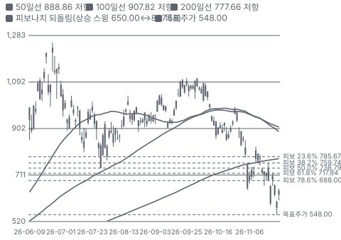

**주봉**

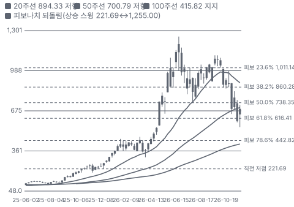

**월봉**

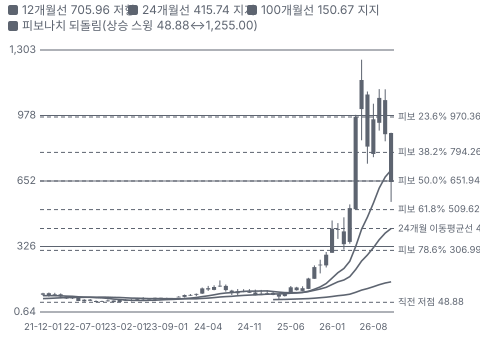

**분기 매출·EPS 실적과 컨센서스**

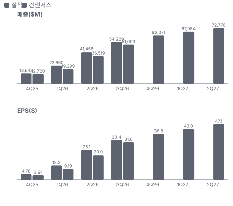

**4Q26 매출 — 지표 추세 vs 가이던스·컨센서스**

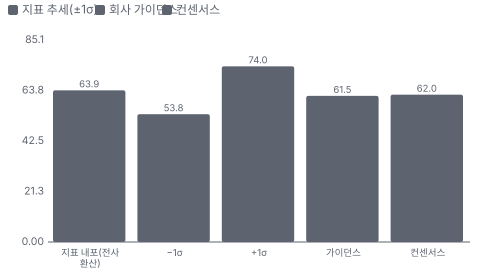

**최근 4개 분기 주가 변화 분석**

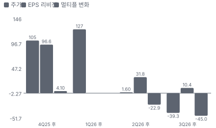

**EPS 리비전**

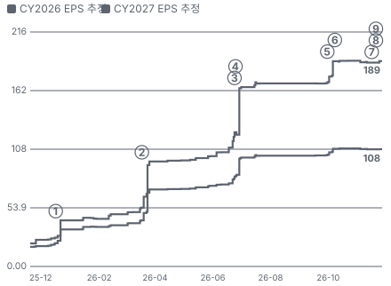

① 25-12-17 1Q FY26 실적 — 2Q 가이던스가 예상을 크게 웃돌았다(다음 날 +10.2%) · EPS 리비전 +59%
② 26-03-18 2Q FY26 실적 — 매출 \$23.9B, 다음 날 −3.8% · EPS 리비전 +79%
③ 26-06-24 3Q FY26 실적 — 매출 \$41.5B·SCA 16건, 다음 날 +15.7% · EPS 리비전 +38%
④ 26-06-25 DRAM 가격 담합 집단소송 제기 — 가격 급등의 법적 비용이 처음 붙었다 · 실적 창과 겹침
⑤ 26-09-30 4Q FY26 실적 — 1Q 가이던스 \$61.5B·SCA 26건, 다음 날 +3.0% · EPS 리비전 +12%
⑥ 26-10-08 자사주 한도 \$35.16B — '잉여현금 100% 환원'이 숫자가 됐다 · 실적 창과 겹침
⑦ 26-11-16 원격 접근 수출통제 규칙(11월 19일 관보) — 중국 클라우드 수요 우려, −7.6% · EPS 리비전 +0%
⑧ 26-11-23 엔비디아 CEO 복귀 8-K — AI 공급망 신뢰 회복, +19.0% · EPS 리비전 +0%
⑨ 26-11-24 첫 의견 하향 — 2028년 수요 위험, 목표가 \$775, −11.0% · EPS 리비전 +1%

**멀티플 프리미엄(Fwd 1Y P/E, 최근 4개 분기말 절대값 — 대상 vs 동종 중앙값)**

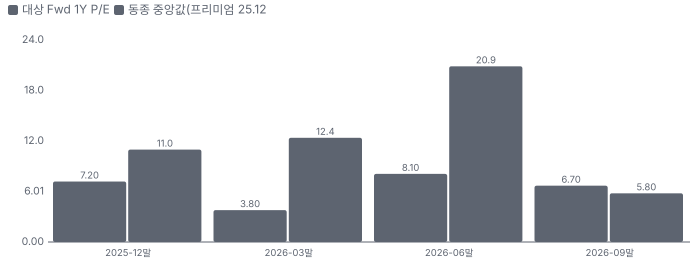

**합리적 멀티플**

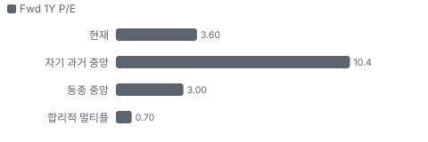

**밸류에이션 주가 시나리오**

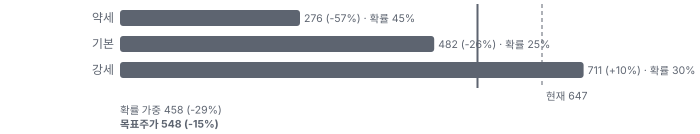

**주가별 업사이드**

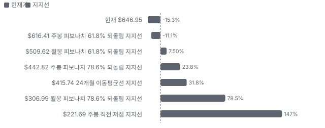
- 제품·서비스 포트폴리오

**고객 믹스(FY2026, 매출 대비)**

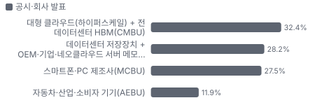

**공급 병목(10점, 낮을수록 병목)**

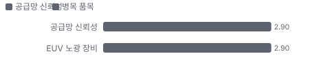

**CAPEX의 매출 대비 비중**

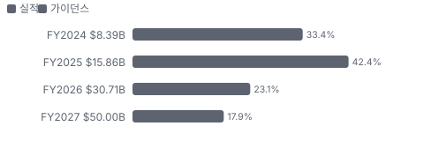

**위성 판독**

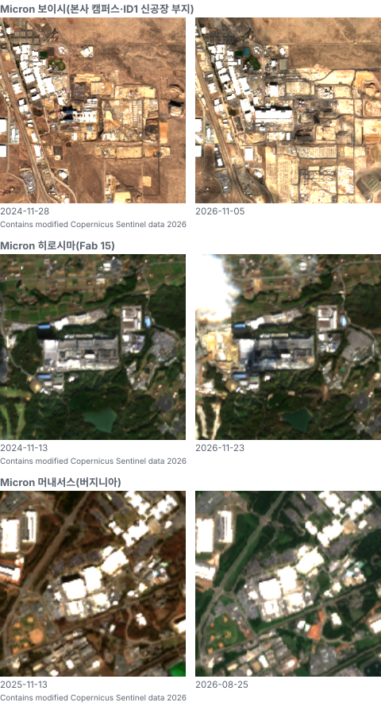

**어닝콜 변화별 주주가치 영향**

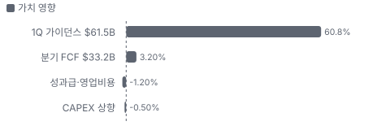

**수주·파이프라인 확실성 사다리**

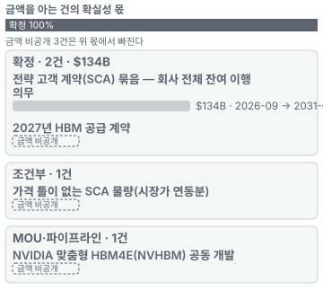

**매출 → 매출총이익 → 영업이익(매출 = 100, 최근 4분기)**

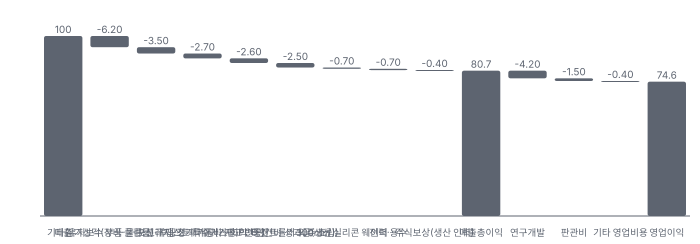

**분기 비용 비중 추이(매출 대비, 공시)**

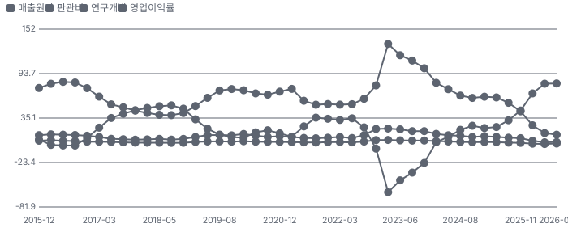

**비용 요인별 매출 대비 비중 1년 변화**

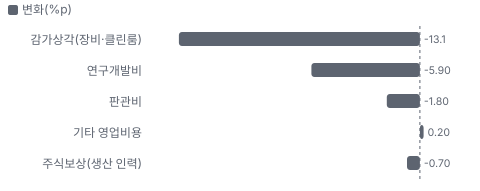

**DRAM BOM 원가 몫**

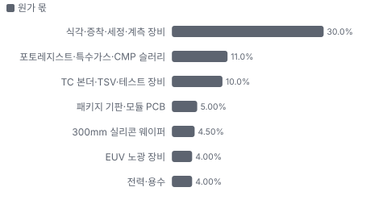

**NAND BOM 원가 몫**

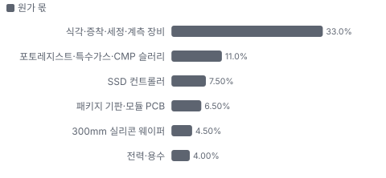

**BOM 항목 가격 +10% 시 OPM 변화**

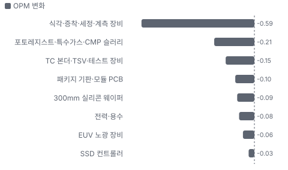

**재고 일수 — 분기별 — 재고를 줄이며 마진도 지킨다: 건전(최근 재고 증가율 − 매출 증가율 -232.2%p)**

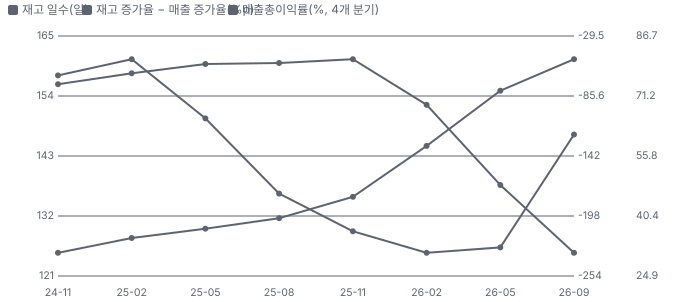

**원가 물가 vs 판매가 물가 — 최근 24개월**

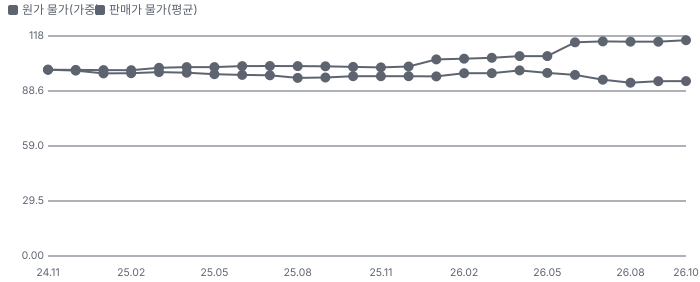

**매출 vs PPI·수출입 — 4Q22 = 100(변화율, 로그 눈금)**

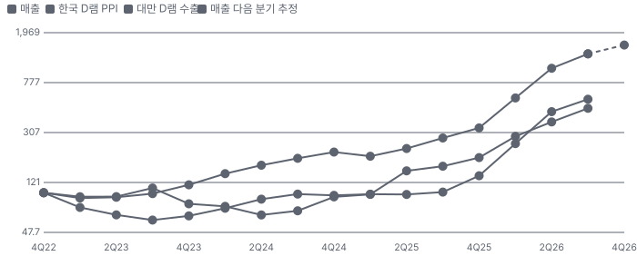

**10년 P·Q 사이클 — 추세(HP 필터) 대비 갭과 8분기 전망**

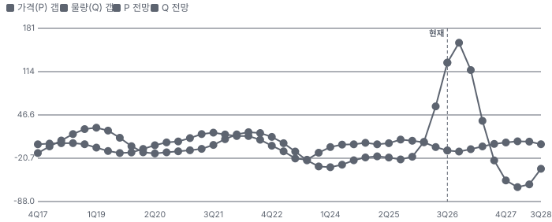

**매출 증가율의 가격·물량 분해와 8분기 전망(전년 대비)**

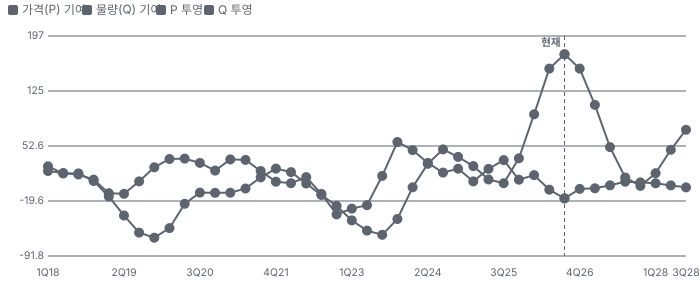

**목표주가 산정 — 시나리오 수정 가중평균(강세 확률 30%→51%), 도달 확률 약 35%**

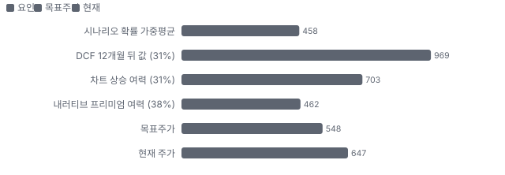

**PEG — 성장 대비 멀티플(낮을수록 성장 대비 쌈)**

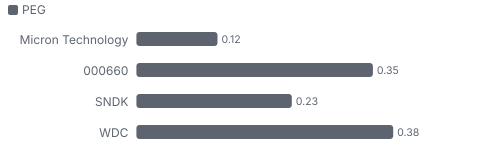

**커뮤니티 언급 수(최근 30일, 채널별)**

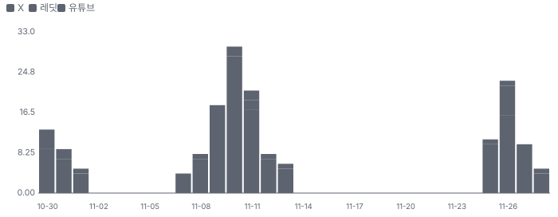

**커뮤니티 게시 수(월, 최근 12개월 — 이번 달은 진행 중)**

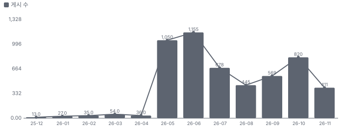

**일별 거래량 분해**

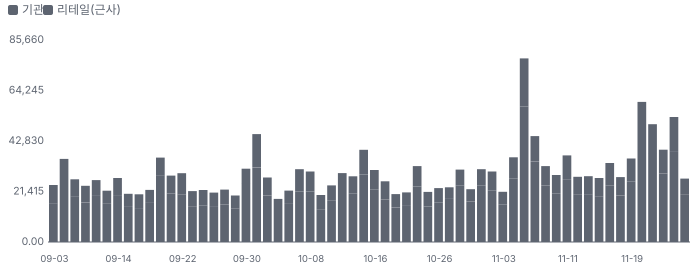

**기관 자금 흐름**

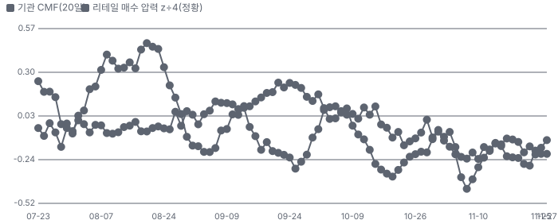

**몬테카를로**

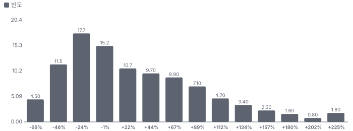

해석: 3,000번 중 1,705번(57%)에서 가치가 지금 주가 이상이었다. 지금 주가를 뒷받침하는 경우와 그렇지 않은 경우가 반반에 가깝다. 가운데 값은 1.13배이고, 열 번 중 여덟 번은 0.57~2.22배 사이에 든다.

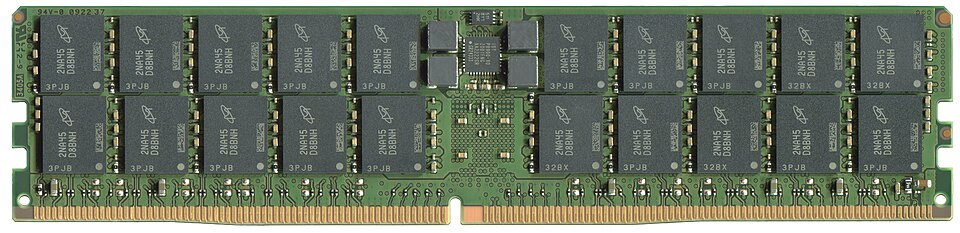
**서버 DRAM(DDR5·고용량 모듈·LP 서버 DRAM·SOCAMM)** — Micron DDR5 서버용 메모리 모듈(부품번호 MTC40F204681RC48BA1R) — 위키미디어 공용, CC BY 4.0
_사진: PantheraLeo1359531 · CC BY 4.0 · Wikimedia Commons_

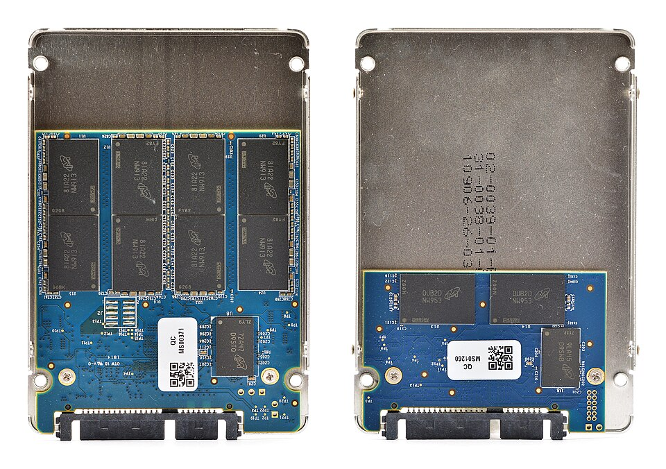
**모바일·PC용 DRAM·NAND(LPDDR5X·UFS·클라이언트 SSD)** — Micron의 소비자 브랜드 Crucial MX500 2TB SATA SSD(NAND 저장장치) — 위키미디어 공용, CC BY-SA 4.0
_사진: Phiarc · CC BY-SA 4.0 · Wikimedia Commons_

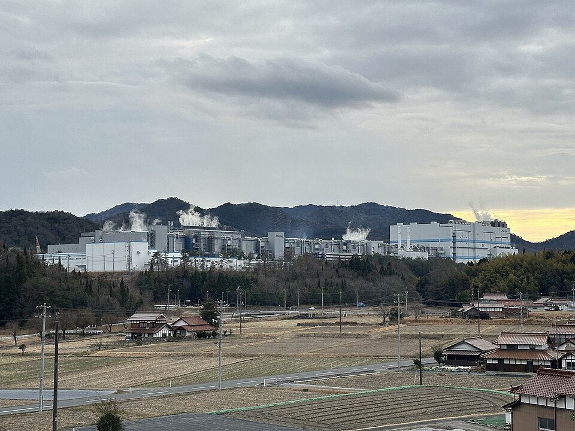
**일본 히로시마 팹** — Micron Memory Japan 히로시마 공장 외관 — 위키미디어 공용, CC BY 4.0
_사진: ノボホショコロトソ · CC BY 4.0 · Wikimedia Commons_

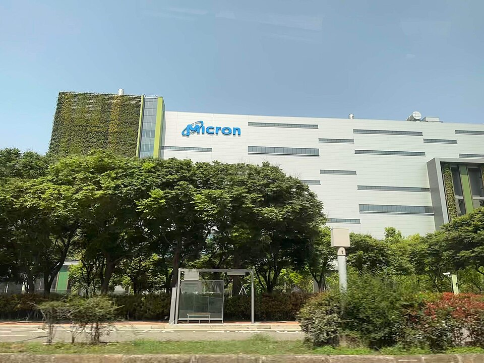
**대만 사업장(타이중 등 기존 팹 + 퉁뤄 인수 팹)** — Micron 대만 타이중 팹 외관 — 위키미디어 공용, CC BY-SA 4.0
_사진: Thingreenline4546 · CC BY-SA 4.0 · Wikimedia Commons_

## 내러티브

> **기업가치를 결정하는 이야기:** 값을 정하는 것은 세 가지다. ① 장기 계약의 구속력 — 잔여 이행 의무 약 \$150B와 고객 예치금 \$12.7B는 확인된 숫자지만, 가격 하한의 수준과 해지 조건은 공개되지 않았다. 하한이 지켜지면 불황기 이익의 바닥이 올라가 배수가 올라갈 근거가 된다. ② 2028년 수급 — 회사는 2028년도 공급 부족이라고 말하고, IB는 부족률을 1%대까지 낮췄다. 중국 증설과 데이터센터 착공 지연이 이 얇은 숫자를 뒤집을 수 있다. ③ 현금의 쓰임 — 분기 \$30B대 잉여현금이 12월 9일부터 자사주 매입으로 가느냐, 늘어나는 설비투자(FY27 상반기 약 \$25B)로 가느냐다.

> **멀티플·EPS 프리미엄**
> **멀티플:** 12개월 선행 P/E 3.6배는 SK하이닉스 3.0배·SanDisk 3.0배보다 조금 높고 Western Digital 10.1배·Seagate 11.4배보다 크게 낮다. 회사 자신의 5월 말 10.2배, 9월 말 6.7배에서 내려왔다 — 메모리 3사가 함께 받는 '정점 이익 할인'이다
> **EPS:** FY2027 EPS 추정은 6월 5일 \$105.7에서 11월 24일 \$175.5로 66% 올랐다. 다만 10월 6일 \$176.6 이후 7주째 제자리다 — 상향이 멈춘 것이 배수 하락과 겹쳤다

### 투자자들은 왜 열광했나

5월 말 시가총액이 약 \$1T에 닿았고 6월 24일 3Q 실적(매출 \$41.5B, 예상 \$35.8B)과 '장기 계약 16건·잔여 이행 의무 \$100B' 공개 다음 날 15.7% 올라 6월 25일 종가 \$1,213.56이 고점이 됐다. 열광의 근거는 '메모리가 처음으로 가격 하한이 붙은 다년 계약 사업이 됐다'는 이야기와 분기마다 예상을 15% 넘게 웃돈 실적이었다. 식은 과정은 세 단계다. 첫째, 고점 직후부터 공급 쪽 뉴스가 이어졌다 — 6월 25일 담합 집단소송 제기(10-K 확인), 7월 1일 −10.6%(애플이 중국 메모리 2곳과 협상 중이라는 보도가 원인으로 꼽혔다, 1차 확인 못 함), 7월 중순 CXMT 상장(보도). 둘째, 9월 30일 4Q 실적은 다시 예상을 넘었지만 다음 날 +3.0%에 그쳤고 10월 6일 이후 추정 상향이 멈췄다. 셋째, 11월에는 회사 밖의 일로 AI 종목 전체가 무너졌다 — 11월 5일 −17.5%(중간선거 뒤 데이터센터 규제 우려, 언론 해석), 11월 20일 −13.9%(엔비디아 회계 조사 보도, 1차 출처 미확인), 11월 24일 −11.0%(첫 의견 하향). 세 단계 모두 2027년 실적이 아니라 2028년 이후를 겨냥한 걱정이다.

### 무엇이 기업가치를 바꾸나

> **구조적 체질 변화**
> **변화:** 1년짜리 공급 약정이 최대 5년짜리 전략 고객 계약으로 바뀌었다. 26건 서명, 2030년까지 매출의 35% 이상(목표 약 50%), 4분의 3이 가격 틀 확정. 고객 예치금 \$12.7B를 받아 순현금이 \$68.3B가 됐다
> **증거:** 4Q FY26 어닝콜(2026-09-30) · FY2026 10-K(기타 장기부채·잔여 이행 의무)
> **반증:** 고객의 계약 해지·가격 재협상 공시, 예치금 조기 반환

> **고부가 믹스 확장**
> **변화:** HBM과 데이터센터 SSD 비중이 커졌다. 4Q 데이터센터 SSD 매출 약 \$10B(NAND의 3분의 2 이상), 2027년 HBM 물량 대부분 계약 완료. 클라우드·데이터센터 두 사업부가 매출의 63%, 매출총이익률 83~90%
> **증거:** 4Q FY26 어닝콜 · 4Q 실적 보도자료(8-K EX-99.1)
> **반증:** HBM 사양 축소가 탑재 용량 감소로 확인되거나 기업용 SSD 계약가가 내린다

> **기술 혁신**
> **변화:** 1γ(Micron의 6세대 10나노급 DRAM 공정으로 처음 극자외선 노광을 쓴 노드) DRAM과 G9(Micron의 9세대 3D NAND 공정) NAND가 최대 양산 노드가 됐고 차세대 노드는 2027년 하반기 양산이다. HBM4(6세대 고대역폭 메모리로 입출력 단자 수를 두 배로 늘려 대역폭을 높인 제품)는 2026년 1분기 양산을 시작했고(회사 발언), 엔비디아와 맞춤형 HBM4E를 함께 설계한다. ASML과 다년 EUV 공급 계약을 맺었다
> **증거:** 3Q·4Q FY26 어닝콜 · 2026-02-12 증권사 행사 발언
> **반증:** HBM4E 고객 인증 지연, 차세대 노드 양산이 2028년으로 밀린다

> **실행 속도**
> **변화:** 해당 없음(주문에서 출하까지의 리드타임을 공시하지 않는다 — 2027년 생산의 75% 이상이 이미 약정돼 주문 리드타임 개념이 약하다). 속도를 정하는 것은 신규 공장이다: 아이다호 1공장은 2023년 10월 착공, 첫 웨이퍼 2027년 중반(약 44개월), 2공장 2028년 말, 뉴욕 2030년, 히로시마 2028년 말, 싱가포르 HBM 패키징 2027년 초. 대만 타오위안 신공장은 노사 분쟁으로 공사가 멈췄다는 보도가 있다(회사 확인 미확인) **납품 리드타임 미확인.** 피어 비교 미확인. 이전 대비 미확인.
> **증거:** 4Q FY26 어닝콜 · FY2026 10-K · 2026-11-05 보도
> **반증:** 아이다호 1공장 첫 웨이퍼가 2027년 중반에서 밀린다는 회사 발표

> **M&A**
> **변화:** 큰 인수는 없다. 대만 퉁뤄 부지를 인수해 2027년 중반 의미 있는 출하를 목표로 한다. 6월 22일 Anthropic 시리즈 H에 전략 투자했고 11월 상장 때 사모 배정에도 참여했다는 보도가 있다(금액 미확인). 7월에는 GlobalWafers에 \$0.5B 금융 지원과 10년 공급 계약, 미국 공급망에 최대 \$3B 투자 계획을 냈다
> **증거:** 회사 보도자료(2026-06-22, 2026-07-09) · 3Q·4Q FY26 어닝콜
> **반증:** 퉁뤄 출하 일정 지연, 전략 투자 지분의 평가손 공시

> **정책·입법 연관성**
> **재정정책:** CHIPS법 직접 보조금 최대 \$6.4B(아이다호·뉴욕 \$6.1B + 버지니아 \$275M)를 받는 수혜자다. 2026년 9월 3일 기준 아직 인식하지 않은 잔여 약정이 \$4.9B이고, 미국 내 적격 투자에 세액공제 35%를 받는다(2025년 세법으로 25% → 35%). 조건이 붙는다 — 계약 뒤 2년(12월 9일까지)은 자사주 매입 제한, 그 뒤 3년은 잉여현금 한도, 사업 현금흐름이 기준을 넘으면 초과분 일부 공유(지급액의 75% 한도), 일정 미달 때 환수. 뉴욕주와는 최대 \$5.5B의 구속력 없는 조건 합의가 있다 FY2026 10-K(정부 보조금 주석·위험 요인·자사주 프로그램) 반증: 공사·장비 반입·생산 마일스톤 미달로 지급 보류·환수 공시, 세액공제율을 낮추는 법 개정 의회 동의 10/10 — 하원 5/5(CHIPS법(2022년, 공법 117-167)과 세액공제 35%를 담은 2025년 세법(공법 119-21)이 본회의를 통과해 시행 중) · 상원 5/5(같은 두 법 본회의 통과 — 세액공제 5년 연장안(S.5809)은 11월 21일 발의 단계).
> **행정명령:** 세 갈래다. ① 반도체·장비 수입에 대한 무역확장법 232조 포고문이 2026년 1월 관보에 실렸다(문서 2026-01052) — 메모리 품목의 적용 범위와 세율은 이번 회차에 조문으로 확인하지 못했다(미확인). 회사는 10-K에서 관세를 원가·수요 위험으로만 적는다. ② 상무부가 해외 데이터센터를 통한 첨단 연산 '원격 접근'을 통제하는 잠정 최종 규칙을 11월 19일 관보에 실었다(문서 2026-23529) — 메모리를 직접 묶지는 않지만 중국 클라우드 수요와 11월 16일 업종 하락의 배경이다. ③ 중국은 2023년 5월 사이버 보안 심사 결정으로 핵심 정보 인프라 운영자의 Micron 제품 구매를 막았고 지금도 유지된다 관보 2026-01052 · 관보 2026-23529 · FY2026 10-K(위험 요인) 반증: 232조 관세가 메모리 완제품·모듈에 넓게 적용돼 해외 생산분(대만·일본·싱가포르) 원가가 오른다. 중국이 제재를 민간 고객으로 넓힌다 의회 동의 2/10 — 하원 1/5(행정부 단독 조치 — 관련 표결·법안 번호를 확인하지 못했다(미확인이라 가장 낮게 둔다. 논의가 없다는 뜻이 아니다)) · 상원 1/5(대중 장비 수출 제한 법안이 상원 국방수권법안에 들어갔다는 IB 자료가 있으나 의결 기록을 확인하지 못했다(미확인)).
> **연관입법:** ① 첨단제조 투자세액공제를 5년 연장하는 S.5809가 11월 21일 상원에 초당적으로 발의됐다(조문·세율 미확인, 발의는 시행이 아니다). ② 대중 반도체 장비 수출을 더 막는 법안은 통과되면 중국 경쟁사 증설을 늦추는 쪽이다(IB 자료 기준, 의결 미확인). ③ 법률은 아니지만 2026년 6월 25일 제기된 DRAM 가격 담합 집단소송이 진행 중이다 업계 협회 성명(2026-11-21) · FY2026 10-K(Antitrust Matters) · 노션 IB 자료(11월 18일) 반증: S.5809가 회기 안에 위원회를 통과하지 못한다. 담합 소송이 집단 인증 단계로 넘어간다

> **고객의 지출 예산**
> **변화:** 매출의 약 63%가 클라우드·데이터센터 고객의 설비투자에서, 약 37%가 스마트폰·PC·자동차 제조사의 부품 원가에서 나온다. 설비투자 쪽은 물량이 약정돼 있고, 부품 원가 쪽은 값이 오르면 고객이 탑재량과 출하를 줄인다
> **사업별 예산:** **매출의 33%**: 코어 데이터센터(CDBU(데이터센터 SSD와 서버 제조사·기업 고객용 사업부) — 서버 제조사·기업용 DRAM·SSD) — 고객 CAPEX(서버 제조사를 거친 기업·클라우드의 서버·스토리지 투자) · 동인: 서버 대수(2026·2027년 10%대 후반 성장 전망)와 기업용 SSD 수요
**매출의 30%**: 클라우드 메모리(CMBU — 하이퍼스케일러용 DRAM·HBM) — 고객 CAPEX(하이퍼스케일러의 AI·일반 서버 설비투자) · 동인: AI 가속기 출하와 서버당 메모리 탑재량
**매출의 24%**: 모바일·클라이언트(MCBU(스마트폰·PC 고객용 사업부) — 스마트폰·PC용) — 고객 OPEX(스마트폰·PC 제조사의 부품 원가) · 동인: 기기 출하와 대당 탑재량 — 값이 오르면 줄어든다(4Q 매출은 가격으로 +14%, 비트 출하는 전 분기보다 감소)
**매출의 13%**: 자동차·임베디드(AEBU(자동차·산업·임베디드 고객용 사업부)) — 고객 OPEX(자동차·산업 기기 제조사의 부품 원가) · 동인: 차량당 메모리 탑재량, 3년짜리 공급 계약
> **증거:** 4Q FY26 사업부 매출(8-K EX-99.1) · 4Q 어닝콜
> **반증:** 하이퍼스케일러 설비투자 가이던스 하향, 서버 대수 성장률(회사 전망 10%대 후반) 하향

### 내러티브 근거

> 'AI 메모리 부족이 2028년까지 이어지고, 장기 계약이 사이클 사업을 계약 사업으로 바꿨다'는 이야기는 셀사이드 43명 중 38명이 받아들인 컨센서스다. 그런데 시장은 6월 말부터 이 이야기에 주던 배수를 거둬들이고 있다 — FY2027 EPS 추정은 6월 초 \$105.7에서 \$175.5로 66% 올랐는데 주가는 고점에서 47% 내렸고, 12개월 선행 P/E는 5월 말 10.2배에서 3.6배가 됐다. 이익 추정이 꺾인 것이 아니라 '2028년 뒤에도 이 이익이 남느냐'에 값을 주지 않는 국면이라 단계를 소멸로 본다. 추정이 실제로 내려가기 시작하면 붕괴로 넘어간다. 동종 대비 멀티플 차이 +21% 중 회사 고유 몫은 +420%다. 단계는 소멸, 쏠림은 높음이다.

> **장기 계약이 사이클 사업을 계약 사업으로 바꾼다** · 유지
> **논리:** 다년 전략 고객 계약(SCA)에 최소 물량·가격 하한·선수금이 붙어 불황기 이익의 바닥이 과거보다 높아진다
> **숫자:** SCA 26건(6월 16건), 잔여 이행 의무 약 \$150B(최소 물량 × 최소 가격), 고객 재무 약정 \$32B 중 예치금 \$12.7B 수령, 2027년 생산의 75% 이상 약정
> **반증:** 고객이 SCA를 해지·재협상했다는 공시나 예치금 조기 반환, 또는 다음 10-Q에서 잔여 이행 의무가 줄어든다
> **출처:** 4Q FY26 어닝콜(2026-09-30) · FY2026 10-K

> **공급 부족이 2028년까지 이어진다** · 약화
> **논리:** 클린룸이 2028년 전에는 크게 늘지 않고 HBM이 웨이퍼를 더 먹어 범용 DRAM 공급이 수요를 못 따라간다
> **숫자:** 회사: 2027·2028년 산업 DRAM 비트 20%대 초반 증가, 두 해 모두 공급 부족. FY2027 EPS 추정 \$105.7 → \$175.5(6월 초 → 11월). 1Q FY27 가이던스 매출 \$61.5B·매출총이익률 약 86.25%
> **반증:** 12월 17일 실적에서 2Q 매출 가이던스가 전 분기보다 줄거나 매출총이익률이 86% 아래로 내려간다. DRAM 계약가가 분기 기준 하락한다
> **출처:** 4Q FY26 어닝콜(2026-09-30) · 투자자 행사 발언(2026-11-18)

> **HBM·데이터센터 SSD로 믹스가 올라간다** · 유지
> **논리:** AI 서버용 HBM과 기업용 SSD가 가격 협상력이 가장 큰 제품이고 비중이 커진다
> **숫자:** 2027년 HBM 물량 대부분 계약·가격 큰 폭 인상(회사). IB의 2027년 HBM 단가 가정 +65~103%. 4Q 데이터센터 SSD 매출 약 \$10B, 사업부 매출총이익률 83~90%
> **반증:** 고객의 HBM 사양 축소가 대수 증가로 상쇄되지 않고 탑재 용량 감소로 확인된다. HBM 가격이 2027년 계약분에서 재협상된다
> **출처:** 4Q FY26 어닝콜(2026-09-30) · 노션 IB 자료(11월)

> **잉여현금 100% 환원으로 바닥이 생긴다** · 강화
> **논리:** 12월 9일부터 자사주 매입 제한이 풀리고 분기 \$30B대 잉여현금이 매입으로 간다
> **숫자:** 한도 \$35.16B(시가총액의 약 4.8%), 4Q 잉여현금흐름 \$33.2B, 순현금 \$68.3B. 한도는 '기존 잔여 \$2.16B + 4Q 조정 잉여현금 100%'로 산정
> **반증:** 12월 9일 뒤 첫 분기 매입액이 그 분기 잉여현금의 절반에 못 미치거나, 설비투자 상향으로 잉여현금이 줄어든다
> **출처:** FY2026 10-K(자사주 프로그램·정부 보조금 주석)

> **반대 내러티브 — 2028년 절벽(정점 이익)** · 강화
> **논리:** 지금 이익은 사이클 정점이고 2028년에 가격이 내리면 이익이 급감하므로 낮은 배수가 맞다
> **숫자:** 12개월 선행 P/E 10.2배(5월 말) → 3.6배. 컨센서스 매출 FY2028 \$347.3B → FY2029 \$324.6B(4명) → FY2031 \$182.1B(1명). 한 IB는 2028년 범용 DRAM 가격 −19~−20%, 부족률 1.2%로 낮췄다. 첫 하향 증권사 목표가 \$775
> **반증:** 2028년 물량 SCA 추가 체결이 공시되고 하이퍼스케일러의 2028년 설비투자 계획이 늘며, DRAM 계약가가 2027년 말까지 오른다
> **출처:** 배수·컨센서스 계산 · 노션 IB 자료(11월 22일) · 의견 변경 보도(11월 24일)

> **반대 내러티브 — AI 자금 조달과 데이터센터 규제** · 강화
> **논리:** 수요가 사라지는 것이 아니라 짓는 속도와 돈줄이 막혀 2028년 물량이 뒤로 밀린다
> **숫자:** 나스닥 100 20거래일 −12.6%, 하이일드 스프레드 20거래일 +51bp, VIX 26.8. 반도체 지수 11/5 −12.3%·11/20 −10.7%. 한 IB는 미국 데이터센터 증설 약 5GW를 2028년에서 2029년으로 옮겼다(2028년 예상 증설의 약 20%)
> **반증:** 1월 주지사 취임 뒤 인허가 중단이 실제로 나오지 않고, 1월 말 하이퍼스케일러 실적에서 2027년 설비투자 계획이 유지·상향된다
> **출처:** 시장 지표 · 노션 IB 자료(11월 15일·23일)

> **반대 내러티브 — 중국 공급과 담합 소송** · 유지
> **논리:** CXMT 증설과 화웨이의 자체 HBM 개발이 가격 결정력을 깎고, 가격 급등이 소송·규제를 부른다
> **숫자:** 2026년 6월 25일 DRAM 구매자 집단소송 제기(캘리포니아 북부 연방지법, 공급 제한·가격 담합 주장, 대상 기간 2022년 10월~), 7월 17일 하와이 추가 소송. 한 IB는 CXMT 비트 증가를 2026~28년 +48%/+36%/+32%로 가정
> **반증:** 법원이 소송을 기각한다. CXMT의 서버 DRAM·HBM이 중국 밖 고객 인증을 받지 못한다
> **출처:** FY2026 10-K(Antitrust Matters) · 노션 IB 자료(11월 22일)

### 투자 포인트

> **이익 추정은 올랐고 배수만 빠졌다**
> **명제:** 9월 말 콜 뒤 두 달 동안 FY2027 EPS 추정은 10.5% 올랐는데 주가는 39% 내렸다 — 하락의 전부가 배수 축소다
> **숫자:** FY2027 EPS 평균 \$158.8(9/28) → \$175.5(11/24), 종가 \$1,065.08(9/29) → \$646.95(11/27), Fwd 1Y P/E 6.7배(9월 말) → 3.6배
> **시장과 다른 점:** 셀사이드 43명 중 38명이 매수이고 목표가 평균이 \$1,526이라 '시장이 못 봤다'고 말할 자리가 아니다. 다른 점은 두 자의 엇갈림이다 — 현금흐름 할인으로는 약세 시나리오 가치가 지금 주가의 약 0.8배라 하강이 상당 부분 값에 들어 있고, 동종 배수로는 한국 2사보다 20% 비싸다
> **증명:** 12월 17일 1Q 실적에서 2Q 가이던스가 1Q를 웃도는지, 2028년 물량 계약의 가격 언급
> **출처:** 8-K EX-99.1(2026-09-30) · 컨센서스 이력

> **계약이 바닥을 만든다 — 높이는 모른다**
> **명제:** 의무 구매 계약 26건과 잔여 이행 의무 \$134B는 과거 사이클에 없던 것이다. 다만 하한 가격이 공시되지 않아 바닥의 높이는 아직 숫자가 아니다
> **숫자:** 잔여 이행 의무 \$134B(9/3, 10-K) → 콜 시점 약 \$150B, 고객 예치금 \$12.75B·신용장 \$7B, 12개월 안 인식은 약 4분의 1(\$33.5B)
> **시장과 다른 점:** 강세 쪽은 '사이클이 끝났다'고 읽지만 12개월 안 인식분은 FY2027 매출 추정의 12%뿐이다 — 최소 물량 × 최소 가격이라 그렇다. 회사는 하한에서도 과거 정점 이익률을 웃돈다고 말했는데(3Q·4Q 콜) 그 문장을 검증할 숫자는 없다
> **증명:** 1Q 10-Q의 잔여 이행 의무 총액과 12개월 안 인식 비중, 계약 부채 잔액
> **출처:** Micron FY2026 10-K(2026-10-09) Note 16 · 4Q FY26 어닝콜(2026-09-30)

> **현금이 시가총액의 8%, 환원이 12월 9일부터 열린다**
> **명제:** 예치금을 뺀 순현금이 약 \$55.6B이고 분기 FCF가 \$33B를 넘는다. 자사주 한도는 \$35.16B로 늘었다
> **숫자:** 4Q FCF \$33.2B, 현금·투자 \$73.5B, 차입 \$5.2B, 예치금 \$12.7B. 이사회가 10월 8일 총 한도 \$35.16B 승인, 12월 9일부터 집행 가능(10-K)
> **시장과 다른 점:** 한도는 집행이 아니다. FY2026 자사주 집행은 \$650M뿐이었고 FY2027 CAPEX는 \$50B를 넘는다. 내부자는 12개월간 장내 매수 없이 \$279M을 팔았다(대부분 사전 계획)
> **증명:** 1Q 실적의 자사주 매입 금액과 평균 단가, 2Q 환원 계획
> **출처:** Micron FY2026 10-K(2026-10-09) · 4Q FY26 어닝콜(2026-09-30) · Form 4

### 모멘텀 생성·소멸 타임라인

**카탈리스트 달력 — 지난 사건의 주가 반응과 앞으로 확인할 숫자**
| 날짜 | 상태 | 구분 | 사건 | 반응·확인 | 결과에 따라 |
|---|---|---|---|---|---|
| 2026-06-24 | 완료 | 생성 | 3Q FY26 실적 — 매출 \$41.5B, 장기 계약 16건 첫 공개 | +15.7% |  |
| 2026-06-25 | 완료 | 소멸 | 종가 고점 \$1,213.56 — 같은 날 DRAM 가격 담합 집단소송 제기(10-K 소송 항목) | 6/25 → 7/29 −39.1% |  |
| 2026-09-30 | 완료 | 생성 | 4Q FY26 실적 — 매출 \$54.2B, 1Q 가이던스 \$61.5B | +3.0% |  |
| 2026-11-05 | 완료 | 소멸 | 반도체 업종 동반 급락 — 회사 고유 원인은 확인되지 않았다 | −17.5% |  |
| 2026-11-24 | 완료 | 소멸 | 증권사 한 곳의 중립 하향·목표가 대폭 인하 보도 | −11.0% |  |
| 2026-12-09 | 예정 | 확인 | 자사주 매입 확대 가능일(CHIPS 계약 2주년) | 회사가 매입 규모·방식(가속 매입 여부)을 밝히는지 | 분기 \$10B 이상 집행이 확인되면 기본~강세, 언급이 없으면 중립 |
| 2026-12-17 | 예정 | 확인 | 1Q FY27 실적·2Q 가이던스(장 마감 뒤) | 1Q 매출 \$61.5B 이상·매출총이익률 86.25% 이상, 2Q 매출 가이던스가 1Q 실적 이상이고 매출총이익률이 1Q보다 높은지 | 모두 맞으면 기본~강세. 2Q 매출총이익률이 1Q 아래면 '1Q가 바닥' 발언이 깨져 약세 쪽 |
| 2027-01 말(예상) | 예정 | 매크로 | 대형 클라우드 4분기 실적 — 2027년 설비투자 가이던스 | 주요 4사 합산 설비투자 가이던스가 2026년보다 느는지, 서버 대수 전망 | 늘면 2028년 수요 근거가 생겨 배수 회복 여지, 줄면 약세 시나리오 |
| 2027-03 중순(예상) | 예정 | 확인 | 2Q FY27 실적 — 2028년 계약 가격 | 2028년 물량 계약 비중과 가격 방향, 잔여 이행 의무가 \$134B에서 늘었는지 | 잔고 증가와 가격 유지가 함께 나오면 'FY2028 정점' 가정이 약해진다 |

### 언제 사서 언제 팔아야 할까?

**가격·조건 틀 — 가격은 밸류에이션(약세·기본·강세·목표주가)과 차트 지지 구간에서, 조건은 이벤트에서**
| 구간 | 가격 | 목표주가까지 | 약세까지 | 조건·근거 |
|---|---|---|---|---|
| 관찰 구간 | \$616~\$616 | -11% | -55% | 11월 20일 종가 \$594.51과 11월 25일 장중 \$548.13이 이번 하락의 저점권이다. 고점 대비 절반 근처이고 4월 돌파 전 가격대와 겹친다 |
| 확인 뒤 | 지금 \$647 이상에서 조건 확인 | -15% | -57% | 12월 17일 1Q 실적에서 매출 \$61.5B 이상, 2Q 매출총이익률 가이던스가 86.25%보다 높고, 자사주 집행 규모가 숫자로 나온다 |
| 무효화 | 약세 시나리오 \$276 | - | -57% | 2Q 매출총이익률 가이던스가 1Q 아래이거나, 회사가 2027년 DRAM 가격 상승 폭을 낮춰 말하거나, 고객의 계약 재협상이 공시된다 |
| 차익 고민 2차 | \$711(강세 시나리오) | +10% | - | 목표주가는 지금 주가 아래다 — 동종 배수로 재면 이미 값이 찬 구간이라는 뜻이다. 그 위로 가려면 FY2028 이익이 정점이 아니라는 근거(2028년 계약 가격)가 먼저 나와야 한다 |

11월에 하루 ±10% 넘는 움직임이 다섯 번 있었다(11/5 −17.5%, 11/20 −13.9%, 11/23 +19.0%) — 실적 전 하루 움직임으로 판단을 바꾸지 않는다 가격·조건 틀이며 매매·비중 지시가 아니다(투자 권유 아님).

## 포트폴리오

| 제품·서비스 | 구분 | 무엇 | 쓰는 곳 | 돈 버는 방식 | Mix | Mix 변화(전 분기 대비) |
|---|---|---|---|---|---|---|
| HBM(HBM3E(5세대 고대역폭 메모리로 FY2026 출하의 다수를 차지한 12단 제품)·HBM4) | 제품 | DRAM 다이를 수직으로 쌓고 실리콘 관통 전극으로 이은 AI 가속기용 고대역폭 메모리. FY2026 출하의 다수는 HBM3E 12단, HBM4 36GB 12단은 양산 시작, 48GB 16단은 샘플 | AI 가속기(GPU·주문형 칩) 옆에 붙어 모델 가중치와 중간 계산값을 빠르게 주고받는다 | 매출 미공시. 4Q 매출 증가율이 전사보다 높았고, 2027년 물량 대부분이 전년보다 크게 오른 가격으로 계약됐다(4Q 콜) | 미확인 | 미확인 |
| 서버 DRAM(DDR5(서버·PC 주 메모리의 현 세대 규격)·고용량 모듈·LP(저전력) 서버 DRAM·SOCAMM(저전력 DRAM을 서버에 꽂았다 뺄 수 있게 만든 소형 모듈 규격)) | 제품 | 데이터센터 서버의 주 메모리. 1γ·1β(Micron의 5세대 10나노급 DRAM 공정) 공정 DDR5와 고용량 모듈, 저전력 LPDDR(스마트폰 등에 쓰는 저전력 D램 규격)을 서버용 탈착 모듈로 만든 SOCAMM | AI 서버·일반 서버의 CPU 주 메모리, 가속기 랙의 저전력 메모리 | 제품별 매출 미공시. 데이터센터가 FY2026 매출의 약 60%(10-K), 3Q 데이터센터 매출 \$25B 초과(3Q 콜) | 미확인 | 미확인 |
| 데이터센터 SSD | 제품 | G9 NAND 기반 기업용 NVMe(SSD를 고속으로 연결하는 통신 규격) SSD. PCIe(서버와 SSD를 잇는 고속 연결 규격) Gen6 고성능 제품과 245TB 6600 ION(G9 QLC(셀 하나에 4비트를 담는 고밀도 NAND)) 대용량 제품 | AI 학습·추론 데이터 저장, 추론 KV(추론 중 앞 토큰 계산값을 저장해 두는 키-값 캐시) 캐시 오프로드, HDD 대체 | 4Q 매출 약 \$10B — 1년 전의 10배 이상, NAND 매출의 3분의 2 이상(4Q 콜) | 18% | 미확인 |
| 모바일·PC용 DRAM·NAND(LPDDR5X(스마트폰과 서버에 쓰는 저전력 DRAM 규격)·UFS(스마트폰용 내장 플래시 저장 규격)·클라이언트 SSD) | 제품 | 스마트폰용 저전력 DRAM과 내장 플래시, 노트북·PC용 DRAM과 SSD | 스마트폰·PC의 주 메모리와 저장 장치, 기기 내 AI 구동 | 제품별 매출 미공시. 이 제품군이 속한 MCBU 사업부 4Q 매출 \$13.11B(전사의 24%, 사업부 기준) | 미확인 | 미확인 |
| 자동차·임베디드 메모리 | 제품 | 차량·산업·가전용 DRAM·NAND·NOR(코드 저장에 쓰는 읽기 빠른 플래시 메모리). 긴 수명과 품질 인증이 필요한 제품으로 버지니아 머내서스 팹에서 1α(Micron의 4세대 10나노급 DRAM 공정) DDR4(DDR5 한 세대 전의 D램 규격) 생산을 시작했다 | 운전자 보조·인포테인먼트, 산업 장비, 의료·항공·방위, 휴머노이드 로봇 | 제품별 매출 미공시. 이 제품군이 속한 AEBU 사업부 4Q 매출 \$6.82B(전사의 13%, 사업부 기준, 전 분기 대비 +47%) | 미확인 | 미확인 |

**Mix 변화가 가장 큰 쪽은 DRAM(-2.2%p, 전 분기 대비).** 계절성 판정: 분기 매출 계절 지수 기준 없음 → 직전 분기와 비교.

## 고객

> **FY2026 최대 고객 대형 클라우드(하이퍼스케일) + 전 데이터센터 HBM(CMBU) 32%, 상위 3곳 88%, 집중도 집중.** 공시·회사 발표로 확인한 몫은 매출의 100%이고, 나머지 고객 몫은 추정이거나 미분해다. FY2026에는 매출 10% 이상 고객이 한 곳도 없다(10-K Note 21). FY2025에는 이름을 밝히지 않은 1곳이 17%(주로 CMBU), FY2024에는 1곳이 10%였다. 10-K는 고객 이름을 밝히지 않아 사업부를 고객 유형으로 쓴다 — 고객 본사 기준 미국이 68.6%, 대만 12.7%, 중국 본토 6.3%, 홍콩 4.7%다(계산). 콜에서 이름이 나온 고객은 NVIDIA(맞춤형 HBM4E 협업)뿐이고 몫은 공시되지 않았다

**고객별 매출 몫(FY2026)**
| 고객 | 몫 | 변화 | 근거 |
|---|---|---|---|
| 대형 클라우드(하이퍼스케일) + 전 데이터센터 HBM(CMBU) | 32% | -4%p | 공시 |
| 데이터센터 저장장치 + OEM·기업·네오클라우드 서버 메모리(CDBU) | 28% | +9%p | 공시 |
| 스마트폰·PC 제조사(MCBU) | 27% | -4%p | 공시 |
| 자동차·산업·소비자 기기(AEBU) | 12% | -1%p | 공시 |

> **대형 클라우드(하이퍼스케일) + 전 데이터센터 HBM(CMBU)** · 공시
> **사는 것:** 서버용 DDR(서버·PC용 D램의 표준 규격)·LPDDR·GDDR(그래픽 카드용 D램 규격), HBM

> **데이터센터 저장장치 + OEM·기업·네오클라우드 서버 메모리(CDBU)** · 공시
> **사는 것:** 데이터센터 SSD·NAND 부품, 서버 DRAM

> **스마트폰·PC 제조사(MCBU)** · 공시
> **사는 것:** 모바일 LPDDR·관리형 NAND, PC용 DRAM 모듈·SSD

> **자동차·산업·소비자 기기(AEBU)** · 공시
> **사는 것:** 차량·산업용 DRAM·NAND·NOR

## 수주·파이프라인

> **2026-09-03 기준 4건.** 확정 \$134B. 공시 잔여 이행 의무 \$134B. 서로 겹치는 항목은 합계에서 뺐다.

**수주 목록**
| 상태 | 계약 | 계약 총액 | 진척 | 기간 | 비고 |
|---|---|---|---|---|---|
| 확정 | 전략 고객 계약(SCA) 묶음 — 회사 전체 잔여 이행 의무 | \$134B | - | 2026-09 → 2031-09 | 다년 의무 구매(take-or-pay). 고객 예치금 \$12.75B 수령(계약 부채 \$13B가 잔고에 포함), 신용장 \$7B. 계약 26건은 콜 기준(주석은 건수를 밝히지 않는다). 건별 진척 미확인 |
| 확정 | 2027년 HBM 공급 계약 | 금액 비공개 | - | - | 금액·물량·상대방 미공시. 위 잔여 이행 의무에 포함되는지도 밝히지 않았다(겹칠 수 있어 합계에서 뺀다) (다른 항목과 겹칠 수 있어 합계에서 뺌) |
| 조건부 | 가격 틀이 없는 SCA 물량(시장가 연동분) | 금액 비공개 | - | - | 콜: SCA 예상 매출의 약 4분의 1. 금액은 공개되지 않았다 (다른 항목과 겹칠 수 있어 합계에서 뺌) |
| 파이프라인 | NVIDIA 맞춤형 HBM4E(NVHBM(NVIDIA와 함께 만드는 첫 맞춤형 고대역폭 메모리 구현)) 공동 개발 | 금액 비공개 | - | - | 개발 협업 발표이지 수주가 아니다 (다른 항목과 겹칠 수 있어 합계에서 뺌) |

**실행 속도와 방해 요인**
| 항목 | 상태 | 실행 속도 | 방해 요인 |
|---|---|---|---|
| 전략 고객 계약(SCA) 묶음 — 회사 전체 잔여 이행 의무 | 확정 | 12개월 안 약 4분의 1(약 \$33.5B, 계산), 5년 안 전부 인식. 1년 전에는 '중요하지 않음' | 최소 가격 기준이라 실제 매출과 다르다(회사 명시) · 증설 일정(아이다호 2027년 중반·퉁뤄 2027년 중반 출하) · 고객이 최소 구매를 못 채우면 예치금 차감·신용장으로 보전 — 분쟁 가능성 |
| 2027년 HBM 공급 계약 | 확정 | 2027년 HBM 비트 공급의 대부분에 대해 계약 완료, 가격은 전년보다 크게 인상(콜) | HBM4 램프·수율 · 첨단 패키징 캐파(싱가포르 2027년 초 첫 산출) · 고객 플랫폼 일정 |
| 가격 틀이 없는 SCA 물량(시장가 연동분) | 조건부 | 물량은 의무 구매로 묶였지만 가격을 주기적으로 협상 — 잔여 이행 의무에서 제외 | 가격이 시장에 따라 움직인다 |
| NVIDIA 맞춤형 HBM4E(NVHBM) 공동 개발 | 파이프라인 | 차세대 GPU·NVLink(엔비디아의 칩 간 고속 연결 기술) Fusion 플랫폼 채택 예정이라는 발표 — 양산 시점·물량 미공시 | 제품 인증 · 양산 일정 · 경쟁사 공급 몫 |

## 마진 구조

> **GPM 80.7%, OPM 74.6%.** FY2025 대비 GPM +40.9%p, OPM +48.4%p. FY2026 매출원가는 매출의 19.3%로 1년 전 60.2%에서 41%p 내려갔다. 원가가 줄어서가 아니라 판매가가 올라서다 — 매출원가는 \$22.5B에서 \$25.7B로 14% 늘었는데 매출은 3.6배가 됐다(DRAM 판매가 약 +180%, NAND 약 +200%, 10-K). 매출원가의 가장 큰 덩어리는 장비·건물 감가상각이고, 그래서 가격이 내릴 때는 같은 고정비가 마진을 거꾸로 깎는다.

> **매출 100 중 매출원가 19.3, 매출총이익 80.7(최근 4분기, 공시).** 매출원가 요인 중 감가상각(장비·클린룸)이 매출의 6.2%로 가장 무겁고, 단가가 +10% 오르면 GPM이 -0.61%p 움직인다. 분기 회귀로 매출 1이 늘 때 매출원가는 0.08 늘고, 매출원가의 고정비 몫은 82%다.

**비용 요인 강도 — 비중·추세·충격(+10%)·탄력**
| 비용 | 구분 | 매출 대비 | 1년 변화 | 마진 기여 | 충격 시 마진 | 매출 탄력 | 고정비 몫 |
|---|---|---|---|---|---|---|---|
| 감가상각(장비·클린룸) | 매출원가 요인 | 6.2% | -13.1%p | +13.1%p | -0.61%p | 미확인 | 100% |
| 기타(유지보수 부품·물류·신규 팹 초기 가동비·재고 변동) | 매출원가 요인 | 3.5% | 미확인 | 미확인 | -0.35%p | 미확인 | 50% |
| 포토레지스트·특수가스·화학·타깃 | 매출원가 요인 | 2.7% | 미확인 | 미확인 | -0.27%p | 미확인 | 10% |
| 후공정·패키징(기판·PCB·컨트롤러·외주 조립) | 매출원가 요인 | 2.6% | 미확인 | 미확인 | -0.26%p | 미확인 | 20% |
| 인건비·성과급(생산) | 매출원가 요인 | 2.5% | 미확인 | 미확인 | -0.25%p | 미확인 | 70% |
| 300mm 실리콘 웨이퍼 | 매출원가 요인 | 0.7% | 미확인 | 미확인 | -0.07%p | 미확인 | 0% |
| 전력·용수 | 매출원가 요인 | 0.7% | 미확인 | 미확인 | -0.07%p | 미확인 | 50% |
| 주식보상(생산 인력) | 매출원가 요인 | 0.4% | -0.7%p | +0.7%p | -0.04%p | 미확인 | 80% |
| 매출원가 | 공시 항목 | 19.3% | -40.9%p | +40.9%p | -1.93%p | 0.08 | 82% |
| 연구개발 | 공시 항목 | 4.2% | -5.9%p | +5.9%p | 미확인 | 0.03 | 70% |
| 판관비 | 공시 항목 | 1.5% | -1.8%p | +1.8%p | 미확인 | 0.01 | 65% |
| 기타 영업비용 | 공시 항목 | 0.4% | +0.3%p | -0.3%p | 미확인 | 0.01 | -62% |

매출 탄력 = 분기 비용을 매출에 회귀한 기울기(매출 1당 변동비), 고정비 몫 = 절편 ÷ 평균 비용. 표본이 8분기 미만이면 미확인. 매출원가 요인 비중은 margin 재료의 추정이 섞여 있고, 공시 매출원가와의 차이는 '기타 매출원가'로 둔다.

**GPM에서 OPM까지(GAAP, 아래는 최근 4개 분기)**
| 기간 | GPM | 연구개발 | 판관비 | 기타 | OPM |
|---|---|---|---|---|---|
| FY2025 | 39.8% | 10.2% | 3.2% | 0.3% | 26.1% |
| FY2026 | 80.7% | 4.2% | 1.5% | 0.4% | 74.6% |
| 2025-11 | 56.0% | - | - | - | 45.0% |
| 2026-02 | 74.4% | - | - | - | 67.6% |
| 2026-05 | 84.6% | - | - | - | 80.4% |
| 2026-09 | 86.8% | - | - | - | 80.7% |

**비용을 움직이는 요인**
| 비용 | 요인 |
|---|---|
| 감가상각(장비·클린룸, 매출원가) | 설비투자 누적액과 내용연수. FY2027 CAPEX가 상반기에만 약 \$25B라 절대액은 계속 는다 · 근거 추정 |
| 연구개발비(연구개발) | 차세대 노드·HBM4E 개발, 개발용 웨이퍼 · 근거 공시 |
| 기타(유지보수 부품·물류·신규 팹 초기 가동비·재고 변동, 매출원가) | 위 항목으로 나누지 못한 나머지. 고정비 몫 0.5는 추정 · 근거 추정 |
| 포토레지스트·특수가스·화학·타깃(매출원가) | 공정 스텝 수(세대가 올라갈수록 증가)와 EUV 레지스트·전구체 단가 · 근거 추정 |
| 후공정·패키징(기판·PCB·컨트롤러·외주 조립, 매출원가) | HBM 적층·SSD·모듈 비중이 커질수록 는다 · 근거 추정 |
| 인건비·성과급(생산, 매출원가) | 임직원 약 61,000명, 이익 연동 성과급. 회사는 FY2027에 성과급·신규 팹 초기 가동비 등으로 약 \$1B의 추가 원가를 예고했다 · 근거 추정 |
| 판관비(판관비) | 인건비·변동 보상·지역사회 투자 · 근거 공시 |
| 300mm 실리콘 웨이퍼(매출원가) | 웨이퍼 투입 장수와 장기 공급 계약 단가 · 근거 추정 |
| 전력·용수(매출원가) | 팹 24시간 가동, EUV·식각 장비 전력 · 근거 추정 |
| 기타 영업비용(기타) | 일회성 항목 · 근거 공시 |
| 주식보상(생산 인력, 매출원가) | 주가와 부여 수량 · 근거 공시 |

**DRAM BOM — 매출의 76%, GPM 81%(기술별 매출총이익 미공시 — 전사 FY2026 GAAP 매출총이익률 80.7%를 대용으로 쓴다(추정). 4Q 사업부 매출총이익률은 83~90%(4Q 콜)), 항목 가격 +10% 시**
| 항목 | 원가 몫 | 전가 | 제품 GPM | OPM |
|---|---|---|---|---|
| 식각·증착·세정·계측 장비 | 25~35% | 미확인 | -0.6%p | -0.44%p |
| 포토레지스트·특수가스·CMP(웨이퍼 표면을 화학약품과 연마로 평평하게 깎는 공정) 슬러리 | 8~14% | 미확인 | -0.2%p | -0.16%p |
| TC(열과 압력으로 칩을 붙이는 열압착 방식) 본더·TSV(칩을 수직으로 뚫어 위아래 다이를 잇는 실리콘 관통 전극)·테스트 장비 | 6~14% | 미확인 | -0.2%p | -0.15%p |
| 패키지 기판·모듈 PCB | 3~7% | 미확인 | -0.1%p | -0.07%p |
| 300mm 실리콘 웨이퍼 | 3~6% | 미확인 | -0.1%p | -0.07%p |
| EUV 노광 장비 | 2~6% | 미확인 | -0.1%p | -0.06%p |
| 전력·용수 | 3~5% | 미확인 | -0.1%p | -0.06%p |
| 미분해 | 31% | - | - | - |

**NAND BOM — 매출의 24%, GPM 81%(기술별 매출총이익 미공시 — 전사 FY2026 GAAP 매출총이익률 80.7%를 대용으로 쓴다(추정). 4Q 사업부 매출총이익률은 83~90%(4Q 콜)), 항목 가격 +10% 시**
| 항목 | 원가 몫 | 전가 | 제품 GPM | OPM |
|---|---|---|---|---|
| 식각·증착·세정·계측 장비 | 28~38% | 미확인 | -0.6%p | -0.15%p |
| 포토레지스트·특수가스·CMP 슬러리 | 8~14% | 미확인 | -0.2%p | -0.05%p |
| SSD 컨트롤러 | 5~10% | 미확인 | -0.1%p | -0.03%p |
| 패키지 기판·모듈 PCB | 4~9% | 미확인 | -0.1%p | -0.03%p |
| 300mm 실리콘 웨이퍼 | 3~6% | 미확인 | -0.1%p | -0.02%p |
| 전력·용수 | 3~5% | 미확인 | -0.1%p | -0.02%p |
| 미분해 | 34% | - | - | - |

식각·증착·세정·계측 장비 가격이 +10% 오르면 영업이익은 -0.8% 움직인다. 판매가 전가를 모르는 항목은 전가 0%로 계산했다.

**BOM 항목 가격을 움직이는 것**
| 항목 | 요인 |
|---|---|
| 식각·증착·세정·계측 장비 | 공정 스텝 수와 장비 단가. 감가상각으로 5~7년에 걸쳐 원가에 들어온다 · 전가: 원가 연동 조항 미공시, 판매가는 수급과 계약 밴드가 정한다 · 근거 추정 |
| EUV 노광 장비 | 1γ에서 EUV 층수가 적어 아직 몫이 작다. 1δ(1γ 다음 DRAM 공정으로 극자외선 노광 적용 층이 늘어난다)부터 적용 층이 늘면 커진다(3Q 콜) · 전가: 원가 연동 조항 미공시, 판매가는 수급과 계약 밴드가 정한다 · 근거 추정 |
| TC 본더·TSV·테스트 장비 | HBM 비중과 적층 단수(12단 → 16단). 적층 수율 손실이 원가에 직접 들어간다 · 전가: 원가 연동 조항 미공시, 판매가는 수급과 계약 밴드가 정한다 · 근거 추정 |
| 포토레지스트·특수가스·CMP 슬러리 | 세대 전환으로 스텝 수 증가, EUV 레지스트·고유전 전구체 단가 · 전가: 원가 연동 조항 미공시, 판매가는 수급과 계약 밴드가 정한다 · 근거 추정 |
| 300mm 실리콘 웨이퍼 | 웨이퍼 투입 장수, 장기 계약 단가 · 전가: 원가 연동 조항 미공시, 판매가는 수급과 계약 밴드가 정한다 · 근거 추정 |
| 패키지 기판·모듈 PCB | 서버 모듈·SOCAMM 비중, 기판 가격 · 전가: 원가 연동 조항 미공시, 판매가는 수급과 계약 밴드가 정한다 · 근거 추정 |
| 전력·용수 | 전력 단가와 가동 시간 · 전가: 원가 연동 조항 미공시, 판매가는 수급과 계약 밴드가 정한다 · 근거 추정 |
| 식각·증착·세정·계측 장비 | 3D 적층 단수가 늘수록 식각·증착 시간이 길어진다. NAND에는 EUV를 쓰지 않는다 · 전가: 원가 연동 조항 미공시, 판매가는 수급과 계약 밴드가 정한다 · 근거 추정 |
| SSD 컨트롤러 | 데이터센터 SSD가 NAND 매출의 3분의 2를 넘어 컨트롤러·DRAM 캐시·PCB 몫이 커졌다 · 전가: 원가 연동 조항 미공시, 판매가는 수급과 계약 밴드가 정한다 · 근거 추정 |
| 패키지 기판·모듈 PCB | SSD 보드·기판 가격 · 전가: 원가 연동 조항 미공시, 판매가는 수급과 계약 밴드가 정한다 · 근거 추정 |
| 포토레지스트·특수가스·CMP 슬러리 | 식각 가스·WF6(텅스텐 막을 입히는 데 쓰는 육불화텅스텐 가스) 등 증착 전구체 사용량이 단수에 비례 · 전가: 원가 연동 조항 미공시, 판매가는 수급과 계약 밴드가 정한다 · 근거 추정 |
| 300mm 실리콘 웨이퍼 | 웨이퍼 투입 장수 · 전가: 원가 연동 조항 미공시, 판매가는 수급과 계약 밴드가 정한다 · 근거 추정 |
| 전력·용수 | 전력 단가 · 전가: 원가 연동 조항 미공시, 판매가는 수급과 계약 밴드가 정한다 · 근거 추정 |

> **원가·판매가 물가 격차 -16.5%p** — 판매가 물가가 투입 원가 물가보다 느리게 오른다.

**투입 물가 — 미국 PPI 3·6·12개월(2026-10, 개정 반영)과 해외 전년비**
| 항목 | 미국 3개월 | 6개월 | 12개월 | 전가 못 할 때 OPM | 일본 | 한국 | 대만 |
|---|---|---|---|---|---|---|---|
| 식각·증착·세정·계측 장비 | +1.9% | +2.0% | +3.4% | - | +2.2% | +0.0% | +3.0%* |
| TC 본더·TSV·테스트 장비 | +1.9% | +2.0% | +3.4% | - | +2.2% | +0.0% | 미확인 |
| 300mm 실리콘 웨이퍼 | -0.7% | -5.7% | -2.7%* | +0.0%p | +1.6%* | 미확인 | 미확인 |
| 패키지 기판·모듈 PCB | +0.0% | +24.0% | +46.4% | - | +11.5% | +1.7% | +12.1% |
| 전력·용수 | -6.1% | +1.8% | +0.6%* | -0.0%p | 미확인 | 미확인 | 미확인 |
| SSD 컨트롤러 | -0.7% | -5.7% | -2.7% | - | +1.6% | +1.5% | +22.9%* |

별표는 품목보다 넓은 업종 지수다. 연결한 투입 원가의 미국 PPI(생산자물가지수)는 1년 새 가중 +13.8%이고, 판매가로 넘기지 못하면 GPM -1.4%p·OPM -1.4%p가 움직인다. DRAM 가격은 +180.0%로 비교 물가(미국 PPI 반도체·관련 소자(메모리 단독 지수가 아닌 대용), 2026-10) -2.7%보다 182.7%p 더 올랐다. 물가 지수를 붙이지 못한 매출원가 항목은 주식보상(생산 인력), 인건비·성과급(생산), 포토레지스트·특수가스·화학·타깃다(미연결).

## 공급망 병목

> **공급망 신뢰성 2.9/10, 병목 심각.** 가장 약한 고리는 EUV 노광 장비 2.9점이고, 품목 평균은 2.9점이다. 근거가 부족한 8건(클린룸 건설(신규 팹 공간) · 식각·증착·세정·계측 장비 · TC 본더·TSV·테스트 장비 · 포토레지스트·특수가스·CMP 슬러리 · 300mm 실리콘 웨이퍼 · 패키지 기판·모듈 PCB · SSD 컨트롤러 · 전력·용수)은 점수에서 뺐다. 회사가 직접 꼽은 병목은 클린룸이다 — 세대 전환만으로는 DRAM 수요 증가를 따라가지 못해 새 공간이 필요한데, 짓는 데 오래 걸리고 첫 웨이퍼가 나온 뒤에도 생산은 천천히 오른다(4Q 콜). 외부 투입물 가운데 대체가 불가능한 것은 EUV 노광 장비(공급사 한 곳)이고, 다년 공급 계약으로 묶어 두었다. 10-K는 일부 소재·부품에서 부족과 리드타임 연장이 지금 일어나고 있다고 적었지만 품목과 공급사는 밝히지 않았다.

**병목과 마진 — 품목 가격 +10% 시 OPM**
| 품목 | 점수 | 판정 | 구분 | OPM |
|---|---|---|---|---|
| EUV 노광 장비(필수) | 2.9 | 병목 심각 | 출하 차질 위험 | -0.06%p |

> **EUV 노광 장비** · 2.9/10
> **왜:** EUV 스캐너는 세계에 공급사가 한 곳뿐이라 대체 인증이 불가능하다. Micron은 1γ에서 처음 EUV를 쓰기 시작해 경쟁사보다 적용 층이 적고, 1δ부터 늘린다
> **병목 요인:** 인증 공급사 1곳 · 캐파 빠듯 · 리드타임 미확인 · 재인증 미확인 · 1위 점유율 100% · 네덜란드 집중 100% · 물량 확보 장기계약
> **풀리는 조건:** 다년 계약으로 물량은 확보(대수·금액 미공시). 실제 반입은 EUV를 놓을 클린룸 완공에 묶인다 — 퉁뤄 두 번째 클린룸이 EUV용(3Q 콜)

**공급사**
| 품목 | 공급사 | 몫 | 근거 |
|---|---|---|---|
| 클린룸 건설(신규 팹 공간) | 미공개(건설사·설비 시공사, 아이다호·뉴욕·히로시마·퉁뤄·싱가포르 팹 건설) | 미확인 | 회사 발표 |
| EUV 노광 장비 | ASML(EUV 스캐너(1γ, 1δ 이후 적용 확대)) | 100% | 회사 발표 |
| 식각·증착·세정·계측 장비 | 미공개(업계 주요 공급사: Lam Research·Applied Materials·Tokyo Electron·KLA, 식각·증착·세정·계측) | 미확인 | 추정 |
| TC 본더·TSV·테스트 장비 | 한미반도체(HBM3E용 TC 본더) | 미확인 | 공시 |
| TC 본더·TSV·테스트 장비 | Shinkawa(Yamaha Robotics, TC 본더) | 미확인 | 보도 |
| TC 본더·TSV·테스트 장비 | ASMPT(HBM4용 TC 본더 공동 개발) | 미확인 | 보도 |
| 포토레지스트·특수가스·CMP 슬러리 | 미공개(레지스트·네온·헬륨·WF6·전구체·슬러리) | 미확인 | 공시 |
| 300mm 실리콘 웨이퍼 | 미공개(업계 주요 공급사: Shin-Etsu·SUMCO·GlobalWafers·Siltronic·SK실트론, 300mm 폴리시드·에피 웨이퍼) | 미확인 | 추정 |
| 패키지 기판·모듈 PCB | 미공개(패키지 기판·모듈 PCB·리드프레임) | 미확인 | 공시 |
| SSD 컨트롤러 | 미공개(자체 설계와 외부 구매 병행 여부 미확인, SSD 컨트롤러) | 미확인 | 추정 |
| 전력·용수 | 미공개(지역 전력·수도 사업자, 팹 전력·가스·용수) | 미확인 | 공시 |

**무역 통계로 본 공급 지역**
| 품목 | EU 수입처 | 일본 수입처 | EU 1위 전년비 |
|---|---|---|---|
| EUV 노광 장비 | JP 48% · US 33% · TW(대만) 8% | 大韓民国 37% · アメリカ合衆国 22% | +892.4% |
| 식각·증착·세정·계측 장비 | JP 48% · US 33% · TW 8% | 大韓民国 37% · アメリカ合衆国 22% | +892.4% |
| TC 본더·TSV·테스트 장비 | US 33% · JP 22% · MY(말레이시아) 18% | シンガポール 67% · マレーシア 7% | +0.7% |
| 300mm 실리콘 웨이퍼 | JP 38% · CN(중국) 20% · US 19% | 中華人民共和国 32% · 台湾 19% | +8.1% |
| 패키지 기판·모듈 PCB | CN 85% · TW 4% · KR(한국) 4% | 中華人民共和国 61% · 台湾 12% | +32.0% |
| SSD 컨트롤러 | TW 31% · MY 19% · CN 15% | 台湾 59% · アメリカ合衆国 8% | +120.6% |
| 전력·용수 | US 100% | 미확인 | 미확인 |

## 생산능력

> **현재 명목 캐파 미확인, 가동률 미확인.** 착공 이상 증설은 0 웨이퍼/월, 발표까지 합치면 0 웨이퍼/월이다. FY2026 CAPEX는 \$30.71B로 매출의 23.1%다. Micron은 웨이퍼 캐파·클린룸 면적·가동률 수치를 공시하지 않는다. FY2026 10-K는 '기존 제조 캐파를 대체로 전부 쓰고 있다'고만 적는다. 증설은 7건이 착공 이후 단계이나 첫 웨이퍼 산출은 2027년 초(싱가포르 HBM 패키징)·2027년 중반(아이다호 ID1(아이다호주 보이시 1공장)·대만 퉁뤄)부터이고, 큰 클린룸은 2028년 말 이후에 몰려 있다. FY2026 설비투자는 \$30.7B(매출의 23%)였고, FY2027은 상반기만 보조금 차감 후 약 \$25B, 하반기는 더 많다는 가이던스다.

**생산시설 7곳**(FY2026 10-K Item 2 Properties — 주요 시설을 국가 단위 7곳(대만·싱가포르·미국·일본·말레이시아·중국·인도)으로만 적는다. 팹 수·주소·면적·시설별 소유/임차는 공시하지 않는다(국가마다 최소 1곳으로 센 하한). 아래 항목은 10-K 본문에 지명이 나온 곳을 국가 행에 맞춰 적은 것이다), 미확인 7곳. 시설별 생산능력은 공개되지 않았다 — 회사 전체 캐파만 위에 적었다.

**생산시설 7곳 — 명칭·위치·생산능력**
| 시설 | 위치 | 용도 | 생산능력 | 소유·상태 |
|---|---|---|---|---|
| 대만 사업장(타이중 등 기존 팹 + 퉁뤄 인수 팹) | 대만(퉁뤄는 먀오리현) | R&D, 웨이퍼 제조(DRAM·HBM), 부품 조립·시험, 모듈 조립·시험 | 미확인 — 시설별 웨이퍼 캐파·면적 미공시 | 미확인 · 증설 중 |
| 싱가포르 사업장(NAND 웨이퍼 팹 단지 + HBM 첨단 패키징 공장 건설) | 싱가포르 | R&D, 웨이퍼 제조(NAND), 부품 조립·시험, 모듈 조립·시험 | 미확인 — 시설별 웨이퍼 캐파·면적 미공시 | 미확인 · 증설 중 |
| 미국 사업장(아이다호 보이시 본사·R&D 팹과 ID1·ID2(아이다호주 보이시 2공장) 건설, 버지니아 머내서스 팹, 뉴욕 클레이 건설) | 미국 아이다호 보이시 · 버지니아 머내서스 · 뉴욕 클레이 | R&D, 웨이퍼 제조(DRAM), 레티클(reticle) 제조 | 미확인 — 시설별 웨이퍼 캐파·면적 미공시. 머내서스는 2026 회계연도에 1α DDR4 생산 투입 시작 | 미확인 · 증설 중 |
| 일본 히로시마 팹 | 일본 히로시마현 | R&D, 웨이퍼 제조(DRAM, EUV 적용) | 미확인 — 웨이퍼 캐파·면적 미공시 | 미확인 · 증설 중 |
| 말레이시아 조립·시험 공장 | 말레이시아 | 부품 조립·시험, 모듈 조립·시험(제조 후공정) | 미확인 — 후공정 캐파 미공시. 10-K는 도시를 적지 않는다 | 미확인 · 가동 |
| 중국 조립·시험 공장 | 중국 | 부품 조립·시험, 모듈 조립·시험(제조 후공정) | 미확인 — 후공정 캐파 미공시. 10-K는 도시를 적지 않는다 | 미확인 · 가동 |
| 인도 구자라트 조립·시험 공장 | 인도 구자라트주 | 부품 조립·시험, 모듈 조립·시험(제조 후공정) | 미확인 — 후공정 캐파 미공시. 2026 회계연도에 상업 출하·램프 시작(10-K) | 미확인 · 가동 |

**생산능력 확충 계획**
| 계획 | 단계 | 증설 | 가동 시점 | CAPEX |
|---|---|---|---|---|
| 아이다호 ID1(보이시 선단 DRAM 팹) | 착공 | 미확인 | 2027-06 | 미확인 |
| 아이다호 ID2(보이시 두 번째 선단 팹) | 착공 | 미확인 | 2028-12 | 미확인 |
| 뉴욕 클레이(Clay) 1공장(최대 4개 팹 부지) | 착공 | 미확인 | 2030-06 | 미확인 |
| 일본 히로시마 신규 클린룸 | 착공 | 미확인 | 2028-12 | 미확인 |
| 대만 퉁뤄(Tongluo) 인수 팹 + 두 번째 클린룸 | 착공 | 미확인 | 2027-06 | 미확인 |
| 싱가포르 HBM 첨단 패키징 공장 | 착공 | 미확인 | 2027-03 | 미확인 |
| 싱가포르 NAND 신규 웨이퍼 팹(기존 NAND 단지 안) | 착공 | 미확인 | 2028-09 | 미확인 |

남은 계획의 CAPEX 합계는 \$0.00B(금액 미확인 7건 제외)다. 합계는 FY2027 매출의 0%다.

**증설 방해 요인**
| 계획 | 방해 요인 |
|---|---|
| 아이다호 ID1(보이시 선단 DRAM 팹) | 첫 웨이퍼 산출 뒤에도 양산 램프는 점진적(콜). 장비 반입 여부는 10-K에 없다. CHIPS 보조금은 건설·장비 설치·웨이퍼 생산 마일스톤 달성 조건이고 환수 조항이 있다 |
| 아이다호 ID2(보이시 두 번째 선단 팹) | 건설 초기 단계. 건설 인력·장비 납기, 보조금 마일스톤 조건 |
| 뉴욕 클레이(Clay) 1공장(최대 4개 팹 부지) | 첫 산출이 2030년으로 멀다. 최대 4개 팹을 20년 넘게 짓는 계획이라 뒤쪽 팹은 확정이 아니다. 뉴욕주 지원(최대 \$5.5B)은 구속력 없는 조건 합의서(term sheet) 단계 |
| 일본 히로시마 신규 클린룸 | 첫 산출이 2028년 말. 용도가 차세대 DRAM 노드 전환·HBM 지원이라 웨이퍼 순증 규모는 미공시. 일본 경제산업성 보조금은 조건부 |
| 대만 퉁뤄(Tongluo) 인수 팹 + 두 번째 클린룸 | 인수한 기존 팹을 DRAM·HBM용으로 전환해야 한다(장비 반입 여부는 공시에 없다). 두 번째 클린룸은 건설 시작 단계이고 가동 시점 미공시 |
| 싱가포르 HBM 첨단 패키징 공장 | 후공정 캐파라 HBM 출하는 전공정 DRAM 웨이퍼 공급에도 묶인다. 4Q 콜은 클린룸 준비가 계획보다 앞선다고 했다 |
| 싱가포르 NAND 신규 웨이퍼 팹(기존 NAND 단지 안) | 가동이 2028년 하반기. 싱가포르 정부 지원 조건은 비공개(기밀 조항) |

**CAPEX와 매출 대비**
| 기간 | CAPEX | 매출 | 매출 대비 | 구분 |
|---|---|---|---|---|
| FY2024 | \$8.39B | \$25.11B | 33.4% | 실적 |
| FY2025 | \$15.86B | \$37.38B | 42.4% | 실적 |
| FY2026 | \$30.71B | \$133B | 23.1% | 실적 |
| FY2027 | \$50.00B | \$280B | 17.9% | 가이던스 |

**위성 판독: Micron 보이시(본사 캠퍼스·ID1 신공장 부지)**
| 시설 | 면적 | 캐파 | 외관 진척 | 판독일 |
|---|---|---|---|---|
| ID1(신공장 추정 건물) | 10.9만㎡ | 미확인 | 외장 완료 65% | 2026-11-05 |

최근 6개월 영상 변화: ID1(신공장 추정 건물) 11%.

**위성 판독: Micron 히로시마(Fab 15)**
| 시설 | 면적 | 캐파 | 외관 진척 | 판독일 |
|---|---|---|---|---|
| 기존 팹(최대 건물) | 2.6만㎡ | 미확인 | 가동 흔적 100% | 2026-11-23 |
| 서쪽 신규 부지(신규 클린룸 추정) | 11.9만㎡ | 미확인 | 부지 정지 10% | 2026-11-23 |

최근 6개월 영상 변화: 기존 팹(최대 건물) 17%, 서쪽 신규 부지(신규 클린룸 추정) 21%.

**위성 판독: Micron 머내서스(버지니아)**
| 시설 | 면적 | 캐파 | 외관 진척 | 판독일 |
|---|---|---|---|---|
| 기존 팹 건물군 | 6.5만㎡ | 미확인 | 가동 흔적 100% | 2026-08-25 |

최근 6개월 영상 변화: 기존 팹 건물군 21%.

**위성 판독: Micron 타이중 허우리(Fab 16)**
| 시설 | 면적 | 캐파 | 외관 진척 | 판독일 |
|---|---|---|---|---|
| 기존 팹(회사명 표기 건물) | 3.8만㎡ | 미확인 | 가동 흔적 100% | 2026-11-17 |

최근 6개월 영상 변화: 기존 팹(회사명 표기 건물) 18%.

**위성 판독: Micron 싱가포르 우드랜즈(NAND 단지)**
| 시설 | 면적 | 캐파 | 외관 진척 | 판독일 |
|---|---|---|---|---|
| 단지 최대 건물(소속 추정) | 7.5만㎡ | 미확인 | 주변 설비 완료 85% | 2026-08-22 |

외관 진척은 영상에 보이는 공사 단계다. 장비 반입·수율·가동은 영상으로 알 수 없어 판매 가능 물량으로 세지 않는다. 건물 면적: © OpenStreetMap contributors.

## 구루 교차 점검

> **여섯 관점 중 통과 3 · 미달 3 · 미확인 0.** 가장 약한 관점은 해자와 자본수익률 — 이 회사의 수익률은 업계 공급 규율에 달려 있고 회사가 통제하지 못한다 — 3사와 중국 업체가 모두 증설 중이다.

판정은 자체추론이고 숫자는 계산값이다.

> **성장 여지** · 미달
> **질문:** 5년 안에 매출이 2배가 될 자리가 있나, 10년 뒤에도 커지나
> **이유:** 컨센서스 매출 경로가 FY2027 \$281B에서 FY2029 \$345B로 연 10.8%라 5년 2배 기준(연 14.9%)에 못 미치고, 애널리스트 평균은 FY2029부터 매출 감소를 넣고 있다. 반대 근거 — 회사는 2028년까지 공급 부족을 말한다
> **계산한 숫자:** 매출 경로 FY2027→FY2029 연 10.8%, 2배까지 6.8년
> **근거:** 컨센서스 매출 추정(2026-11-24) · 4Q FY26 어닝콜(2026-09-30)

> **해자와 자본수익률** · 미달
> **질문:** 경쟁우위가 무엇이고, 투하자본수익률(ROIC)이 자본비용보다 높으며 유지·상승하나
> **이유:** 지금 투하자본수익률은 100%를 넘지만 지속되는 수익률이 아니다 — 10년 평균 영업이익률이 24.7%이고 FY2023은 적자였다. 장기 계약이 바닥을 올렸을 수 있으나 하강기를 지나며 확인된 적이 없다
> **계산한 숫자:** ROIC 101.4% · 자본비용 11.6%
> **근거:** Micron FY2026 10-K(2026-10-09) · 과거 10-K 손익

> **재투자 복리** · 통과
> **질문:** 번 돈을 높은 수익률로 다시 넣을 곳이 있나 — 자본 배분(재투자·인수·자사주·희석) 이력은
> **이유:** 지난 12개월 설비에 \$30.7B, 연구개발에 \$5.7B를 넣었고 새 팹 투자는 의무 구매 계약(잔여 이행 의무 \$134B)이 수요를 받친다. 반대 근거 — 새 클린룸이 2028년 말 이후에 나와 하강기와 겹칠 수 있다
> **계산한 숫자:** 설비 재투자율 25.3% · 지속 가능 성장 25.6%(근사) · 넓은 재투자율 30.0%(설비 + 인수 + 연구개발) · 연구개발 매출의 4.2% · 소유주 이익 수익률 11.3%(근사)
> **근거:** Micron FY2026 10-K(2026-10-09) Note 16·현금흐름표 · 4Q FY26 어닝콜(2026-09-30)

> **사람과 문화** · 통과
> **질문:** 경영진이 주주와 같은 배를 탔나 — 창업자·내부자 지분, 기회형 내부자 매수, 문화가 경쟁우위에 기여하나
> **이유:** CEO가 2017년부터 맡아 1γ·HBM·데이터센터 SSD에서 기술 격차를 좁혔고 호황기에 차입을 줄이며 계약 구조를 바꿨다. 반대 근거 — 내부자는 12개월간 장내 매수 없이 \$279M을 팔았다(261건 중 255건이 사전 계획)
> **계산한 숫자:** 최근 12개월 Form 4 60건 — 장내 매수 0건 \$0.0M · 매도 261건 \$279.3M(사전 계획 255건) · 위임장 2026-11-24 · 연차보고서 2026-10-09
> **근거:** Micron 2026년 위임장(2026-11-24) · Form 4(12개월) · Micron FY2026 10-K(2026-10-09)

> **변화의 방향** · 통과
> **질문:** 18~24개월 뒤 이익 그림이 지금과 얼마나 다른가, 유동성 국면은 그 변화를 받쳐 주나
> **이유:** 매출·이익률·가이던스·추정치가 모두 위를 향하고 2년 뒤 EPS 추정이 다음 12개월보다 29% 높다. 반대 근거 — 유동성 국면은 긴축 쪽이고 주가는 고점 대비 47% 아래다
> **계산한 숫자:** 2년 뒤 EPS +29.4%(다음 12개월 대비) · 유동성 국면 긴축
> **근거:** 4Q FY26 실적 보도자료(8-K EX-99.1, 2026-09-30) · 컨센서스 이력

> **5배 경로와 시장이 모르는 이유** · 미달
> **질문:** 어떻게 5배 이상이 되나(이익 성장 × 배수 변화), 시장은 왜 아직 값을 안 매기나
> **이유:** 5배는 시가총액 약 \$3.7T가 필요해 근거가 없다. 2배는 FY2028 컨센서스 이익과 P/E 6배가 함께 맞아야 한다
> **계산한 숫자:** 5년에 5배 = 연 38.0% · 10배 = 연 58.5% · Fwd P/E 3.6배
> **근거:** 이 리포트의 2배 경로 계산

### 피터 린치 분류 — 크기·이야기 유형·기대 수익

> **경기순환주(Cyclical), 대형.** 린치 표의 기대 수익 10배, 하방 -80~100%, 위험 고. 10배 경로가 있는 분류다(고성장주·회생주·경기순환주).

**분류 근거 — 크기 먼저, 다음은 이야기 유형**
| 항목 | 값 |
|---|---|
| 크기 | 대형(시가총액 \$731.7B) |
| 장기 성장 | 19.0%(컨센서스 EPS 2년 CAGR) |
| 린치 비율((성장% + 배당%) ÷ P/E) | 5.30 — 2 이상 매력, 1 미만 비싸다 |
| PEG(P/E ÷ 성장%) | 0.19 — 1 적정, 0.5 매우 매력, 2 매우 불리 |
| 근거 | 순환 업종(semiconductor) · TTM 매출이 과거 고점 대비 52% 빠진 적이 있다 · 영업이익이 적자였다가 흑자로 돌아온 순환 이력 |
| 반대 근거 | 장기 성장률 19%로 고성장주 구간 — 순환 위의 성장주일 수 있다 |

- 점검: 재고·공급과 수요(가격)의 방향
- 점검: 경쟁사의 증설
- 점검: 이익 정점에서 P/E가 낮아 보이는 함정
- 점검: 부채가 바닥을 견딜 수 있나
- 팔 때(점검 조건, 매매 지시 아님): 재고가 쌓이고 증설이 시작되고 가격이 꺾일 때 — 정점의 낮은 P/E는 싸다는 뜻이 아니다

분류 = 피터 린치·존 로스차일드 『One Up On Wall Street』(1989)·『Beating the Street』(1993)의 6분류와 위험·보상 표를 숫자 규칙으로 옮긴 자체추론이다(config/lynch.yaml).

**배수별로 필요한 연 성장률 — 이익 성장과 배수 변화를 합친 속도**
| 목표 | 5년 | 7년 | 10년 |
|---|---|---|---|
| 2배 | 14.9% | 10.4% | 7.2% |
| 5배 | 38.0% | 25.8% | 17.5% |
| 10배 | 58.5%(희소) | 38.9% | 25.9% |

### 보유 규율 — 가격이 아니라 지표로 유지·종료를 가른다

- 투자 논리 지표: DRAM·NAND 분기 가격 변화율과 매출총이익률 · 잔여 이행 의무와 고객 계약 부채 잔액 · 재고 일수 · 업계 DRAM 비트 공급 증가율과 3사 CAPEX
- 규칙: 가격만 빠지고 매출총이익률 85% 안팎과 잔여 이행 의무 증가가 이어지면 투자 논리는 유지된다 — 매출총이익률이 2개 분기 연속 내려가거나 잔고가 줄면 다시 본다
- 지금 주가는 일봉 760개 기간의 고점 대비 -46.7%, 그 기간 최대 낙폭은 -57.8%다.

여섯 관점은 베일리 기포드(성장 여지·5배 경로), 워렌 버핏(해자·재투자), 론 바론(사람), 피터 린치(분류·내부자), 스탠리 드러켄밀러(변화의 방향·유동성)의 질문을 옮긴 점검 틀이다. 유동성 국면은 긴축(10년물 20일 -14bp · 하이일드 스프레드 20일 +51bp). 설비 재투자율은 설비투자에서 감가상각을 뺀 몫만 본 근사이고(연구개발·인수·운전자본은 빠진다), 소유주 이익 수익률은 유지 설비투자를 감가상각과 같다고 본 근사다. 점검 틀이며 매매·비중 지시가 아니다.

## 해자

> 해자는 셋이고 모두 '보통'이다. DRAM 3사 과점과 공정 장벽은 진입을 막지만 가격 전쟁은 막지 못했다. 새로 생긴 것은 의무 구매 장기 계약인데 아직 하강기를 한 번도 지나지 않았다

> **DRAM 3사 과점과 공정·자본 장벽** · 보통
> **해자:** 첨단 DRAM을 양산하는 회사는 셋뿐이고 새 팹 하나에 수백억 달러와 4~5년이 든다 — 신규 진입은 사실상 중국 한 곳이다
> **근거:** FY2026 매출총이익률 80.7%·영업이익률 74.6%(10-K). 반대로 FY2023 영업이익률은 −37%였다 — 과점이 공급 과잉기의 가격 하락을 막지 못한다. 1γ DRAM이 최대 양산 노드(4Q 콜)
> **숫자:** FY2026 DRAM 매출 \$100.7B, 10년 평균 영업이익률 24.7%
> **깨지는 조건:** 중국 업체의 DDR5·HBM 양산 인증이 주요 고객에서 확인되거나, 3사 중 한 곳이 점유율 확대를 위해 CAPEX를 매출 증가율보다 빠르게 늘린다

> **의무 구매 장기 계약과 예치금** · 보통
> **해자:** 고객이 물량을 약정하고 돈을 맡긴다 — 가격 밴드의 하한이 하강기 이익의 바닥이 된다
> **근거:** 계약 26건, 잔여 이행 의무 \$134B(2026-09-03, 10-K Note 16), 고객 예치금 수령 \$12.75B·신용장 \$7B(10-K). 계약 매출의 4분의 3이 가격 틀 확정(4Q 콜). 하한 가격 수준은 공시되지 않았고 계약이 하강기를 지난 적이 없다
> **숫자:** 잔여 이행 의무 \$134B = FY2026 매출의 1.0배, 12개월 안 인식 약 4분의 1
> **깨지는 조건:** 고객이 최소 구매를 채우지 못해 계약을 다시 협상했다는 공시, 또는 잔여 이행 의무가 2개 분기 연속 줄어든다

> **HBM·데이터센터 SSD의 고객 인증과 공동 개발** · 보통
> **해자:** 가속기 세대마다 메모리를 다시 인증받아야 하고 인증에 여러 분기가 걸린다 — 한번 들어간 공급사는 그 세대 동안 남는다
> **근거:** 2027년 HBM 물량 대부분 계약 완료, NVIDIA와 맞춤형 HBM4E 협업, 데이터센터 SSD 매출 약 \$10B(4Q 콜). HBM 점유율과 매출은 회사가 따로 공시하지 않는다
> **숫자:** 4Q 데이터센터 SSD 약 \$10B(NAND 매출의 3분의 2 이상)
> **깨지는 조건:** 다음 세대 HBM 인증에서 빠지거나, 고객의 HBM 사양 축소가 회사 HBM 출하 감소로 확인된다

## 경영진·네트워크

> 산제이 메흐로트라가 2017년 5월부터 CEO, 2025년 1월부터 이사회 의장을 겸한다(의장·CEO 겸직, 선임 사외이사 Lynn Dugle). 2026년 8월(8-K 발표 8월 26일, 보고 사건일 8월 24일) Manish Bhatia가 사장 겸 COO, Scott DeBoer가 사장 겸 CTPO(최고기술·제품책임자)로 올랐고 Sumit Sadana는 최고사업책임자에서 CEO 선임 고문으로 물러났다. CFO는 Mark Murphy(2022년 4월~). 임원·이사 16명 합계 지분은 2.04M주로 1% 미만이다(2026-10-30). 최근 12개월 내부자 장내 매수는 0건, 매도는 261건 \$279.3M이고 그중 255건이 사전 계획 매도다(Form 4 60건 중 40건 판독분). 공개 기록으로 개인 연결과 매출을 잇는 근거는 찾지 못해 연결 가치 표는 비웠다

> **Sanjay Mehrotra(산제이 메흐로트라)** · 이사회 의장 겸 CEO · 2017-05(CEO) · 2025-01(의장)
> **프로필:** 1988년 SanDisk 공동 창업, 2011~2016년 SanDisk 사장·CEO(2016년 5월 Western Digital에 매각). 반도체 경력 45년, 특허 70건 이상. 2022년 미국 공학한림원 회원, 2023년 미국반도체산업협회 로버트 노이스상
> **비즈니스:** 과거 이사: Cavium(2009~2018), Western Digital(2016~2017), CDW(2021-03~2026-05). 현재 다른 상장사 이사직 없음
> **정계:** 미확인(위임장에 공직·정부 위원회 이력 기재 없음)
> **동문:** UC 버클리 전기공학·컴퓨터과학 학사·석사, 스탠퍼드 경영대학원 임원 과정
> **사모임:** 미확인

> **Manish Bhatia** · 사장 겸 최고운영책임자(COO) · 2026-08(사장·COO) · 2017-10 입사
> **프로필:** 2017년 글로벌 운영 총괄 부사장으로 입사. 그 전 Western Digital 실리콘 운영 총괄(2016~2017), SanDisk 운영 총괄(2010~2016) — 메흐로트라와 SanDisk에서 같이 일했다. 지금은 4개 사업부 손익, 팹·조립·시험, 조달·공급망, 대정부 업무, IT(정보기술 기기)·AI를 맡는다
> **비즈니스:** Quantinuum 이사
> **정계:** 미·일 경제협의회(U.S.-Japan Business Council) 이사, 싱가포르 경제개발청(EDB(싱가포르 경제개발청)) 이사회 위원, 2024년 싱가포르 공공봉사훈장. 회사의 대정부 업무 총괄
> **동문:** MIT 기계공학 학사·석사, MBA
> **사모임:** 미확인

> **Scott J. DeBoer** · 사장 겸 최고기술·제품책임자(CTPO) · 2026-08(사장) · 1995-02 입사
> **프로필:** Micron 30년. 기술 노드 15개 개발·양산을 이끌었고 특허 120건 이상. 공정 기술 개발, 제품 설계·시험·품질, Micron Ventures, 전사 전략, Micron Research Labs(10년 약 \$10B 투자 계획)를 맡는다
> **비즈니스:** 세계반도체연맹(GSA(세계반도체연맹)) 이사
> **정계:** 미국 에너지부 자문위원회(위임장 표기 'SCAC(미국 에너지부 산하 자문위원회의 위임장 표기) Committee') 위원
> **동문:** 아이오와주립대 전기공학 박사·물리학 석사, 헤이스팅스 칼리지 학사
> **사모임:** 미확인

> **Mark J. Murphy** · 부사장 겸 최고재무책임자(CFO) · 2022-04
> **프로필:** Qorvo CFO(2016~2022), Delphi Automotive CFO, Praxair·MEMC 임원. 미 해병대 장교 출신
> **비즈니스:** Albany International 이사(2019-05~2026-05, 퇴임)
> **정계:** 미확인
> **동문:** 하버드 MBA, 마켓대 경영학 학사, 미 해병대
> **사모임:** 미확인

**네트워크 정량화**
| 연결 | 강도 | 닿는 매출 | 가중 노출 | 매출 대비 | 근거 |
|---|---|---|---|---|---|
| 정계: 미국 상무부 CHIPS법 직접 지원 계약 — 아이다호·뉴욕·버지니아 공장 | 5/5 | \$6.40B | \$6.40B | 5% | 직접 지원 한도 최대 \$6.4B(최종 계약, 마일스톤 지급) — 매출이 아니라 정부 지원금 한도다. 미인식 잔여 약정 \$4.9B FY2026 10-K 정부 지원 주석 |
| 비즈니스: 전략 고객 계약 26건 — 회사 차원의 의무 구매 계약(개인 연결이 아니다) | 5/5 | \$134.00B | \$134.00B | 101% | 잔여 이행 의무 \$134B(2026-09-03) — 5년에 걸쳐 인식되는 최소 물량 × 최소 가격. 상대방 이름은 공시되지 않았다 FY2026 10-K Note 16 |

가중 노출은 연결이 닿는 매출의 크기다. 연결이 그 매출을 만들었다는 뜻이 아니며, 인과는 공개 자료로 입증하지 못한다.

## 약세 논리 및 셀온 조건

| 약세 논리 | 근거 | 가를 자료 |
|---|---|---|
| 2028년 절벽 — 지금 이익은 정점 | 애널리스트 평균은 FY2028 매출 \$347B를 정점으로 FY2031 \$182B까지 내려간다. 일부 증권사는 2028년 DRAM 부족률을 1%대로 낮추고 범용 DRAM 가격 약 −20%를 넣었다. 회사와 경쟁사의 새 클린룸이 2028년 말부터 나온다. | 2028년 물량 계약 가격(2Q FY27 콜, 2027년 3월 예상) · 3사 2027년 CAPEX 가이던스(2027년 1월) |
| 계약은 물량을 지키고 가격은 덜 지킨다 | 잔여 이행 의무 \$134B 중 12개월 안 인식은 약 4분의 1(\$33.5B)로 FY2027 매출 추정의 12%다. 계약 매출의 4분의 1은 시장가 연동이고 하한 가격은 공시되지 않았다. 예치금 \$12.75B는 2029~2031년에 돌려준다. | 1Q 10-Q 잔여 이행 의무·계약 부채(2026년 12월) · 고객 재협상 공시 여부 |
| 수요 쪽 균열 | 회사가 서버당 탑재량 증가율 하향과 대형 고객의 HBM 사양 축소 질문을 처음 받았다. 중간선거 뒤 미국 데이터센터 증설 일부가 2028년에서 2029년으로 밀린다는 전망이 나왔고 수출통제 규칙이 더해졌다. | 대형 클라우드 2027년 설비투자 가이던스(2027년 1~2월) · 재고 일수(4Q 129일) |
| 법적·내부자 신호 | 6월 25일 DRAM 가격 담합 집단소송이 제기됐다(10-K). 내부자는 12개월간 장내 매수 없이 \$279M을 팔았다(261건 중 255건 사전 계획). FY2026 자사주 집행은 \$650M뿐이었다. | 소송 진행(10-Q 소송 항목) · 1Q 자사주 매입 금액 · Form 4 |

**변이 관점.** 셀사이드 43명 중 38명이 매수이고 최저 목표가(\$755)도 지금 주가 위다. 그래서 '시장이 못 봤다'고 말할 자리가 아니다. 제가 다르게 보는 곳은 가격이다 — 지금 주가는 약세 시나리오의 현금흐름 할인 가치(주가의 약 0.8배) 근처라 2028년 절벽을 상당 부분 담았다. 가를 자료는 2028년 계약 가격과 1Q 10-Q의 잔여 이행 의무다.

쟁점에 대한 회사 답변: 2028년 가격에는 '2027·2028년이 2026년보다 더 빡빡하고 수급 균형 시점은 보이지 않는다'고 답했고 가격 숫자는 내지 않았다. HBM 사양 축소에는 '출하 대수를 늘리려는 최적화이고 추가 효과는 줄어든다'고 답했으며 고객 이름은 말하지 않았다. 계약 하한 가격 수준에 대해서는 회사 답변 없음 — 하한에서도 과거 정점 이익률을 웃돈다는 말뿐이다.

> **셀온 조건**
> **조건 1:** 2Q 매출총이익률 가이던스가 1Q(약 86.25%) 아래로 나오거나 회사가 'FY2027 매 분기 순차 성장' 발언을 거둔다(12월 17일).
> **조건 2:** 잔여 이행 의무가 2개 분기 연속 줄거나 고객의 계약 재협상·최소 구매 미달이 공시된다.
> **조건 3:** DRAM 분기 가격 변화율이 마이너스로 돌아서고 재고 일수가 2개 분기 연속 늘어난다(4Q 129일).
> **조건 4:** 삼성전자·SK하이닉스 중 한 곳이 2027년 CAPEX를 매출 증가율보다 빠르게 늘리거나 중국 업체의 DDR5·HBM 인증이 주요 고객에서 확인된다.
> **조건 5:** 대형 클라우드 합산 2027년 설비투자 가이던스가 2026년보다 줄어든다.
> **조건 6:** FY2027 EPS 애널리스트 평균이 \$175.5에서 내려가기 시작한다 — 배수만 빠지던 국면이 추정 하향으로 넘어간다는 신호다.

## 어닝콜 변화

**직전 콜 대비 새로 나오거나 바뀐 내용 → 가치 영향**
| 항목 | 내용 | 직전 콜 | 최신 콜 | 모델 동인 이동 | 확신도 | 가치 영향 |
|---|---|---|---|---|---|---|
| 업데이트 | 1Q FY27 매출 가이던스와 FY2027 매출 추정 | FY2027 매출 애널리스트 평균 \$250.7B(9월 29일) — FY2026 대비 +88% | \$280.1B(11월 24일) — +110%. 1Q 가이던스 \$61.5B ± \$1.5B | 1년차 성장률 +22.0% | 0.8 | +60.8% |
| 업데이트 | 전략 고객 계약 수와 잔여 이행 의무 | 계약 16건, 잔여 이행 의무 약 \$100B, 고객 약정 \$22B(3Q 콜) | 26건, 약 \$150B, 약정 \$32B — 2031년까지 연장분 포함 | 장기 성장 수렴값 +0.50% | 0.5 | +0.0% |
| 부정 | 성과급·초기 가동 비용과 영업비용 증가 | 3Q 영업비용 \$1.5B, 매출총이익률 84.9% → 4Q 87.0% | 1Q 매출총이익률 약 86.25%, 원가 약 \$1B 증가(일부 연중 지속), FY2027 영업비용 약 +\$2.5B | 출발 이익률 -1.0% | 0.8 | -1.2% |
| 부정 | FY2027 CAPEX 상향 | FY2026 순 CAPEX 약 \$30B 수준(현금흐름표 유형자산 취득 \$30.7B) | FY2027 상반기 약 \$25B, 하반기는 더 많다 — 건설비 중심, 2028년 말 이후 클린룸 | 매출÷투하자본 -10.0% | 0.8 | -0.5% |
| 신규 | 분기 FCF와 순현금 | 3Q 말 현금·투자 약 \$30.1B, 차입 \$5.7B | 4Q 말 현금·투자 \$73.5B, 차입 \$5.2B, 예치금 \$12.7B — 예치금을 뺀 순현금 약 \$55.6B | 순차입 -\$31.20B | 1.0 | +3.2% |
| 반복 | 2027·2028년 공급 부족 지속 전망 | 3Q 콜 — 2027년 이후에도 빡빡하고 균형 시점은 보이지 않는다 | 4Q 콜 — 2027·2028년이 2026년보다 더 빡빡하다 | 장기 성장 수렴값 — | 0.5 | +0.0% |
| **합계** | 단독 합 |  |  | 동시 적용 +67.6% |  | **+62.3%** |

**사건별 EPS 리비전**
| # | 날짜 | 구분 | 사건 | CY2026 EPS 전→후 | CY2027 EPS 전→후 | 리비전 | 주가 반응 |
|---|---|---|---|---|---|---|---|
| ① | 25-12-17 | 실적 | 1Q FY26 실적 — 2Q 가이던스가 예상을 크게 웃돌았다(다음 날 +10.2%) | \$21.43 → \$34.10 | \$26.57 → \$42.37 | +59.5% | +10.2% |
| ② | 26-03-18 | 실적 | 2Q FY26 실적 — 매출 \$23.9B, 다음 날 −3.8% | \$42.38 → \$70.78 | \$54.06 → \$96.53 | +78.6% | -3.8% |
| ③ | 26-06-24 | 실적 | 3Q FY26 실적 — 매출 \$41.5B·SCA 16건, 다음 날 +15.7% | \$80.56 → \$100.13 | \$119.14 → \$164.88 | +38.4% | +15.7% |
| ④ | 26-06-25 | 내러티브 | DRAM 가격 담합 집단소송 제기 — 가격 급등의 법적 비용이 처음 붙었다 | \$82.60 → \$100.13 | \$123.40 → \$164.88 | 실적 창과 겹침 | +15.7% |
| ⑤ | 26-09-30 | 실적 | 4Q FY26 실적 — 1Q 가이던스 \$61.5B·SCA 26건, 다음 날 +3.0% | \$102.28 → \$108.59 | \$168.51 → \$189.09 | +12.2% | +3.0% |
| ⑥ | 26-10-08 | 내러티브 | 자사주 한도 \$35.16B — '잉여현금 100% 환원'이 숫자가 됐다 | \$108.22 → \$108.59 | \$188.73 → \$189.16 | 실적 창과 겹침 | -4.8% |
| ⑦ | 26-11-16 | 내러티브 | 원격 접근 수출통제 규칙(11월 19일 관보) — 중국 클라우드 수요 우려, −7.6% | \$107.71 → \$107.71 | \$187.43 → \$187.43 | +0.0% | -7.6% |
| ⑧ | 26-11-23 | 내러티브 | 엔비디아 CEO 복귀 8-K — AI 공급망 신뢰 회복, +19.0% | \$107.71 → \$107.71 | \$187.43 → \$187.43 | +0.0% | +19.0% |
| ⑨ | 26-11-24 | 내러티브 | 첫 의견 하향 — 2028년 수요 위험, 목표가 \$775, −11.0% | \$107.71 → \$107.85 | \$187.43 → \$188.88 | +0.8% | -11.0% |

**추정치 수정 폭:** 최근 30일 EPS 추정은 상향 2건·하향 0건으로 **표본 적음**(순 비율 -), 90일은 상향 10건·하향 0건으로 상향 우세(+1.00)이다. 평균이 몇 % 움직였나(리비전 크기)와 달리 몇 번 같은 방향으로 고쳤나를 본다 — 수정 1건은 애널리스트 수가 그대로인 채 컨센서스가 움직인 날(지표별 하루 1건)이라 같은 날 여러 명이 고치면 1건으로 합쳐지고, 상향 + 하향이 3건 미만이면 순 비율을 쓰지 않는다.

**추정치 수정 폭 — 열린 기간(다음 분기들·올해·내년) 컨센서스 수정 건수, 최근 30·90일**
| 지표 | 30일 상향/하향 | 30일 순 비율 | 90일 상향/하향 | 90일 순 비율 | 90일 커버리지 변화 |
|---|---|---|---|---|---|
| EPS | 2 / 0 | - | 10 / 0 | +1.00 | 3 |
| 매출 | 1 / 0 | - | 8 / 0 | +1.00 | 2 |
| EBITDA | 1 / 1 | - | 6 / 1 | +0.71 | 1 |
| EBIT | 1 / 0 | - | 6 / 0 | +1.00 | 1 |
| 전체 | 5 / 1 | +0.67 | 30 / 1 | +0.94 | 7 |

**실적 발표 예상 변동폭:** 지난 4번 실적 발표 때 주가는 하루에 평균 ±8.2%(최대 15.7%, 오른 날 3번) 움직였다.

**실적 발표 예상 변동폭 — 과거 실적 발표 다음 거래일 주가 변화**
| 분기 | 발표일 | 주가 변화 |
|---|---|---|
| 4Q25 | 2025-12-17 | +10.2% |
| 1Q26 | 2026-03-18 | -3.8% |
| 2Q26 | 2026-06-24 | +15.7% |
| 3Q26 | 2026-09-30 | +3.0% |

**해석:** 3개 구간(분해 불가 1Q26 후 제외, 누적) 주가 +26% = EPS 리비전 +186% × 멀티플 -56%. 더 크게 움직인 쪽은 **EPS 리비전**이다.

## 거시 지표 싱크로율

> **대만 D램 수출과 DRAM 싱크로율 96%(4분기 = 약 12개월 선행, 전년 대비, 표본 10개·t 10.4·유의·신뢰 낮음).** 이 지표가 내포하는 4Q26 DRAM은 46.33B(±1σ 36.25B~56.40B, 확정)다. 표본 밖 검증(최근 5개 분기)에서 지표 모델 오차는 86.8%p, 기준선(직전 증가율 지속)은 58.5%p다 — **지표가 기준선을 이기지 못해(예측력 없음) 추정은 대부분 기준선이다(지표 가중 39%).** 기준선은 인수·환율 효과의 소멸을 모르므로 회사 가이던스와 차이가 크면 가이던스 쪽 설명을 먼저 본다. 세그먼트 추정에 나머지 사업(직전 증가율 지속)을 더한 전사 매출은 63.89B(53.81B~73.96B)다. 가이던스는 이보다 -3.7%(범위 안), 컨센서스는 -2.9%(범위 안)다. Micron 매출은 DRAM·NAND 가격 × 비트 출하다. 가격은 한국 D램 생산자물가가, 물량과 가격을 합친 금액은 대만 D램 수출과 미국 메모리 수입이 같은 흐름을 먼저 또는 함께 보인다. 한국 수출 통계는 저장소에 없어 쓰지 않았다

**지표별 싱크로율(상관계수 × 100) — 위 두 줄이 제품 연관성 × 싱크로율로 고른 PPI·수출입 세부 지표**
| 지표 | 비교 대상 | 증가율 기준 | 지표 선행 | 매출(t값) | 영업이익 | 방향 일치 | 표본·신뢰 | 표본 밖 오차(지표/기준선) | 4Q26 추정 매출 |
|---|---|---|---|---|---|---|---|---|---|
| 한국 D램 PPI | DRAM | 전년 대비 | 0분기(0개월) | 67%(t 2.5) | 57%(1분기) | 100% | 10·낮음 | 110.0/58.5%p ✘ | +304.5% → 43.74B(나우캐스트 2개월 · 지표 범위 밖 → 범위 끝으로 제한) |
| 대만 D램 수출 | DRAM | 전년 대비 | 4분기(12개월) | 96%(t 10.4) | 66%(3분기) | 40% | 10·낮음 | 86.8/58.5%p ✘ | +328.5% → 46.33B(확정) |
| 미국 메모리 반도체 수입 | DRAM | 전년 대비 | 0분기(0개월) | 77%(t 3.5) | 63%(0분기) | 80% | 10·낮음 | 98.7/58.5%p ✘ | +319.1% → 45.31B(나우캐스트 1개월 · 지표 범위 밖 → 범위 끝으로 제한) |
| 미국 저장 장치 수입 | NAND | 전년 대비 | 4분기(12개월) | 40%(t 1.2) | 59%(2분기) | 60% | 10·낮음 | 203.4/108.0%p ✘ | +454.6% → 15.21B(확정) |

**지표 후보 16개 — 연관성(제품 품목 일치 × 대용 감점 × 매출 비중) × 싱크로율로 고른다. 후보가 많을수록 최대 상관은 우연히 부풀 수 있다**
| 후보 | 종류 | 연관성 | 매출 분기 일치 | 싱크로율(선행) | 점수 | 출처 |
|---|---|---|---|---|---|---|
| 대만 D램 수출 ✔ | 수출입 | 1.00 | 100% | 96%(4분기) | 0.96 | 모델 지정 |
| 미국 메모리 반도체 수입 | 수출입 | 1.00 | 100% | 77%(0분기) | 0.77 | 모델 지정 |
| EU(유럽연합) 메모리 반도체 수출(HS(국제 통일 상품 분류 코드) 854232) | 수출입 | 0.74 | 100% | 92%(1분기) | 0.68 | 자동 |
| EU 메모리 반도체 수입(HS 854232) | 수출입 | 0.74 | 100% | 91%(2분기) | 0.67 | 자동 |
| 한국 D램 PPI ✔ | PPI | 1.00 | 100% | 67%(0분기) | 0.53 | 모델 지정 |
| 미국 메모리 반도체 수출(HS 854232) | 수출입 | 0.74 | 100% | 77%(4분기) | 0.45 | 자동 |
| 미국 저장 장치 수입 | 수출입 | 1.00 | 100% | 40%(4분기) | 0.32 | 모델 지정 |
| 미국 HS 847170 수출(데이터센터 SSD 대용) | 수출입 | 0.25 | 100% | 74%(0분기) | 0.18 | 자동 |
| EU HS 847170 수출(데이터센터 SSD 대용) | 수출입 | 0.25 | 100% | 71%(4분기) | 0.18 | 자동 |
| EU HS 847170 수입(데이터센터 SSD 대용) | 수출입 | 0.25 | 100% | 43%(0분기) | 0.09 | 자동 |
| 미국 메모리 반도체 PPI(업종 대용) | PPI | 0.44 | 100% | -69%(4분기) | 0.00 | 자동 |
| 일본 메모리 반도체 PPI(업종 대용) | PPI | 0.44 | 100% | -87%(4분기) | 0.00 | 자동 |

**선행 지표로 본 향후 분기 매출 전망(이미 나온 지표 값 기준, ±1σ)**
| 지표 | 대상 | 분기 | 지표 증가율 | 내포 매출 증가율 | 내포 매출 |
|---|---|---|---|---|---|
| 대만 D램 수출 | DRAM | 4Q26 | +108.1% | +306.4% | 43.94B(40.43B~47.46B) |
| 대만 D램 수출 | DRAM | 1Q27 | +195.0% | +471.8% | 107.32B(101.21B~113.42B) |
| 대만 D램 수출 | DRAM | 2Q27 | +148.9% | +384.0% | 151.63B(141.44B~161.83B) |
| 대만 D램 수출 | DRAM | 3Q27 | +194.4% | +470.8% | 227.01B(214.07B~239.95B) |
| 미국 저장 장치 수입 | NAND | 4Q26 | +41.1% | +187.5% | 7.89B(3.25B~12.53B) |
| 미국 저장 장치 수입 | NAND | 1Q27 | +77.3% | +256.5% | 17.81B(9.36B~26.27B) |
| 미국 저장 장치 수입 | NAND | 2Q27 | +117.7% | +333.6% | 43.11B(26.29B~59.93B) |
| 미국 저장 장치 수입 | NAND | 3Q27 | +110.1% | +319.2% | 59.11B(35.25B~82.96B) |
| EU 메모리 반도체 수출(HS 854232) | DRAM | 4Q26 | +204.5% | +819.5% | 99.41B(94.23B~104.60B) |
| EU 메모리 반도체 수입(HS 854232) | DRAM | 4Q26 | +192.8% | +1116.3% | 131.51B(126.07B~136.94B) |
| EU 메모리 반도체 수입(HS 854232) | DRAM | 1Q27 | +304.6% | +1692.9% | 336.50B(327.06B~345.94B) |
| 미국 메모리 반도체 수출(HS 854232) | DRAM | 4Q26 | +21.3% | +212.5% | 33.79B(25.19B~42.39B) |
| 미국 메모리 반도체 수출(HS 854232) | DRAM | 1Q27 | +59.6% | +361.1% | 86.54B(71.60B~101.47B) |
| 미국 메모리 반도체 수출(HS 854232) | DRAM | 2Q27 | +43.3% | +297.8% | 124.62B(99.70B~149.54B) |
| 미국 메모리 반도체 수출(HS 854232) | DRAM | 3Q27 | +48.2% | +317.1% | 165.88B(134.24B~197.52B) |
| 미국 메모리 반도체 PPI(업종 대용) | DRAM | 4Q26 | -3.5% | +200.5% | 32.49B(22.76B~42.23B) |
| 미국 메모리 반도체 PPI(업종 대용) | DRAM | 1Q27 | -1.5% | +139.6% | 44.98B(28.08B~61.88B) |
| 미국 메모리 반도체 PPI(업종 대용) | DRAM | 2Q27 | +0.5% | +78.1% | 55.80B(27.59B~84.01B) |
| 미국 메모리 반도체 PPI(업종 대용) | DRAM | 3Q27 | -1.8% | +147.3% | 98.34B(62.53B~134.15B) |
| 일본 메모리 반도체 PPI(업종 대용) | DRAM | 4Q26 | -1.4% | +275.6% | 40.61B(33.93B~47.30B) |
| 일본 메모리 반도체 PPI(업종 대용) | DRAM | 1Q27 | +0.3% | +180.4% | 52.63B(41.02B~64.23B) |
| 일본 메모리 반도체 PPI(업종 대용) | DRAM | 2Q27 | +1.6% | +103.4% | 63.73B(44.36B~83.11B) |
| 일본 메모리 반도체 PPI(업종 대용) | DRAM | 3Q27 | +2.3% | +65.7% | 65.90B(41.30B~90.50B) |
| EU 메모리 반도체 PPI(업종 대용) | DRAM | 4Q26 | +0.9% | +104.7% | 22.13B(14.12B~30.14B) |
| EU 메모리 반도체 PPI(업종 대용) | DRAM | 1Q27 | +5.2% | -69.5% | 5.72B(-8.18B~19.63B) |
| 영국 메모리 반도체 PPI(업종 대용) | DRAM | 4Q26 | +0.3% | +296.8% | 42.91B(34.80B~51.01B) |
| 영국 메모리 반도체 PPI(업종 대용) | DRAM | 1Q27 | -0.1% | +322.3% | 79.26B(65.19B~93.33B) |
| 영국 메모리 반도체 PPI(업종 대용) | DRAM | 2Q27 | +1.8% | +189.8% | 90.78B(67.29B~114.26B) |
| 영국 메모리 반도체 PPI(업종 대용) | DRAM | 3Q27 | +3.0% | +104.1% | 81.19B(51.37B~111.00B) |
| 대만 메모리 반도체 PPI(업종 대용) | DRAM | 4Q26 | -0.3% | +181.4% | 30.42B(21.71B~39.14B) |
| 대만 메모리 반도체 PPI(업종 대용) | DRAM | 1Q27 | +7.4% | -79.6% | 3.82B(-11.31B~18.95B) |
| 대만 메모리 반도체 PPI(업종 대용) | DRAM | 2Q27 | +21.1% | -540.4% | -137.97B(-163.23B~-112.71B) |
| EU HS 847170 수출(데이터센터 SSD 대용) | NAND | 4Q26 | +35.6% | +396.9% | 13.63B(10.05B~17.22B) |
| EU HS 847170 수출(데이터센터 SSD 대용) | NAND | 1Q27 | +28.6% | +349.0% | 22.44B(15.91B~28.97B) |
| EU HS 847170 수출(데이터센터 SSD 대용) | NAND | 2Q27 | +40.7% | +431.5% | 52.84B(39.85B~65.84B) |
| EU HS 847170 수출(데이터센터 SSD 대용) | NAND | 3Q27 | +80.2% | +701.9% | 113.08B(94.65B~131.51B) |

지표가 k분기 앞서면 이미 발표된 지표로 k분기 뒤까지의 매출 증가율을 회귀식으로 읽는다. 표본이 작거나 t값이 2 미만이면 전망은 참고용이다.

**지표를 고른 이유**
| 지표 | 이유 |
|---|---|
| 한국 D램 PPI | 한국은행 품목 지수 — 삼성전자·SK하이닉스의 D램 출하 가격이라 Micron DRAM 판매가와 같은 시장 가격을 잰다 |
| 대만 D램 수출 | Micron의 최대 DRAM 생산지가 대만(타이중·타오위안)이라 회사 출하가 직접 섞여 있다 |
| 미국 메모리 반도체 수입 | 미국 데이터센터로 들어오는 메모리 금액 — 2025-09 \$155M → 2026-09 \$1.26B |
| 미국 저장 장치 수입 | SSD가 들어 있는 품목 — 데이터센터 SSD 수요의 대용. HDD도 섞여 있다 |

다음 분기 추정 = 지표 회귀와 기준선(직전 증가율 지속)을 표본 밖 오차의 역제곱으로 가중 결합한 값이다(예측 결합). 지표가 회귀에 쓴 범위를 벗어나면 범위 끝으로 자르고(외삽 제한), 세그먼트 추정은 나머지 사업을 기준선으로 더해 전사로 바꾼다. 싱크로율은 증가율의 상관계수이며 인과가 아니다. 지표 단위·통화는 원자료 그대로이고 나라끼리 더하지 않는다(EU 수입만 상대국 합계). ±1σ는 회귀 잔차 표준편차이고, 지표를 예측한 분기는 지표 예측 오차까지 더해 넓혔다.

## P·Q 사이클

> **10년 위치: P형 기업(매출 갭 분산의 85%가 가격) — 가격은 추세 대비 +127.9%(확장, 10년 분위 100%), 물량은 -8.7%(수축, 분위 22%). P 프리미엄 +100%, Q 프리미엄 -17%(매출총이익이 정상(추세) 수준보다 요인별로 이만큼 높거나 낮다).** 전망으로 가격 갭은 4분기 뒤 -24.1%·8분기 뒤 -37.1%, 물량 갭은 +1.5%·+1.1%(물량은 컨센서스 몫 7%를 섞었다). 이익이 사이클 덕에 정상보다 높다 — 지금 이익에 높은 멀티플을 함께 주면 사이클을 두 번 세는 셈이다(IB는 정상 이익에 멀티플을 건다).

**10년 P·Q 사이클 위치·프리미엄**
| 항목 | 가격(P) | 물량(Q) |
|---|---|---|
| 추세 대비 갭(현재) | +127.9% | -8.7% |
| 사이클 시계 | 확장 | 수축 |
| 10년 분위 | 100% | 22% |
| 프리미엄(현재) | +100% | -17% |
| 프리미엄 4분기 뒤 | -63% | +3% |
| 프리미엄 8분기 뒤 | -97% | +2% |
| 갭 반감기 | 3분기 | 3분기 |
| 갭 4분기 뒤(80% 범위) | -24.1% (-51.0%~+17.6%) | +1.5% (-9.9%~+14.4%) |
| 갭 8분기 뒤(80% 범위) | -37.1% (-63.9%~+9.7%) | +1.1% (-11.1%~+15.1%) |
| 전망 모형 | 자기회귀모델(과거 3개 시점) | 자기회귀모델(과거 2개 시점) + 컨센서스(분기 컨센서스 4개 + 연간 컨센서스 성장률 FY2027→FY2028 +17%, 4분기 뒤 몫 7%) |

방법: P = 가격 지수 4분기 평균(한국 PPI D램(한국은행 품목) 대용 — 회사 판매가가 아니라 업종 가격), Q = TTM 매출 ÷ P. 추세는 로그 레벨의 HP 필터(λ 1600)로 정상(mid-cycle) 수준을 잡는다. 프리미엄 = 요인별 매출총이익 증분 ÷ 정상 매출총이익(정상 GPM 38.7% = 10년 중앙값, 물량 증분 마진 77.4% = 전년 대비 ΔGP÷ΔRev 회귀, 가격은 전액 이익 반영). 표본 36개 TTM 분기. 전망: 가격 갭은 BIC(모형 차수를 고르는 정보 기준)로 차수를 고른 자기회귀모델(정상성 보정), 물량은 통계 갭 자기회귀모델과 컨센서스 매출 ÷ 가격 전망(매출 = P × Q)을 분산 역수로 섞는다(Bates·Granger 1969). 끝점 편향을 줄이려고 전망 경로를 이어 붙인 뒤 HP 필터를 다시 건다(Kaiser·Maravall 1999). 80% 범위는 예측 오차(TTM이 4분기씩 겹쳐 생기는 자기상관을 뉴이·웨스트 장기 분산으로 반영)와 애널리스트 범위에서 낸다. 모형 산출이며 가이던스가 아니다.

> **P 사이클 — 최근 4분기 평균 가격 기여 +114.5%, 물량 기여 +0.5%(전년 대비 로그 증가율).** P 강도 9.1/10, Q 강도 3.8/10, 최근 8분기 중 75%가 같은 요인 우세(구조적). 전망으로는 5분기 뒤(4Q27) Q 사이클로 전환(물량은 컨센서스를 섞었다).

**P·Q 사이클 정량**
| 항목 | 가격(P) | 물량(Q) |
|---|---|---|
| 최근 4분기 평균 기여 | +114.5% | +0.5% |
| 강도(0~10, 자기 이력 z) | 9.1 | 3.8 |
| 고유 주기(자기회귀모델 과거 2개 시점일 때) | 미확인 | 미확인 |
| 다음 4분기 투영 평균 | +80.8% | +0.0% |
| 4분기 뒤 투영(80% 범위) | +11.3% (-51.6%~+74.2%) | +5.8% (-22.8%~+34.4%) |
| 장기 평균(표본 → 기저율 수축) | +13.6% → +8.7% | +10.7% → +7.9% |
| 투영 모형 | 자기회귀모델(과거 3개 시점) · 4Q26 월간 가격 2개월 반영 | 자기회귀모델(과거 1개 시점) + 컨센서스(분기 컨센서스 4개 + 연간 컨센서스 성장률 FY2027→FY2028 +17%) |

가격 근거: 한국 PPI D램(한국은행 품목) 대용 — 회사 판매가가 아니라 업종 가격. PPI를 쓰면 회사 판매가가 아니라 업종 가격 대용이다. 로그 증가율이라 가격·물량 기여의 합이 매출 증가율이다. 전망: 가격은 BIC로 차수를 고른 자기회귀모델에 이미 발표된 월간 가격을 먼저 넣고(나우캐스트), 물량은 자기회귀모델과 '컨센서스 매출 증가율 − 가격 전망'을 분산 역수로 섞는다. 장기 평균은 표본 평균을 장기 기저율(가격 연 2%·물량 연 4%) 쪽으로 줄인다 — 고성장 구간만 담긴 표본이 그 성장을 끝없이 잇지 않게. 범위는 4분기 겹친 표본의 자기상관을 반영한다. 모형 산출이며 가이던스가 아니다. 회사 판매가로 잴 수 없는 이유: 회사가 평균 판매가와 비트 출하를 수준이 아니라 증감률로만, 그것도 '10%대 후반' 같은 범위로 공시한다. 분기 값은 기준도 섞여 있다 — 10-Q는 전년 동기 대비, 실적 발표는 전 분기 대비. 이어 붙이면 반올림 오차가 쌓여 가격 지수를 만들 수 없다. 한국 D램 생산자물가를 가격 대용으로 쓴다(config/pq_cycle.yaml price_by_entity)

## 밸류에이션

> **목표주가 \$548, 업사이드 -15%.** 자리는 시나리오 수정 가중평균(강세 확률 30%→51%)이고 도달 확률은 약 35%다. 기본 \$482, 강세 \$711(+10%), 약세 \$276(-57%). DCF 기준 업사이드는 기본 +34%, 강세 +92%, 약세 -21%다(WACC 11.6%).

기본 EPS \$216은 애널리스트 평균(\$215.6, 11명)이다. 이 추정은 9월 중순 \$188에서 15% 올랐다. 약세는 일부 증권사가 내놓은 '2028년 범용 DRAM 가격 약 −20%'가 2027년 하반기로 당겨지는 경우다. 시나리오 확률은 규칙 계산값(약세 55%·기본 15%·강세 30%)에서 약세를 10%p 내리고 기본을 10%p 올렸다 — FY2027 생산의 75% 이상이 이미 약정돼 1년차 미달 확률이 과하게 잡혔기 때문이다.

**DCF와의 차이.** DCF는 10년 현금흐름을 연도별로 넣는다. 기본은 FY2028 매출 정점 뒤 3년 하강(FY2031 매출 약 \$206B)과 장기 영업이익률 35%이고, 가치가 지금 주가보다 약 34% 높다. 약세(FY2030 영업이익률 20%, 장기 22%)는 약 21% 낮고 강세(장기 45%)는 약 92% 높다(WACC 11.6%). 시나리오 주가는 FY2028 EPS에 배수를 곱한 값이라 정점 이익 한 해만 본다. 시나리오 주가(기본 \$482)는 선정 배수 3.2배를 2년 뒤 이익용으로 환산한 2.5배를 곱한 값이다 — 동종 배수가 그대로라는 전제다. 두 값의 차이는 정점 뒤 이익에 값을 주느냐에서 나온다. 목표주가 \$548은 두 방법과 차트·내러티브 요인을 함께 반영한 시나리오 수정 가중평균이다. 지난 10년 평균 영업이익률이 24.7%이고 FY2023은 적자였던 회사라 지금 이익률을 영구값으로 두지 않았다. 장기 35%는 장기 계약의 가격 하한을 반영한 제 판단이고 하한 수준은 공시되지 않았다.

시나리오 확률: 다음 해 매출 성장 분포로 계산 — 약세 +100.5% 아래·강세 +120.5% 위 확률. 내부 관점(컨센서스 +111.0%, σ 37.2%: 범위 80.8% ÷ d2(14) × 1.5) 70% + 외부 관점(같은 규모 >\$50B 실제 1년 성장, 중앙값 +3.6%) 30% · 모델 조정: 규칙 확률은 1년차(FY2027) 매출 성장 분포로 자르는데, 세 시나리오는 1년차가 아니라 3~5년차 하강 깊이에서 갈린다. FY2027 생산의 75% 이상이 이미 약정돼(4Q FY26 콜) 1년차 미달로 약세가 되는 확률 55%는 과하다 — 한도 ±10%p 안에서 약세를 10%p 내리고 기본을 10%p 올렸다

> **약세 \$276 (-57%)** · 확률 45%
> **가정:** 1.9배 × EPS \$165.00
> **근거:** 2027년 하반기부터 범용 DRAM 계약 가격이 내리고 FY2028 매출이 약 \$273B(+8%)에 그친다. 영업이익률 74%. 업계 증설과 고객의 탑재량 축소가 겹치는 경우다. 애널리스트 최저 추정 \$188 아래다.

> **기본 \$482 (-26%)** · 확률 25%
> **가정:** 2.5배 × EPS \$216.00
> **근거:** FY2028 매출 약 \$337B(+20%), 영업이익률 82%. 2027년 계약 가격 +30%대, 2028년은 HBM과 데이터센터 SSD가 범용 DRAM 가격 하락을 메운다. 애널리스트 평균 \$215.6 수준이다.

> **강세 \$711 (+10%)** · 확률 30%
> **가정:** 3.1배 × EPS \$255.00
> **근거:** 공급 부족이 2028년 내내 이어져 FY2028 매출 약 \$374B, 영업이익률 84%. 2028년 계약 가격이 유지되고 자사주 매입이 주식 수를 줄인다. 애널리스트 최고 추정 \$286 아래다.

**멀티플 선정 — Fwd 1Y P/E**
| 단계 | 조정 | 근거 |
|---|---|---|
| 동종 중앙값 | 3.0배 | 범위 2.8~3.0배, 3곳 · 이상치 제외 WDC ev_ebitda_fwd 7.9, WDC ev_ebitda_fwd2 6.5, WDC ev_ebitda_fwd3 5.9, WDC pe_fwd 10.1 |
| 펀더멘털 | +0% | 합리적 멀티플 0.7배는 쓰지 않음 — 심리 배율 표본 3곳·동종 중앙값의 0.2배 |
| 해자 | -1% | DRAM 3사 과점과 공정·자본 장벽 보통 · 의무 구매 장기 계약과 예치금 보통 · HBM·데이터센터 SSD의 고객 인증과 공동 개발 보통 — 점수 4.5%에서 동종 기준 5.5%를 뺌 |
| 반복 매출 | +0% | 반복 매출 0%(동종 0%) · 없음 — 제품 판매(인도 시점 일괄 인식) · 이미 반복 단계 |
| 수주 전환·가시성 | +0% | 재료 없음 |
| 내러티브 | -10% | 단계 소멸 |
| 사이클·실행 판단 | +20% | 한국 상장 2사가 동종 중앙값을 정하는데, Micron은 그 둘보다 꾸준히 높은 배수를 받아 왔다 — 9월 말 Fwd 1Y P/E 6.7배 대 SK하이닉스 5.8배(+16%), 지금 3.6배 대 3.0배(+21%). 미국 상장·메모리 단일 사업·잉여현금 100% 환원 방침이 이유로 꼽힌다. 내러티브 단계 할인(−10%)도 동종 배수가 같은 기간 절반이 되며 이미 들어가 있다. 이 둘을 되돌려 20% 올린다. '지금 이익이 정점이냐'는 조정이 아니라 시나리오에서 다룬다 |
| **선정** | **3.2배** | 지금 3.6배 |

**동종 레인지**
| 회사 | Fwd 1Y P/E | 성장 | 영업이익률 | ROIC |
|---|---|---|---|---|
| 000660 | 3.0 | 62% | 79% | 88% |
| 005930 | 2.8 | 88% | 46% | 83% |
| SNDK | 3.0 | 89% | 81% | 153% |
| **Micron Technology** | 3.6 |  |  |  |

> **PEG 0.12** — Fwd 1Y P/E 3.6배를 다음 해 EPS 성장 30%로 나눈 값, 동종 중앙 0.35(성장 대비 싸다). 성장률은 Fwd 1Y·2Y P/E에서 역산한 컨센서스라 다음 해 한 해 성장만 반영하고, 성장 지속 기간은 담지 않는다.

**PEG — Fwd 1Y P/E ÷ 다음 해 EPS 성장률**
| 회사 | Fwd 1Y P/E | 다음 해 EPS 성장 | PEG |
|---|---|---|---|
| **Micron Technology** | 3.6 | +30% | 0.12 |
| 000660 | 3.0 | +8% | 0.35 |
| 005930 | 2.8 | - | - |
| SNDK | 3.0 | +13% | 0.23 |
| WDC | 10.1 | +26% | 0.38 |

지금 주가가 요구하는 5년 매출 CAGR 8%, 기본 시나리오 13%. 몬테카를로 중앙값 업사이드 +13%.

> 의사결정 보조(투자자문 아님): ① 매수 매력: 5년 보유 가정 연 기대수익 +14.3% — 주주가 요구하는 수익률(자기자본비용) 11.6%보다 +2.6%p · 요구수익률을 넘을 확률 49% · 안전마진 없음(비관적 경우(하위 10%) 가치가 시총의 57%) → 정량 신호 약함 / ② 위험 예산 지표(이론): 켈리 기준(수익·손실 확률로 계산한 이론상 최대 노출)의 1/4만 반영 10.0% (상한 10%) · 5년 뒤 나쁜 경우(하위 10%) -18% · 30% 넘게 잃을 확률 6% / ③ 상방(5년): 평균 1.95배 · 2배 이상 확률 41% · 3배 이상 17% · 10배 이상 0% · 잘 풀린 경우(상위 10%) 3.44배 이상

투입 물가 점검: 지난 1년 PPI를 BOM에 넣으면 OPM -0.35%p다(매출원가의 57% 기준).

## 매수 위치(일봉)

> **현재가 \$647는 '지지선 미확인'.** 이 자리에서 목표주가까지 -15.3%, 첫 일봉 저항까지 +6.3%, 다음 지지까지 하방 미확인.

**가격대별 업사이드(일봉 기준)**
| 가격대 | 가격 | 목표주가까지 | 첫 저항까지 | 다음 지지까지 | 손익비 | 근거 기법(강도) |
|---|---|---|---|---|---|---|
| 현재가 | \$647 | -15.3% | +6.3% | 미확인 | 미확인 | - |

**일봉 저항**
| 저항 | 가격 | 현재가 대비 | 근거 기법(강도) |
|---|---|---|---|
| 저항 1 | \$650 | +0.5% | 120일 지그재그 저점 · 스윙 저점(1.8) |
| 저항 2 | \$688 | +6.3% | 피보 78.6%(1.0) |
| 저항 3 | \$718 | +11.0% | 피보 61.8%(1.0) |

일봉만 쓴다(주봉·월봉 제외). 손익비 = 목표주가까지 업사이드 ÷ 다음 지지까지 하방. 가격대별 기대값 참고표이며 매수·매도 시점 지시가 아니다.

## 애널리스트 토론

> **토론 결론 Neutral(규칙 등급 Sell).** 규칙 등급을 유지한다. 살아남은 반박은 둘이다 — 약세 시나리오의 현금흐름 할인 가치가 지금 주가의 약 0.8배라 하방 여유가 과거 하강기보다 작다는 점, 그리고 잔고의 12개월 안 인식분이 FY2027 매출의 12%뿐이라 계약이 2028년 이익을 보장하지 않는다는 점. 현금흐름으로는 싸고 동종 배수로는 비싸 등급을 올릴 만큼 한쪽이 이기지 못했다. 가를 자료는 12월 17일 2Q 가이던스·자사주 집행 규모와 1Q 10-Q의 잔여 이행 의무다

**패널 — 등급별 자리**
| 자리 | 핵심 논리 | 틀리는 조건 | 최종 투표 |
|---|---|---|---|
| Strong Buy | 분기에 \$33B를 버는 회사가 다음 12개월 이익의 3.6배다 — 2년치 이익이면 시가총액의 3분의 2가 회수된다 | 2Q 매출 가이던스가 1Q 실적보다 낮다 | Buy |
| Buy | 의무 구매 계약이 하강기 바닥을 올렸고 순현금과 자사주 한도 \$35.16B가 받친다 — 배수가 9월 말 수준의 절반만 돌아와도 된다 | 잔여 이행 의무가 2개 분기 연속 줄어든다 | Buy |
| Neutral | 2027년은 믿지만 2028년 가격의 근거가 경영진 발언뿐이다 — 하한 가격이 숫자로 나오기 전에는 배수 회복을 전제할 수 없다 | 2028년 계약 가격이 2027년 이상으로 공시되고 대형 클라우드 설비투자 가이던스가 는다 | Neutral |
| Sell | 매출총이익률 87%는 유지되는 수준이 아니다 — 3사와 중국이 모두 증설하고 고객은 이미 탑재량을 줄이기 시작했다 | 2028년 말 새 클린룸이 가동된 뒤에도 DRAM 계약 가격이 오른다 | Neutral |
| Strong Sell | 정점 이익에 낮은 배수는 싼 것이 아니다 — 담합 소송과 수출 규제가 겹쳤고 내부자는 팔기만 했다 | 소송이 기각되고 재고 일수가 2개 분기 연속 줄어든다 | Sell |

**투표**
| Strong Buy | Buy | Neutral | Sell | Strong Sell |
|---|---|---|---|---|
| 0 | 2 | 2 | 1 | 0 |

> **개회 · Strong Buy**
> **발언:** 1Q 가이던스가 발표 전 추정보다 8% 높고 FY2027 EPS 추정은 두 달 새 10% 올랐다. 그 사이 주가는 39% 내렸다. 3.6배는 이익이 내년에 반 토막 나야 맞는 값이다.

> **개회 · Buy**
> **발언:** 과거 사이클과 다른 점은 계약이다. 고객이 \$12.75B를 맡기고 의무 구매를 약정했다. 순현금이 시가총액의 8%이고 12월 9일부터 환원이 열린다.

> **개회 · Neutral**
> **발언:** FY2027 숫자에는 이견이 없다. 문제는 잔고의 12개월 안 인식분이 \$33.5B뿐이라는 점이다. 나머지는 하한 가격을 모르는 약정이다.

> **개회 · Sell**
> **발언:** 회사 스스로 CAPEX를 올렸고 클린룸은 2028년 말부터 나온다. 삼성전자와 SK하이닉스도 같은 일을 한다. 메모리에서 이 조합은 늘 같은 결말이었다.

> **개회 · Strong Sell**
> **발언:** 매출총이익률 87%는 고객에게 대체재를 찾으라는 신호다. 고객은 이미 사양을 낮추고 있고 담합 소송까지 걸렸다.

> **반박1 · Strong Buy → Sell**
> **발언:** 증설이 2028년 말이라면 FY2027과 FY2028 상반기 이익은 그대로다. 두 해 EPS 합이 약 \$390인데 주가가 \$647이다.

> **반박1 · Buy → Neutral**
> **발언:** 하한이 숫자로 안 나왔다는 지적은 맞다. 다만 회사는 하한에서도 과거 정점 이익률을 넘는다고 두 번 말했다. 과거 정점 분기 매출총이익률은 60% 안팎이다.

> **반박1 · Neutral → Strong Buy**
> **발언:** 두 해 이익을 더하는 계산은 그 뒤 가치가 0이 아니라는 전제다. 애널리스트 평균도 FY2031 EPS를 \$95로 본다. 그 이익에 6배면 \$570이다.

> **반박1 · Sell → Buy**
> **발언:** 계약 매출의 4분의 1은 시장가 연동이고 계약 밖 매출이 절반 이상이다. 하한이 지키는 것은 일부 물량의 일부 가격이다.

> **반박1 · Strong Sell → Buy**
> **발언:** 예치금은 돌려줄 돈이고 잔고는 고객이 재협상을 요구하면 바뀐다. 2019년과 2023년에도 장기 공급 계약은 있었다.

> **반박2 · Strong Buy → Neutral**
> **발언:** FY2031 EPS \$95는 1명의 추정이다. 그 숫자로도 순현금과 4년치 현금흐름을 더하면 지금 주가를 넘는다.

> **반박2 · Buy → Strong Sell**
> **발언:** 이번 계약은 의무 구매이고 신용장 \$7B가 붙었다. 과거 계약에는 예치금이 없었다. 다만 분쟁 없이 집행된다는 증거가 아직 없다는 점은 받아들인다.

> **반박2 · Neutral → Strong Buy**
> **발언:** 양쪽 모두 2028년 가격이라는 같은 미지수를 다르게 채우고 있다. 약세 시나리오 가치가 주가의 0.8배, 기본이 1.3배라면 등급을 가를 만큼 한쪽이 이기지 못한다.

> **반박2 · Sell → Neutral**
> **발언:** 약세 시나리오로도 0.8배라는 점은 인정한다. 하지만 메모리 하강기에는 주가가 계산값 아래로 내려간 뒤에 멈췄다.

> **반박2 · Strong Sell → Strong Buy**
> **발언:** 내부자 매도 대부분이 사전 계획이라는 반박은 받는다. 그래도 고점 부근에서 산 임원이 한 명도 없다.

> **최종 · Strong Buy**
> **발언:** 가를 숫자는 12월 17일 2Q 가이던스와 자사주 집행 규모다. 둘 다 나오면 3.6배는 유지되기 어렵다.

> **최종 · Buy**
> **발언:** 1Q 10-Q의 잔여 이행 의무가 \$134B에서 늘었는지 확인하기 전에는 등급을 더 올리자고 하지 않겠다.

> **최종 · Neutral**
> **발언:** 2028년 계약 가격이 공시되기 전에는 배수 회복을 전제로 삼지 않는다. 다만 지금 가격에서 약세 쪽 여유가 크지 않다는 점은 인정한다.

> **최종 · Sell**
> **발언:** 업계 증설 속도가 늦춰졌다는 증거가 나오기 전까지 2028년 이익 추정은 높다고 본다.

> **최종 · Strong Sell**
> **발언:** 재고 일수와 소송 진행을 본다. 둘 다 좋아지면 다시 본다.

남은 반대 의견: Strong Buy 쪽 — 두 해 이익 합이 주가의 60%인 회사에 Neutral은 지나치게 조심스럽다는 주장이 남았다

패널은 등급별 논리를 대표하는 자리이고 실존 IB의 의견이 아니다.

## 커뮤니티 반응

통계: 관심 급증 7.2/10(결합 Z +3.1), 최근 7일 신뢰 가중 감성 +0.32, 최근 언급 38건, 리테일 관심 2026-W47 4위(이야기 게시 56건).

> **관심은 6월(월 1,155건)이 정점이고 11월은 411건이다. 글은 줄었지만 남은 글은 '이익의 3~4배 값'과 '12월 9일 자사주 매입'을 드는 강세가 우세하고, 약세는 '2028년 가격 하락'과 '중국 경쟁'으로 좁혀졌다. 기대를 올리는 단계가 아니라 낮은 값을 방어하는 단계다**

**강세** — 2027년 생산의 75%가 팔렸고 선수금·약정이 \$32B인데 시장은 이미 재앙을 값에 넣었다. 12월 9일부터 회사가 직접 사들인다 근거로 드는 것: 경영진의 11월 투자자 행사 발언과 자사주 한도. (X, 2026-11-27)

**약세** — 매출 증가의 대부분이 가격 인상이고 물량은 거의 늘지 않았다. 범용 DRAM 계약가가 2028년 초, 나쁘면 2027년 말에 하락으로 돌 수 있다 근거로 드는 것: 4Q 실적의 가격·물량 분해와 조사업체의 가격 전망 보도. (레딧 r/wallstreetbets · X, 2026-11-27) [사실관계 미확인]

**새 쟁점** — DRAM 가격 담합 집단소송 — 강세 쪽은 수주 잔고가 더 크다고 보고 약세 쪽은 법적 위험과 정책 역풍을 든다 근거로 드는 것: 소송 제기 자체는 회사 10-K로 확인된다(2026년 6월 25일 캘리포니아 북부 연방지법, 7월 17일 하와이). 11월 중순 '법원이 피고 측 방어 논리를 받아들이지 않았다'는 보도는 1차 기록으로 확인하지 못했다. (레딧 · X, 2026-11-22)

**새 쟁점** — 대만 노사 분쟁으로 타오위안 신공장 공사가 멈췄고 본사가 대만 투자를 다시 볼 수 있다 근거로 드는 것: 11월 5일 외신 보도와 11월 26일 대만 통신사 보도 인용. (X, 2026-11-26) [사실관계 미확인]

**시장과 다른 점** — 자사주 한도 승인은 집행이 아니다 — 12월 9일에 곧바로 큰 매입이 나온다는 기대는 앞서 간다 근거로 드는 것: 회사 공시 문구(한도는 매입 의무가 아니고 보조금 계약 조건을 따른다). (레딧 r/wallstreetbets, 2026-11-24)

**기대가 바뀐 시점:** 6월이 관심의 정점이다(월 1,155건). 첫 전환은 9월 30일 실적 — 예상을 넘고도 시간외에서 움직이지 않자 '정점 마진' 논쟁이 붙었다. 10월 말 CXMT의 HBM 생산 계획 보도와 AI 종목 약세로 월간 점수가 85에서 76으로 내렸고, 11월 5일 급락 뒤 72가 됐다. 11월 23~27일에는 '12월 9일 자사주 매입'이 새 기대의 축으로 올라왔다

커뮤니티 의견은 시장 기대의 증거이지 사실이 아니며, 관심 급증은 주가·펀더멘털 변화가 아니다.

## 수주·출하·재고 사이클

> **수주 미공시 — 재고만 본다.** 재고 일수 147일(2024-11 158일에서) · 재고 전년 대비 +24% vs 매출(4개 분기) +256%. 재고를 줄이며 마진도 지킨다: 건전(최근 재고 증가율 − 매출 증가율 -232.2%p).

**수주/출하 비율 × 재고 — 분기별**
| 분기 말 | B/B(분기) | B/B(4분기) | 재고 일수 | 재고 전년 대비 | 매출 전년 대비(4분기) |
|---|---|---|---|---|---|
| 2024-11 | - | - | 158 | +5% | +80% |
| 2025-02 | - | - | 161 | +7% | +71% |
| 2025-05 | - | - | 150 | +3% | +58% |
| 2025-08 | - | - | 136 | -6% | +49% |
| 2025-11 | - | - | 129 | -6% | +45% |
| 2026-02 | - | - | 125 | -8% | +86% |
| 2026-05 | - | - | 126 | -2% | +167% |
| 2026-09 | - | - | 147 | +24% | +256% |

B/B가 1을 넘으면 받은 주문이 내보낸 물건보다 많아 잔고가 쌓이고, 재고가 매출보다 빨리 늘면 수요보다 생산이 앞선다는 뜻이다. 둘을 함께 봐야 '주문이 많아 쌓이는 재고'와 '안 팔려 쌓이는 재고'를 가른다.

## 시장 평가

> **셀사이드(IB 애널리스트)**
> **한 줄:** 셀사이드는 2027년 숫자는 지키고 2028년 가정을 낮추는 중이다. 한국 메모리 2사 목표가를 30~43% 내리면서 매수 의견을 유지한 사례가 그 모양이다. Micron에 대한 첫 하향(11월 24일)도 2027년이 아니라 2028년을 이유로 들었다
> **의견 분포:** 적극 매수 33 · 매수 5 · 중립 5 · 매도 0 — 43명(11월 24일 기준)
> **목표가:** 평균 \$1,526(중앙 \$1,500, 범위 \$755~3,000) — 37명, 11월 25일 — 지금 주가의 2.4배라 '기대의 증거'로만 본다
> **FY2027 EPS 추정:** \$105.7 → \$151.2 → \$176.6 → \$175.5 — 6월 5일 → 6월 29일 → 10월 6일 → 11월 24일(14명). 10월 초 이후 멈췄다
> **의견 변경:** BNP Paribas Exane 중립으로 하향, 목표가 \$1,700 → \$775 — 11월 23~24일 보도 — 사유는 2028년 수요 위험. UBS도 목표가를 낮췄다(금액 미확인)
> **4Q 콜 질문 증권사:** UBS · Cantor · BofA · TD Cowen · JPMorgan 등 — 질문 초점: 계약의 가격 틀, 2028년 수급, HBM 사양 축소, 매출총이익률 바닥
> **IB의 2027년 DRAM 수급:** 부족률 3.8~5.1% — 노션 IB 자료 3건의 범위 — 2028년은 1.2%까지 좁힌 곳이 있다

> **바이사이드(기관 투자자)**
> **한 줄:** 9월 말까지는 기관 순매수였지만 그 뒤 주가가 39% 내렸으므로 지금 보유는 알 수 없다. 바이사이드 안에서 갈린다 — 장기 자금은 '계약이 붙은 낮은 배수'를 사고, 모멘텀·AI 전문 자금은 9월 말 이전에 이미 나갔다. 유럽 투자자는 메모리를 소폭 비중 축소로 둔다는 증권사 면담 정리가 있다
> **13F 보유 기관(3Q26):** 3,850곳 — 늘린 곳 1,079 · 줄인 곳 719 · 순증 592만 주(9월 말 기준, 45일 지연)
> **큰 매수:** Fidelity +878만 주, Amundi +292만 주, Assenagon +263만 주 — 같은 기준
> **큰 매도:** Capital World −1,120만 주, JPMorgan −340만 주, Goldman Sachs −275만 주, T. Rowe Price −247만 주 — 같은 기준
> **AI 전문 펀드:** Situational Awareness 전량 청산 — 9월 말 13F — 2분기 말 비중 상위 종목이었다(보도 11월 17일)
> **펀드 레터(4Q26):** 9건 중 강세 6 · 약세 2 · 청산 1 — 강세는 '계약·가격 하한으로 사업의 질이 바뀌었는데 배수가 낮다', 약세는 '정점 사이클의 원자재 사업'
> **내부자:** 장내 매수 2건 · 매도 113건 — 10월 16일 사장 겸 CTO 장내 매도 \$25.7M(기간은 원천 전체 목록 기준)
> **자사주:** 한도 \$35.16B(10월 8일 이사회) — CHIPS 계약 2주년인 12월 9일부터 매입 가능 — 시가총액의 약 4.8%

> **언론·업계**
> **한 줄:** 언론은 11월 하락을 회사가 아니라 AI 종목 전체의 문제로 설명한다. 회사 고유 뉴스는 세 가지다 — 대만 타오위안 공장 노사 분쟁(보도, 회사 확인 미확인), 담합 집단소송(10-K 확인), 화웨이·CXMT의 차세대 메모리 논문 예고(보도). 소비자 가격 급등 보도가 늘수록 정책·소송 위험도 커진다
> **11/5 주가:** −17.5% — 반도체 지수 −12.3% — 중간선거 뒤 데이터센터 규제 우려와 포지션 청산(언론 해석). 같은 날 대만 공장 공사 중단 보도
> **11/20 주가:** −13.9% — 반도체 지수 −10.7% — 엔비디아 회계 조사 보도·AI 자금 우려(언론 해석, 1차 출처 미확인)
> **11/23 주가:** +19.0% — 엔비디아 CEO 복귀 8-K(11월 22일 이사회)
> **11/24 주가:** −11.0% — BNP Paribas Exane 하향 보도
> **기술 커뮤니티 화제(6~11월):** '가격 담합 소송'·'2027~28년 더 빠듯'이 최상위 — 소비자 쪽에서는 메모리 값 급등이 기기 가격을 올린다는 보도가 이어진다

## 체크리스트

| 시점 | 무엇 | 의미 |
|---|---|---|
| 2026-12-09 | 자사주 매입 확대 가능일 | 한도 \$35.16B를 실제로 쓰는지 — 규모·방식 공시 |
| 2026-12-17 | 1Q FY27 실적·2Q 가이던스(장 마감 뒤) | 매출 \$61.5B 이상, 매출총이익률 86.25% 이상, 2Q 매출총이익률이 1Q보다 높은지 |
| 2026-12 하순(예상) | 1Q 10-Q — 잔여 이행 의무·계약 부채·소송 항목 | 잔고가 \$134B 위인지, 12개월 안 인식 비중 |
| 2027-01 말~02(예상) | 대형 클라우드·삼성전자·SK하이닉스 4분기 실적 | 2027년 설비투자와 메모리 CAPEX — 2028년 수급을 가르는 변수 |
| 2027-03 중순(예상) | 2Q FY27 실적 | 2028년 물량 계약 비중과 가격, HBM4 비중, ID1 가동 일정(2027년 중반) |

## 출처
- 타일 대조: 목표주가 \$548·업사이드 −15%·다운사이드 −57%·손익비 0.2·구매 등급 Neutral·Fwd 1Y P/E 3.6배(동종 중앙값 3.0배)·약세 \$276·기본 \$482·강세 \$711·DCF 기본 +34% — 대시보드·시나리오 표와 같은 값. 시가총액은 본문에 쓰지 않았다(대시보드 \$743.99B는 완전 희석 기준)
- 산식 대조: \$646.95 ÷ \$1,213.56 − 1 = −46.7%, \$646.95 ÷ \$1,065.08 − 1 = −39.3%, FY2027 EPS 추정 \$158.79(9월 28일) → \$175.51(+10.5%), 1Q 가이던스 \$61.5B ÷ 발표 전 추정 \$56.77B − 1 = +8.3%, 12개월 안 인식 잔고 \$33.5B ÷ FY2027 매출 추정 \$280.1B = 12%, \$646.95 ÷ \$236.48 − 1 = +173.6%(1년)
- 일봉 대조: TradingView 실측 일봉(NASDAQ:MU, 종가 기준) — 6/25 종가 고점 \$1,213.56(장중 고점 같은 날 \$1,255.00), 12/17 \$225.52 → 12/18 \$248.55(+10.2%), 3/18 \$461.73 → 3/19 \$444.27(−3.8%), 6/24 \$1,048.51 → 6/25 \$1,213.56(+15.7%), 9/30 \$1,065.11 → 10/1 \$1,097.39(+3.0%), 11/4 \$795.23 → 11/5 \$656.39(−17.5%), 11/19 \$690.44 → 11/20 \$594.51(−13.9%), 11/20 → 11/23 \$707.70(+19.0%), 11/23 → 11/24 \$629.79(−11.0%)
- 마스터 노션 자료: 미확인 US_Data_Center_Bills_Tracker.xlsx (요지만, 외부 공유 금지)
- 마스터 노션 자료: 미확인 AI_Datacenters_Power_and_liquid_cooling_model_update_Assessing_xPU.pdf (요지만, 외부 공유 금지)
- 마스터 노션 자료: 미확인 HSBC - Global Memory - European Roadshow Feedback, Demand Worries Rise, Supply Stays Tight.pdf (요지만, 외부 공유 금지)
- 마스터 노션 자료: 미확인 Bernstein - Global Semis - Power Discretes Primer, Powering the World.pdf (요지만, 외부 공유 금지)
- FY2026 10-K Note 20 — \$15.886B ÷ \$133.188B(계산)
- FY2026 10-K Note 20 — \$36.601B ÷ \$133.188B(계산)
- FY2026 10-K Note 20 — \$37.592B ÷ \$133.188B(계산)
- FY2026 10-K Note 20 — \$43.085B ÷ \$133.188B(계산), FY2025 \$13.524B ÷ \$37.378B https://www.sec.gov/Archives/edgar/data/723125/000072312526000023/mu-20260903.htm
- 4Q FY26 어닝콜(2026-09-30) CEO 발언
- FY2026 10-K Note 16 https://www.sec.gov/Archives/edgar/data/723125/000072312526000023/mu-20260903.htm
- FY2026 10-K Note 16(제외 기준) · 4Q FY26 어닝콜(2026-09-30)
- 10-K — 1γ가 첫 EUV 적용 노드. 장비 대수·금액 미공시
- 10-K — HBM 설계·패키징·테스트 자체 수행. 금액 미공시
- 10-K — SSD는 NAND·컨트롤러·펌웨어로 구성. 공급사 미공시
- 10-K 공급 위험 절
- 10-K 공급 위험 절 — 기판·PCB 나열
- 10-K 공급 위험 절 — 품목 나열, 금액 미공시
- FY26 10-K(2026-10-09) — 일부 공정은 외주 업체 이용(금액 미공시) — 범위 2.0~3.5%
- FY26 10-K(2026-10-09) 공급 위험 절(품목만 나열, 금액 미공시) — 범위 2.0~3.5%
- FY26 10-K(2026-10-09) 매출원가 \$25.68B에서 위 항목을 뺀 잔여
- FY26 10-K(2026-10-09) 연결 손익계산서
- FY26 10-K(2026-10-09) 유형자산 주석 — 전사 감가상각비 \$9.42B(FY2025 \$8.28B). 매출원가 귀속 몫 87%는 추정(범위 80~92%)
- FY26 10-K(2026-10-09) 인력 현황(인원만 공시, 생산 인건비 미공시) · 4Q FY26 어닝콜(2026-09-30) — 범위 2.0~3.5%
- FY26 10-K(2026-10-09) 주식보상 주석 — 매출원가 귀속 \$528M
- 업계 메모리 팹 원가 구조
- 업계 메모리 팹 원가 구조 — 범위 0.5~1.0%. 회사 미공시
- 업계 메모리 팹 원가 구조 — 범위 0.5~1.2%. 회사 미공시
- 전사 감가상각 \$9.42B(10-K) — 기술별 배분 미공시
- 전사 감가상각 \$9.42B가 매출원가의 약 3분의 1(10-K) — 장비 종류별 배분은 추정
- 3Q FY26 어닝콜(2026-06-24)
- 3Q FY26 어닝콜(2026-06-24) — 다년 EUV 공급 계약 체결
- 4Q FY26 어닝콜(2026-09-30)
- FY26 10-K(2026-10-09) — SSD는 NAND·컨트롤러·펌웨어로 구성
- FY26 10-K(2026-10-09) — 전력·가스·용수의 끊김 없는 공급에 의존
- FY26 10-K(2026-10-09) 공급 위험 절 — 기판·리드프레임·PCB 나열
- FY26 10-K(2026-10-09) 공급 위험 절 — 화학·가스·포토레지스트·타깃을 나열, 일부는 단일 공급원
- TrendForce 인용 보도
- https://www.sec.gov/Archives/edgar/data/723125/000072312526000023/mu-20260903.htm
- 업계 구조 — Micron은 장비 공급사를 공시하지 않는다
- 업계 구조 — 회사 미공시
- 한미반도체 2024-04 공급계약 공시(₩22.6B) — 이후 물량은 보도만 있다
- FY2026 10-K Item 2 Properties · 4Q FY26 콜(2026-09-30)
- FY2026 10-K Item 2 — 2022-09 기공, 2023-10 건설 시작, 첫 DRAM 웨이퍼 산출 2027년 중반 예상
- FY2026 10-K Item 2 — 2025-01 기공, 2027년 초부터 첨단 패키징 캐파를 의미 있게 확대 · 4Q FY26 콜(첫 산출 2027년 초)
- FY2026 10-K Item 2 — 2025-06 계획 발표(CHIPS 계약 수정), 2026 회계연도에 건설 활동 시작, 첫 웨이퍼 산출 2028년 말 예상
- FY2026 10-K Item 2 — 2026 회계연도에 1α DDR4 첫 생산 투입(production starts). CHIPS 직접 지원 최대 \$275M(2025-06 계약)
- FY2026 10-K Item 2 — 2026-01 기공, 2026-07 기초 첫 콘크리트 타설, 첫 웨이퍼 산출 2030년 예상
- FY2026 10-K Item 2 — 2026-01 기공, 2028년 하반기 가동 시 클린룸 공간 추가 · 4Q FY26 콜(건설 순조)
- FY2026 10-K Item 2 — 2026-07 기공, 첫 산출 2028년 말 예상. Note 15 — 일본 경제산업성 미인식 잔여 약정 최대 ¥536B(약 \$3.4B)
- FY2026 10-K Item 2·인수 주석 — 2026-03 PSMC에서 퉁뤄 팹 인수 완료(현금 \$1.8B), 기존 팹에서 2027년 중반 의미 있는 제품 출하 예상, 비슷한 크기의 두 번째 클린룸 건설 시작
- OpenStreetMap(node/10020354918 'Micron F 15', way/1143772490 변전 설비) · FY2026 10-K Item 2(Hiroshima manufacturing facility)
- OpenStreetMap(건물 way/46038937·way/46038938 등 'Micron Technology') · FY2026 10-K Item 2(Manassas, Virginia fab)
- OpenStreetMap(산업 부지 relation/13674773 'Micron Technology', 공사 부지 way/1238745380 operator Micron) · FY2026 10-K Item 2(보이시 본사, 선단 메모리 팹 2022-09 기공·2023-10 건설 시작)
- OpenStreetMap(산업 부지 relation/14570811·way/928218331 대만 Micron 표기) · FY2026 10-K Item 2(Taiwan 웨이퍼 팹·조립·시험)
- OpenStreetMap(산업 부지 relation/6728841 'Micron Singapore') · FY2026 10-K Item 2(Singapore 웨이퍼 팹·조립·시험)

_구매 등급·목표주가 모두 규칙이 계산한 모델 값으로, 개인의 보유 종목·자금 사정을 반영하지 않는다 · 공개 자료 기반 분석이며 투자 권유가 아님 · 1차 판정, 미검증 · Chiip ten-bagger_