# 텐배거 리포트 2026-11-28 — 매출 +35%로 빨라졌는데 고점 대비 −36% — Plexus, 이익 추정은 오르고 배수가 깎였다

> 2026-11-28 · Plexus(PLXS) · 기업: 의료기기·반도체 장비·항공방산 회사의 복잡한 전자 부품을 대신 설계·조립·시험하는 미국 EMS(전자제품 위탁 생산) 회사

## Chiip View

목표주가 \$98은 지금 주가 \$194.70보다 50% 낮다(구매 등급 Sell — 규칙 등급 Strong Sell에서 애널리스트 토론으로 한 단계 올렸다). 약세 \$49, 기본 \$85, 강세 \$126이다. 회사는 좋다 — 4분기 매출이 35% 늘었고 FY2027 성장 전망과 이익률 목표를 모두 올렸다. 문제는 값이다. **지금 Fwd 1Y P/E 17.6배는 동종 EMS(전자제품을 고객 대신 설계·조립·시험해 주는 위탁 생산) 5사 중앙값 11.5배의 1.5배이고, 성장·이익률·ROIC로 본 합리적 멀티플은 8.3배다.** 선정 배수 10.7배는 그 사이에서 규제 시장 고객의 전환 비용을 일부 인정한 값이다. 현금흐름 할인 가치도 기본 20% 아래라 배수만의 결론이 아니다. 다만 이 회사는 3년 내내 17~34배에 거래됐다 — 시장이 동종보다 높은 배수를 계속 준다면 목표주가는 보수적일 수 있다. 판단을 가를 자료는 2027년 1월 말(예상) 1Q 실적의 조정 영업이익률(가이던스 6.0~6.4%)과 2Q 매출 가이던스다.

## 대시보드
| 항목 | 값 | 설명 |
|---|---|---|
| 주가 | \$194.70 | 고점 대비 -36% · 1년 +35% |
| 시가총액 | \$5.30B | 완전 희석 기준 · EV \$5.30B |
| 업사이드 | -50% | 목표주가 \$98 · 다운사이드 -75% · 손익비(강세÷약세) -0.5 |
| 구매등급 | Sell | 애널리스트 7명: Strong Buy 5 · Buy 2 · Neutral 0 · Sell 0 · Strong Sell 0 |
| 멀티플 | Fwd 1Y P/E 17.6배 | 동종 중앙값 11.5배 |
| 가이던스 1Q FY27 | \$1.44B · \$2.54 | 컨센서스 \$1.44B · \$2.47 |
| 알파 | 4.9/10 | 텐배거 가능성 점수 |
| 이벤트 | 1Q FY27 실적(추정 — 전년 1/28 발표 기준, 회사 미확정) | 2027-01-28 |

## 한 장 요약
- **기업가치를 결정하는 내러티브** Plexus는 의료기기·방산·반도체 장비 회사의 복잡한 전자 부품을 대신 설계하고 만든다. FY2026 매출은 \$4.97B(+23%)였고 4분기에는 +35%로 빨라졌다. 주가는 6월 고점에서 36% 내려왔는데, 그 사이 이익 추정은 올랐고 배수가 깎였다
- **투자 포인트** **[이익 추정은 올랐고 배수가 깎였다]** 6월 고점 뒤 하락의 대부분이 배수 축소다 6월 22일 종가 \$303.82 → \$194.70(−36%), 같은 기간 FY2027 EPS 추정 \$9.38(5월 22일) → \$10.33. Fwd 1Y P/E 33.8배(6월 말) → 17.6배
**[반도체 장비가 산업 부문을 끈다]** 반도체 장비 하위 조립 매출이 FY2026에 50% 늘어 산업 부문이 매출의 44%가 됐다 4Q 산업 매출 \$691.3M(+49.9% YoY, 계산), FY2027 산업 20% 초과 성장 전망
**[방산 수주는 3년치를 1년에]** FY2026 A&D(항공우주·방산) 수주가 약 \$490M으로 FY2023~2025 합보다 많다 4Q A&D 수주 \$90M(+67%), FY2027 A&D 20% 초과 성장 전망
- **밸류에이션 모델로 본 주가 상방은 어디까지인가?** **목표주가 \$98(-50%), 시나리오 수정 가중평균(강세 확률 20%→43%)다.** 강세 \$126(-35%)는 Fwd 1Y P/E 9.5배를 강세 EPS에 적용한 값이다. 기본 \$85, 약세 \$49. 손익비 의미 없음(강세가 지금 주가 아래거나 약세가 5% 안), DCF 기준 업사이드 -20%. 기본 이익이 2년 뒤 컨센서스와 맞아 2년 뒤 멀티플(동종 2년 뒤 중앙값 8.2배 ÷ 1년 뒤 11.5배)을 쓰고 1년을 자기자본비용으로 할인.
- **모멘텀은 어떻게 만들어지고 사라지나?** 2026-07-29 3Q FY26 실적 — FY27 9~12% 초과 성장 제시 → +0.6%
2026-10-28 4Q FY26 실적 — 가이던스 상회에도 1Q 이익률 가이던스 하락 → −9.6%
**2027-01 말(예상)** 1Q FY27 실적·2Q 가이던스 — 확인: 매출 \$1.41~1.46B 안, 조정 영업이익률 6.4% 이상, 2Q 가이던스가 1Q 실적 이상
**2027-01~02(예상)** 주요 반도체 장비 고객의 2027년 WFE 전망 — 확인: 2027년 WFE 성장 전망이 2026년보다 강한지
**2027-04 말(예상)** 2Q FY27 실적 — 확인: A&D 분기 매출 \$250M 이상, FCF 흑자 전환
- **수주는 어디까지 왔나?** - 1Q FY26 수주 — 미확정
- 2Q FY26 수주 — 미확정
- 3Q FY26 수주 — 미확정
- 4Q FY26 수주 — 미확정
- 퍼널 — 미확정
수주잔고·잔여 이행 의무는 공시하지 않는다. FY2026 신규 제조 프로그램 수주는 119건, 완전 램프 시 연 매출 \$1.18B(계산)이고 적격 기회 퍼널은 \$4.9B(1년 새 +\$1.2B)다. 수주는 발주서가 오기 전엔 매출이 보장되지 않는다(10-K Note 15)
- **누가 사 주나?** 최대 고객 나머지 고객 약 170곳(이름 미공시) 46%, 상위 3곳 100%. 공시·회사 발표로 확인한 몫은 100%다.
- **마진과 공급망은 어디가 약한가?** GPM 10.1%, OPM 5.3%. OPM을 가장 흔드는 BOM(제품 원가를 이루는 부품·재료 명세) 항목은 첨단 반도체(MCU(기기를 제어하는 소형 연산 칩)·메모리·전원 모듈)이고 가격 +10%에 -4.26%p다. 공급망 신뢰성은 4.8/10(병목 주의)이고 가장 약한 고리는 첨단 반도체(MCU·메모리·전원 모듈)다.
- **생산능력은 얼마나 늘어나나?** 현재 명목 캐파 5,400,000 sq ft(가동 면적), 착공 이상 증설 0 sq ft(가동 면적). FY27 CAPEX는 매출의 3.0%다.
- **구루들은 어떻게 보는가 — 피터 린치 분류와 여섯 관점** **피터 린치 분류:** **대형우량주(Stalwart) · 중형** — 기대 2년 +50%, 하방 -20%, 위험 저. 장기 EPS 성장 15% — 중간 성장 구간(6%~18%). 10배 경로가 없는 분류라 텐배거 후보로 보지 않는다. 팔 때: 30~50% 오르거나 P/E가 과거 범위 위쪽이면 차익을 고민한다 — 2배가 된 뒤 10배를 기대하지 않는다. **통과 3 · 미달 3 · 미확인 0**(여섯 관점). 가장 약한 관점은 성장 여지 — FY2026 성장의 큰 몫이 반도체 장비 사이클과 방산 지출 증가 두 가지에서 왔다 — 둘 다 회사가 통제하지 못하는 고객 예산이다. 판단 기간 5년, 그 안에 10배면 연 58.5%가 필요하다. 투자 논리 지표: 산업 부문 매출 전 분기 대비 성장률 · 조정 영업이익률(목표 6.5~7%) · 분기 신규 수주와 펀넬.
- **지금 가격은 무엇을 가정하나?** 주가 \$194.70은 Fwd 1Y EPS의 17.6배로 동종 EMS 5사 중앙값(11.5배)보다 높고 자기 3년 범위(17~34배)의 하단이다. **시장은 FY2027 성장(10%대 중후반)은 받아들이되 FY2028 이후 반도체 장비 성장이 꺾일 가능성을 배수에 넣고 있다.**
- **왜 움직였나?** 6월 22일 종가 고점 \$303.82에서 36% 내렸다. 같은 기간 FY2027 EPS 추정은 10% 올랐으므로 ==하락의 대부분은 배수 축소다==. 결정적인 날은 10월 29일이다 — 4Q 실적이 가이던스를 넘었지만 1Q 이익률 가이던스가 4Q보다 낮게 나오자 하루에 9.6% 내렸다.
- **4Q 콜에서 무엇이 바뀌었나?** 좋아진 것은 셋이다. FY2027 매출 성장 전망이 '9~12% 목표 초과'에서 '10%대 중후반'으로 올랐고, 조정 영업이익률 목표가 6.5~7%로 올랐으며, 펀넬이 \$4.9B(+33%)로 커졌다. 나빠진 것은 둘이다. 증분율(늘어난 매출 1달러 가운데 영업이익으로 남는 몫)이 8~12% 범위의 하단이라고 했고, 상위 10개 고객 비중이 56%로 올랐다는 질문이 나왔다. 회사는 1Q 이익률 하락을 새 프로그램 투자 때문이라고 답했다.
- **판단을 바꿀 조건은?** 1Q 조정 영업이익률이 6.4%를 넘고 2Q 매출 가이던스가 1Q보다 높으면 기본 시나리오 쪽으로 기운다. 산업 부문 매출이 전 분기보다 줄거나 주요 반도체 장비 고객이 2027년 WFE 전망을 낮추면 약세 쪽으로 기운다.
- **언제 사서 언제 팔아야 할까?** **관찰 \$193~\$193**: 목표주가까지 -49%, 약세까지 -74% — 11월 25일 장중 \$177.14가 실적 뒤 저점이고 1월 말 실적 갭 전 가격대(\$175~181)와 겹친다
**확인**: 1Q 실적에서 조정 영업이익률 6.4% 이상, 2Q 매출 가이던스가 1Q 실적 이상
**무효화**: 산업 부문 매출이 2개 분기 연속 줄거나 조정 영업이익률이 6% 아래로 내려간다(약세 \$49)
실적 다음 날 ±10% 움직임이 두 번 있었다(1/29 +9.3%, 10/29 −9.6%) — 하루 움직임으로 판단을 바꾸지 않는다
가격·조건 틀이며 매매·비중 지시가 아니다.

## 한눈에 보기

**일봉**

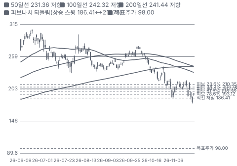

**주봉**

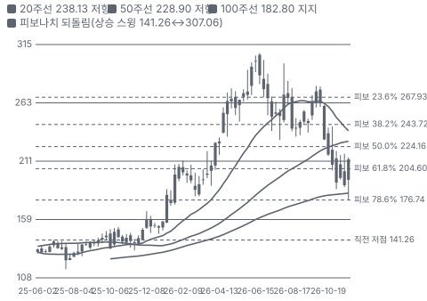

**월봉**

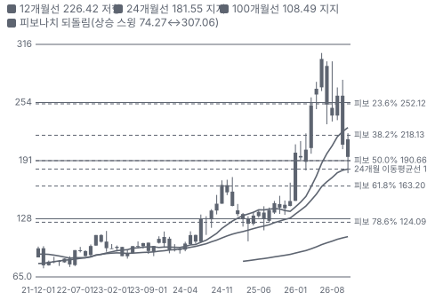

**분기 매출·EPS 실적과 컨센서스**

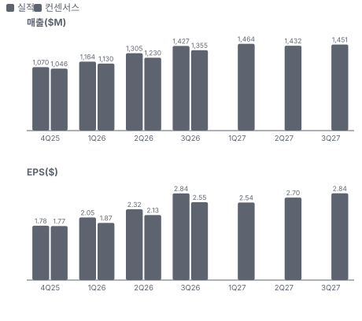

**4Q26 매출 — 지표 추세 vs 가이던스·컨센서스**

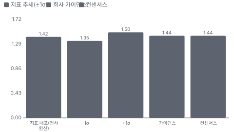

**최근 4개 분기 주가 변화 분석**

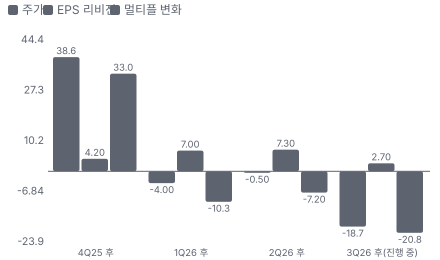

**EPS 리비전**

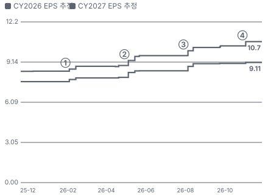

① 26-01-28 1Q FY26 실적 — A&D 수주 급증, 다음 날 +9.3% · EPS 리비전 +2%
② 26-04-29 2Q FY26 실적 — 매출 \$1.16B, 3Q 가이던스 상향 · EPS 리비전 +4%
③ 26-07-29 3Q FY26 실적 — 매출 \$1.30B, FY27 9~12% 초과 성장 제시 · EPS 리비전 +4%
④ 26-10-28 4Q FY26 실적 — FY27 10%대 중후반 성장, 1Q 이익률 하락 가이던스 · EPS 리비전 +3%

**멀티플 프리미엄(Fwd 1Y P/E, 최근 4개 분기말 절대값 — 대상 vs 동종 중앙값)**

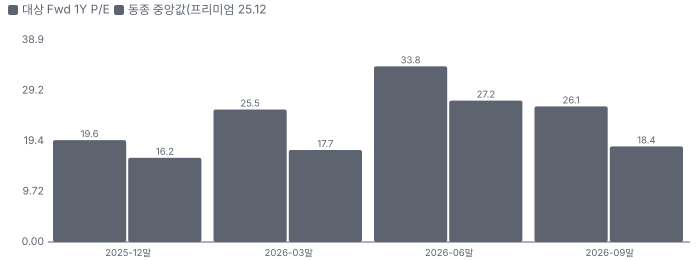

**합리적 멀티플**

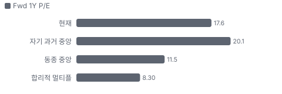

**밸류에이션 주가 시나리오**

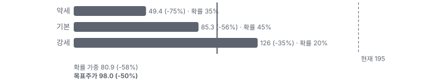

**주가별 업사이드**

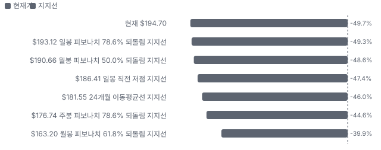
- 제품·서비스 포트폴리오

**고객 믹스(FY2026, 매출 대비)**

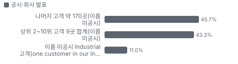

**공급 병목(10점, 낮을수록 병목)**

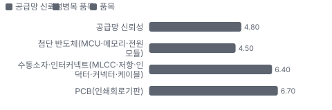

**생산능력 현재와 확충 계획(sq ft(가동 면적))**

**CAPEX의 매출 대비 비중**

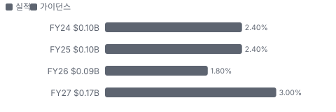

**어닝콜 변화별 주주가치 영향**

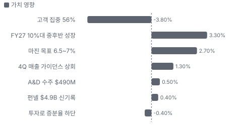

**수주·파이프라인 확실성 사다리**

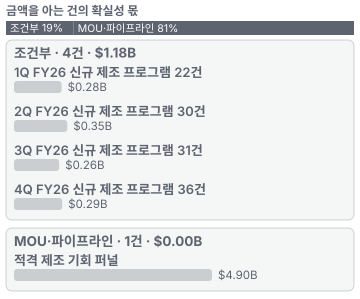

**매출 → 매출총이익 → 영업이익(매출 = 100, 최근 4분기)**

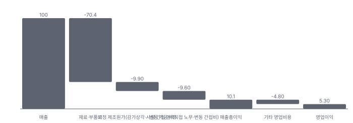

**분기 비용 비중 추이(매출 대비, 공시)**

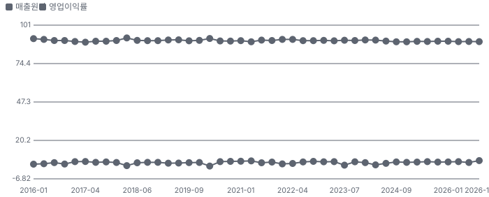

**비용 요인별 매출 대비 비중 1년 변화**

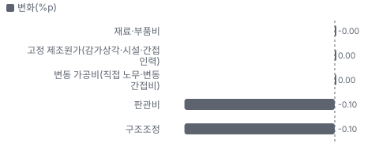

**산업 BOM 원가 몫**

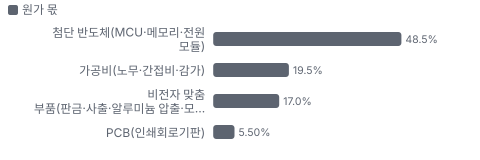

**헬스케어·생명과학 BOM 원가 몫**

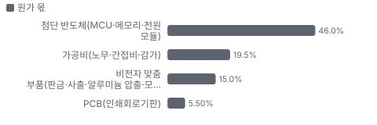

**항공우주·방산(A&D) BOM 원가 몫**

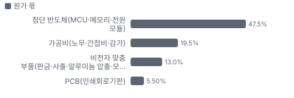

**BOM 항목 가격 +10% 시 OPM 변화**

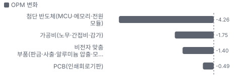

**재고 일수 — 분기별 — 재고 일수는 늘었지만 마진이 버틴다: 수요에 대비한 재고일 가능성(최근 재고 증가율 − 매출 증가율 +13.1%p)**

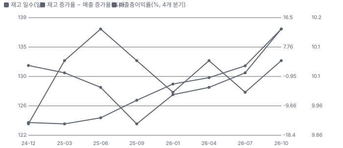

**자산 구성 — 4Q26 분기말 투하자본 \$1.48B**

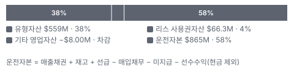

**자산별 변화율 — 최근 12개 분기(2Q20 = 0%) + 다음 4개 분기 추정**

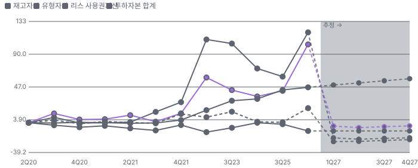

**ROIC 추이 — TTM, 최근 12개 분기 + 다음 4개 분기 추정(컨센서스 NOPAT)**

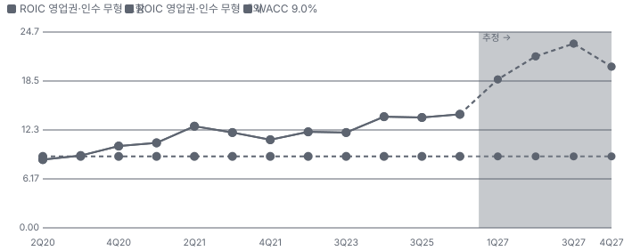

**생산시설별 면적(sq ft, 큰 순) — 생산능력 미공시라 면적을 대용으로**

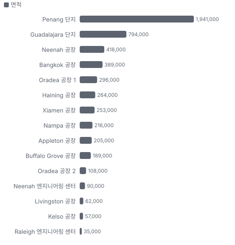

**매출 vs PPI·수출입 — 4Q22 = 100(변화율, 로그 눈금)**

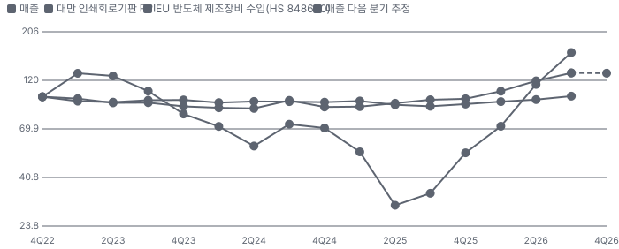

**10년 P·Q 사이클 — 추세(HP 필터) 대비 갭과 8분기 전망**

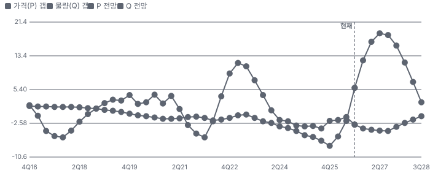

**매출 증가율의 가격·물량 분해와 8분기 전망(전년 대비)**

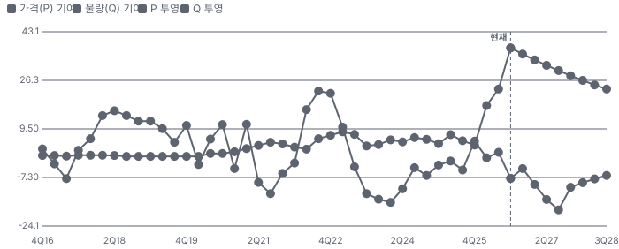

**목표주가 산정 — 시나리오 수정 가중평균(강세 확률 20%→43%), 도달 확률 약 32%**

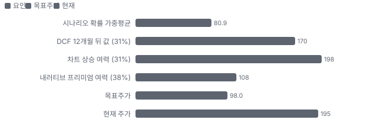

**PEG — 성장 대비 멀티플(낮을수록 성장 대비 쌈)**

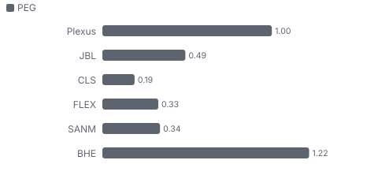

**일별 거래량 분해**

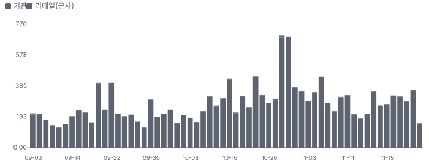

**기관 자금 흐름**

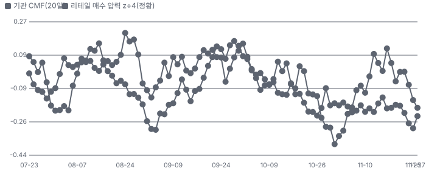

**몬테카를로**

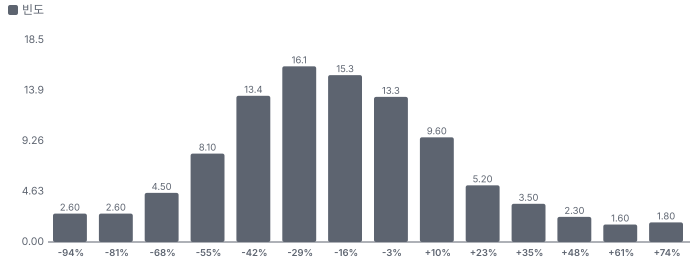

해석: 3,000번 중 809번(27%)에서 가치가 지금 주가 이상이었다. 가정을 흔들어도 지금 주가를 뒷받침하지 못하는 경우가 더 많다. 가운데 값은 0.79배이고, 열 번 중 여덟 번은 0.39~1.26배 사이에 든다.

## 내러티브

> **기업가치를 결정하는 이야기:** 위탁 생산이라 이익률은 6%대로 낮지만, 규제 시장의 인증 비용 때문에 고객이 잘 옮기지 않아 프로그램이 5~10년 간다. 기업가치는 매출 성장 × 조정 영업이익률 6.5~7% 도달 × 운전자본 효율로 정해진다

> **멀티플·EPS 프리미엄**
> **멀티플:** Fwd 1Y P/E 17.6배 — 동종 EMS 5사 중앙값 11.5배의 1.5배
> **EPS:** FY2027 EPS 추정 2월 \$8.45 → 11월 \$10.33(+22%)

### 투자자들은 왜 열광했나

1월 실적에서 방산 수주가 급증하고, 4월부터 반도체 장비 하위 조립이 +50%로 크면서 배수가 20배에서 34배까지 올랐다(6월). 10월 실적에서 1Q 이익률이 4Q보다 낮게 나오자 성장은 이어져도 이익률 확장이 늦어진다고 읽혀 식었다

### 무엇이 기업가치를 바꾸나

> **구조적 체질 변화**
> **변화:** FY2026 조정 영업이익률 6.2%로 오랜 목표 6%를 넘었고, 새 목표를 6.5~7%로 올렸다. 인당 매출이 2년 새 크게 늘었다(회사 설명)
> **증거:** 4Q FY26 어닝콜(2026-10-28)
> **반증:** 조정 영업이익률이 6% 아래로 돌아간다

> **고부가 믹스 확장**
> **변화:** 반도체 장비·A&D처럼 공정이 어려운 하위 조립 비중이 커진다. 산업 부문이 매출의 44%(FY2025 42%)가 됐다(계산)
> **증거:** 분기 시장 부문 매출(10-Q·10-K)
> **반증:** 산업·A&D 합산 비중이 55% 아래로 내려간다

> **기술 혁신**
> **변화:** 해당 없음(자체 제품 기술보다 공정·자동화 역량 — 저액 구매 주문 접수를 AI 에이전트가 처리하는 정도가 회사가 밝힌 변화다)
> **증거:** 4Q FY26 어닝콜(2026-10-28)
> **반증:** 판관비율이 오른다

> **실행 속도**
> **변화:** 해당 없음(신제품 도입부터 양산 램프까지 기간을 회사가 공시하지 않는다 — 수주는 완전 램프 시 연환산 매출로 잡히고 램프에 통상 1~2년이 걸린다는 것이 업계 설명이다(추정)) **납품 리드타임 미확인.** 피어 비교 미확인. 이전 대비 미확인.
> **증거:** 4Q FY26 어닝콜(2026-10-28)
> **반증:** 신규 수주 대비 매출 전환이 2개 분기 늦어진다

> **M&A**
> **변화:** 해당 없음(최근 3년 인수 없음 — FY2026 현금흐름표에 인수 지출이 없다. 경영진도 이번 콜에서 인수를 언급하지 않았다)
> **증거:** FY2026 10-K(2026-11-19)
> **반증:** 대형 인수 발표

> **정책·입법 연관성**
> **재정정책:** 해당 없음(보조금·세액공제를 받지 않는다 — FY2026 10-K에 정부 지원 수령 공시 없음. 국방 예산은 회사가 프로그램별 금액을 공시하지 않아 연결하지 않는다) FY2026 10-K(2026-11-19)
> **행정명령:** 해당 없음(회사에 직접 닿는 행정명령을 1차 자료로 확인하지 못했다 — 관세는 콜에서 언급되지 않았다) 4Q FY26 어닝콜(2026-10-28)
> **연관입법:** 해당 없음(연결되는 법안을 확인하지 못했다) FY2026 10-K(2026-11-19)

> **고객의 지출 예산**
> **변화:** 산업 부문 매출은 반도체 장비·계측 고객의 설비투자에서, 헬스케어는 의료기기 회사의 제품 원가에서, A&D는 국방 조달 예산에서 나온다
> **사업별 예산:** **매출의 44%**: 산업(반도체 장비·계측·에너지) — 고객 CAPEX(반도체 장비 회사가 고객 팹 설비투자에 맞춰 사는 하위 조립품) · 동인: WFE·AI 반도체 증설
**매출의 39%**: 헬스케어·생명과학 — 고객 OPEX(의료기기 회사의 제품 원가(매출원가)) · 동인: 수술 로봇·진단 장비 판매량
**매출의 17%**: 항공우주·방산 — 고객 CAPEX(정부의 무기·위성 조달 예산과 항공기 제조사의 부품 원가) · 동인: NATO(북대서양조약기구)·미국 국방 지출, 상용 항공기 생산률
> **증거:** FY2026 시장 부문 매출(계산)
> **반증:** WFE 2027년 전망 하향

### 내러티브 근거

> 규제가 심한 저물량·고혼합 시장(의료기기·방산·반도체 장비)만 골라 위탁 생산하는 EMS가 1년 새 매출 +35%로 빨라졌다. 시장은 이것을 '반도체 장비 사이클 + 방산 수주'로 읽고, 4Q 실적 뒤 1Q 이익률 하락 가이던스에 배수를 깎았다. 동종 대비 멀티플 차이 +53% 중 회사 고유 몫은 +111%다. 단계는 확산, 쏠림은 낮음이다.

> **반도체 장비 하위 조립 성장** · 강화
> **논리:** 반도체 장비 고객이 하위 조립을 외부로 더 넘기고, Plexus가 점유율을 넓혀 WFE보다 빨리 큰다
> **숫자:** FY2026 반도체 장비 매출 +50%(4Q 콜), 4Q 산업 부문 매출 \$691.3M(+49.9% YoY, 계산)
> **반증:** 산업 부문 매출이 2개 분기 연속 전 분기보다 줄어든다
> **출처:** 4Q FY26 어닝콜(2026-10-28)

> **방산 수주 급증** · 강화
> **논리:** 유럽·미국 국방 지출 증가와 신기술(위성·드론 전자)로 A&D 수주가 3년치를 1년에 받았다
> **숫자:** FY2026 A&D 수주 약 \$490M(FY23~25 합보다 많다), FY2027 A&D 매출 20% 초과 성장 전망
> **반증:** A&D 분기 수주가 \$60M 아래로 내려간다
> **출처:** 4Q FY26 어닝콜(2026-10-28)

> **이익률 목표의 단계 상향** · 유지
> **논리:** 자동화·AI 업무 처리로 인당 매출이 늘어 조정 영업이익률 목표를 6%에서 6.5~7%로 올렸다
> **숫자:** FY2026 조정 영업이익률 6.2%, 4Q 6.7%, 새 목표 6.5~7%
> **반증:** FY2027 조정 영업이익률이 6.2% 아래
> **출처:** 4Q FY26 어닝콜(2026-10-28)

> **자본 효율(ROIC·현금 순환일(재고·매출채권에 묶였다가 현금으로 돌아오기까지 걸리는 날수))** · 유지
> **논리:** 고객 선수금으로 재고를 대고 현금 순환일을 줄여 고성장에도 ROIC 15%대를 지킨다
> **숫자:** 4Q ROIC 15.8%(자본비용 +680bp), 현금 순환일 62일 사상 최저
> **반증:** 현금 순환일이 70일 위로 오르거나 FY2027 FCF가 \$100M 아래
> **출처:** 4Q FY26 어닝콜(2026-10-28)

> **반대 내러티브 — 사이클 정점의 이익** · 강화
> **논리:** 반도체 장비와 고객 선주문이 겹친 국면이라 FY2028에 성장이 꺾이면 배수와 추정이 함께 내려간다
> **숫자:** 4Q 실적 다음 날 −9.6%, 1Q 이익률 가이던스 6.0~6.4%(4Q 6.7%), 상위 10개 고객 56%(FY2025 49%)
> **반증:** 1Q 실적이 가이던스 상단을 넘고 2Q 매출 가이던스가 1Q보다 높다
> **출처:** 4Q FY26 어닝콜(2026-10-28)

### 투자 포인트

> **이익 추정은 올랐고 배수가 깎였다**
> **명제:** 6월 고점 뒤 하락의 대부분이 배수 축소다
> **숫자:** 6월 22일 종가 \$303.82 → \$194.70(−36%), 같은 기간 FY2027 EPS 추정 \$9.38(5월 22일) → \$10.33. Fwd 1Y P/E 33.8배(6월 말) → 17.6배
> **시장과 다른 점:** 셀사이드 7명 전원이 매수라 시장이 못 봤다고 말할 자리가 아니다. 다른 점은 이익률이다 — 시장은 1Q 가이던스를 확장 정체로 읽었고 회사는 투자 때문이라고 했다
> **증명:** 1Q FY27 실적(2027년 1월 말 예상)의 조정 영업이익률과 2Q 가이던스
> **출처:** 8-K EX-99.1(2026-10-28) · 컨센서스 이력

> **반도체 장비가 산업 부문을 끈다**
> **명제:** 반도체 장비 하위 조립 매출이 FY2026에 50% 늘어 산업 부문이 매출의 44%가 됐다
> **숫자:** 4Q 산업 매출 \$691.3M(+49.9% YoY, 계산), FY2027 산업 20% 초과 성장 전망
> **시장과 다른 점:** 반도체 장비는 사이클이다 — 경영진도 1년 너머는 보지 못한다고 했다
> **증명:** 주요 장비 고객의 2027년 WFE 전망
> **출처:** 4Q FY26 어닝콜(2026-10-28)

> **방산 수주는 3년치를 1년에**
> **명제:** FY2026 A&D 수주가 약 \$490M으로 FY2023~2025 합보다 많다
> **숫자:** 4Q A&D 수주 \$90M(+67%), FY2027 A&D 20% 초과 성장 전망
> **시장과 다른 점:** 수주는 완전 램프 시 연환산 매출이라 실제 매출 전환은 1~2년에 걸친다(추정)
> **증명:** A&D 분기 매출이 \$250M을 넘는 시점
> **출처:** 4Q FY26 어닝콜(2026-10-28)

### 모멘텀 생성·소멸 타임라인

**카탈리스트 달력 — 지난 사건의 주가 반응과 앞으로 확인할 숫자**
| 날짜 | 상태 | 구분 | 사건 | 반응·확인 | 결과에 따라 |
|---|---|---|---|---|---|
| 2026-01-28 | 완료 | 생성 | 1Q FY26 실적 — A&D 수주 급증 | +9.3% |  |
| 2026-04-29 | 완료 | 확인 | 2Q FY26 실적 — 매출 \$1.16B, 3Q 가이던스 상향 | 보합(다음 날 +5.6%) |  |
| 2026-07-29 | 완료 | 확인 | 3Q FY26 실적 — FY27 9~12% 초과 성장 제시 | +0.6% |  |
| 2026-10-28 | 완료 | 소멸 | 4Q FY26 실적 — 가이던스 상회에도 1Q 이익률 가이던스 하락 | −9.6% |  |
| 2027-01 말(예상) | 예정 | 확인 | 1Q FY27 실적·2Q 가이던스 | 매출 \$1.41~1.46B 안, 조정 영업이익률 6.4% 이상, 2Q 가이던스가 1Q 실적 이상 | 모두 맞으면 기본~강세, 이익률이 6% 아래면 약세 쪽 |
| 2027-01~02(예상) | 예정 | 매크로 | 주요 반도체 장비 고객의 2027년 WFE 전망 | 2027년 WFE 성장 전망이 2026년보다 강한지 | 강하면 산업 부문 성장 지속, 약하면 약세 시나리오 |
| 2027-04 말(예상) | 예정 | 확인 | 2Q FY27 실적 | A&D 분기 매출 \$250M 이상, FCF 흑자 전환 | 수주가 매출로 바뀌는 속도 확인 |

### 언제 사서 언제 팔아야 할까?

**가격·조건 틀 — 가격은 밸류에이션(약세·기본·강세·목표주가)과 차트 지지 구간에서, 조건은 이벤트에서**
| 구간 | 가격 | 목표주가까지 | 약세까지 | 조건·근거 |
|---|---|---|---|---|
| 관찰 구간 | \$193~\$193 | -49% | -74% | 11월 25일 장중 \$177.14가 실적 뒤 저점이고 1월 말 실적 갭 전 가격대(\$175~181)와 겹친다 |
| 확인 뒤 | 지금 \$195 이상에서 조건 확인 | -50% | -75% | 1Q 실적에서 조정 영업이익률 6.4% 이상, 2Q 매출 가이던스가 1Q 실적 이상 |
| 무효화 | 약세 시나리오 \$49 | - | -75% | 산업 부문 매출이 2개 분기 연속 줄거나 조정 영업이익률이 6% 아래로 내려간다 |

실적 다음 날 ±10% 움직임이 두 번 있었다(1/29 +9.3%, 10/29 −9.6%) — 하루 움직임으로 판단을 바꾸지 않는다 가격·조건 틀이며 매매·비중 지시가 아니다(투자 권유 아님).

## 포트폴리오

| 제품·서비스 | 구분 | 무엇 | 쓰는 곳 | 돈 버는 방식 | Mix | Mix 변화(전 분기 대비) |
|---|---|---|---|---|---|---|
| 산업 | 서비스 | 반도체 장비 하위 조립품·계측기·로봇·에너지 저장 장치의 전자 조립과 시험 | 반도체 장비 회사, 산업용 계측·로보틱스, 에너지 | FY2026 매출 \$2.19B(44%, +27%), 4Q +50% YoY | 48% | +3.3%p |
| 헬스케어·생명과학 | 서비스 | 수술 로봇·진단·영상 장비 같은 의료기기의 설계 지원과 규제 인증 양산 | 의료기기·생명과학 장비 회사 | FY2026 매출 \$1.93B(39%, +19%) | 36% | -1.1%p |
| 항공우주·방산(A&D) | 서비스 | 항공기 전자장비·위성·방산 통신 장비의 전자 조립과 시험 | 방산 원청·항공기 제조사·위성 회사 | FY2026 매출 \$847M(17%, +23%), FY2026 수주 약 \$490M | 16% | -2.2%p |

**Mix 변화가 가장 큰 쪽은 산업(+3.3%p, 전 분기 대비).** 계절성 판정: 분기 매출 계절 지수 기준 없음 → 직전 분기와 비교.

## 고객

> **FY2026 최대 고객 나머지 고객 약 170곳(이름 미공시) 46%, 상위 3곳 100%, 집중도 집중.** 공시·회사 발표로 확인한 몫은 매출의 100%이고, 나머지 고객 몫은 추정이거나 미분해다. 약 180곳에 판다. 매출 10%를 넘는 고객은 Industrial 부문의 1곳(약 11%)뿐이고 이름은 공시되지 않는다 — FY2025·FY2024에는 10% 넘는 고객이 없었다. 상위 10곳 몫은 49.1% → 54.3%로 높아졌고 4분기엔 56%였다

**고객별 매출 몫(FY2026)**
| 고객 | 몫 | 변화 | 근거 |
|---|---|---|---|
| 나머지 고객 약 170곳(이름 미공시) | 46% | -5%p | 공시 |
| 상위 2~10위 고객 9곳 합계(이름 미공시) | 43% | 미확인 | 공시 |
| 이름 미공시 Industrial 고객(one customer in our Industrial market sector(10-K Note 11)) | 11% | 미확인 | 공시 |

> **나머지 고객 약 170곳(이름 미공시)** · 공시
> **사는 것:** 세 부문 전반

> **상위 2~10위 고객 9곳 합계(이름 미공시)** · 공시
> **사는 것:** 세 부문 전반
> **추정 근거:** FY2025 상위 10곳 49.1% 안의 1위 몫은 미공시라 직전 값은 나누지 못한다

> **이름 미공시 Industrial 고객(one customer in our Industrial market sector(10-K Note 11))** · 공시
> **사는 것:** 미확인 — Industrial 부문(자동화·로봇·전력·반도체 장비) 제품, APAC(아시아·태평양 생산 지역)·AMER(미주 생산 지역) 두 지역에서 생산
> **추정 근거:** FY2025에는 10% 미만이었다(정확한 몫 미공시). 어느 회사인지는 공시 근거가 없어 매핑하지 않는다

## 수주·파이프라인

> **2026-10-03 기준 5건.** 건별 확정 금액은 공개되지 않았다. 서로 겹치는 항목은 합계에서 뺐다.

**수주 목록**
| 상태 | 계약 | 계약 총액 | 진척 | 기간 | 비고 |
|---|---|---|---|---|---|
| 조건부 | 1Q FY26 신규 제조 프로그램 22건 | \$0.28B | - | - | 연 매출 환산치이지 계약 금액이 아니다 |
| 조건부 | 2Q FY26 신규 제조 프로그램 30건 | \$0.35B | - | - | 연 매출 환산치이지 계약 금액이 아니다 |
| 조건부 | 3Q FY26 신규 제조 프로그램 31건 | \$0.26B | - | - | 연 매출 환산치이지 계약 금액이 아니다 |
| 조건부 | 4Q FY26 신규 제조 프로그램 36건 | \$0.29B | - | - | 연 매출 환산치이지 계약 금액이 아니다 |
| 파이프라인 | 적격 제조 기회 퍼널 | \$4.90B | - | - | 수주가 아니다 — 영업 기회의 합 (다른 항목과 겹칠 수 있어 합계에서 뺌) |

**실행 속도와 방해 요인**
| 항목 | 상태 | 실행 속도 | 방해 요인 |
|---|---|---|---|
| 1Q FY26 신규 제조 프로그램 22건 | 조건부 | 완전 램프 시 연 매출 기준 — 램프 기간 미공시 | 고객 발주서(최소 물량 약정 없음) · 고객 제품 출시·인증 일정 |
| 2Q FY26 신규 제조 프로그램 30건 | 조건부 | 완전 램프 시 연 매출 기준 — 램프 기간 미공시 | 고객 발주서(최소 물량 약정 없음) · 고객 제품 출시·인증 일정 |
| 3Q FY26 신규 제조 프로그램 31건 | 조건부 | 완전 램프 시 연 매출 기준 — 램프 기간 미공시 | 고객 발주서(최소 물량 약정 없음) · 고객 제품 출시·인증 일정 |
| 4Q FY26 신규 제조 프로그램 36건 | 조건부 | 완전 램프 시 연 매출 기준 — 램프 기간 미공시 | 고객 발주서(최소 물량 약정 없음) · 고객 제품 출시·인증 일정 |
| 적격 제조 기회 퍼널 | 파이프라인 | 1년 새 +\$1.2B(+33%) | 수주 전환율 미공시 |

## 마진 구조

> **GPM 10.1%, OPM 5.3%.** FY25 대비 GPM +0.0%p, OPM +0.3%p. 변동비는 매출의 81%이고, 매출이 10% 늘면 OPM은 +1.2%p 움직인다. 매출총이익률은 FY2025·FY2026 모두 10.1%로 같다. 매출이 23% 늘었지만 고정비 증가와 고객 믹스 변화가 상쇄했다. 영업이익률은 5.0% → 5.3%로, 판관비가 매출보다 덜 늘어(+19.8%) 올랐다 — 판관비 증가의 상당 부분은 임원 은퇴에 따른 주식보상 가속 \$14.0M이다. 매출원가의 약 89%가 변동비이고 그 88%가 재료비라 재료비가 매출의 약 70%다

> **매출 100 중 매출원가 89.9, 매출총이익 10.1(최근 4분기, 공시).** 매출원가 요인 중 재료·부품비이 매출의 70.4%로 가장 무겁고, 단가가 +10% 오르면 GPM이 -7.04%p 움직인다. 분기 회귀로 매출 1이 늘 때 매출원가는 0.89 늘고, 매출원가의 고정비 몫은 1%다.

**비용 요인 강도 — 비중·추세·충격(+10%)·탄력**
| 비용 | 구분 | 매출 대비 | 1년 변화 | 마진 기여 | 충격 시 마진 | 매출 탄력 | 고정비 몫 |
|---|---|---|---|---|---|---|---|
| 재료·부품비 | 매출원가 요인 | 70.4% | -0.0%p | +0.0%p | -7.04%p | 미확인 | 0% |
| 고정 제조원가(감가상각·시설·간접 인력) | 매출원가 요인 | 9.9% | +0.0%p | -0.0%p | -0.99%p | 미확인 | 100% |
| 변동 가공비(직접 노무·변동 간접비) | 매출원가 요인 | 9.6% | +0.0%p | -0.0%p | -0.96%p | 미확인 | 0% |
| 매출원가 | 공시 항목 | 89.9% | -0.0%p | +0.0%p | -8.99%p | 0.89 | 1% |
| 기타 영업비용 | 공시 항목 | 4.8% | -0.3%p | +0.3%p | 미확인 | 0.05 | 7% |

매출 탄력 = 분기 비용을 매출에 회귀한 기울기(매출 1당 변동비), 고정비 몫 = 절편 ÷ 평균 비용. 표본이 8분기 미만이면 미확인. 매출원가 요인 비중은 margin 재료의 추정이 섞여 있고, 공시 매출원가와의 차이는 '기타 매출원가'로 둔다.

**GPM에서 OPM까지(GAAP — 10-K 연간 손익, 아래는 최근 4개 분기)**
| 기간 | GPM | 연구개발 | 판관비 | 기타 | OPM |
|---|---|---|---|---|---|
| FY25 | 10.1% | 0.0% | 4.9% | 0.1% | 5.0% |
| FY26 | 10.1% | 0.0% | 4.8% | 0.0% | 5.3% |
| 2026-01 | 9.9% | - | - | - | 5.1% |
| 2026-04 | 10.2% | - | - | - | 5.3% |
| 2026-07 | 10.1% | - | - | - | 4.7% |
| 2026-10 | 10.2% | - | - | - | 6.0% |

**비용을 움직이는 요인**
| 비용 | 요인 |
|---|---|
| 재료·부품비(매출원가) | 부품 단가, 턴키 비중, 고객 믹스 · 근거 공시 |
| 고정 제조원가(감가상각·시설·간접 인력, 매출원가) | 신규 프로그램 램프용 설비·인력, 가동률. 감가상각 전체 \$77.0M(매출의 1.6%) · 근거 공시 |
| 변동 가공비(직접 노무·변동 간접비, 매출원가) | 생산량, 아시아·멕시코 임금, 임시 인력 · 근거 공시 |
| 판관비(판관비) | 주식보상(\$45.8M, 은퇴 가속 \$14.0M 포함), 성과급 · 근거 공시 |
| 구조조정(기타) | 인력 감축 · 근거 공시 |

**산업 BOM — 매출의 44%, GPM 10%(부문별 이익률 미공시 — 회사는 비용을 시장 부문별로 추적하지 않는다(10-K Item 1). 회사 매출총이익률 10.1%를 씀), 항목 가격 +10% 시**
| 항목 | 원가 몫 | 전가 | 제품 GPM | OPM |
|---|---|---|---|---|
| 첨단 반도체(MCU·메모리·전원 모듈) | 42~55% | 미확인 | -4.4%p | -1.92%p |
| 가공비(노무·간접비·감가) | 17~22% | 미확인 | -1.8%p | -0.77%p |
| 비전자 맞춤 부품(판금·사출·알루미늄 압출·모터·비전 센서) | 12~22% | 미확인 | -1.5%p | -0.67%p |
| PCB(인쇄회로기판) | 3~8% | 미확인 | -0.5%p | -0.22%p |
| 미분해 | 9% | - | - | - |

**헬스케어·생명과학 BOM — 매출의 39%, GPM 10%(부문별 이익률 미공시 — 회사는 비용을 시장 부문별로 추적하지 않는다(10-K Item 1). 회사 매출총이익률 10.1%를 씀), 항목 가격 +10% 시**
| 항목 | 원가 몫 | 전가 | 제품 GPM | OPM |
|---|---|---|---|---|
| 첨단 반도체(MCU·메모리·전원 모듈) | 40~52% | 미확인 | -4.1%p | -1.61%p |
| 가공비(노무·간접비·감가) | 17~22% | 미확인 | -1.8%p | -0.68%p |
| 비전자 맞춤 부품(판금·사출·알루미늄 압출·모터·비전 센서) | 10~20% | 미확인 | -1.3%p | -0.52%p |
| PCB(인쇄회로기판) | 3~8% | 미확인 | -0.5%p | -0.19%p |
| 미분해 | 14% | - | - | - |

**항공우주·방산(A&D) BOM — 매출의 17%, GPM 10%(부문별 이익률 미공시 — 회사는 비용을 시장 부문별로 추적하지 않는다(10-K Item 1). 회사 매출총이익률 10.1%를 씀), 항목 가격 +10% 시**
| 항목 | 원가 몫 | 전가 | 제품 GPM | OPM |
|---|---|---|---|---|
| 첨단 반도체(MCU·메모리·전원 모듈) | 40~55% | 미확인 | -4.3%p | -0.73%p |
| 가공비(노무·간접비·감가) | 17~22% | 미확인 | -1.8%p | -0.30%p |
| 비전자 맞춤 부품(판금·사출·알루미늄 압출·모터·비전 센서) | 8~18% | 미확인 | -1.2%p | -0.20%p |
| PCB(인쇄회로기판) | 3~8% | 미확인 | -0.5%p | -0.08%p |
| 미분해 | 14% | - | - | - |

첨단 반도체(MCU·메모리·전원 모듈) 가격이 +10% 오르면 영업이익은 -80.1% 움직인다. 판매가 전가를 모르는 항목은 전가 0%로 계산했다.

**BOM 항목 가격을 움직이는 것**
| 항목 | 요인 |
|---|---|
| 첨단 반도체(MCU·메모리·전원 모듈) | 수동소자·인터커넥트 몫을 포함한 전자 부품 전체 범위다(분리 공시 없음). 많은 고객이 분기 등 주기적 재가격을 허용하지만 그 사이 가격 상승은 회사 부담이고 회수분은 이익률을 희석한다(10-K) · 근거 추정 |
| PCB(인쇄회로기판) | 주요 원재료로 명시(10-K). 몫은 업종 통상 범위 추정 · 근거 추정 |
| 비전자 맞춤 부품(판금·사출·알루미늄 압출·모터·비전 센서) | 시스템 조립 비중이 높을수록 커진다 · 근거 추정 |
| 가공비(노무·간접비·감가) | 인건비 상승은 견적 갱신 때 반영된다 — 반영 시차 미공시 · 근거 추정 |

**투입 물가 — 미국 PPI 3·6·12개월(2026-10, 개정 반영)과 해외 전년비**
| 항목 | 미국 3개월 | 6개월 | 12개월 | 전가 못 할 때 OPM | 일본 | 한국 | 대만 |
|---|---|---|---|---|---|---|---|
| 첨단 반도체(MCU·메모리·전원 모듈) | -0.7% | -5.7% | -2.7% | - | +1.6% | +1.5% | +22.9%* |
| PCB(인쇄회로기판) | +0.0% | +24.0% | +46.4% | - | +11.5% | +1.7% | +12.1% |
| 비전자 맞춤 부품(판금·사출·알루미늄 압출·모터·비전 센서) | -3.8% | +1.1% | +23.3%* | - | 미확인 | 미확인 | 미확인 |

별표는 품목보다 넓은 업종 지수다. 연결한 투입 원가의 미국 PPI(생산자물가지수)는 1년 새 가중 -2.7%이고, 판매가로 넘기지 못하면 GPM +1.9%p·OPM +1.9%p가 움직인다. 물가 지수를 붙이지 못한 매출원가 항목은 변동 가공비(직접 노무·변동 간접비), 고정 제조원가(감가상각·시설·간접 인력)다(미연결).

## 자산 구성

> **4Q26 분기말 투하자본 \$1.48B** — 운전자본 58%, 유형자산 38%. 최근 12개 분기(2Q20 → 4Q26) 가장 크게 늘어난 자산은 재고자산(+119%), 투하자본 합계 +19%. 4Q27 추정 투하자본 \$967.5M(-35%, 컨센서스 매출과 회전 일수·CAPEX 강도 유지 가정). 연율 감가 비율(총액 기준)은 직전 4분기 11.68% → 최근 4분기 6.73%, 직전 비율이면 감가상각이 \$56.5M 더 컸다(영업이익의 22.9%).

**자산·운전자본 항목별 분기말 잔액 — 최근 12개 분기와 다음 4개 분기 추정**
| 항목 | 2Q20 | 4Q22 | 4Q26(최근) | 4Q27 추정 | 12개 분기 변화 | 다음 4개 분기 변화 |
|---|---|---|---|---|---|---|
| 매출채권 | \$462.8M | \$737.7M | \$939.0M | \$443.4M | +103% | -53% |
| 재고자산 | \$765.8M | \$1,602.8M | \$1,674.6M | \$614.2M | +119% | -63% |
| 선급·기타 유동자산 | \$27.5M | \$61.6M | \$74.0M | \$36.7M | +169% | -50% |
| 매입채무 | \$483.4M | \$805.6M | \$1,132.4M | \$323.4M | +134% | -71% |
| 선수수익(계약부채) | 미확인 | \$779.3M | \$690.6M | \$464.1M | 비교 불가 | -33% |
| 유형자산 | \$381.7M | \$444.7M | \$559.2M | \$602.2M | +47% | +8% |
| 리스 사용권자산 | \$74.4M | \$65.1M | \$66.3M | \$66.3M | -11% | +0% |

**자산 추정 동인 — 최근 4개 분기 평균(재무상태표 동인 모형)**
| 동인 | 값 | 곱하는 기준 |
|---|---|---|
| 매출채권 | 28일 | 매출 |
| 재고자산 | 129일 | 매출원가 |
| 선급·기타 유동자산 | 2일 | 매출 |
| 매입채무 | 68일 | 매출원가 |
| 선수수익(계약부채) | 29일 | 매출 |
| CAPEX 강도 | 0.7% | 매출(최근 4개 분기 합) |
| 분기 감가율 | 3.82% | 기초 유형자산 순액(무형 상각 제외 감가상각) |
| 매출원가율 | 29.5% | 매출(최근 4개 분기) |
| 영업권·리스 사용권·기타 | 유지 | 인수·새 리스는 공시 전 모름 |
| 인수 무형자산 | 분기 \$0.3M 상각 | 최근 4개 분기 평균 상각 |

**추정 방법:** 증권사 3표 모델(손익·재무상태표·현금흐름)의 재무상태표 동인 방식이다. 운전자본은 항목별 회전 일수(매출채권·선급·미지급·선수는 매출, 재고·매입채무는 매출원가 기준)를 최근 4개 분기 평균으로 두고 컨센서스 매출에 곱한다. 유형자산은 기초 + CAPEX − 감가상각으로 굴린다(Koller·Goedhart·Wessels 『Valuation』 재무상태표 추정). 매출 경로는 ROIC 절의 컨센서스와 같다.

**유형·무형자산 항목별 가치(2026-10-03 vs 2025-09-27)**
| 구분 | 항목 | 총액 2026-10-03 | 누적상각 | 순액 | 총액 2025-09-27 | 총액 1년 변화 | 공시 내용연수 |
|---|---|---|---|---|---|---|---|
| 유형 | 유형자산 합계(항목 미분해) | \$1,270.1M | 총계만 공시 | 총계만 공시 | \$1,226.7M | +3.5% | 미확인 |
| 유형 합계 | 유형자산 | \$1,270.1M | \$711.0M | \$559.2M | \$1,226.7M | +3.5% | 경과율 56%(상각 대상 기준) |

**내용연수 산식(상각 대상 유형자산 = 총액 − 토지 − 건설중)**
| 기준일 | 연 감가상각 | 상각 대상 총액 | 평균 내용연수 | 경과 연수 | 잔여 연수 | 경과율 |
|---|---|---|---|---|---|---|
| 2026-10-03 | \$77.0M | \$1,270.1M | 16.5년 | 9.2년 | 7.3년 | 56% |
| 2025-09-27 | \$76.8M | \$1,226.7M | 16.0년 | 8.9년 | 7.1년 | 55% |

산식 평균 내용연수는 16.5년. 1년 전 16.0년 → 지금 16.5년.

**분기 감가 비율(감가상각 ÷ 평균 유형자산 총액)**
| 분기 | 감가상각 | 평균 유형자산(총액) | 분기 비율 | 연율 | 연율의 역수 |
|---|---|---|---|---|---|
| 2Q21 | \$15.8M | \$380.3M | 4.16% | 16.65% | 6.0년 |
| 3Q21 | \$15.1M | \$379.8M | 3.98% | 15.92% | 6.3년 |
| 4Q21 | \$15.2M | \$387.8M | 3.93% | 15.71% | 6.4년 |
| 4Q22 | \$15.8M | \$976.9M | 1.62% | 6.49% | 15.4년 |
| 3Q23 | \$18.4M | \$1,038.0M | 1.77% | 7.09% | 14.1년 |
| 3Q24 | \$19.6M | \$1,105.2M | 1.77% | 7.09% | 14.1년 |
| 3Q25 | \$19.3M | \$1,180.9M | 1.63% | 6.53% | 15.3년 |
| 4Q26 | \$19.7M | \$1,248.4M | 1.58% | 6.30% | 15.9년 |

감가상각 기준: 손익계산서 감가상각·상각비(SEC 공시 데이터, 4분기 = 연간 − 1~3분기).

**감가율 하락 경고: 연율 11.68% → 6.73%(-42%).** 직전 4분기 비율을 그대로 쓰면 최근 4분기 감가상각이 \$56.5M 더 컸다(영업이익의 22.9%). 내용연수 연장·상각 끝난 자산 증가·건설중 자산 증가(믹스) 중 무엇인지는 공시 주석으로 가린다(자체추론).

미공시·미분해: 영업권 · 무형자산 · 유형자산 항목별 총액·내용연수(10-K 주석에서 모델이 채움) · 무형자산 항목(10-K 주석에서 모델이 채움) — 이 칸은 비우고 나머지로 계산했다.

### 해석 — 자산이 어디에 쌓이고 있나

- 같은 기간 4개 분기 매출은 +300%. 자산이 매출보다 빨리 쌓이지 않았다 — 회전율이 유지된다.
- 다음 4개 분기 CAPEX \$42.6M vs 감가상각 \$87.9M(최근 4개 분기 CAPEX 강도·감가율 유지) — 유형자산 4Q26 \$559.2M → 4Q27 \$602.2M. 투자가 감가보다 작아 자산이 줄어드는 국면이다.
- 감가 비율 하락으로 최근 4분기 영업이익에 \$56.5M(22.9%)가 보태졌을 수 있다 — 내용연수 변경 공시가 없으면 건설중 자산·토지 같은 비상각 자산 몫이 커진 믹스 효과일 가능성이 크다(자체추론).

## ROIC

> **TTM 4Q26 ROIC는 영업권·인수 무형 포함 14.3%, 제외 14.3%**(NOPAT 마진 1.5% × 투하자본 회전율 9.87회). 최근 12개 분기 2Q20 8.6% → 4Q26 14.3%(고점 4Q26 14.3%). 컨센서스 NOPAT으로 굴리면 4Q27 20.3%(제외 20.3%) — WACC 9.0% 대비 +11.3%p. 1년 변화의 가장 큰 요인은 NOPAT 마진(-13.8%p).

**ROIC 추이(TTM)와 다음 4개 분기 추정 — NOPAT ÷ 평균 투하자본(이번 분기말·4개 분기 전)**
| 분기 | 구분 | TTM 매출 | TTM NOPAT | NOPAT 마진 | 평균 투하자본 | ROIC 포함 | ROIC 제외 |
|---|---|---|---|---|---|---|---|
| 2Q20 | 실적 | \$3,358.8M | \$105.5M | 3.1% | \$1,232.8M | 8.6% | 8.6% |
| 3Q20 | 실적 | \$3,406.2M | \$114.8M | 3.4% | \$1,265.6M | 9.1% | 9.1% |
| 4Q20 | 실적 | \$3,501.8M | \$125.9M | 3.6% | \$1,220.6M | 10.3% | 10.3% |
| 1Q21 | 실적 | \$3,470.3M | \$132.4M | 3.8% | \$1,236.0M | 10.7% | 10.7% |
| 2Q21 | 실적 | \$3,580.9M | \$159.4M | 4.5% | \$1,245.1M | 12.8% | 12.8% |
| 3Q21 | 실적 | \$3,543.1M | \$151.7M | 4.3% | \$1,260.0M | 12.0% | 12.0% |
| 4Q21 | 실적 | \$3,480.7M | \$145.2M | 4.2% | \$1,307.0M | 11.1% | 11.1% |
| 4Q22 | 실적 | \$3,777.0M | \$157.7M | 4.2% | \$1,298.7M | 12.1% | 12.1% |
| 3Q23 | 실적 | \$3,814.7M | \$159.8M | 4.2% | \$1,335.1M | 12.0% | 12.0% |
| 3Q24 | 실적 | \$6,930.3M | \$174.0M | 2.5% | \$1,246.1M | 14.0% | 14.0% |
| 3Q25 | 실적 | \$10,086.4M | \$182.6M | 1.8% | \$1,318.5M | 13.9% | 13.9% |
| 4Q26 | 실적 | \$13,893.9M | \$201.9M | 1.5% | \$1,407.9M | 14.3% | 14.3% |
| 1Q27 | 추정 | \$14,412.9M | \$220.7M | 1.5% | \$1,179.5M | 18.7% | 18.7% |
| 2Q27 | 추정 | \$11,886.7M | \$237.7M | 2.0% | \$1,098.9M | 21.6% | 21.6% |
| 3Q27 | 추정 | \$9,308.1M | \$256.1M | 2.8% | \$1,101.8M | 23.2% | 23.2% |
| 4Q27 | 추정 | \$5,812.8M | \$248.2M | 4.3% | \$1,224.8M | 20.3% | 20.3% |

**다음 4개 분기 NOPAT — 컨센서스(세율 19%, 리스 이자 별도)**
| 분기 | 매출 | EBITA 마진 | EBITA | NOPAT(분기) | 근거 |
|---|---|---|---|---|---|
| 1Q27 | \$1,463.6M | 5.3% | \$76.8M | \$62.2M | 컨센서스 매출 × EBIT 마진 FY2027(조정 − 주식보상 0.9%) |
| 2Q27 | \$1,431.7M | 5.3% | \$75.2M | \$60.9M | 컨센서스 매출 × EBIT 마진 FY2027(조정 − 주식보상 0.9%) |
| 3Q27 | \$1,451.4M | 5.3% | \$76.2M | \$61.7M | 컨센서스 매출 × EBIT 마진 FY2027(조정 − 주식보상 0.9%) |
| 4Q27 | \$1,466.1M | 5.3% | \$77.0M | \$62.3M | 컨센서스 매출 × EBIT 마진 FY2027(조정 − 주식보상 0.9%) |

**추정 방법:** NOPAT은 컨센서스(분기 매출 추정 × 회계연도 EBIT 마진 추정)로 잡고, 조정(비 GAAP) 마진이면 주식보상 몫을 빼서 과거 실적과 같은 기준(영업이익 + 인수 무형 상각)으로 맞췄다. 이미 발표했지만 분기 보고서(10-Q)가 아직 없는 분기는 발표 실적을 쓴다. 투하자본은 자산 구성 절의 재무상태표 동인으로 굴렸다. ROIC는 4개 분기 NOPAT을 이번 분기말과 4개 분기 전 투하자본의 평균으로 나눈다 — 추정 분기의 ROIC에는 이미 나온 실적 분기가 섞여 있다.

**투하자본 항목별 회전율과 ROIC 기여(TTM 4Q26, 평균 잔액)**
| 항목 | 투하자본 | 매출 1달러당 자본 | 회전율(매출 ÷ 항목) | 자본 몫 | 이 항목을 빼면 ROIC |
|---|---|---|---|---|---|
| 운전자본 | \$840.9M | 0.06 | 16.52회 | 60% | 35.6% |
| 유형자산 | \$501.9M | 0.04 | 27.68회 | 36% | 22.3% |
| 리스 사용권자산 | \$65.7M | 0.00 | 211.38회 | 5% | 15.0% |
| 기타 영업자산 | −\$0.7M | -0.00 | 음수(자금 원천) | 0% | 14.3% |

**ROIC 세 가지 판**
| 판 | NOPAT | 투하자본 | ROIC | 무엇을 재나 |
|---|---|---|---|---|
| 영업권·인수 무형 포함 | \$201.9M | \$1,407.9M | 14.3% | 인수 웃돈까지 낸 돈에 대한 수익률 |
| 영업권·인수 무형 제외 | \$201.9M | \$1,407.9M | 14.3% | 본업 운영 수익률(동종 비교용) |
| 무형 자본화 조정(판관비 20%·5년, 연구개발 6년) | \$214.6M | \$1,531.2M | 14.0% | 비용으로 처리한 무형 투자를 자산으로 본 판 |
| 경제적 이익(포함판) | \$75.0M | \$1,407.9M | 자본비용 9.0% | (ROIC − 자본비용) × 투하자본 |

NOPAT = (영업이익 \$246.6M + 인수 무형 상각 + 리스 내재 이자 \$1.4M) × (1 − 세율 19%). 리스 사용권자산을 투하자본에 넣었으므로 임차료 속 이자 몫을 영업이익에 되더했다. 현금은 영업에 필요한 몫을 따로 알 수 없어 투하자본에서 뺐다. SEC 공시 데이터 자동 초안 — 운전자본 = 매출채권 + 재고 + 선급 − (매입채무 + 미지급비용 + 선수수익), 현금 제외. 손상 누계는 공시 데이터 수록분.

**ROIC 1년 변화 분해(포함판, TTM 4Q22 → TTM 4Q26)**
| 요인 | ROIC 기여 |
|---|---|
| NOPAT 마진 | -13.82%p |
| 운전자본 | +10.18%p |
| 유형자산 | +4.86%p |
| 리스 사용권자산 | +0.88%p |
| 기타 영업자산 | +0.16%p |
| 합계 | +2.27%p |

**무형 자본화 가정별 ROIC(2026년 지출 기준, 포함판에 더함)**
| 투자로 보는 몫 | 상각 연수 | 무형 자산 | NOPAT 조정 | 조정 ROIC |
|---|---|---|---|---|
| 판관비 20% | 2년 | \$67.7M | \$8.8M | 14.3% |
| 판관비 20% | 5년 | \$123.3M | \$12.7M | 14.0% |
| 판관비 30% | 2년 | \$101.6M | \$13.1M | 14.2% |
| 판관비 30% | 5년 | \$184.9M | \$19.1M | 13.9% |

### 해석 — 무엇이 수익성을 끌어올리고 희석하나

- 운전자본: 투하자본의 60% — 빼면 ROIC 14.3% → 35.6%. 이 자산의 회전율(16.52회)이 수익성을 희석하는 주된 자리다.
- 유형자산: 투하자본의 36% — 빼면 ROIC 14.3% → 22.3%. 이 자산의 회전율(27.68회)이 수익성을 희석하는 주된 자리다.
- 기타 영업자산: −\$0.7M(음수), 고객 선수금·공급사 외상이 자본을 대신 댄다 — 빼면 ROIC 14.3%로 낮아진다. 수익성을 끌어올리는 쪽이다.
- 영업권·인수 무형을 빼면 ROIC가 +0.0%p 오른다 — 과거 인수에 치른 웃돈이 주주 수익률을 그만큼 낮춘다(본업 수익률은 제외판, 인수까지 포함한 가치 창출은 포함판으로 본다).
- 1년 ROIC 개선의 최대 요인은 운전자본(+10.2%p). 반대로 깎은 최대 요인은 NOPAT 마진(-13.8%p).
- 비용으로 처리한 무형 투자를 자산으로 보면 ROIC가 -0.3%p 움직인다(무형 자산 \$123.3M). 투자를 늘리는 중이라 NOPAT이 더 커지는 쪽이다.
- 추정 경로 4Q26 14.3% → 4Q27 20.3%: NOPAT 마진 +2.8%p, 투하자본 회전율 -5.12회 — 컨센서스 매출·마진이 맞고 회전 일수·CAPEX 강도가 유지된다는 가정이다. 마진 추정이 내려가거나 재고 일수가 늘면 이 경로가 먼저 틀린다.
- ROIC(포함) − WACC = +5.3%p(4Q26) — 양수면 투하자본을 늘릴수록 가치가 쌓인다.

## 공급망 병목

> **공급망 신뢰성 4.8/10, 병목 주의.** 가장 약한 고리는 첨단 반도체(MCU·메모리·전원 모듈) 4.5점이고, 품목 평균은 5.3점이다. 근거가 부족한 2건(비전자 맞춤 부품(판금·사출·알루미늄 압출·모터·비전 센서) · 생산 거점(말레이시아 Penang))은 점수에서 뺐다. EMS(전자제품 위탁 생산)라 대부분 턴키로 부품을 직접 사서 조립한다. 10-K는 장기 공급 계약이 대체로 없고, 많은 부품을 소수 공급사에 의존하며 일부는 단일 공급원이라고 적는다. 공급사 이름·점유율·리드타임은 공시되지 않는다. 구매 약정은 \$1.21B → \$2.92B로 2.4배가 됐고 재고도 \$1.23B → \$1.67B로 늘었다 — 램프 대비 선구매다

**병목과 마진 — 품목 가격 +10% 시 OPM**
| 품목 | 점수 | 판정 | 구분 | OPM |
|---|---|---|---|---|
| 첨단 반도체(MCU·메모리·전원 모듈, 필수) | 4.5 | 병목 주의 | 핵심 통제 품목 | -4.26%p |
| 수동소자·인터커넥트(MLCC(적층 세라믹 콘덴서)·저항·인덕터·커넥터·케이블)(필수) | 6.4 | 관리 가능 | 일반 | 미확인 |
| PCB(인쇄회로기판, 필수) | 6.7 | 관리 가능 | 일반 | -0.49%p |

> **첨단 반도체(MCU·메모리·전원 모듈)** · 4.5/10
> **왜:** 제품별 맞춤 부품이 많아 한 부품이 늦으면 같은 프로그램의 다른 재고가 묶이고 출하가 밀린다(10-K 위험 요인) · 요인 값 일부는 업계 일반값 추정(회사 미공시)
> **병목 요인:** 인증 공급사 미확인 · 캐파 빠듯 · 리드타임 미확인 · 재인증 9개월 · 1위 점유율 미확인 · 아시아(대만·말레이시아·중국 후공정, 추정) 집중 75% · 물량 확보 현물
> **풀리는 조건:** 미확인 — 공급사 증설·리드타임 정상화 공시 없음

> **수동소자·인터커넥트(MLCC·저항·인덕터·커넥터·케이블)** · 6.4/10
> **왜:** 범용 품목이라 대체 공급원은 많지만 가격 변동은 분기 재가격 협상 전까지 회사가 떠안는다 · 요인 값 일부는 업계 일반값 추정(회사 미공시)
> **병목 요인:** 인증 공급사 미확인 · 캐파 균형 · 리드타임 미확인 · 재인증 6개월 · 1위 점유율 40% · 일본·한국·중국(추정) 집중 90% · 물량 확보 현물
> **풀리는 조건:** 해당 없음(병목 신호 미공시)

> **PCB(인쇄회로기판)** · 6.7/10
> **왜:** 설계마다 고유한 품목이라 공급사를 바꾸면 고객 재인증이 필요할 수 있다(의료·항공 규제 제품, 추정) · 요인 값 일부는 업계 일반값 추정(회사 미공시)
> **병목 요인:** 인증 공급사 미확인 · 캐파 균형 · 리드타임 미확인 · 재인증 6개월 · 1위 점유율 미확인 · 아시아(추정) 집중 85% · 물량 확보 복수구매
> **풀리는 조건:** 미확인

**공급사**
| 품목 | 공급사 | 몫 | 근거 |
|---|---|---|---|
| 첨단 반도체(MCU·메모리·전원 모듈) | 부품 제조사·공인 유통사(이름 미공시, 첨단 반도체·다이오드·전원 관리 모듈·마이크로컨트롤러·메모리 모듈) | 미확인 | 공시 |
| 수동소자·인터커넥트(MLCC·저항·인덕터·커넥터·케이블) | 부품 제조사·공인 유통사(이름 미공시, 인덕터·저항·커패시터·인터커넥트·전원 공급기·케이블) | 미확인 | 공시 |
| PCB(인쇄회로기판) | 기판 공급사(이름 미공시, 조립용 베어 기판) | 미확인 | 공시 |
| 비전자 맞춤 부품(판금·사출·알루미늄 압출·모터·비전 센서) | Plexus 선호 공급사·고객 지정 공급사(이름 미공시, 판금·사출·압출·다이캐스팅·로봇·모터·비전 센서·유체 부품·디스플레이) | 미확인 | 공시 |
| 생산 거점(말레이시아 Penang) | 자체 생산(Penang 단지, 소유, APAC 매출의 주력 생산지) | 100% | 공시 |

**무역 통계로 본 공급 지역**
| 품목 | EU 수입처 | 일본 수입처 | EU 1위 전년비 |
|---|---|---|---|
| 첨단 반도체(MCU·메모리·전원 모듈) | TW(대만) 31% · MY(말레이시아) 19% · CN(중국) 15% | 台湾 59% · アメリカ合衆国 8% | +120.6% |
| 수동소자·인터커넥트(MLCC·저항·인덕터·커넥터·케이블) | JP(일본) 45% · CN 25% · KR(한국) 13% | 中華人民共和国 45% · 大韓民国 23% | -0.8% |
| PCB(인쇄회로기판) | CN 85% · TW 4% · KR 4% | 中華人民共和国 61% · 台湾 12% | +32.0% |
| 비전자 맞춤 부품(판금·사출·알루미늄 압출·모터·비전 센서) | CN 52% · JP 25% · US 16% | 中華人民共和国 39% · タイ 16% | +86.5% |

## 생산능력

> **현재 명목 캐파 5,400,000 sq ft(가동 면적), 가동률 미확인.** FY26 CAPEX는 \$0.09B로 매출의 1.8%다. 회사는 생산능력을 가동 면적으로만 밝힌다 — 29개 가동 시설, 약 540만 sq ft(1년 전 26곳·500만 sq ft). 증가분 대부분은 Penang 단지(+41만 sq ft)다. 가동률은 공시하지 않는다. FY2027 설비투자 계획은 약 \$175M으로 FY2026 \$90.7M의 약 두 배다

**생산시설 29곳**(FY2026 10-K Item 1 — 가동 시설 29곳(제조 시설 20곳, ISO(국제표준화기구 품질 인증) 인증 문단). Item 2 표에는 16개 행만 이름이 나오고, 그중 Guadalajara·Buffalo Grove·Penang·Haining·Xiamen은 건물이 여러 동이다. 이름 없는 나머지는 개수에만 넣는다. 유형자산 국가별 표에 폴란드(\$14.3M)가 있으나 Item 2 표에는 없다) — 이름·위치를 밝힌 곳 16곳, 소유 9곳 · 임차 7곳. 시설별 생산능력은 공개되지 않았다 — 회사 전체 캐파만 위에 적었다.

**생산시설 29곳 — 명칭·위치·생산능력**
| 시설 | 위치 | 용도 | 생산능력 | 소유·상태 |
|---|---|---|---|---|
| Neenah 공장 | 미국 위스콘신 Neenah | 제조 | 미확인 — 시설별 생산능력 미공시 — 회사는 면적(sq ft)만 공시한다 · 면적 418,000 sq ft | 소유 · 가동 |
| Guadalajara 단지 | 멕시코 Guadalajara | 제조·엔지니어링 | 미확인 — 시설별 생산능력 미공시 — 회사는 면적(sq ft)만 공시한다 · 면적 794,000 sq ft | 임차 · 가동 |
| Nampa 공장 | 미국 아이다호 Nampa | 제조 | 미확인 — 시설별 생산능력 미공시 — 회사는 면적(sq ft)만 공시한다 · 면적 216,000 sq ft | 소유 · 가동 |
| Appleton 공장 | 미국 위스콘신 Appleton | 제조 | 미확인 — 시설별 생산능력 미공시 — 회사는 면적(sq ft)만 공시한다 · 면적 205,000 sq ft | 소유 · 가동 |
| Buffalo Grove 공장 | 미국 일리노이 Buffalo Grove | 제조 | 미확인 — 시설별 생산능력 미공시 — 회사는 면적(sq ft)만 공시한다 · 면적 189,000 sq ft | 임차 · 가동 |
| Neenah 본사 | 미국 위스콘신 Neenah | 본사 | 미확인 — 시설별 생산능력 미공시 — 회사는 면적(sq ft)만 공시한다 · 면적 104,000 sq ft | 소유 · 가동 |
| Neenah 엔지니어링 센터 | 미국 위스콘신 Neenah | 엔지니어링 | 미확인 — 시설별 생산능력 미공시 — 회사는 면적(sq ft)만 공시한다 · 면적 90,000 sq ft | 임차 · 가동 |
| Raleigh 엔지니어링 센터 | 미국 노스캐롤라이나 Raleigh | 엔지니어링 | 미확인 — 시설별 생산능력 미공시 — 회사는 면적(sq ft)만 공시한다 · 면적 35,000 sq ft | 소유 · 가동 |
| Penang 단지 | 말레이시아 Penang | 제조·엔지니어링 | 미확인 — 시설별 생산능력 미공시 — 회사는 면적(sq ft)만 공시한다 · 면적 1,941,000 sq ft | 소유 · 가동 |
| Bangkok 공장 | 태국 Bangkok | 제조 | 미확인 — 시설별 생산능력 미공시 — 회사는 면적(sq ft)만 공시한다 · 면적 389,000 sq ft | 소유 · 가동 |
| Haining 공장 | 중국 Haining | 제조 | 미확인 — 시설별 생산능력 미공시 — 회사는 면적(sq ft)만 공시한다 · 면적 264,000 sq ft | 임차 · 가동 |
| Xiamen 공장 | 중국 Xiamen | 제조 | 미확인 — 시설별 생산능력 미공시 — 회사는 면적(sq ft)만 공시한다 · 면적 253,000 sq ft | 임차 · 가동 |
| Oradea 공장 1 | 루마니아 Oradea | 제조·엔지니어링 | 미확인 — 시설별 생산능력 미공시 — 회사는 면적(sq ft)만 공시한다 · 면적 296,000 sq ft | 소유 · 가동 |
| Oradea 공장 2 | 루마니아 Oradea | 제조 | 미확인 — 시설별 생산능력 미공시 — 회사는 면적(sq ft)만 공시한다 · 면적 108,000 sq ft | 임차 · 가동 |
| Livingston 공장 | 영국 스코틀랜드 Livingston | 제조·엔지니어링 | 미확인 — 시설별 생산능력 미공시 — 회사는 면적(sq ft)만 공시한다 · 면적 62,000 sq ft | 임차 · 가동 |
| Kelso 공장 | 영국 스코틀랜드 Kelso | 제조 | 미확인 — 시설별 생산능력 미공시 — 회사는 면적(sq ft)만 공시한다 · 면적 57,000 sq ft | 소유 · 가동 |

공개된 증설 계획은 확인되지 않았다.

**CAPEX와 매출 대비**
| 기간 | CAPEX | 매출 | 매출 대비 | 구분 |
|---|---|---|---|---|
| FY24 | \$0.10B | \$3.96B | 2.4% | 실적 |
| FY25 | \$0.10B | \$4.03B | 2.4% | 실적 |
| FY26 | \$0.09B | \$4.96B | 1.8% | 실적 |
| FY27 | \$0.17B | \$5.81B | 3.0% | 가이던스 |

## 구루 교차 점검

> **여섯 관점 중 통과 3 · 미달 3 · 미확인 0.** 가장 약한 관점은 성장 여지 — FY2026 성장의 큰 몫이 반도체 장비 사이클과 방산 지출 증가 두 가지에서 왔다 — 둘 다 회사가 통제하지 못하는 고객 예산이다.

판정은 자체추론이고 숫자는 계산값이다.

> **성장 여지** · 미달
> **질문:** 5년 안에 매출이 2배가 될 자리가 있나, 10년 뒤에도 커지나
> **이유:** 컨센서스 매출 경로 FY2027 → FY2029가 연 10.1%라 5년 2배 기준(연 14.9%)에 못 미친다. 반대로 회사는 FY2027 성장을 10%대 중후반으로 제시했지만 1년 너머는 보지 못한다고 했다
> **계산한 숫자:** 매출 경로 FY2027→FY2029 연 10.1%, 2배까지 7.2년
> **근거:** 컨센서스 매출 추정(2026-11-28) · 4Q FY26 어닝콜(2026-10-28)

> **해자와 자본수익률** · 통과
> **질문:** 경쟁우위가 무엇이고, 투하자본수익률(ROIC)이 자본비용보다 높으며 유지·상승하나
> **이유:** TTM 투하자본수익률 13.6%(계산)로 자본비용을 넘고, 회사 기준 4Q ROIC는 15.8%(자본비용 +680bp)다. 의료·방산 인증 때문에 고객 이전 비용이 높다
> **계산한 숫자:** ROIC 13.6% · 자본비용 9.0%
> **근거:** Plexus FY2026 10-K  · 4Q FY26 실적 보도자료 · 출처 목록

> **재투자 복리** · 미달
> **질문:** 번 돈을 높은 수익률로 다시 넣을 곳이 있나 — 자본 배분(재투자·인수·자사주·희석) 이력은
> **이유:** 설비 재투자율이 6.4%로 낮아 설비 기준 지속 가능 성장은 1%대다(계산). 실제 성장 자본은 재고·매출채권이고 고객 재고 예치금 \$483.7M이 상당 부분을 댄다 — 복리 재투자로 보기 어렵다
> **계산한 숫자:** 설비 재투자율 6.4% · 지속 가능 성장 0.9%(근사) · 넓은 재투자율 6.4%(설비 + 인수 + 연구개발) · 소유주 이익 수익률 3.2%(근사)
> **근거:** Plexus FY2026 10-K 현금흐름표·재무상태표 · 출처 목록

> **사람과 문화** · 통과
> **질문:** 경영진이 주주와 같은 배를 탔나 — 창업자·내부자 지분, 기회형 내부자 매수, 문화가 경쟁우위에 기여하나
> **이유:** CEO가 2016년부터 맡아 이익률 목표를 넘겼고 FY2026에 자사주 \$85.4M(42.6만 주)을 샀다. 반대 근거 — 내부자는 12개월간 장내 매수 없이 \$14.1M을 팔았고(사전 계획 26건) 의장이 2027년 주총에서 물러난다
> **계산한 숫자:** 최근 12개월 Form 4 74건 — 장내 매수 0건 \$0.0M · 매도 49건 \$14.1M(사전 계획 26건) · 위임장 2025-12-22 · 연차보고서 2026-11-19
> **근거:** Plexus 2025년 위임장(2025-12-22) · Form 4 · 8-K(2026-11-19) · FY2026 10-K · 출처 목록

> **변화의 방향** · 통과
> **질문:** 18~24개월 뒤 이익 그림이 지금과 얼마나 다른가, 유동성 국면은 그 변화를 받쳐 주나
> **이유:** 매출 성장이 23% → 35%로 빨라졌고 FY2027 성장 가이던스와 이익률 목표가 모두 올랐다. 2년 뒤 EPS 추정이 다음 12개월보다 17.6% 높다. 반대로 1Q 이익률 가이던스는 4Q보다 낮고 유동성 국면은 긴축 쪽이다
> **계산한 숫자:** 2년 뒤 EPS +17.6%(다음 12개월 대비) · 유동성 국면 긴축
> **근거:** 4Q FY26 실적 보도자료(8-K) · 출처 목록

> **5배 경로와 시장이 모르는 이유** · 미달
> **질문:** 어떻게 5배 이상이 되나(이익 성장 × 배수 변화), 시장은 왜 아직 값을 안 매기나
> **이유:** 5배는 매출 약 \$27B가 필요해 근거가 없다. 2배도 성장·이익률·배수가 함께 맞아야 한다
> **계산한 숫자:** 5년에 5배 = 연 38.0% · 10배 = 연 58.5% · Fwd P/E 17.6배
> **근거:** 이 리포트의 2·3·5·10배 경로 계산

### 피터 린치 분류 — 크기·이야기 유형·기대 수익

> **대형우량주(Stalwart), 중형.** 린치 표의 기대 수익 2년 +50%, 하방 -20%, 위험 저. 10배 경로가 없는 분류다 — 기대치를 그 분류에 맞춘다.

**분류 근거 — 크기 먼저, 다음은 이야기 유형**
| 항목 | 값 |
|---|---|
| 크기 | 중형(시가총액 \$5.2B) |
| 장기 성장 | 15.3%(컨센서스 EPS 2년 CAGR) |
| 린치 비율((성장% + 배당%) ÷ P/E) | 0.87 — 2 이상 매력, 1 미만 비싸다 |
| PEG(P/E ÷ 성장%) | 1.15 — 1 적정, 0.5 매우 매력, 2 매우 불리 |
| 근거 | 장기 EPS 성장 15% — 중간 성장 구간(6%~18%) |
| 반대 근거 | 없음 |

- 점검: P/E가 자기 과거 범위의 어디인가
- 점검: 본업과 무관한 확장(diworsification)이 있나
- 점검: 장기 성장률이 유지되나
- 점검: 불황에 얼마나 버텼나
- 팔 때(점검 조건, 매매 지시 아님): 30~50% 오르거나 P/E가 과거 범위 위쪽이면 차익을 고민한다 — 2배가 된 뒤 10배를 기대하지 않는다

분류 = 피터 린치·존 로스차일드 『One Up On Wall Street』(1989)·『Beating the Street』(1993)의 6분류와 위험·보상 표를 숫자 규칙으로 옮긴 자체추론이다(config/lynch.yaml).

**배수별로 필요한 연 성장률 — 이익 성장과 배수 변화를 합친 속도**
| 목표 | 5년 | 7년 | 10년 |
|---|---|---|---|
| 2배 | 14.9% | 10.4% | 7.2% |
| 5배 | 38.0% | 25.8% | 17.5% |
| 10배 | 58.5%(희소) | 38.9% | 25.9% |

### 보유 규율 — 가격이 아니라 지표로 유지·종료를 가른다

- 투자 논리 지표: 산업 부문 매출 전 분기 대비 성장률 · 조정 영업이익률(목표 6.5~7%) · 분기 신규 수주와 펀넬
- 규칙: 가격만 빠지고 분기 수주 \$250M 이상과 조정 영업이익률 6% 이상이 이어지면 투자 논리는 유지된다 — 둘 중 하나가 2개 분기 연속 꺾이면 다시 본다
- 지금 주가는 일봉 760개 기간의 고점 대비 -35.9%, 그 기간 최대 낙폭은 -38.3%다.

여섯 관점은 베일리 기포드(성장 여지·5배 경로), 워렌 버핏(해자·재투자), 론 바론(사람), 피터 린치(분류·내부자), 스탠리 드러켄밀러(변화의 방향·유동성)의 질문을 옮긴 점검 틀이다. 유동성 국면은 긴축(10년물 20일 -14bp · 하이일드 스프레드 20일 +51bp). 설비 재투자율은 설비투자에서 감가상각을 뺀 몫만 본 근사이고(연구개발·인수·운전자본은 빠진다), 소유주 이익 수익률은 유지 설비투자를 감가상각과 같다고 본 근사다. 점검 틀이며 매매·비중 지시가 아니다.

## 해자

> 해자는 규제 제품 제조 자격과 고객 공정 안의 깊은 엔지니어링 관여다. 둘 다 고객 이탈이 적고 ROIC가 자본비용을 6.8%p 넘는 것으로 확인되지만, 매출총이익률 10%대라 가격 결정력은 약하다. 아시아 대형 거점의 원가 이점은 경쟁사도 따라 할 수 있다

> **규제 제품 제조 자격** · 보통
> **해자:** 의료(ISO 13485·FDA(미국 식품의약국) 21 CFR(미국 연방 규정집) 820)·항공(AS9100(항공우주 품질경영 인증)·NADCAP(항공우주 특수 공정 인증)·FAA(미국 연방항공청) 수리)·방산(ITAR(미국 국제무기거래규정 — 방산 품목 수출 통제))·원자력(NQA-1) 인증을 세 지역에 갖춰, 고객이 생산지를 옮기면 재검증이 필요하다
> **근거:** 10-K Item 1 인증 표. 의료·항공 두 부문이 매출의 56%(헬스케어·생명과학 39%·A&D 17%). 고객 이탈로 줄어든 매출은 FY2026 약 \$86M(AMER \$64.7M·APAC \$5.9M·EMEA(유럽·중동·아프리카 생산 지역) \$15.4M, 매출의 2.1%, 계산)
> **숫자:** 이탈 매출 ÷ 전년 매출 약 2.1%(계산)
> **깨지는 조건:** 이탈 매출이 2년 연속 전년 매출의 5%를 넘거나 헬스케어·생명과학 부문이 2년 연속 역성장

> **기존 고객 안의 신제품 램프(설계~애프터마켓 통합)** · 보통
> **해자:** 설계·신제품 도입 단계부터 들어가 기존 고객의 다음 제품 생산을 이어받는다
> **근거:** FY2026 기존 고객 신제품 램프 매출 증가 AMER \$356.0M·APAC \$50.7M·EMEA \$27.4M(합 \$434.1M, 매출 증가분 \$932M의 47%, 계산). ROIC 15.8% vs WACC 9.0%(10-K, 비GAAP)
> **숫자:** 경제적 이익률 6.8%(FY2025 5.7%)
> **깨지는 조건:** ROIC가 2년 연속 WACC+3%p 아래로 내려가거나 분기 수주(연 매출 환산)가 4개 분기 연속 \$200M 미만

> **아시아 대형 자가 거점과 세금 감면** · 약함
> **해자:** 소유한 Penang 단지(194만 sq ft)와 태국 공장에서 저원가 생산하고 세금 감면을 받는다
> **근거:** APAC 부문 이익률 14.0%(AMER 8.2%, 계산 — 부문 이익 ÷ 부문 매출). 세금 감면 효과 \$23.5M(FY2025 \$43.1M) — 글로벌 최저한세로 줄었다. 말레이시아 감면 2034-12-31, 태국 2030-08-21 만료
> **숫자:** 세금 감면 희석 EPS \$0.86(FY2025 \$1.56)
> **깨지는 조건:** 말레이시아 감면 조건 미충족 공시, 또는 APAC 부문 이익률이 2년 연속 12% 아래

## 경영진·네트워크

> CEO Todd Kelsey는 1994년 설계 엔지니어로 입사해 2016년부터 CEO다. CFO는 2026년 5월 Kimberly-Clark 출신 David Abuhl로 바뀌었다. 2013년부터 의장인 전 CEO Dean Foate가 2027년 주총에서 물러나고 선임 사외이사 Michael Schrock이 의장을 잇는다(이사회 10명 → 9명)

> **Todd P. Kelsey** · 사장·CEO, 이사 · 2016
> **프로필:** 1994년 설계 엔지니어로 입사, 글로벌 고객 서비스 부사장, COO(2013~2016)를 거쳤다. 위스콘신대 전기공학 학·석사
> **비즈니스:** Steelcase 이사·감사위원장(2025년 12월까지)
> **정계:** 미확인
> **동문:** University of Wisconsin-Madison(공시된 학력)
> **사모임:** 미확인

> **David W. Abuhl** · 수석부사장·CFO · 2026-05
> **프로필:** 2025년 입사(재무 수석부사장). 전 Kimberly-Clark 공급망 부문 CFO(2023-05~2025-09)
> **비즈니스:** 미확인
> **정계:** 미확인
> **동문:** 미확인
> **사모임:** 미확인

> **Dean A. Foate** · 이사회 의장(비독립) · 2013
> **프로필:** 1984년 입사, CEO(2002~2016) 후 의장. 2027년 주총에서 재선임을 받지 않기로 했다
> **비즈니스:** 전 Regal Rexnord 이사(2021년까지)
> **정계:** 미확인
> **동문:** University of Wisconsin-Madison(공시된 학력)
> **사모임:** 미확인

> **Michael V. Schrock** · 선임 사외이사 → 2027년 주총 뒤 의장(재선임 조건) · 2013(선임 사외이사)
> **프로필:** 전 Pentair 사장·COO. 2014년부터 Oak Hill Capital Partners 선임 고문
> **비즈니스:** Atkore 이사회 의장, 전 MTS Systems 이사(2014~2021)
> **정계:** 미확인
> **동문:** 미확인
> **사모임:** 미확인

**네트워크 정량화**
| 연결 | 강도 | 닿는 매출 | 가중 노출 | 매출 대비 | 근거 |
|---|---|---|---|---|---|
| 비즈니스: 이사진의 산업계 이사회 연결(Atkore·Oak Hill·Steelcase·Regal Rexnord) | 4/5 | \$0.00B | \$0.00B | 0% | 이 회사들이 Plexus 고객이라는 공시가 없어 닿는 매출을 0으로 둔다 2025 위임장 이사 약력 |

가중 노출은 연결이 닿는 매출의 크기다. 연결이 그 매출을 만들었다는 뜻이 아니며, 인과는 공개 자료로 입증하지 못한다.

## 약세 논리 및 셀온 조건

| 약세 논리 | 근거 | 가를 자료 |
|---|---|---|
| 반도체 장비 사이클 정점 | FY2026 반도체 장비 매출 +50%로 WFE보다 빨랐고 4Q 산업 매출은 +49.9%다. 경영진은 가시성이 약 1년이라며 FY2027 이후 전망을 거부했다. | 주요 장비 고객의 2027년 WFE 전망(2027년 1~2월) · 1Q 산업 매출(가이던스: 한 자릿수 초반 감소) |
| 이익률 확장 정체 | 1Q 조정 영업이익률 가이던스 6.0~6.4%로 4Q 6.7%보다 낮고 FY2027 증분율은 8~12% 범위 하단이다. 실적 다음 날 −9.6%. | 1Q 조정 영업이익률 · 2Q 가이던스(2027년 1월 말 예상) |
| 운전자본과 구매 약정 | 구매 약정이 1년 새 \$1.21B에서 \$2.92B로 늘었고 재고는 \$1.23B에서 \$1.67B가 됐다. FY2026 FCF는 −\$28.9M이었고 1Q에도 현금을 쓴다고 했다. | FY2027 FCF(\$100M 초과 목표) · 분기 재고·고객 재고 예치금(\$483.7M) 추이 |
| 고객 집중 | FY2026에 처음으로 10% 초과 고객 1곳(산업, 약 11%)이 생겼고 상위 10곳 비중이 49.1%에서 54.3%로 올랐다. | FY2027 10-K 고객 집중 공시 · 산업 부문 분기 매출 |

**변이 관점.** 셀사이드 7명 전원이 매수이고 최저 목표가(\$236)도 지금 주가 위다. 그래서 '시장이 못 봤다'고 말할 자리가 아니다. 제가 다르게 보는 곳은 이익률이다 — 시장은 1Q 가이던스를 확장 정체로 읽었는데, FY2027 연간으로는 회사가 확장을 말했고 새 목표가 6.5~7%다. 가를 자료는 1Q 실적(2027년 1월 말 예상)이다.

쟁점에 대한 회사 답변: 1Q 이익률 하락에는 새 프로그램 램프와 인력 투자 때문이라고 답했다. 고객 집중 질문(KeyBanc)에는 56%가 역사적 평균 수준이라고 답했다. 반도체 장비 지속성 질문(Needham)에는 다가오는 역년이 FY2026보다 강할 것이라면서도 1년 너머는 전망하지 않겠다고 했다.

> **셀온 조건**
> **조건 1:** 1Q 매출이 가이던스 하단 \$1.41B 아래로 나오거나 2Q 매출 가이던스가 1Q 실적보다 낮다(2027년 1월 말 예상).
> **조건 2:** 산업 부문 매출이 2개 분기 연속 전 분기보다 줄어든다 — 반도체 장비 사이클이 꺾인다는 첫 신호다.
> **조건 3:** 조정 영업이익률이 2개 분기 연속 6% 아래로 내려간다.
> **조건 4:** 분기 신규 수주가 2개 분기 연속 \$200M 아래로 내려가거나 펀넬이 줄어든다.
> **조건 5:** FY2027 FCF가 \$100M 목표에 못 미치고 현금 순환일이 70일 위로 오른다.

## 어닝콜 변화

**직전 콜 대비 새로 나오거나 바뀐 내용 → 가치 영향**
| 항목 | 내용 | 직전 콜 | 최신 콜 | 모델 동인 이동 | 확신도 | 가치 영향 |
|---|---|---|---|---|---|---|
| 업데이트 | FY27 매출 성장 전망 | 3Q 콜 — FY27 9~12% 목표 초과 | 4Q 콜 — FY27 10%대 중후반 성장, 1Q 가이던스 \$1.41~1.46B(+34% YoY 중간값) | 1년차 성장률 +3.5% | 0.8 | +3.3% |
| 업데이트 | FY26 실적 기준연도 상회 | 4Q 가이던스 \$1.33~1.38B, FY26 20% 초과 성장 | 4Q 매출 \$1.43B, FY26 약 \$5B(+23%) | 기준연도 매출 +\$0.07B | 1.0 | +1.3% |
| 신규 | 조정 영업이익률 목표 상향 | 조정 영업이익률 6% 이상 꾸준히 달성 목표 | 새 목표 6.5~7%(가격·믹스 영향은 미미, 레버리지·효율이 동인) | 목표 이익률 +0.75% | 0.5 | +2.7% |
| 부정 | FY27 증분율 하단·1Q 마진 순차 하락 | 3Q 콜 — FY27 영업이익률 확장, 투자 병행 | 1Q 6.0~6.4%(4Q 6.7%), FY27 증분율 8~12% 범위 하단 | 출발 이익률 -0.30% | 0.8 | -0.4% |
| 업데이트 | 펀넬·수주 확대 | 3Q 펀넬 \$4.5B, 연초 이후 수주 누적 | 펀넬 \$4.9B(+33% YoY), FY26 수주 약 \$1.2B(연환산) | 성장 지속(감속 계수) +3.0% | 0.3 | +0.4% |
| 업데이트 | A&D 수주·성장 지속 | 3Q 누적 A&D 수주 \$400M, FY27 9~12% 크게 초과 | FY26 A&D 수주 \$490M(FY23~25 합계 초과), FY27 A&D 20% 초과 | 장기 성장 수렴값 +0.30% | 0.5 | +0.5% |
| 부정 | 상위 10개 고객 집중도 상승 | FY25 상위 10개 고객 49% | 4Q FY26 56%(CEO — 역사적 평균, 구조적 집중 아님) | 할인율(WACC) +0.25% | 0.3 | -3.8% |
| 반복 | FY27 FCF \$100M 초과·자본 효율 | 3Q 콜 — FY27 FCF \$100M 초과, 설비투자 매출의 2~3% | 성장 상향에도 FCF \$100M 초과 유지, 설비투자는 2~3% 상단, 운전자본 매출 \$1당 약 17센트 | 매출÷투하자본 — | 0.8 | +0.0% |
| **합계** | 단독 합 |  |  | 동시 적용 +3.7% |  | **+4.0%** |

**사건별 EPS 리비전**
| # | 날짜 | 구분 | 사건 | CY2026 EPS 전→후 | CY2027 EPS 전→후 | 리비전 | 주가 반응 |
|---|---|---|---|---|---|---|---|
| ① | 26-01-28 | 실적 | 1Q FY26 실적 — A&D 수주 급증, 다음 날 +9.3% | \$7.66 → \$7.82 | \$8.45 → \$8.61 | +2.0% | +9.3% |
| ② | 26-04-29 | 실적 | 2Q FY26 실적 — 매출 \$1.16B, 3Q 가이던스 상향 | \$7.98 → \$8.35 | \$8.88 → \$9.26 | +4.3% | -0.0% |
| ③ | 26-07-29 | 실적 | 3Q FY26 실적 — 매출 \$1.30B, FY27 9~12% 초과 성장 제시 | \$8.48 → \$8.81 | \$9.63 → \$10.00 | +3.8% | +0.6% |
| ④ | 26-10-28 | 실적 | 4Q FY26 실적 — FY27 10%대 중후반 성장, 1Q 이익률 하락 가이던스 | \$9.04 → \$9.11 | \$10.37 → \$10.69 | +3.1% | -9.6% |

**추정치 수정 폭:** 최근 30일 EPS 추정은 상향 1건·하향 0건으로 **표본 적음**(순 비율 -), 90일은 상향 1건·하향 0건으로 표본 적음(-)이다. 평균이 몇 % 움직였나(리비전 크기)와 달리 몇 번 같은 방향으로 고쳤나를 본다 — 수정 1건은 애널리스트 수가 그대로인 채 컨센서스가 움직인 날(지표별 하루 1건)이라 같은 날 여러 명이 고치면 1건으로 합쳐지고, 상향 + 하향이 3건 미만이면 순 비율을 쓰지 않는다.

**추정치 수정 폭 — 열린 기간(다음 분기들·올해·내년) 컨센서스 수정 건수, 최근 30·90일**
| 지표 | 30일 상향/하향 | 30일 순 비율 | 90일 상향/하향 | 90일 순 비율 | 90일 커버리지 변화 |
|---|---|---|---|---|---|
| EPS | 1 / 0 | - | 1 / 0 | - | 2 |
| 매출 | 2 / 0 | - | 2 / 0 | - | 1 |
| EBITDA | 2 / 0 | - | 2 / 0 | - | 1 |
| EBIT | 2 / 0 | - | 2 / 0 | - | 1 |
| 전체 | 7 / 0 | +1.00 | 7 / 0 | +1.00 | 5 |

**실적 발표 예상 변동폭:** 지난 4번 실적 발표 때 주가는 하루에 평균 ±4.9%(최대 9.6%, 오른 날 2번) 움직였다.

**실적 발표 예상 변동폭 — 과거 실적 발표 다음 거래일 주가 변화**
| 분기 | 발표일 | 주가 변화 |
|---|---|---|
| 4Q25 | 2026-01-28 | +9.3% |
| 1Q26 | 2026-04-29 | -0.0% |
| 2Q26 | 2026-07-29 | +0.6% |
| 3Q26 | 2026-10-28 | -9.6% |

**해석:** 4개 구간(누적) 주가 +8% = EPS 리비전 +23% × 멀티플 -12%. 더 크게 움직인 쪽은 **EPS 리비전**이다.

## 거시 지표 싱크로율

> **EU(유럽연합) 반도체 제조장비 수입(HS(국제 통일 상품 분류 코드) 848620)와 산업 싱크로율 95%(0분기 = 약 0개월 선행, 전년 대비, 표본 12개·t 9.5·유의·신뢰 보통).** 이 지표가 내포하는 4Q26 산업은 629M(±1σ 555M~703M, 지표 자기회귀 추정 · 지표 범위 밖 → 범위 끝으로 제한)다. 표본 밖 검증(최근 6개 분기)에서 지표 모델 오차는 8.8%p, 기준선(직전 증가율 지속)은 11.3%p다 — 지표가 기준선을 이겨 지표 62%·기준선 38%로 결합했다. 세그먼트 추정에 나머지 사업(직전 증가율 지속)을 더한 전사 매출은 1.42B(1.35B~1.50B)다. 가이던스는 이보다 +0.9%(범위 안), 컨센서스는 +0.9%(범위 안)다. Plexus의 산업 부문은 반도체 장비 하위 조립품이 크고, 헬스케어·A&D는 저물량 고혼합 전자 조립이다. 반도체 장비 출하와 PCB·반도체 부품 가격이 매출·원가를 따라간다

**지표별 싱크로율(상관계수 × 100) — 위 두 줄이 제품 연관성 × 싱크로율로 고른 PPI·수출입 세부 지표**
| 지표 | 비교 대상 | 증가율 기준 | 지표 선행 | 매출(t값) | 영업이익 | 방향 일치 | 표본·신뢰 | 표본 밖 오차(지표/기준선) | 4Q26 추정 매출 |
|---|---|---|---|---|---|---|---|---|---|
| 대만 인쇄회로기판 PPI | 전사 매출 | 전년 대비 | 1분기(3개월) | 75%(t 4.6) | 60%(1분기) | 72% | 18·보통 | 15.0/7.3%p ✘ | +33.8% → 1.43B(확정 · 지표 범위 밖 → 범위 끝으로 제한) |
| EU 반도체 제조장비 수입(HS 848620) | 산업 | 전년 대비 | 0분기(0개월) | 95%(t 9.5) | 31%(1분기) | 67% | 12·보통 | 8.8/11.3%p ✔ | +47.7% → 629M(지표 자기회귀 추정 · 지표 범위 밖 → 범위 끝으로 제한) |
| 일본 반도체 장비 수출 | 산업 | 전 분기 대비 | 0분기(0개월) | -54%(t -1.3) | 44%(1분기) | 33% | 6·참고용 | 미확인 | +11.0% → 768M(나우캐스트 1개월) |
| 미국 PCB PPI | 전사 매출 | 전년 대비 | 0분기(0개월) | 21%(t 1.3) | -15%(3분기) | 70% | 40·보통 | 13.1/7.3%p ✘ | +30.5% → 1.40B(나우캐스트 1개월 · 지표 범위 밖 → 범위 끝으로 제한) |
| 미국 반도체 PPI | 전사 매출 | 전년 대비 | 4분기(12개월) | -21%(t -1.4) | -18%(0분기) | 32% | 40·보통 | 11.6/7.3%p ✘ | +29.3% → 1.38B(확정) |

**지표 후보 26개 — 연관성(제품 품목 일치 × 대용 감점 × 매출 비중) × 싱크로율로 고른다. 후보가 많을수록 최대 상관은 우연히 부풀 수 있다**
| 후보 | 종류 | 연관성 | 매출 분기 일치 | 싱크로율(선행) | 점수 | 출처 |
|---|---|---|---|---|---|---|
| EU 반도체 제조장비 수입(HS 848620) ✔ | 수출입 | 0.33 | 100% | 95%(0분기) | 0.32 | 자동 |
| 대만 인쇄회로기판 PPI ✔ | PPI | 0.33 | 100% | 75%(1분기) | 0.25 | 자동 |
| 미국 인쇄회로기판 수출(HS 853400) | 수출입 | 0.33 | 100% | 52%(1분기) | 0.17 | 자동 |
| 미국 PCB PPI | PPI | 1.00 | 100% | 21%(0분기) | 0.17 | 모델 지정 |
| EU HS 848630 수출(반도체 제조장비과 같은 4자리 품목군) | 수출입 | 0.23 | 100% | 72%(0분기) | 0.17 | 자동 |
| 미국 반도체 제조장비 수출(HS 848620) | 수출입 | 0.33 | 100% | 61%(3분기) | 0.16 | 자동 |
| 일본 인쇄회로기판 PPI | PPI | 0.33 | 100% | 43%(1분기) | 0.11 | 자동 |
| EU 로직 반도체 수입(HS 854231) | 수출입 | 0.33 | 100% | 42%(3분기) | 0.11 | 자동 |
| 미국 인쇄회로기판 수입(HS 853400) | 수출입 | 0.33 | 100% | 42%(4분기) | 0.11 | 자동 |
| 한국 로직 반도체 PPI | PPI | 0.33 | 100% | 41%(1분기) | 0.11 | 자동 |
| EU 로직 반도체 수출(HS 854231) | 수출입 | 0.33 | 100% | 41%(2분기) | 0.11 | 자동 |
| 일본 로직 반도체 PPI | PPI | 0.33 | 100% | 40%(1분기) | 0.11 | 자동 |

**선행 지표로 본 향후 분기 매출 전망(이미 나온 지표 값 기준, ±1σ)**
| 지표 | 대상 | 분기 | 지표 증가율 | 내포 매출 증가율 | 내포 매출 |
|---|---|---|---|---|---|
| 미국 반도체 PPI | 전사 매출 | 4Q26 | -3.3% | +8.5% | 1.16B(1.03B~1.29B) |
| 미국 반도체 PPI | 전사 매출 | 1Q27 | -0.8% | +5.9% | 1.23B(1.09B~1.37B) |
| 미국 반도체 PPI | 전사 매출 | 2Q27 | +0.6% | +4.5% | 1.36B(1.21B~1.52B) |
| 미국 반도체 PPI | 전사 매출 | 3Q27 | -2.5% | +7.7% | 1.54B(1.36B~1.71B) |
| EU 반도체 제조장비 수출(HS 848620) | 산업 | 4Q26 | +46.6% | -12.7% | 372M(296M~448M) |
| 미국 반도체 제조장비 수출(HS 848620) | 산업 | 4Q26 | -2.6% | +16.4% | 496M(427M~564M) |
| 미국 반도체 제조장비 수출(HS 848620) | 산업 | 1Q27 | +3.7% | +22.6% | 587M(510M~664M) |
| 미국 반도체 제조장비 수출(HS 848620) | 산업 | 2Q27 | +11.1% | +30.0% | 766M(671M~861M) |
| 미국 반도체 제조장비 수입(HS 848620) | 산업 | 4Q26 | +4.3% | +9.5% | 466M(394M~539M) |
| 미국 반도체 제조장비 수입(HS 848620) | 산업 | 1Q27 | +121.9% | -22.9% | 369M(288M~450M) |
| 미국 반도체 제조장비 PPI | 산업 | 4Q26 | +0.8% | +23.1% | 524M(459M~589M) |
| 미국 반도체 제조장비 PPI | 산업 | 1Q27 | +1.5% | +20.0% | 574M(501M~647M) |
| 미국 반도체 제조장비 PPI | 산업 | 2Q27 | +1.5% | +19.7% | 706M(616M~796M) |
| 일본 반도체 제조장비 PPI | 산업 | 4Q26 | +0.6% | +12.0% | 477M(394M~560M) |
| 일본 반도체 제조장비 PPI | 산업 | 1Q27 | +4.5% | +6.4% | 510M(416M~603M) |
| EU 인쇄회로기판 수입(HS 853400) | 전사 매출 | 4Q26 | -1.2% | +5.9% | 1.13B(1.00B~1.26B) |
| EU 인쇄회로기판 수입(HS 853400) | 전사 매출 | 1Q27 | -0.5% | +6.2% | 1.24B(1.09B~1.38B) |
| EU 인쇄회로기판 수입(HS 853400) | 전사 매출 | 2Q27 | +13.1% | +12.2% | 1.46B(1.31B~1.62B) |
| EU 인쇄회로기판 수입(HS 853400) | 전사 매출 | 3Q27 | +25.3% | +17.6% | 1.68B(1.50B~1.85B) |
| 미국 인쇄회로기판 수출(HS 853400) | 전사 매출 | 4Q26 | +3.0% | +11.2% | 1.19B(1.07B~1.31B) |
| 미국 인쇄회로기판 수입(HS 853400) | 전사 매출 | 4Q26 | +8.3% | +8.3% | 1.16B(1.03B~1.29B) |
| 미국 인쇄회로기판 수입(HS 853400) | 전사 매출 | 1Q27 | -9.4% | +2.5% | 1.19B(1.05B~1.33B) |
| 미국 인쇄회로기판 수입(HS 853400) | 전사 매출 | 2Q27 | +14.8% | +10.4% | 1.44B(1.28B~1.60B) |
| 미국 인쇄회로기판 수입(HS 853400) | 전사 매출 | 3Q27 | +34.7% | +16.9% | 1.67B(1.50B~1.84B) |
| 일본 인쇄회로기판 PPI | 전사 매출 | 4Q26 | +10.6% | +27.2% | 1.36B(1.24B~1.48B) |
| 한국 인쇄회로기판 PPI | 전사 매출 | 4Q26 | +4.5% | +14.1% | 1.22B(1.09B~1.35B) |
| 대만 인쇄회로기판 PPI | 전사 매출 | 4Q26 | +12.0% | +36.4% | 1.46B(1.35B~1.57B) |
| EU 로직 반도체 수출(HS 854231) | 전사 매출 | 4Q26 | +13.0% | +10.0% | 1.18B(1.05B~1.30B) |
| EU 로직 반도체 수출(HS 854231) | 전사 매출 | 1Q27 | +14.4% | +10.5% | 1.29B(1.15B~1.42B) |
| EU 로직 반도체 수입(HS 854231) | 전사 매출 | 4Q26 | +3.8% | +6.0% | 1.13B(1.01B~1.26B) |
| EU 로직 반도체 수입(HS 854231) | 전사 매출 | 1Q27 | +32.5% | +12.6% | 1.31B(1.17B~1.45B) |
| EU 로직 반도체 수입(HS 854231) | 전사 매출 | 2Q27 | +26.1% | +11.1% | 1.45B(1.30B~1.60B) |
| 미국 로직 반도체 수입(HS 854231) | 전사 매출 | 4Q26 | +23.0% | +11.2% | 1.19B(1.06B~1.32B) |
| 미국 로직 반도체 수입(HS 854231) | 전사 매출 | 1Q27 | +24.2% | +11.5% | 1.30B(1.15B~1.44B) |
| 미국 로직 반도체 수입(HS 854231) | 전사 매출 | 2Q27 | +23.0% | +11.2% | 1.45B(1.29B~1.61B) |
| 미국 로직 반도체 수입(HS 854231) | 전사 매출 | 3Q27 | +25.0% | +11.7% | 1.59B(1.42B~1.77B) |
| 일본 로직 반도체 PPI | 전사 매출 | 4Q26 | +1.9% | +5.7% | 1.13B(979M~1.28B) |
| 한국 로직 반도체 PPI | 전사 매출 | 4Q26 | +3.7% | +11.6% | 1.19B(1.07B~1.32B) |
| EU HS 848610 수출(반도체 제조장비과 같은 4자리 품목군) | 산업 | 4Q26 | -12.8% | +14.5% | 487M(418M~557M) |
| EU HS 848690 수출(반도체 제조장비과 같은 4자리 품목군) | 산업 | 4Q26 | +24.2% | +18.4% | 504M(431M~577M) |
| EU HS 848690 수출(반도체 제조장비과 같은 4자리 품목군) | 산업 | 1Q27 | +2.5% | +5.4% | 505M(423M~587M) |
| EU HS 848690 수출(반도체 제조장비과 같은 4자리 품목군) | 산업 | 2Q27 | +10.3% | +10.1% | 649M(548M~750M) |

지표가 k분기 앞서면 이미 발표된 지표로 k분기 뒤까지의 매출 증가율을 회귀식으로 읽는다. 표본이 작거나 t값이 2 미만이면 전망은 참고용이다.

**지표를 고른 이유**
| 지표 | 이유 |
|---|---|
| 대만 인쇄회로기판 PPI | 인쇄회로기판 ↔ 인쇄회로기판 생산자물가 |
| EU 반도체 제조장비 수입(HS 848620) | 반도체 제조장비 품목 일치 |
| 일본 반도체 장비 수출 | 반도체 장비 출하 물량 — 회사가 만드는 장비 하위 조립품 수요의 거울 |
| 미국 PCB PPI | 조립에 쓰는 인쇄회로기판 가격 — 원가 쪽 지표(대부분 고객에 전가) |
| 미국 반도체 PPI | BOM 최대 품목인 반도체 부품 가격 흐름 — 원가 쪽 지표 |

다음 분기 추정 = 지표 회귀와 기준선(직전 증가율 지속)을 표본 밖 오차의 역제곱으로 가중 결합한 값이다(예측 결합). 지표가 회귀에 쓴 범위를 벗어나면 범위 끝으로 자르고(외삽 제한), 세그먼트 추정은 나머지 사업을 기준선으로 더해 전사로 바꾼다. 싱크로율은 증가율의 상관계수이며 인과가 아니다. 지표 단위·통화는 원자료 그대로이고 나라끼리 더하지 않는다(EU 수입만 상대국 합계). ±1σ는 회귀 잔차 표준편차이고, 지표를 예측한 분기는 지표 예측 오차까지 더해 넓혔다.

## P·Q 사이클

> **10년 위치: Q형 기업(매출 갭 분산의 29%가 가격) — 가격은 추세 대비 +5.8%(확장, 10년 분위 100%), 물량은 -2.9%(수축, 분위 30%). P 프리미엄 +60%, Q 프리미엄 -3%(매출총이익이 정상(추세) 수준보다 요인별로 이만큼 높거나 낮다).** 전망으로 가격 갭은 4분기 뒤 +18.3%·8분기 뒤 +2.4%, 물량 갭은 -4.4%·-0.9%(물량은 컨센서스 몫 31%를 섞었다). 이익이 사이클 덕에 정상보다 높다 — 지금 이익에 높은 멀티플을 함께 주면 사이클을 두 번 세는 셈이다(IB는 정상 이익에 멀티플을 건다).

**10년 P·Q 사이클 위치·프리미엄**
| 항목 | 가격(P) | 물량(Q) |
|---|---|---|
| 추세 대비 갭(현재) | +5.8% | -2.9% |
| 사이클 시계 | 확장 | 수축 |
| 10년 분위 | 100% | 30% |
| 프리미엄(현재) | +60% | -3% |
| 프리미엄 4분기 뒤 | +100% | -5% |
| 프리미엄 8분기 뒤 | +25% | -1% |
| 갭 반감기 | 8분기 | 8분기 |
| 갭 4분기 뒤(80% 범위) | +18.3% (+13.2%~+23.5%) | -4.4% (-8.4%~-0.2%) |
| 갭 8분기 뒤(80% 범위) | +2.4% (-4.0%~+9.2%) | -0.9% (-5.4%~+3.9%) |
| 전망 모형 | 자기회귀모델(과거 2개 시점) 정상성 보정 | 자기회귀모델(과거 2개 시점) + 컨센서스(분기 컨센서스 4개 + 연간 컨센서스 성장률 FY2027→FY2028 +12%, 4분기 뒤 몫 31%) |

방법: P = 가격 지수 4분기 평균(미국 PPI 인쇄회로기판 대용 — 회사 판매가가 아니라 업종 가격), Q = TTM 매출 ÷ P. 추세는 로그 레벨의 HP(추세를 떼어 내는 통계 필터, Hodrick-Prescott) 필터(λ 1600)로 정상(mid-cycle) 수준을 잡는다. 프리미엄 = 요인별 매출총이익 증분 ÷ 정상 매출총이익(정상 GPM 9.4% = 10년 중앙값, 물량 증분 마진 9.8% = 전년 대비 ΔGP÷ΔRev 회귀, 가격은 전액 이익 반영). 표본 40개 TTM 분기. 전망: 가격 갭은 BIC(모형 차수를 고르는 정보 기준)로 차수를 고른 자기회귀모델(정상성 보정), 물량은 통계 갭 자기회귀모델과 컨센서스 매출 ÷ 가격 전망(매출 = P × Q)을 분산 역수로 섞는다(Bates·Granger 1969). 끝점 편향을 줄이려고 전망 경로를 이어 붙인 뒤 HP 필터를 다시 건다(Kaiser·Maravall 1999). 80% 범위는 예측 오차(TTM이 4분기씩 겹쳐 생기는 자기상관을 뉴이·웨스트 장기 분산으로 반영)와 애널리스트 범위에서 낸다. 모형 산출이며 가이던스가 아니다.

> **P 사이클 — 최근 4분기 평균 가격 기여 +20.6%, 물량 기여 -0.4%(전년 대비 로그 증가율).** P 강도 9.5/10, Q 강도 4.6/10, 최근 8분기 중 88%가 같은 요인 우세(구조적). 전망으로는 8분기 안에 전환 신호가 없다(물량은 컨센서스를 섞었다).

**P·Q 사이클 정량**
| 항목 | 가격(P) | 물량(Q) |
|---|---|---|
| 최근 4분기 평균 기여 | +20.6% | -0.4% |
| 강도(0~10, 자기 이력 z) | 9.5 | 4.6 |
| 고유 주기(자기회귀모델 과거 2개 시점일 때) | 미확인 | 미확인 |
| 다음 4분기 투영 평균 | +32.5% | -11.8% |
| 4분기 뒤 투영(80% 범위) | +29.7% (+22.0%~+37.3%) | -18.5% (-26.8%~-10.2%) |
| 장기 평균(표본 → 기저율 수축) | -8.4% → -4.7% | +1.3% → +2.3% |
| 투영 모형 | 자기회귀모델(과거 1개 시점) | 자기회귀모델(과거 1개 시점) + 컨센서스(분기 컨센서스 4개 + 연간 컨센서스 성장률 FY2027→FY2028 +12%) |

가격 근거: 미국 PPI 인쇄회로기판 대용 — 회사 판매가가 아니라 업종 가격. PPI를 쓰면 회사 판매가가 아니라 업종 가격 대용이다. 로그 증가율이라 가격·물량 기여의 합이 매출 증가율이다. 전망: 가격은 BIC로 차수를 고른 자기회귀모델에 이미 발표된 월간 가격을 먼저 넣고(나우캐스트), 물량은 자기회귀모델과 '컨센서스 매출 증가율 − 가격 전망'을 분산 역수로 섞는다. 장기 평균은 표본 평균을 장기 기저율(가격 연 2%·물량 연 4%) 쪽으로 줄인다 — 고성장 구간만 담긴 표본이 그 성장을 끝없이 잇지 않게. 범위는 4분기 겹친 표본의 자기상관을 반영한다. 모형 산출이며 가이던스가 아니다. 회사 판매가로 잴 수 없는 이유: 회사가 출하 대수·평균 판매가를 공시하지 않는다(위탁 생산 — 매출은 고객 BOM 가격을 따라간다) — 업종 물가지수 대용으로 본다

## 밸류에이션

> **목표주가 \$98, 업사이드 -50%.** 자리는 시나리오 수정 가중평균(강세 확률 20%→43%)이고 도달 확률은 약 32%다. 기본 \$85, 강세 \$126(-35%), 약세 \$49(-75%). DCF 기준 업사이드는 기본 -20%, 강세 -2%, 약세 -30%다(WACC 9.0%).

기본 EPS \$12.3은 애널리스트 평균 두 값(\$11.79·4명 집계, \$13.00·다른 집계)의 사이다. 추정은 2월 \$9.50에서 24% 올랐다. 약세는 반도체 장비 사이클이 꺾이는 경우다 — 산업 부문이 매출의 44%이고 경영진도 1년 너머는 보지 못한다고 했다. 시나리오 확률은 다음 해 매출 성장 분포로 계산한 값이고 손대지 않았다.

**DCF와의 차이.** DCF는 주식보상을 비용으로 넣은 이익률(조정 6.2% − 주식보상 0.9%)에서 출발해 3년 뒤 5.8%, 장기 6%로 수렴시킨다 — 기본 가치가 지금 주가보다 20% 낮고 강세 −2%, 약세 −30%다(WACC 9.0%). 시나리오 주가는 FY2028 조정 EPS에 2년 뒤 배수를 곱하고 1년을 할인한 값이다. 두 방법 모두 지금 주가 아래에 있다 — 지금 주가를 정당화하려면 영업이익률이 새 목표 상단(7%)을 넘거나 매출 성장이 FY2028 이후에도 10%대 중반을 유지해야 한다(계산).

시나리오 확률: 다음 해 매출 성장 분포로 계산 — 약세 +10.3% 아래·강세 +15.5% 위 확률. 내부 관점(컨센서스 +12.9%, σ 3.0%: 범위 2.7% ÷ d2(4) × 1.5) 70% + 외부 관점(같은 규모 \$1~10B 실제 1년 성장, 중앙값 +5.0%) 30%

> **약세 \$49 (-75%)** · 확률 35%
> **가정:** 5.7배 × EPS \$9.50
> **근거:** 반도체 장비 투자가 2027년 하반기에 쉬어 FY2028 매출이 \$5.9B 안팎(+2%)에 그친다. 조정 영업이익률 6.0%, 재고 조정으로 현금 순환일이 70일 위로 오른다. 애널리스트 최저 추정 \$11.06 아래다.

> **기본 \$85 (-56%)** · 확률 45%
> **가정:** 7.6배 × EPS \$12.30
> **근거:** FY2028 매출 약 \$6.5B(+12%), 조정 영업이익률 6.6% 안팎. A&D 수주가 매출로 바뀌며 반도체 장비 둔화를 메운다. 애널리스트 평균 \$11.79~13.00 사이다.

> **강세 \$126 (-35%)** · 확률 20%
> **가정:** 9.5배 × EPS \$14.50
> **근거:** FY2028 매출 약 \$7.0B(+18%), 조정 영업이익률 7%로 새 목표 상단. 반도체 장비 사이클이 2028년까지 이어지고 데이터센터 전력·에너지 저장 프로그램이 붙는다. 애널리스트 최고 추정 \$12.48을 넘는 값이다.

**멀티플 선정 — Fwd 1Y P/E**
| 단계 | 조정 | 근거 |
|---|---|---|
| 동종 중앙값 | 11.5배 | 범위 8.8~16.0배, 5곳 |
| 펀더멘털 | -13% | 성장·이익률·ROIC로 본 합리적 멀티플 8.3배와의 차이의 일부만 인정(로그 차이 × 0.5, 상한 ±20%에 부드럽게 수렴) |
| 해자 | -4% | 규제 제품 제조 자격 보통 · 기존 고객 안의 신제품 램프(설계~애프터마켓 통합) 보통 · 아시아 대형 자가 거점과 세금 감면 약함 — 점수 1.5%에서 동종 기준 5.5%를 뺌 |
| 반복 매출 | +0% | 재료 없음 |
| 수주 전환·가시성 | +0% | 가시성 재료 없음 |
| 내러티브 | +5% | 단계 확산 |
| 사이클·실행 판단 | +5% | 동종 중앙값이 대형 AI 서버 EMS(Celestica·Jabil·Flex)의 배수 급락에 끌려 내려와 있다. Plexus는 AI 서버 매출이 거의 없고 의료·방산 같은 규제 시장 비중이 커서 고객 전환 비용이 높다 — 그 차이만큼 5% 올린다. 반도체 장비 비중의 사이클 위험은 시나리오 확률에 넣었다 |
| **선정** | **10.7배** | 지금 17.6배 |

**동종 레인지**
| 회사 | Fwd 1Y P/E | Fwd 2Y P/E | Fwd 3Y P/E | 성장 | 영업이익률 | ROIC |
|---|---|---|---|---|---|---|
| JBL | 13.3 | 10.5 | 9.1 | 24% | 6% | 45% |
| CLS | 11.5 | 7.1 | 5.7 | 80% | 9% | - |
| FLEX | 10.8 | 8.2 | 6.1 | 33% | 8% | 23% |
| SANM | 8.8 | 7.0 | 6.1 | 27% | 7% | 28% |
| BHE | 16.0 | 14.2 | 12.1 | 18% | 6% | 12% |
| **Plexus** | 17.6 | 15.0 | 13.2 |  |  |  |

> **PEG 1.00** — Fwd 1Y P/E 17.6배를 다음 해 EPS 성장 18%로 나눈 값, 동종 중앙 0.34(성장 대비 비싸다). 성장률은 Fwd 1Y·2Y P/E에서 역산한 컨센서스라 다음 해 한 해 성장만 반영하고, 성장 지속 기간은 담지 않는다.

**PEG — Fwd 1Y P/E ÷ 다음 해 EPS 성장률**
| 회사 | Fwd 1Y P/E | 다음 해 EPS 성장 | PEG |
|---|---|---|---|
| **Plexus** | 17.6 | +18% | 1.00 |
| JBL | 13.3 | +27% | 0.49 |
| CLS | 11.5 | +62% | 0.19 |
| FLEX | 10.8 | +33% | 0.33 |
| SANM | 8.8 | +26% | 0.34 |
| BHE | 16.0 | +13% | 1.22 |

지금 주가가 요구하는 5년 매출 CAGR 15%, 기본 시나리오 7%. 몬테카를로 중앙값 업사이드 -21%.

> 의사결정 보조(투자자문 아님): ① 매수 매력: 5년 보유 가정 연 기대수익 +4.2% — 주주가 요구하는 수익률(자기자본비용) 9.0%보다 -4.8%p · 요구수익률을 넘을 확률 25% · 안전마진 없음(비관적 경우(하위 10%) 가치가 시총의 39%) → 정량 신호 약함 / ② 위험 예산 지표(이론): 0% — 기대수익이 요구수익률에 못 미친다(켈리 기준 — 수익·손실 확률로 계산한 이론상 최대 노출 — 0%는 참고) · 5년 뒤 나쁜 경우(하위 10%) -39% · 30% 넘게 잃을 확률 14% / ③ 상방(5년): 평균 1.23배 · 2배 이상 확률 8% · 3배 이상 0% · 10배 이상 0% · 잘 풀린 경우(상위 10%) 1.89배 이상

투입 물가 점검: 지난 1년 PPI를 BOM에 넣으면 OPM -4.21%p다(매출원가의 68% 기준).

## 매수 위치(일봉)

> **현재가 \$195는 '지지 근접'(가장 가까운 일봉 지지 \$193에서 ATR 0.1배 위).** 이 자리에서 목표주가까지 -49.7%, 첫 일봉 저항까지 +1.9%, 다음 지지까지 하방 -0.8%, 손익비 -61.1배. 손익비는 지지 1 \$193에서 -14.2배로 가장 높다(목표주가까지 -49.3%).

**가격대별 업사이드(일봉 기준)**
| 가격대 | 가격 | 목표주가까지 | 첫 저항까지 | 다음 지지까지 | 손익비 | 근거 기법(강도) |
|---|---|---|---|---|---|---|
| 현재가 | \$195 | -49.7% | +1.9% | -0.8% | -61.1 | - |
| 지지 1 | \$193 | -49.3% | +2.7% | -3.5% | -14.2 | 피보 78.6%(1.0) |
| 지지 2 | \$186 | -47.4% | +3.6% | 미확인 | 미확인 | 120일 지그재그 저점 · 스윙 저점(1.8) |

**일봉 저항**
| 저항 | 가격 | 현재가 대비 | 근거 기법(강도) |
|---|---|---|---|
| 저항 1 | \$198 | +1.9% | 피보 61.8%(1.0) |
| 저항 2 | \$203 | +4.0% | 20일선 · 피보 50.0%(1.5) |
| 저항 3 | \$206 | +5.7% | 피보 38.2%(1.0) |

일봉만 쓴다(주봉·월봉 제외). 손익비 = 목표주가까지 업사이드 ÷ 다음 지지까지 하방. 가격대별 기대값 참고표이며 매수·매도 시점 지시가 아니다.

## 애널리스트 토론

> **토론 결론 Sell(규칙 등급 Strong Sell).** 규칙 등급 Strong Sell에서 한 단계 올린다. 살아남은 반박은 강세 쪽 하나다 — 동종 중앙값이 AI 서버 EMS의 배수 급락에 끌려 내려와 있어 규제 시장 중심인 Plexus에 그대로 대기에는 낮다는 점. 그래도 현금흐름 할인 가치가 기본 −20%이고 1Q 이익률 가이던스가 확장 정체로 읽혀 Neutral까지 올릴 근거는 없다. 가를 자료는 2027년 1월 말 1Q 실적과 2Q 가이던스다

**패널 — 등급별 자리**
| 자리 | 핵심 논리 | 틀리는 조건 | 최종 투표 |
|---|---|---|---|
| Strong Buy | 매출 +35%로 빨라진 회사가 다음 12개월 이익의 17.6배로 자기 3년 범위 하단에 있다 — 추정은 계속 오르는데 배수만 빠졌다 | 1Q 매출이 가이던스 하단 \$1.41B 아래 | Neutral |
| Buy | 규제 시장 고객은 잘 옮기지 않고 ROIC 15%대·FCF \$100M 초과 목표가 성장 중에도 유지된다 | FY2027 FCF \$100M 미달 | Neutral |
| Neutral | 좋은 회사지만 동종 중앙값의 1.5배를 받으면서 이익률 확장은 늦어진다 — 1Q가 확인되기 전에는 배수 회복을 전제할 근거가 없다 | 1Q 조정 영업이익률 6.5% 이상 | Sell |
| Sell | 성장의 주축인 반도체 장비는 사이클 정점 근처일 수 있고 상위 10개 고객 비중이 올랐다 | 2027년 WFE 전망이 올라가고 산업 매출이 계속 늘어난다 | Sell |
| Strong Sell | 구매 약정과 재고가 매출보다 빨리 늘어 성장할수록 현금이 묶이고, 내부자는 팔기만 했다 | 1Q 현금 순환일 66일 이하와 FY2027 FCF \$100M 초과 | Strong Sell |

**투표**
| Strong Buy | Buy | Neutral | Sell | Strong Sell |
|---|---|---|---|---|
| 0 | 0 | 2 | 2 | 1 |

> **개회 · Strong Buy**
> **발언:** 4Q는 매출·EPS 모두 가이던스 상단을 넘었고 1Q 매출 가이던스는 전년보다 34% 높다. 17.6배는 이 성장률에 비해 낮다.

> **개회 · Buy**
> **발언:** 핵심은 질이다. ROIC가 10년 만에 가장 높고 고성장 중에도 FCF \$100M 초과를 목표로 둔다.

> **개회 · Neutral**
> **발언:** 실적에는 이견이 없다. 문제는 이익률 확장이 한 분기 쉬고 간다는 가이던스와 동종보다 50% 비싼 배수다.

> **개회 · Sell**
> **발언:** 반도체 장비 +50%는 사이클이다. 회사도 1년 너머는 모른다고 했다.

> **개회 · Strong Sell**
> **발언:** 구매 약정이 1년 새 2.4배가 됐고 FY2026 FCF는 적자였다.

> **반박1 · Neutral → Strong Buy**
> **발언:** 17.6배의 분모는 1년 새 22% 오른 추정이다. 추정이 되돌아가면 배수는 싸지 않다.

> **반박1 · Buy → Strong Sell**
> **발언:** 재고 증가의 상당 부분은 고객 재고 예치금 \$483.7M이 대고 있다. 현금 순환일은 오히려 최저다.

> **반박1 · Sell → Buy**
> **발언:** ROIC 15.8%는 이익률이 가장 좋은 분기 값이다. 1Q 가이던스로 다시 재면 낮아진다.

> **반박1 · Strong Buy → Sell**
> **발언:** 반도체 장비만이 아니다. A&D 수주가 3년치를 1년에 들어왔고 헬스케어도 성장 전망을 올렸다.

> **반박1 · Strong Sell → Neutral**
> **발언:** 동종 중앙값이 내려온 건 AI 서버 EMS 때문이라는 설명은 맞지만 그렇다고 Plexus 배수가 올라야 할 이유는 아니다.

> **반박2 · Strong Buy → Neutral**
> **발언:** 1Q 이익률 하락은 새 프로그램 투자 때문이고 연간으로는 확장이다. FY2026에는 6% 목표를 넘었다.

> **반박2 · Neutral → Buy**
> **발언:** 예치금은 고객 사정에 따라 줄 수 있다. 예치금이 빠지면 현금 순환일은 바로 늘어난다.

> **반박2 · Sell → Strong Buy**
> **발언:** A&D 수주는 연환산 기준이라 매출이 되는 데 1~2년 걸린다. 반도체 장비가 꺾이면 그 공백을 바로 메우지 못한다.

> **반박2 · Buy → Sell**
> **발언:** 10% 초과 고객은 1곳 약 11%다. 상위 10곳 56%는 CEO 말대로 과거 평균 수준이다.

> **반박2 · Strong Sell → Strong Buy**
> **발언:** 4Q 실적 다음 날 −9.6%는 시장이 이익률 경로를 믿지 않는다는 뜻이다.

> **최종 · Strong Buy**
> **발언:** 가를 숫자는 1Q 이익률이다. 6.4%를 넘으면 배수 논쟁은 약해진다.

> **최종 · Buy**
> **발언:** FY2027 FCF \$100M 초과와 분기 수주 \$250M 이상을 확인하며 본다.

> **최종 · Neutral**
> **발언:** 1Q 실적과 2Q 가이던스 전에는 배수 회복을 전제로 삼지 않는다.

> **최종 · Sell**
> **발언:** 장비 고객의 2027년 WFE 전망이 나올 때까지 사이클 위험이 남는다.

> **최종 · Strong Sell**
> **발언:** 1Q 현금 사용 폭과 구매 약정이 줄어드는지 보고 다시 판단한다.

남은 반대 의견: Strong Buy 쪽 — 이 회사는 3년 내내 17~34배에 거래됐는데 동종 중앙값으로 값을 매기면 회사의 질을 지나치게 깎는다는 주장이 남았다

패널은 등급별 논리를 대표하는 자리이고 실존 IB의 의견이 아니다.

## 커뮤니티 반응

통계: 집계 없음.

> **최근 24시간·7일 추적 글 없음. 2026년 1월에 X 계정 한 곳이 '드론 공급망의 숨은 수혜주'로 18건을 올린 것이 사실상 전부다 — 언급 적음**

언급 적음 — 풀이할 만한 논지가 모이지 않았다.

**강세** — 방산 OEM들이 드론 전자 조립을 Plexus로 돌리고 있다는 공급망 논지 (Quantral 월간 요약(2026-01), 2026-01-29) [사실관계 미확인]

**기대가 바뀐 시점:** 2026-05 이후 월 1건 이하로 관심이 식었다 — 4Q 실적 뒤 하락에도 커뮤니티 반응은 거의 없다

커뮤니티 의견은 시장 기대의 증거이지 사실이 아니며, 관심 급증은 주가·펀더멘털 변화가 아니다.

## 수주·출하·재고 사이클

> **수주 미공시 — 재고만 본다.** 재고 일수 137일(2024-12 132일에서) · 재고 전년 대비 +36% vs 매출(4개 분기) +23%. 재고 일수는 늘었지만 마진이 버틴다: 수요에 대비한 재고일 가능성(최근 재고 증가율 − 매출 증가율 +13.1%p).

**수주/출하 비율 × 재고 — 분기별**
| 분기 말 | B/B(분기) | B/B(4분기) | 재고 일수 | 재고 전년 대비 | 매출 전년 대비(4분기) |
|---|---|---|---|---|---|
| 2024-12 | - | - | 132 | -18% | -4% |
| 2025-03 | - | - | 131 | -16% | -1% |
| 2025-06 | - | - | 129 | -11% | +2% |
| 2025-09 | - | - | 124 | -6% | +2% |
| 2026-01 | - | - | 128 | +1% | +4% |
| 2026-04 | - | - | 129 | +7% | +9% |
| 2026-07 | - | - | 131 | +16% | +14% |
| 2026-10 | - | - | 137 | +36% | +23% |

B/B가 1을 넘으면 받은 주문이 내보낸 물건보다 많아 잔고가 쌓이고, 재고가 매출보다 빨리 늘면 수요보다 생산이 앞선다는 뜻이다. 둘을 함께 봐야 '주문이 많아 쌓이는 재고'와 '안 팔려 쌓이는 재고'를 가른다.

## 시장 평가

> **셀사이드(IB 애널리스트)**
> **한 줄:** 셀사이드는 1년 내내 추정을 올렸고 전원 매수다. 목표가 평균은 지금 주가의 1.5배라 '시장 기대의 증거'로만 본다
> **4Q 콜 질문 증권사:** 4곳 — Needham·KeyBanc·Raymond James·Sidoti
> **의견 분포:** 강력 매수 5 · 매수 2 · 중립 0 — 7명(11월 2일 기준)
> **목표가:** 평균 \$293(범위 \$236~330) — 6명, 11월 18일 — Raymond James \$275 유지
> **FY2027 EPS 추정:** \$8.45 → \$10.33 — 2월 3일 → 11월 2일, 4명
> **FY2028 EPS 추정:** \$9.50 → \$11.79 — 2월 13일 → 11월 2일

> **바이사이드(기관 투자자)**
> **한 줄:** 성장형 장기 펀드 일부가 비중을 줄이고 퀀트 펀드가 채웠다 — 주인이 바뀌는 중이다
> **13F 보유 기관(3Q26):** 456곳 — 증가 163 · 감소 147 · 순감 54만 주
> **큰 매수:** Two Sigma +22만 주, Congress Asset +21만 주, Arrowstreet +16만 주 — 9월 말 기준 — 45일 지연
> **큰 매도:** American Century −60만 주, T. Rowe Price −27만 주, Victory −23만 주 — 같은 기준
> **펀드 레터:** 6개 펀드 — 2026년 1Q 두 곳 모두 강세 — 소형주 펀드가 ROIC·규제 시장 점유율을 든다
> **내부자(12개월):** 장내 매수 0건 · 매도 49건 \$14.1M — 사전 계획 26건
> **자사주:** FY2026 약 \$107M 매입 · 2027 프로그램 \$100M — 현금흐름표·4Q 콜

> **언론·업계**
> **한 줄:** 언론은 실적 정리 위주이고 새 이야기는 없다
> **커뮤니티 제목:** Motley Fool·Benzinga 콜 전문, '장기 투자자 3가지' — 최근 30일
> **의견 변경 제목:** Raymond James 시장 수익률 상회 유지(\$275) — 11월

## 체크리스트

| 시점 | 무엇 | 의미 |
|---|---|---|
| 2027-01 말(예상) | 1Q FY27 실적·2Q 가이던스 | 매출 \$1.41~1.46B 안, 조정 영업이익률 6.4% 이상, 2Q 가이던스가 1Q 실적 이상인지 |
| 2027-01~02(예상) | 주요 반도체 장비 고객의 2027년 WFE 전망 | 산업 부문 성장 지속 여부를 가르는 업종 변수 |
| 2027-02(예상) | 1Q 10-Q — 재고·고객 예치금·구매 약정 | 재고가 매출보다 빨리 느는지, 예치금이 재고를 계속 대는지 |
| 2027-04 말(예상) | 2Q FY27 실적 | A&D 수주가 매출로 바뀌는 속도(A&D 분기 매출 \$250M 이상인지) |
| 2027-11(예상) | FY2027 10-K | 10% 초과 고객 비중·구매 약정·Penang 증설 가동 |

## 출처
- FY2026 10-K(2026-11-19) https://www.sec.gov/Archives/edgar/data/785786/000078578626000067/plxs-20261003.htm
- 4Q FY26 실적 보도자료(8-K EX-99.1, Item 2.02, 2026-10-28) https://www.sec.gov/Archives/edgar/data/785786/000078578626000062/plxsf26q4earningsrelease-e.htm
- 8-K(2026-11-19, Item 5.02 — 이사회 의장 교체) https://www.sec.gov/Archives/edgar/data/785786/000078578626000068/plxs-20261118.htm
- 8-K(2026-08-24, Item 8.01 — \$100M 자사주 매입 승인) https://www.sec.gov/Archives/edgar/data/785786/000078578626000057/plxs-20260824.htm
- 4Q FY26·3Q FY26 어닝콜(2026-10-28·2026-07-29)
- 타일 대조: 목표주가 \$98·업사이드 −50%·다운사이드 −75%·손익비 −0.5·구매 등급 Sell(규칙 Strong Sell)·Fwd 1Y P/E 17.6배(동종 중앙값 11.5배)·약세 \$49·기본 \$85·강세 \$126·DCF 기본 −20% — 대시보드·시나리오 표와 같은 값. 시가총액은 본문에 쓰지 않았다(대시보드 \$5.30B는 완전 희석 기준)
- 산식 대조: \$194.70 ÷ \$303.82 − 1 = −35.9%, 10/29 \$216.32 ÷ 10/28 \$239.34 − 1 = −9.6%, FY2027 EPS 추정 \$9.38(5/22) → \$10.33(+10%)·\$8.45(2/3) → \$10.33(+22%), 4Q 산업 \$691.3M ÷ \$461.2M − 1 = +49.9%, FY2026 산업 \$2,185.4M ÷ \$4,964.9M = 44.0%, 구매 약정 \$2,919.4M ÷ \$1,214.4M = 2.4배
- 일봉 대조: 종가 고점 2026-06-22 \$303.82(장중 \$307.06), 4Q 실적 반응 10/28 종가 \$239.34 → 10/29 \$216.32, 1Q FY26 반응 1/28 \$180.85 → 1/29 \$197.60(+9.3%), 실적 뒤 장중 저점 11/25 \$177.14 — TradingView 실측 일봉(NASDAQ:PLXS)
- 이미지 없음(이번 달 이미지 예산 한도 — 정기 리포트 몫 소진, 위탁 생산이라 '확인' BOM 부품 없음)
- 마스터 노션 자료: 미확인 US_Data_Center_Bills_Tracker.xlsx (요지만, 외부 공유 금지)
- 마스터 노션 자료: 미확인 AI_Datacenters_Power_and_liquid_cooling_model_update_Assessing_xPU.pdf (요지만, 외부 공유 금지)
- 마스터 노션 자료: 미확인 Data_Center_Watch_Strong_AI_Usage_Meets_a_LowerPriced_Model_Mix.pdf (요지만, 외부 공유 금지)
- 마스터 노션 자료: 미확인 BofA - Multi-Industry - Data Center Infra, the Issue Is Execution, Not Demand.pdf (요지만, 외부 공유 금지)
- FY2026 10-K Item 1·Note 11 https://www.sec.gov/Archives/edgar/data/785786/000078578626000067/plxs-20261003.htm
- FY2026 10-K MD&A — 상위 10곳 54.3%(FY2025 49.1%)에서 1위 약 11%를 뺀 계산
- FY2026 10-K — 100% − 상위 10곳 54.3%(FY2025 100% − 49.1%), 계산
- 1Q FY26 실적 발표문 EX-99.1 https://www.sec.gov/Archives/edgar/data/785786/000078578626000005/plxsf26q1earningsrelease-e.htm
- 2Q FY26 실적 발표문 EX-99.1 https://www.sec.gov/Archives/edgar/data/785786/000078578626000028/plxsf26q2er-ex991.htm
- 3Q FY26 실적 발표문 EX-99.1 https://www.sec.gov/Archives/edgar/data/785786/000078578626000049/plxsf26q3er-ex991.htm
- 4Q FY26 실적 발표문 EX-99.1 https://www.sec.gov/Archives/edgar/data/785786/000078578626000062/plxsf26q4earningsrelease-e.htm
- 4Q FY26 실적 발표문 https://www.sec.gov/Archives/edgar/data/785786/000078578626000062/plxsf26q4earningsrelease-e.htm
- FY2026 10-K MD&A — 매출원가의 약 11% 고정(계산)
- FY2026 10-K MD&A — 매출원가의 약 89% 변동, 그중 약 88% 재료·부품(계산: 매출원가 × 0.89 × 0.88 ÷ 매출)
- FY2026 10-K MD&A — 변동비의 나머지 약 12%(계산)
- FY2026 10-K Note 16 — FY2026 없음, FY2025 \$4.7M
- FY2026 10-K — 판관비 \$238.8M(1년 전 \$199.5M). 고정비 몫 0.7은 추정
- 회사 미공시
- 회사 미공시 — 회사 재료비 약 70%(10-K 계산)를 전자·비전자로 나눈 추정
- 회사 전체 값(매출의 약 19.5%, 10-K 계산)을 부문에 그대로 적용한 범위
- SEC 공시 데이터(10-K·10-Q) 자동 초안 — scripts/tenbagger/asset_pack.py
- FY2026 10-K Item 1
- FY2026 10-K Item 1 Materials and Suppliers
- FY2026 10-K Item 1 · https://www.sec.gov/Archives/edgar/data/785786/000078578626000067/plxs-20261003.htm
- FY2026 10-K Item 1 — 주요 원재료로 PCB 명시
- FY2026 10-K Item 1·Item 1A · https://www.sec.gov/Archives/edgar/data/785786/000078578626000067/plxs-20261003.htm
- FY2026 10-K Item 2·Note 11
- FY2026 10-K Note 11 — 말레이시아 매출 \$2,289.1M ÷ \$4,965.0M(계산)
- FY2025 10-K Item 2(1,530,000 sq ft) 대비 FY2026 10-K Item 2(1,941,000 sq ft), 계산. 건설중 자산 \$91.4M → \$37.1M(10-K Note 3)
- FY2026 10-K Item 1·Item 2 — 가동 면적 약 5.4M sq ft(AMER 2.1M·APAC 2.8M·EMEA 0.5M). 가동률 미공시
- https://www.sec.gov/Archives/edgar/data/785786/000078578626000067/plxs-20261003.htm
- https://www.sec.gov/Archives/edgar/data/785786/000078578626000062/plxsf26q4earningsrelease-e.htm

_구매 등급·목표주가 모두 규칙이 계산한 모델 값으로, 개인의 보유 종목·자금 사정을 반영하지 않는다 · 공개 자료 기반 분석이며 투자 권유가 아님 · 1차 판정, 미검증 · Chiip ten-bagger_