# 텐배거 리포트 2026-11-28 — 매출 +57%·가이던스 상회에도 고점 대비 −49% — Viavi, 이익 추정은 거의 두 배가 됐고 배수가 무너졌다

> 2026-11-28 · Viavi Solutions(VIAV) · 기업: 통신망·데이터센터 광 연결을 시험하는 계측 장비와 위조 방지용 광학 코팅 제품을 파는 미국 회사

## Chiip View

목표주가 \$30은 지금 주가 \$28.15보다 7% 높다(구매 등급 Neutral). 약세 \$21, 기본 \$33, 강세 \$48이고 손익비는 2.7이다. 실적은 좋다 — 매출이 57% 늘었고 다음 분기 가이던스도 추정을 넘었다. 그런데 주가는 5월 고점의 절반이다. **이익 추정이 거의 두 배가 되는 동안 Fwd 1Y P/E가 4월 말 52.5배에서 11.6배로 내려왔다.** 배수만 보면 싸지만 등급이 Neutral인 까닭은 셋이다. ① 시나리오 가중 목표가 지금 주가 근처이고 현금흐름 할인 가치는 18% 아래다. ② 데이터센터가 NSE(통신망·데이터센터용 시험·계측 장비와 소프트웨어를 파는 사업 부문) 매출의 절반을 넘는데 CEO 스스로 1.6T(초당 1.6테라비트를 보내는 광모듈 규격) 정점을 2027년 하반기로 말했다. ③ 조정 EPS에는 세율 8%와 관세 환급(이미 낸 수입 관세를 돌려받는 것)이 들어 있다. 판단을 가를 자료는 2027년 1월 말(예상) 3Q 매출 가이던스다 — 2Q 실적을 넘으면 기본 시나리오 쪽으로, 못 넘으면 약세 쪽으로 기운다.

## 대시보드
| 항목 | 값 | 설명 |
|---|---|---|
| 주가 | \$28.15 | 고점 대비 -49% · 1년 +57% |
| 시가총액 | \$7.41B | 완전 희석 기준 · EV \$7.57B |
| 업사이드 | +7% | 목표주가 \$30 · 다운사이드 -26% · 손익비(강세÷약세) 2.7 |
| 구매등급 | Neutral | 애널리스트 9명: Strong Buy 7 · Buy 1 · Neutral 1 · Sell 0 · Strong Sell 0 |
| 멀티플 | Fwd 1Y P/E 11.6배 | 동종 중앙값 16.8배 |
| 가이던스 2Q FY27 | \$510M · \$0.51 | 컨센서스 \$510M · \$0.51 |
| 알파 | 4.9/10 | 텐배거 가능성 점수 |
| 이벤트 | 2Q FY27 실적(추정 — 전년 1/28 발표 기준, 회사 미확정) | 2027-01-27 |

## 한 장 요약
- **기업가치를 결정하는 내러티브** **Viavi는 1Q FY27(7~9월) 매출이 57% 늘고 조정 EPS가 3배가 됐는데 주가는 5월 종가 고점에서 49% 내렸다.** 데이터센터 광 연결을 시험하는 장비 매출이 1년 새 두 배 가까이 됐고 회사는 다음 분기 매출을 \$505~515M로 냈다. 시장이 묻는 것은 실적이 아니라 이 성장이 2027년 하반기에도 이어지느냐다.
- **투자 포인트** **[이익은 올랐고 배수가 무너졌다]** 5월 고점 뒤 하락의 전부가 배수 축소다 — 실적과 추정은 그 사이 계속 올랐다 5월 1일 종가 \$55.33 → \$28.15(−49%), FY2027 EPS 추정 \$1.08(5월 1일) → \$2.04. Fwd 1Y P/E 52.5배(4월 말) → 11.6배
**[추가 매출의 절반이 이익이 된다]** 개발·영업 인력을 늘리지 않고 물량이 늘어 영업이익률이 1년에 13%p 올랐다 조정 영업이익률 16.3% → 29.0%, 연구개발비 + 판관비의 매출 대비 비중 53.6% → 42.4%(GAAP), CEO의 증분 이익률 50%대 발언
**[증자는 비싸게, 자사주는 싸게]** 5월에 \$45로 주식을 팔아 차입을 갚고 9월 분기에 \$37.98로 되샀다 — 새 한도 \$500M은 시가총액의 7%다 증자 12.78M주 \$575M, 1Q 매입 3.95M주 \$150M, 신규 승인 \$500M(8-K Item 8.01)
- **밸류에이션 모델로 본 주가 상방은 어디까지인가?** **목표주가 \$30(+7%), 시나리오 수정 가중평균(약세 확률 30%→38%)다.** 강세 \$48(+72%)는 Fwd 1Y P/E 17.3배를 강세 EPS에 적용한 값이다. 기본 \$33, 약세 \$21. 손익비 2.7, DCF 기준 업사이드 -18%.
- **모멘텀은 어떻게 만들어지고 사라지나?** 2026-08-05 4Q FY26 실적 — 1Q 가이던스 \$450~460M → +4.3%
2026-11-04 1Q FY27 실적 — 가이던스 상회·\$500M 자사주 승인에도 하락 → −10.5%
**2027-01 말(예상)** 2Q FY27 실적·3Q 가이던스 — 확인: 2Q 매출 \$505M 이상·조정 영업이익률 29% 이상, 3Q 매출 가이던스가 2Q 실적 이상
**2027-01 말~02(예상)** 하이퍼스케일러 4분기 실적 — 2027년 설비투자 가이던스 — 확인: 주요 4사 합산 설비투자 가이던스가 2026년보다 느는지
**2027-04 말(예상)** 3Q FY27 실적 — 3월 분기 계절성 — 확인: 3월 분기 매출이 전 분기보다 느는지, 반도체 패키징·시험 매출 언급
- **수주는 어디까지 왔나?** 잔여 이행 의무(계약은 됐지만 아직 매출로 잡히지 않은 금액) \$0.66B
- 미 육군 시험장 장비(미국) — 미확정
- CPO(광 부품을 스위치·연산 칩과 한 패키지에 넣는 방식) 시험 장비 — 미확정
건별 수주는 공시하지 않는다. 회사 전체 잔여 이행 의무는 1년 새 88% 늘었지만 주문 상당수가 같은 분기에 출하되고 취소·납기 변경이 가능하다(10-K)
- **누가 사 주나?** 최대 고객 이름 미공시 고객(OSP(광학 코팅 필터와 위조 방지 안료를 파는 사업 부문))(이름 미공시(10-K Note 19)) 12%, 상위 3곳 12%. 공시·회사 발표로 확인한 몫은 12%다.
- **마진과 공급망은 어디가 약한가?** GPM 61.2%, OPM 17.4%. OPM을 가장 흔드는 BOM(제품 원가를 이루는 부품·재료 명세) 항목은 고속 반도체·광 부품이고 가격 +10%에 -1.42%p다. 공급망 신뢰성은 2.8/10(병목 심각)이고 가장 약한 고리는 코팅 재료·기판이다.
- **생산능력은 얼마나 늘어나나?** 현재 명목 캐파 미확인, 착공 이상 증설 0 분기 매출 \$M. FY27 CAPEX는 매출의 2.3%다.
- **구루들은 어떻게 보는가 — 피터 린치 분류와 여섯 관점** **피터 린치 분류:** **경기순환주(Cyclical) · 중형** — 기대 10배, 하방 -80~100%, 위험 고. TTM 매출이 과거 고점 대비 23% 빠진 적이 있다 · 영업이익이 적자였다가 흑자로 돌아온 순환 이력. 10배 경로가 있는 분류다. 팔 때: 재고가 쌓이고 증설이 시작되고 가격이 꺾일 때 — 정점의 낮은 P/E는 싸다는 뜻이 아니다. **통과 3 · 미달 3 · 미확인 0**(여섯 관점). 가장 약한 관점은 성장 여지 — 지금 성장의 절반 이상이 한 번의 세대 전환(800G(초당 800기가비트를 보내는 광모듈 규격) → 1.6T)과 인수에서 왔다 — 전환이 끝난 뒤의 성장률을 받칠 건별 수주가 공시되지 않는다. 판단 기간 5년, 그 안에 10배면 연 58.5%가 필요하다. 투자 논리 지표: NSE 매출 전 분기 대비 성장률 · 조정 영업이익률 · 잔여 이행 의무와 OSP 고객 1곳 매출.
- **지금 가격은 무엇을 가정하나?** 주가 \$28.15는 Fwd 1Y EPS의 11.6배로 동종 6사 중앙값(약 17배)보다 낮다. 애널리스트 평균 EPS로 다시 재도 13배 안팎이다. **이 배수는 FY2028 EPS 추정 \$2.39가 크게 깎이는 경우를 이미 담고 있다** — 약세 시나리오 EPS \$2.0을 넣어도 14배다. 다만 조정 EPS는 세율 8%와 주식보상 제외 기준이라 겉보기 배수만큼 싸지는 않다.
- **왜 움직였나?** 5월 1일 종가 고점 \$55.33에서 49% 내렸다. 같은 기간 FY2027 EPS 추정은 거의 두 배가 됐으므로 ==하락은 전부 배수 축소다==. 계기는 둘이다. 5월 주당 \$45 증자로 고점이 확인됐고, 10월 중순부터 AI 종목 전체의 배수가 내려왔다. 11월 4일 실적은 가이던스를 넘었지만 다음 날 10.5% 내렸다.
- **1Q에서 무엇이 바뀌었나?** 좋아진 것은 셋이다. 2Q 매출 가이던스 \$505~515M이 발표 전 추정(약 \$470M)을 넘어 연 매출 \$2B 속도에 1년 일찍 닿고, 조정 영업이익률이 29.0%로 가이던스 상단(27.5%)을 넘었으며, 반도체 패키징·시험 고객으로 첫 출하를 했다. 나빠진 것은 둘이다. 1Q 이익률에는 관세 환급 일회성이 약 1.1%p 들어 있고, CFO가 3월 분기 영업비용 증가를 예고했다.
- **무엇이 바뀌면 판단이 달라지나?** 위로는 3Q 매출 가이던스가 2Q 실적을 넘고 하이퍼스케일러 2027년 설비투자 가이던스가 늘 때다. 아래로는 __NSE 매출이 전 분기보다 줄거나 조정 영업이익률이 27% 아래로 내려갈 때__다 — 추가 매출의 절반이 이익이 되는 구조는 매출이 줄면 거꾸로 작동한다.
- **언제 사서 언제 팔아야 할까?** **관찰 \$28~\$28**: 목표주가까지 +7%, 약세까지 -26% — 11월 5일 장중 \$24.08과 11월 25일 장중 \$24.58이 실적 뒤 저점권이다 — 2월 돌파 전 가격대(\$24~27)와 겹친다
**확인**: 2Q 실적에서 매출 \$505M 이상, 조정 영업이익률 29% 이상, 3Q 매출 가이던스가 2Q 실적 이상
**무효화**: 3Q 매출 가이던스가 2Q 실적보다 낮거나 '연중 순차 성장' 발언을 거둔다(약세 \$21)
**차익 고민 1차 \$33(기본 시나리오)**: 지금보다 +16%
**차익 고민 2차 \$48(강세 시나리오)**: 지금보다 +72%
11월에 하루 ±10% 움직임이 여러 번 있었다(11/5 −10.5%, 11/9 +12.3%) — 하루 움직임으로 판단을 바꾸지 않는다
가격·조건 틀이며 매매·비중 지시가 아니다.

## 한눈에 보기

**일봉**

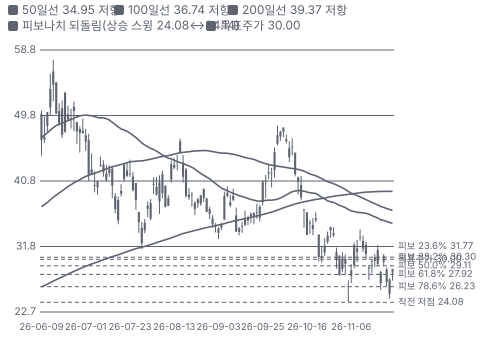

**주봉**

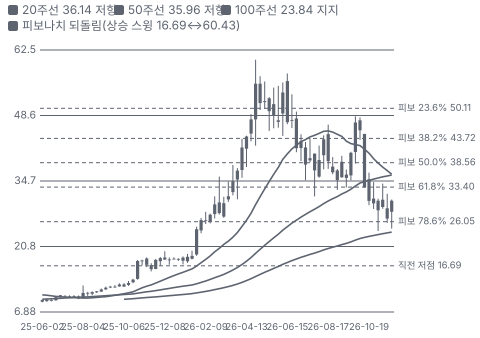

**월봉**

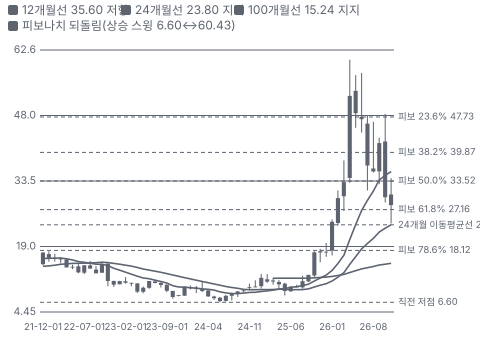

**분기 매출·EPS 실적과 컨센서스**

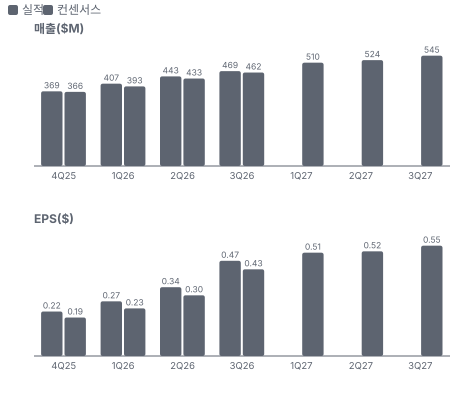

**4Q26 매출 — 지표 추세 vs 가이던스·컨센서스**

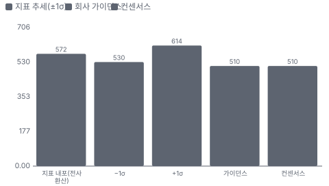

**최근 4개 분기 주가 변화 분석**

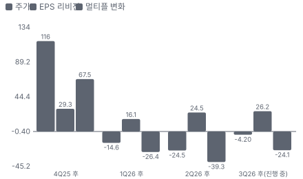

**EPS 리비전**

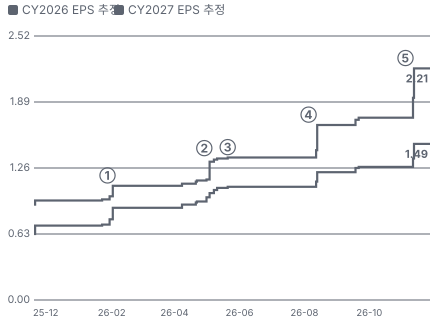

① 26-01-28 2Q FY26 실적 — Spirent 제품군 첫 반영, 3Q 가이던스 상회 · EPS 리비전 +14%
② 26-04-29 3Q FY26 실적 — 매출 \$406.8M, 다음 날 +15% · EPS 리비전 +19%
③ 26-05-21 유상증자 12.78M주(주당 \$45, \$575M) — 기간 대출 상환 · EPS 리비전 +0%
④ 26-08-05 4Q FY26 실적 — 1Q 가이던스 \$450~460M·EPS \$0.40~0.42 · EPS 리비전 +23%
⑤ 26-11-04 1Q FY27 실적 — 2Q 가이던스 \$505~515M, 다음 날 −10.5% · EPS 리비전 +27%

**멀티플 프리미엄(Fwd 1Y P/E, 최근 4개 분기말 절대값 — 대상 vs 동종 중앙값)**

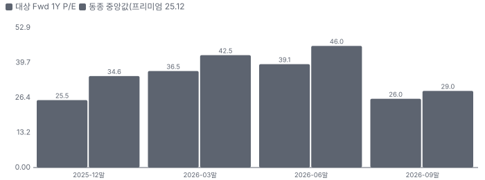

**합리적 멀티플**

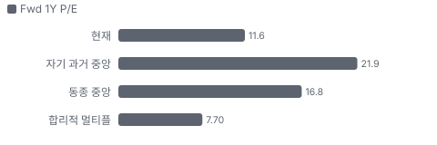

**밸류에이션 주가 시나리오**

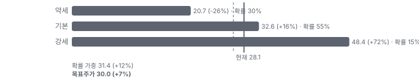

**주가별 업사이드**

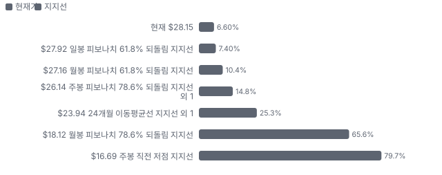
- 제품·서비스 포트폴리오

**고객 믹스(FY2026, 매출 대비)**

**공급 병목(10점, 낮을수록 병목)**

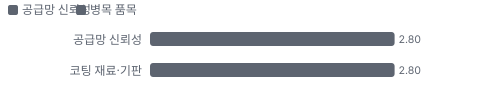

**CAPEX의 매출 대비 비중**

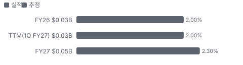

**어닝콜 변화별 주주가치 영향**

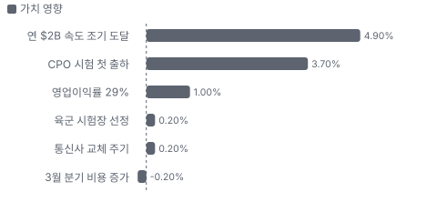

**수주·파이프라인 확실성 사다리**

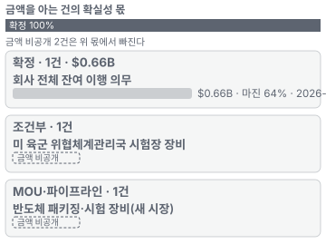

**수주/출하 비율(B/B) × 재고 일수 — 분기별**

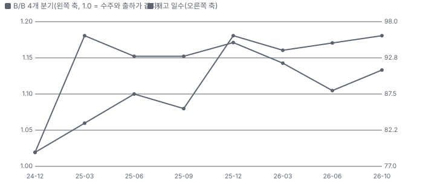

**매출 → 매출총이익 → 영업이익(매출 = 100, 최근 4분기)**

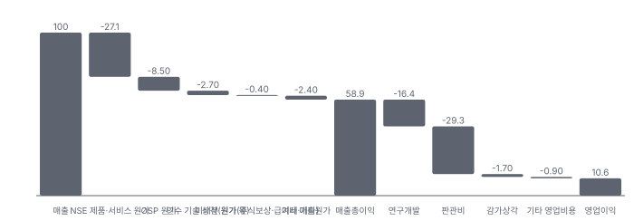

**분기 비용 비중 추이(매출 대비, 공시)**

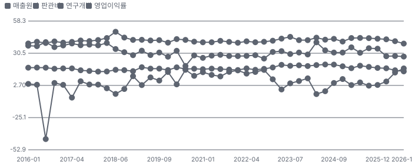

**비용 요인별 매출 대비 비중 1년 변화**

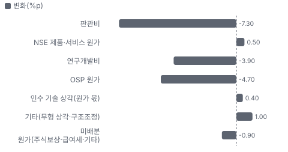

**네트워크 시험·계측(NSE) BOM 원가 몫**

**광학 코팅·보안 안료(OSP) BOM 원가 몫**

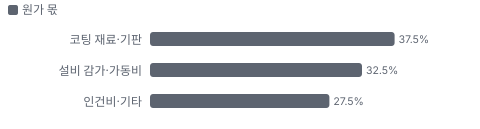

**BOM 항목 가격 +10% 시 OPM 변화**

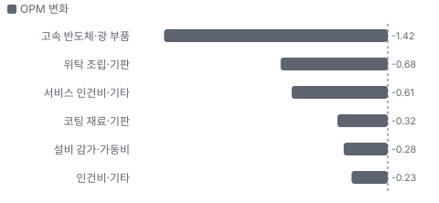

**자산 구성 — 4Q26 분기말 투하자본 \$1,610.5M**

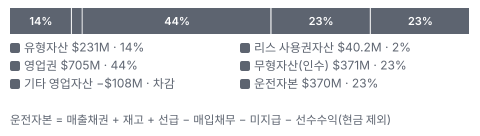

**자산별 변화율 — 최근 12개 분기(4Q23 = 0%) + 다음 4개 분기 추정**

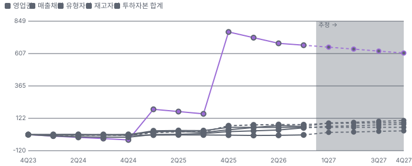

**ROIC 추이 — TTM, 최근 12개 분기 + 다음 4개 분기 추정(컨센서스 NOPAT)**

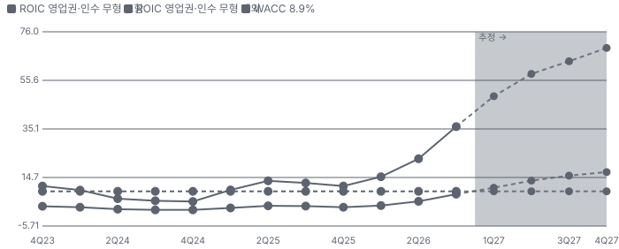

**Spirent 고속 이더넷·채널 에뮬레이션 제품군 인수 효과 — 인수 전 EPS 대비 %, 굵은 선 = 합계 · 시너지 가치 \$0.02B(웃돈 미확인)**

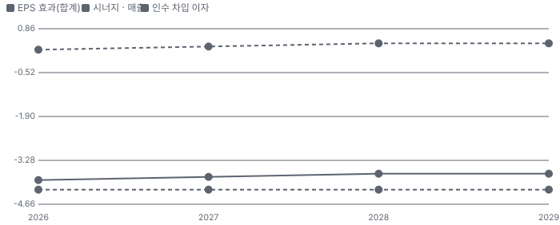

**매출 vs PPI·수출입 — 4Q22 = 100(변화율, 로그 눈금)**

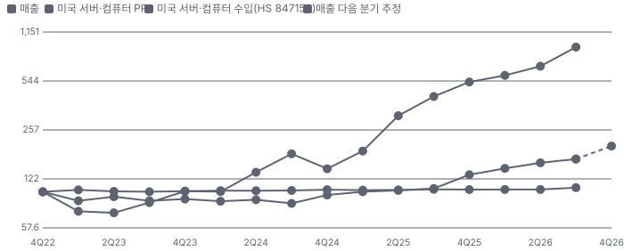

**목표주가 산정 — 시나리오 수정 가중평균(약세 확률 30%→38%), 도달 확률 약 52%**

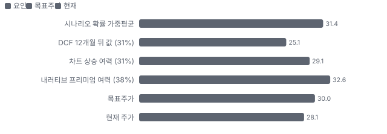

**PEG — 성장 대비 멀티플(낮을수록 성장 대비 쌈)**

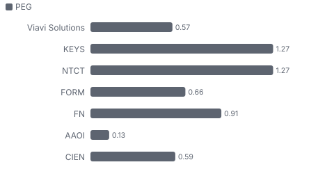

**커뮤니티 언급 수(최근 30일, 채널별)**

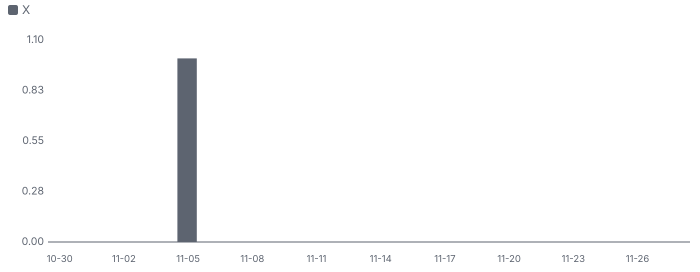

**일별 거래량 분해**

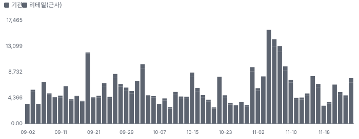

**기관 자금 흐름**

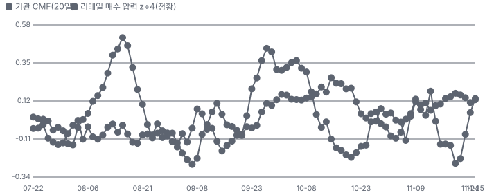

**몬테카를로**

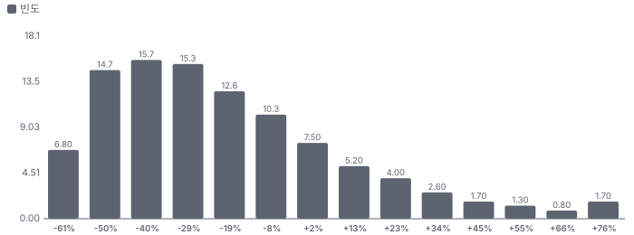

해석: 3,000번 중 672번(22%)에서 가치가 지금 주가 이상이었다. 가정을 흔들어도 지금 주가를 뒷받침하지 못하는 경우가 더 많다. 가운데 값은 0.74배이고, 열 번 중 여덟 번은 0.47~1.23배 사이에 든다.

## 내러티브

> **기업가치를 결정하는 이야기:** 값을 정하는 것은 세 가지다. ① 데이터센터 시험 장비 수요가 1.6T 전환이 끝나는 2027년 하반기 뒤에도 이어지는가 — 회사는 교체 주기가 3~4년이고 새 시험 시장이 열린다고 말하지만 건별 수주는 공시하지 않는다. ② 조정 영업이익률 29%가 머무는가 — 추가 매출의 50% 이상이 이익이 되는 구조는 매출이 줄 때 거꾸로 작동한다. ③ 조정 이익과 주주 몫의 차이 — 세율 8%는 이월결손금(과거 손실을 앞으로의 이익에서 빼 세금을 줄이는 권리)이 있는 동안만이다.

> **멀티플·EPS 프리미엄**
> **멀티플:** Fwd 1Y P/E 11.6배는 동종 6사 중앙값(약 17배)보다 낮다. 4월 말 52.5배, 9월 말 26.0배였다 — 프리미엄이 할인으로 바뀌었다
> **EPS:** FY2027 EPS 추정은 1Q 콜 직전 \$1.62에서 \$2.04로 26% 올랐다(4명). 같은 기간 주가는 6% 내렸다

### 투자자들은 왜 열광했나

1월 29일 2Q 실적 다음 날 +17.5%, 4월 30일 3Q 실적 다음 날 +15.1%로 장중 \$60.43까지 갔고 5월 1일 종가 \$55.33이 고점이다. 열광의 근거는 '시험이 광 연결 양산의 병목'이라는 이야기와 세 분기 연속 가이던스 상회였다. 식은 계기는 둘이다 — 5월 주당 \$45 증자(12.78M주)로 고점이 확인됐고, 10월 중순부터 AI 종목 전체의 배수가 내려왔다. 11월 4일 실적은 다시 가이던스를 넘었지만 다음 날 10.5% 내렸다.

### 무엇이 기업가치를 바꾸나

> **구조적 체질 변화**
> **변화:** 조정 영업이익률이 1년 새 16.3%에서 29.0%로 올랐다. 인수 차입 \$600M을 증자로 다 갚아 순차입이 \$120M 안팎이다. 통신사 비중이 줄고 데이터센터가 NSE의 절반을 넘었다
> **증거:** 1Q FY27 실적 보도자료(8-K EX-99.1) · 10-Q Note 11
> **반증:** 조정 영업이익률이 27% 아래로 내려간다

> **고부가 믹스 확장**
> **변화:** 개발·양산용 시험 장비(매출총이익률 70%대 후반까지, 4Q 콜)가 현장 계측기(60%대 초반)보다 빨리 크고, 이익률이 더 높은 Spirent 제품군이 더해졌다. NSE 부문 매출총이익률 63.1% → 66.2%
> **증거:** 4Q FY26 어닝콜(2026-08-05) · 1Q 부문 자료
> **반증:** NSE 부문 매출총이익률이 63% 아래로 내려간다

> **기술 혁신**
> **변화:** 9월 분기에 반도체 패키징·시험 고객으로 첫 출하를 했다 — 광 부품이 칩 패키지에 들어가면 시험 횟수가 최대 다섯 번으로 는다는 것이 회사 설명이다(회사 주장)
> **증거:** 1Q FY27 어닝콜(2026-11-04)
> **반증:** 이 시장 매출이 분기마다 늘지 않는다

> **실행 속도**
> **변화:** 해당 없음(납품 리드타임 수치를 공시하지 않는다) — 매출 대부분이 분기 마지막 4주에 출하되고 주문 상당수가 같은 분기에 매출이 된다
> **증거:** 4Q FY26 어닝콜(2026-08-05) · FY2026 10-K Backlog
> **반증:** 출하 지연이나 납기 미달 공시

> **M&A**
> **변화:** 2025년 10월 Spirent 제품군을 약 \$399M에, 2025년 1월 Inertial Labs를 현금 \$134M + 조건부 대가 최대 \$175M에 샀다. 1Q FY27 Spirent 제품군 매출 \$52.7M, 통합은 끝났다고 한다
> **증거:** FY2026 10-K · 1Q FY27 10-Q Note 5 · 1Q FY27 어닝콜(2026-11-04)
> **반증:** 인수 제품군 매출이 2개 분기 연속 줄거나 영업권 손상

> **정책·입법 연관성**
> **재정정책:** 해당 없음(보조금·세액공제를 받지 않는다 — 10-K·10-Q에 정부 지원 수령 공시 없음. 국방 예산은 회사가 프로그램별 금액을 공시하지 않아 연결하지 않는다) FY2026 10-K · 1Q FY27 10-Q
> **행정명령:** 해당 없음(회사에 직접 닿는 행정명령을 1차 자료로 확인하지 못했다 — 관세는 2026년 7월 약 \$11M을 환급받았다는 사실만 공시) 1Q FY27 어닝콜(2026-11-04)
> **연관입법:** 해당 없음(연결되는 법안을 확인하지 못했다) FY2026 10-K

> **고객의 지출 예산**
> **변화:** NSE 매출은 데이터센터·통신망·국방의 설비투자와 연구개발 예산에서, OSP 매출은 화폐 인쇄와 기기 제조원가에서 나온다
> **사업별 예산:** **매출의 40%**: 데이터센터 생태계 시험 장비 — 고객 CAPEX(반도체·광모듈·장비 회사의 개발 장비와 생산 라인 시험 장비, 하이퍼스케일러의 구축 계측기) · 동인: 800G → 1.6T 전환, 광모듈 생산 라인 증설
**매출의 26%**: 통신사 현장 계측·무선 — 고객 혼합(통신사의 망 구축 설비투자와 유지보수 예산) · 동인: 광섬유 구축, 케이블 망 고도화, 계측기 교체 주기
**매출의 20%**: 광학 코팅(유리·필름 위에 얇은 막을 여러 겹 입혀 특정 빛만 통과·반사시키는 기술)·보안 안료 — 고객 OPEX(화폐 인쇄 당국의 인쇄 재료비, 스마트폰 제조사의 부품 원가) · 동인: 지폐 발행량, 3D 센싱(빛으로 거리와 형상을 재는 기능 — 스마트폰 얼굴 인식 등) 탑재 기기 출하
**매출의 14%**: 방산 항법·통신 시험 — 고객 CAPEX(국방 조달·시험평가 예산) · 동인: 드론·위성 항법 교란 대응
> **증거:** 1Q 부문 자료 · 4Q 콜(NSE 내 비중)
> **반증:** 하이퍼스케일러 설비투자 가이던스 하향

### 내러티브 근거

> AI 데이터센터의 광 연결이 800G에서 1.6T로 넘어가고 시험 장비가 그 길목에 있다는 이야기는 셀사이드 9명 중 8명이 받아들인 컨센서스다. 실적도 그 방향이다. 다만 10월 초부터 시장은 같은 이야기에 주던 배수를 절반 아래로 낮췄다 — 이익 추정은 오르는데 주가는 내리는 국면이다. 동종 대비 멀티플 차이 -31% 중 회사 고유 몫은 +52%다. 단계는 컨센서스, 쏠림은 중간이다.

> **광 연결 세대 전환과 시험 수요** · 강화
> **논리:** 선 속도가 오를 때마다 개발·양산·현장에서 시험 장비를 다시 사야 하고 세대 간격이 짧아진다
> **숫자:** NSE 매출 +74.1% YoY(Spirent 제외 약 +50%), 데이터센터가 NSE의 절반 이상, 잔여 이행 의무 +88%
> **반증:** NSE 매출이 2개 분기 연속 전 분기보다 줄어든다
> **출처:** 1Q FY27 어닝콜(2026-11-04) · 1Q FY27 10-Q

> **매출 증가가 이익으로 떨어지는 구조** · 강화
> **논리:** 물량이 늘어도 개발·영업 인력은 그만큼 늘지 않아 추가 매출의 절반 이상이 영업이익이 된다
> **숫자:** 조정 영업이익률 16.3% → 29.0%(1년), 2Q 가이던스 29.3%
> **반증:** 조정 영업이익률이 2개 분기 연속 27% 아래로 내려간다
> **출처:** 8-K EX-99.1

> **반도체 패키징·시험이라는 새 시장** · 강화
> **논리:** 광 부품이 칩 패키지 안으로 들어가면 웨이퍼 단계부터 최종 조립까지 광 시험이 여러 번 필요하다
> **숫자:** 9월 분기 첫 출하 약 \$1M, 경영진 목표 2년쯤 뒤 연 \$100M 이상
> **반증:** 2027년 6월 분기까지 이 시장 매출이 분기 \$10M에 못 미친다(회사가 숫자를 밝힐 때)
> **출처:** 1Q FY27 어닝콜(2026-11-04)

> **방산 항법·시각 장비** · 유지
> **논리:** 드론과 위성 항법 교란 대응 수요가 다년 성장축이 된다
> **숫자:** 방산이 NSE의 약 17%(4Q 콜), Inertial Labs FY2026 매출 \$86.1M
> **반증:** 방산 매출이 2개 분기 연속 줄거나 조건부 대가 공정가치가 내려간다
> **출처:** 4Q FY26 어닝콜(2026-08-05) · FY2026 10-K

> **반대 내러티브 — AI 설비투자 고점** · 강화
> **논리:** 데이터센터 투자가 2027년 하반기에 꺾이면 NSE 성장의 가장 큰 축이 서고, 지금 이익은 사이클 고점 이익이라 낮은 배수가 맞다
> **숫자:** Fwd 1Y P/E 52.5배(4월 말) → 11.6배, 나스닥 100 20거래일 −12.6%, 동종 6사 배수도 함께 하락
> **반증:** 하이퍼스케일러 2027년 설비투자 가이던스가 늘고 회사 3Q 가이던스가 2Q를 웃돈다
> **출처:** 주가·배수 계산 · 1Q FY27 어닝콜(2026-11-04)

> **반대 내러티브 — 이익의 질** · 유지
> **논리:** 조정 EPS는 세율 8%·주식보상 제외·관세 환급이 들어간 값이라 정상화하면 낮아진다
> **숫자:** 1Q GAAP EPS \$0.29 대 조정 \$0.47, 조정 세율 8%, 관세 환급 순 약 1.1%p
> **반증:** GAAP 영업이익률이 20%를 넘고 조정과의 차이가 줄어든다
> **출처:** 8-K EX-99.1 · 1Q FY27 어닝콜(2026-11-04)

### 투자 포인트

> **이익은 올랐고 배수가 무너졌다**
> **명제:** 5월 고점 뒤 하락의 전부가 배수 축소다 — 실적과 추정은 그 사이 계속 올랐다
> **숫자:** 5월 1일 종가 \$55.33 → \$28.15(−49%), FY2027 EPS 추정 \$1.08(5월 1일) → \$2.04. Fwd 1Y P/E 52.5배(4월 말) → 11.6배
> **시장과 다른 점:** 셀사이드 9명 중 8명이 매수이고 목표가 평균이 \$55라 '시장이 못 봤다'고 말할 자리가 아니다. 다른 점은 가격이다 — 지금 주가는 FY2028 추정이 크게 깎이는 경우를 이미 담고 있다
> **증명:** 2Q 실적(2027년 1월 말 예상)에서 3Q 가이던스가 2Q를 웃도는지, 하이퍼스케일러 2027년 설비투자 가이던스
> **출처:** 8-K EX-99.1(2026-11-04) · 컨센서스 이력

> **추가 매출의 절반이 이익이 된다**
> **명제:** 개발·영업 인력을 늘리지 않고 물량이 늘어 영업이익률이 1년에 13%p 올랐다
> **숫자:** 조정 영업이익률 16.3% → 29.0%, 연구개발비 + 판관비의 매출 대비 비중 53.6% → 42.4%(GAAP), CEO의 증분 이익률 50%대 발언
> **시장과 다른 점:** 같은 구조는 매출이 줄 때 거꾸로 작동한다. 1Q에는 관세 환급 일회성이 약 1.1%p 들어 있고 CFO는 3월 분기 비용 증가를 예고했다 — 컨센서스 FY2028 영업이익률 31.7%가 이를 얼마나 담았는지는 미확인
> **증명:** 2Q 조정 영업이익률 29.3% ± 0.3%p 달성, 3월 분기 영업비용
> **출처:** 8-K EX-99.1 · 1Q FY27 어닝콜(2026-11-04)

> **증자는 비싸게, 자사주는 싸게**
> **명제:** 5월에 \$45로 주식을 팔아 차입을 갚고 9월 분기에 \$37.98로 되샀다 — 새 한도 \$500M은 시가총액의 7%다
> **숫자:** 증자 12.78M주 \$575M, 1Q 매입 3.95M주 \$150M, 신규 승인 \$500M(8-K Item 8.01)
> **시장과 다른 점:** 승인은 집행이 아니다 — 회사는 매입 의무가 없다고 적었고 내부자는 12개월간 사지 않고 \$35.4M을 팔았다
> **증명:** 2Q 10-Q의 분기 매입 주식 수와 평균 단가
> **출처:** 8-K(2026-11-04) · 1Q FY27 10-Q · Form 4

### 모멘텀 생성·소멸 타임라인

**카탈리스트 달력 — 지난 사건의 주가 반응과 앞으로 확인할 숫자**
| 날짜 | 상태 | 구분 | 사건 | 반응·확인 | 결과에 따라 |
|---|---|---|---|---|---|
| 2026-04-29 | 완료 | 생성 | 3Q FY26 실적 — 매출 \$406.8M, 세 분기 연속 가이던스 상회 | +15.1% |  |
| 2026-05-21 | 완료 | 소멸 | 유상증자 12.78M주(주당 \$45) — 종가 고점 5월 1일 \$55.33 뒤 | 5/15 → 5/21 −4.8% |  |
| 2026-08-05 | 완료 | 생성 | 4Q FY26 실적 — 1Q 가이던스 \$450~460M | +4.3% |  |
| 2026-11-04 | 완료 | 소멸 | 1Q FY27 실적 — 가이던스 상회·\$500M 자사주 승인에도 하락 | −10.5% |  |
| 2027-01 말(예상) | 예정 | 확인 | 2Q FY27 실적·3Q 가이던스 | 2Q 매출 \$505M 이상·조정 영업이익률 29% 이상, 3Q 매출 가이던스가 2Q 실적 이상 | 모두 맞으면 기본~강세, 3Q 가이던스가 2Q 아래면 약세 쪽 |
| 2027-01 말~02(예상) | 예정 | 매크로 | 하이퍼스케일러 4분기 실적 — 2027년 설비투자 가이던스 | 주요 4사 합산 설비투자 가이던스가 2026년보다 느는지 | 늘면 배수 회복 여지, 줄면 약세 시나리오 |
| 2027-04 말(예상) | 예정 | 확인 | 3Q FY27 실적 — 3월 분기 계절성 | 3월 분기 매출이 전 분기보다 느는지, 반도체 패키징·시험 매출 언급 | 늘면 '연중 순차 성장' 발언이 확인된다 |
| 2027-08(예상) | 예정 | 확인 | FY2027 10-K — 구매 약정·OSP 고객 비중 | 구매 약정이 \$266.9M에서 얼마나 늘었는지, OSP 고객 1곳 매출이 \$174.7M 위인지 | 약정 급증이면 재고 위험 상향 |

### 언제 사서 언제 팔아야 할까?

**가격·조건 틀 — 가격은 밸류에이션(약세·기본·강세·목표주가)과 차트 지지 구간에서, 조건은 이벤트에서**
| 구간 | 가격 | 목표주가까지 | 약세까지 | 조건·근거 |
|---|---|---|---|---|
| 관찰 구간 | \$28~\$28 | +7% | -26% | 11월 5일 장중 \$24.08과 11월 25일 장중 \$24.58이 실적 뒤 저점권이다 — 2월 돌파 전 가격대(\$24~27)와 겹친다 |
| 확인 뒤 | 지금 \$28 이상에서 조건 확인 | +7% | -26% | 2Q 실적에서 매출 \$505M 이상, 조정 영업이익률 29% 이상, 3Q 매출 가이던스가 2Q 실적 이상 |
| 무효화 | 약세 시나리오 \$21 | - | -26% | 3Q 매출 가이던스가 2Q 실적보다 낮거나 '연중 순차 성장' 발언을 거둔다 |
| 차익 고민 1차 | \$33(기본 시나리오) | +16% | - | 목표주가 부근에서는 배수가 동종 중앙값 근처로 돌아온 상태다 — 그 위는 새 시험 시장의 성공을 미리 값 매기는 구간이다 |
| 차익 고민 2차 | \$48(강세 시나리오) | +72% | - | 목표주가 부근에서는 배수가 동종 중앙값 근처로 돌아온 상태다 — 그 위는 새 시험 시장의 성공을 미리 값 매기는 구간이다 |

11월에 하루 ±10% 움직임이 여러 번 있었다(11/5 −10.5%, 11/9 +12.3%) — 하루 움직임으로 판단을 바꾸지 않는다 가격·조건 틀이며 매매·비중 지시가 아니다(투자 권유 아님).

## 포트폴리오

| 제품·서비스 | 구분 | 무엇 | 쓰는 곳 | 돈 버는 방식 | Mix | Mix 변화(전 분기 대비) |
|---|---|---|---|---|---|---|
| 네트워크 시험·계측(NSE) | 제품·서비스 | 광모듈·고속 칩·통신망의 성능을 재는 계측 장비와 소프트웨어, 항법·시각 장비 | 반도체·광모듈 개발과 생산 라인, 데이터센터 구축, 통신사 현장, 국방 | 1Q 매출의 80%(\$376.1M, +74% YoY), 부문 영업이익률 25.5% | 80% | +0.3%p |
| 광학 코팅·보안 안료(OSP) | 제품 | 지폐 위조 방지용 색변환 안료(보는 각도에 따라 색이 바뀌는 위조 방지용 안료)와 3D 센싱용 광학 필터 | 화폐 인쇄, 스마트폰 얼굴 인식, 항공우주·산업용 광학 | 1Q 매출의 20%(\$93.2M, +12% YoY), 부문 영업이익률 43.2% | 20% | -0.3%p |

**Mix 변화가 가장 큰 쪽은 광학 코팅·보안 안료(OSP, -0.3%p, 전 분기 대비).** 계절성 판정: 분기 매출 계절 지수 기준 없음 → 직전 분기와 비교.

## 고객

> **FY2026 최대 고객 이름 미공시 고객(OSP)(이름 미공시(10-K Note 19)) 12%, 상위 3곳 12%, 집중도 분산.** 공시·회사 발표로 확인한 몫은 매출의 12%이고, 나머지 고객 몫은 추정이거나 미분해다. 매출의 10%를 넘는 고객은 OSP 부문의 1곳뿐이고 이름은 공시되지 않는다(FY2026 \$174.7M). 같은 부문에 위조 방지 안료를 독점 판매하는 SICPA와의 전략 제휴가 있어 그 회사일 가능성이 높지만 가설이다. NSE는 통신사·반도체·장비 회사·정부에 넓게 판다 — 10-K가 이름을 든 고객은 몫을 밝히지 않았다

**고객별 매출 몫(FY2026)**
| 고객 | 몫 | 변화 | 근거 |
|---|---|---|---|
| 이름 미공시 고객(OSP)(이름 미공시(10-K Note 19)) | 12% | -4%p | 공시 |
| AMD | 미확인 | 미확인 | 공시 |
| AT&T | 미확인 | 미확인 | 공시 |
| Verizon | 미확인 | 미확인 | 공시 |
| Cisco | 미확인 | 미확인 | 공시 |
| 기타·미분해 | 88% | - | - |

> **이름 미공시 고객(OSP)(이름 미공시(10-K Note 19))** · 공시
> **사는 것:** 미확인(품목 미공시 — 같은 부문에 SICPA 제휴가 있다, 가설)

> **AMD** · 공시
> **사는 것:** 고속 반도체 개발·검증용 시험 장비

> **AT&T** · 공시
> **사는 것:** 광섬유·무선망 현장 계측기

> **Verizon** · 공시
> **사는 것:** 광섬유·무선망 현장 계측기

> **Cisco** · 공시
> **사는 것:** 네트워크 장비 개발·생산 시험 장비

## 수주·파이프라인

> **2026-10-03 기준 3건.** 확정 \$0.66B. 공시 잔여 이행 의무 \$0.66B.

**수주 목록**
| 상태 | 계약 | 계약 총액 | 진척 | 기간 | 비고 |
|---|---|---|---|---|---|
| 확정 | 회사 전체 잔여 이행 의무 | \$0.66B | - | 2026-10 → 2027-10 | - |
| 조건부 | 미 육군 위협체계관리국 시험장 장비(미국) | 금액 비공개 | - | - | 선정은 매출이 아니다 — 개별 발주 금액을 확인해야 한다 |
| 파이프라인 | 반도체 패키징·시험 장비(새 시장) | 금액 비공개 | - | - | CEO 목표 — 2년쯤 뒤 연 \$100M 이상(수주가 아니다) |

**실행 속도와 방해 요인**
| 항목 | 상태 | 실행 속도 | 방해 요인 |
|---|---|---|---|
| 회사 전체 잔여 이행 의무 | 확정 | 미확인 | 부품 수급 · 고객 납기 변경·취소 가능 |
| 미 육군 위협체계관리국 시험장 장비 | 조건부 | 선정 발표 — 계약 금액·인도 일정 미공시 | 개별 발주 · 국방 예산 집행 |
| 반도체 패키징·시험 장비(새 시장) | 파이프라인 | 9월 분기 첫 출하 약 \$1M, 분기마다 증가 예고 | CPO 양산 일정 · 고객 인증 |

## 마진 구조

> **GPM 61.2%, OPM 17.4%.** 1Q FY26 대비 GPM +4.7%p, OPM +14.9%p. 변동비는 매출의 38%이고, 매출이 10% 늘면 OPM은 +4.0%p 움직인다. 1Q FY27 GAAP 매출총이익률은 61.2%(1년 전 56.5%), 영업이익률은 17.4%(2.5%)다. 매출이 57% 느는 동안 연구개발비는 24%, 판관비는 24% 늘어 두 비용의 매출 대비 비중이 53.6%에서 42.4%로 내려간 것이 가장 큰 요인이다. 매출총이익률은 NSE 비중 확대와 관세 환급(\$11M)으로 올랐다

> **매출 100 중 매출원가 41.1, 매출총이익 58.9(최근 4분기, 공시).** 매출원가 요인 중 NSE 제품·서비스 원가이 매출의 27.1%로 가장 무겁고, 단가가 +10% 오르면 GPM이 -2.71%p 움직인다. 분기 회귀로 매출 1이 늘 때 매출원가는 0.40 늘고, 매출원가의 고정비 몫은 5%다.

**비용 요인 강도 — 비중·추세·충격(+10%)·탄력**
| 비용 | 구분 | 매출 대비 | 1년 변화 | 마진 기여 | 충격 시 마진 | 매출 탄력 | 고정비 몫 |
|---|---|---|---|---|---|---|---|
| NSE 제품·서비스 원가 | 매출원가 요인 | 27.1% | +0.5%p | -0.5%p | -2.71%p | 미확인 | 20% |
| OSP 원가 | 매출원가 요인 | 8.5% | -4.7%p | +4.7%p | -0.85%p | 미확인 | 40% |
| 인수 기술 상각(원가 몫) | 매출원가 요인 | 2.7% | +0.4%p | -0.4%p | -0.27%p | 미확인 | 100% |
| 미배분 원가(주식보상·급여세·기타) | 매출원가 요인 | 0.4% | -0.9%p | +0.9%p | -0.04%p | 미확인 | 50% |
| 매출원가 | 공시 항목 | 41.1% | -1.7%p | +1.7%p | -4.11%p | 0.40 | 5% |
| 판관비 | 공시 항목 | 29.3% | -3.9%p | +3.9%p | 미확인 | 0.19 | 39% |
| 연구개발 | 공시 항목 | 16.4% | -2.4%p | +2.4%p | 미확인 | 0.15 | 16% |
| 감가상각 | 공시 항목 | 1.7% | +1.2%p | -1.2%p | 미확인 | 0.02 | 4% |
| 기타 영업비용 | 공시 항목 | 0.9% | +0.9%p | -0.9%p | 미확인 | -0.01 | 100% |

매출 탄력 = 분기 비용을 매출에 회귀한 기울기(매출 1당 변동비), 고정비 몫 = 절편 ÷ 평균 비용. 표본이 8분기 미만이면 미확인. 매출원가 요인 비중은 margin 재료의 추정이 섞여 있고, 공시 매출원가와의 차이는 '기타 매출원가'로 둔다.

**GPM에서 OPM까지(GAAP — 10-Q 3개월 손익, 아래는 최근 4개 분기)**
| 기간 | GPM | 연구개발 | 판관비 | 기타 | OPM |
|---|---|---|---|---|---|
| 1Q FY26 | 56.5% | 18.7% | 34.8% | 0.4% | 2.5% |
| 1Q FY27 | 61.2% | 14.8% | 27.6% | 1.4% | 17.4% |
| 2025-12 | 57.0% | - | - | - | 3.1% |
| 2026-03 | 57.5% | - | - | - | 6.1% |
| 2026-06 | 59.1% | - | - | - | 13.8% |
| 2026-10 | 61.2% | - | - | - | 17.4% |

**비용을 움직이는 요인**
| 비용 | 요인 |
|---|---|
| 판관비(판관비) | 영업 인력·수수료, 조건부 대가 공정가치 변동(\$12.4M), 주식보상 · 근거 공시 |
| NSE 제품·서비스 원가(매출원가) | 계측기 출하량, 고속 반도체·광 부품 단가, 위탁 조립비, 관세 · 근거 공시 |
| 연구개발비(연구개발) | 개발 인력, 1.6T·3.2T·CPO 시험 장비 개발 · 근거 공시 |
| OSP 원가(매출원가) | 코팅 공장 가동률, 코팅 재료·기판 단가 · 근거 공시 |
| 인수 기술 상각(원가 몫, 매출원가) | 인수 무형자산 잔액과 내용연수 · 근거 공시 |
| 기타(무형 상각·구조조정, 기타) | 인수 고객관계 상각 · 근거 공시 |
| 미배분 원가(주식보상·급여세·기타, 매출원가) | 주식보상 귀속, 인수 재고 평가 상각 · 근거 공시 |

**네트워크 시험·계측(NSE) BOM — 매출의 80%, GPM 66%(공시 — 1Q FY27 부문 매출총이익 \$248.8M ÷ 매출 \$376.1M(조정 기준)), 항목 가격 +10% 시**
| 항목 | 원가 몫 | 전가 | 제품 GPM | OPM |
|---|---|---|---|---|
| 고속 반도체·광 부품 | 45~60% | 미확인 | -1.8%p | -1.42%p |
| 위탁 조립·기판 | 20~30% | 미확인 | -0.8%p | -0.68%p |
| 서비스 인건비·기타 | 15~30% | 미확인 | -0.8%p | -0.61%p |

**광학 코팅·보안 안료(OSP) BOM — 매출의 20%, GPM 57%(공시 — 1Q FY27 부문 매출총이익 \$53.2M ÷ 매출 \$93.2M(조정 기준)), 항목 가격 +10% 시**
| 항목 | 원가 몫 | 전가 | 제품 GPM | OPM |
|---|---|---|---|---|
| 코팅 재료·기판 | 30~45% | 미확인 | -1.6%p | -0.32%p |
| 설비 감가·가동비 | 25~40% | 미확인 | -1.4%p | -0.28%p |
| 인건비·기타 | 20~35% | 미확인 | -1.2%p | -0.23%p |
| 미분해 | 2% | - | - | - |

고속 반도체·광 부품 가격이 +10% 오르면 영업이익은 -8.2% 움직인다. 판매가 전가를 모르는 항목은 전가 0%로 계산했다.

**BOM 항목 가격을 움직이는 것**
| 항목 | 요인 |
|---|---|
| 고속 반도체·광 부품 | 고속 신호 처리 칩과 광 송수신 소자가 원가의 가장 큰 몫이다. 4Q 콜에서 CEO가 반도체 가격을 역풍으로 들었다 · 근거 추정 |
| 위탁 조립·기판 | 조립 단가와 관세가 닿는다 · 근거 추정 |
| 서비스 인건비·기타 | 수리·교정 인력 비용 · 근거 추정 |
| 코팅 재료·기판 | 증착 재료와 유리·필름 기판 · 근거 추정 |
| 설비 감가·가동비 | 공장 가동률이 오르면 단위 원가가 내려간다 — 1Q 부문 매출총이익률 +4.6%p의 이유로 회사가 물량을 들었다 · 근거 추정 |
| 인건비·기타 | 공정 인력 · 근거 추정 |

**투입 물가 — 미국 PPI 3·6·12개월(2026-10, 개정 반영)과 해외 전년비**
| 항목 | 미국 3개월 | 6개월 | 12개월 | 전가 못 할 때 OPM | 일본 | 한국 | 대만 |
|---|---|---|---|---|---|---|---|
| 고속 반도체·광 부품 | -0.7% | -5.7% | -2.7% | - | +1.6% | +1.5% | +22.9%* |
| 위탁 조립·기판 | +0.0% | +24.0% | +46.4% | - | +11.5% | +1.7% | +12.1% |
| 코팅 재료·기판 | 미확인 | 미확인 | 미확인* | - | 미확인 | 미확인 | 미확인 |

별표는 품목보다 넓은 업종 지수다. 연결한 투입 원가의 미국 PPI(생산자물가지수)는 1년 새 가중 -2.7%이고, 판매가로 넘기지 못하면 GPM +0.7%p·OPM +0.7%p가 움직인다. 물가 지수를 붙이지 못한 매출원가 항목은 OSP 원가, 인수 기술 상각(원가 몫), 미배분 원가(주식보상·급여세·기타)다(미연결).

## 자산 구성

> **4Q26 분기말 투하자본 \$1.61B** — 영업권 44%, 무형자산(인수) 23%. 최근 12개 분기(4Q23 → 4Q26) 가장 크게 늘어난 자산은 무형자산(인수, +670%), 투하자본 합계 +75%. 4Q27 추정 투하자본 \$1.75B(+9%, 컨센서스 매출과 회전 일수·CAPEX 강도 유지 가정).

**자산·운전자본 항목별 분기말 잔액 — 최근 12개 분기와 다음 4개 분기 추정**
| 항목 | 4Q23 | 3Q25 | 4Q26(최근) | 4Q27 추정 | 12개 분기 변화 | 다음 4개 분기 변화 |
|---|---|---|---|---|---|---|
| 매출채권 | \$208.9M | \$242.0M | \$335.0M | \$429.9M | +60% | +28% |
| 재고자산 | \$115.1M | \$124.5M | \$173.8M | \$205.3M | +51% | +18% |
| 선급·기타 유동자산 | \$69.5M | \$74.7M | \$91.3M | \$114.2M | +31% | +25% |
| 매입채무 | \$43.8M | \$66.6M | \$106.3M | \$123.6M | +143% | +16% |
| 미지급비용 | \$21.9M | \$29.9M | \$25.2M | \$35.1M | +15% | +39% |
| 선수수익(계약부채) | \$60.8M | \$64.2M | \$98.1M | \$122.7M | +61% | +25% |
| 유형자산 | \$236.5M | \$230.3M | \$231.1M | \$303.2M | -2% | +31% |
| 리스 사용권자산 | \$37.5M | \$39.4M | \$40.2M | \$40.2M | +7% | +0% |
| 영업권 | \$455.2M | \$592.3M | \$705.3M | \$705.3M | +55% | +0% |
| 무형자산(인수) | \$48.2M | \$123.2M | \$371.0M | \$342.6M | +670% | -8% |

**자산 추정 동인 — 최근 4개 분기 평균(재무상태표 동인 모형)**
| 동인 | 값 | 곱하는 기준 |
|---|---|---|
| 매출채권 | 70일 | 매출 |
| 재고자산 | 81일 | 매출원가 |
| 선급·기타 유동자산 | 19일 | 매출 |
| 매입채무 | 49일 | 매출원가 |
| 미지급비용 | 6일 | 매출 |
| 선수수익(계약부채) | 20일 | 매출 |
| 유형자산 ÷ 분기 매출 | 0.54배 | CAPEX·감가 재료 없음 — 비율 유지 |
| 매출원가율 | 41.1% | 매출(최근 4개 분기) |
| 영업권·리스 사용권·기타 | 유지 | 인수·새 리스는 공시 전 모름 |
| 인수 무형자산 | 분기 \$7.1M 상각 | 최근 4개 분기 평균 상각 |

**추정 방법:** 증권사 3표 모델(손익·재무상태표·현금흐름)의 재무상태표 동인 방식이다. 운전자본은 항목별 회전 일수(매출채권·선급·미지급·선수는 매출, 재고·매입채무는 매출원가 기준)를 최근 4개 분기 평균으로 두고 컨센서스 매출에 곱한다. 유형자산은 기초 + CAPEX − 감가상각으로 굴린다(Koller·Goedhart·Wessels 『Valuation』 재무상태표 추정). 매출 경로는 ROIC 절의 컨센서스와 같다.

**유형·무형자산 항목별 가치(2026-06-27 vs 2025-06-28)**
| 구분 | 항목 | 총액 2026-06-27 | 누적상각 | 순액 | 총액 2025-06-28 | 총액 1년 변화 | 공시 내용연수 |
|---|---|---|---|---|---|---|---|
| 유형 | 토지 | \$19.6M | \$0.0M | \$19.6M | \$19.9M | -1.5% | 비상각 |
| 유형 | 건물·개량 | \$80.6M | 총계만 공시 | 총계만 공시 | \$79.6M | +1.3% | 미확인 |
| 유형 | 기계장치 | \$412.1M | 총계만 공시 | 총계만 공시 | \$400.5M | +2.9% | 미확인 |
| 유형 | 비품·소프트웨어 | \$68.9M | 총계만 공시 | 총계만 공시 | \$67.8M | +1.6% | 미확인 |
| 유형 | 임차 개량 | \$78.4M | 총계만 공시 | 총계만 공시 | \$75.9M | +3.3% | 미확인 |
| 유형 | 건설중 | \$20.9M | \$0.0M | \$20.9M | \$26.5M | -21.1% | 비상각 |
| 영업권 | 영업권 | \$700.7M | \$0.0M | \$700.7M | \$595.7M | +17.6% | 비상각 |
| 무형 | 무형자산 합계(항목 미분해) | \$1,074.3M | \$696.7M | \$377.6M | \$787.6M | +36.4% | 미확인 |
| 유형 합계 | 유형자산 | \$680.5M | \$456.0M | \$224.5M | \$670.2M | +1.5% | 경과율 71%(상각 대상 기준) |

**내용연수 산식(상각 대상 유형자산 = 총액 − 토지 − 건설중)**
| 기준일 | 연 감가상각 | 상각 대상 총액 | 평균 내용연수 | 경과 연수 | 잔여 연수 | 경과율 |
|---|---|---|---|---|---|---|
| 2026-06-27 | \$40.4M | \$640.0M | 15.8년 | 11.3년 | 4.6년 | 71% |
| 2025-06-28 | \$38.4M | \$623.8M | 16.2년 | 11.4년 | 4.8년 | 70% |

산식 평균 내용연수는 15.8년. 1년 전 16.2년 → 지금 15.8년.

미공시·미분해: 분기 유형자산 감가상각(무형 상각과 분리된 값) — 미공시 · 유형자산 항목별 내용연수 — 이 회차 미대조 · 무형자산 항목별 1년 전 값 — 최근 값은 인수 기술 \$674.6M·고객관계 \$353.0M·기타 \$60.4M(2026-10-03 총액) — 이 칸은 비우고 나머지로 계산했다.

### 해석 — 자산이 어디에 쌓이고 있나

- 같은 기간 4개 분기 매출은 +70% — 매출보다 빨리 늘어난 자산: 무형자산(인수) +670%. 이 자산의 회전율이 떨어지면 ROIC를 희석한다.

## ROIC

> **TTM 4Q26 ROIC는 영업권·인수 무형 포함 7.7%, 제외 36.1%**(NOPAT 마진 10.0% × 투하자본 회전율 0.77회). 최근 12개 분기 4Q23 2.6% → 4Q26 7.7%(고점 4Q26 7.7%). 컨센서스 NOPAT으로 굴리면 4Q27 17.0%(제외 69.2%) — WACC 8.9% 대비 +8.1%p. 1년 변화의 가장 큰 요인은 NOPAT 마진(+3.8%p).

**ROIC 추이(TTM)와 다음 4개 분기 추정 — NOPAT ÷ 평균 투하자본(이번 분기말·4개 분기 전)**
| 분기 | 구분 | TTM 매출 | TTM NOPAT | NOPAT 마진 | 평균 투하자본 | ROIC 포함 | ROIC 제외 |
|---|---|---|---|---|---|---|---|
| 4Q23 | 실적 | \$1,013.8M | \$46.7M | 4.6% | \$1,765.0M | 2.6% | 11.1% |
| 1Q24 | 실적 | \$1,012.0M | \$38.4M | 3.8% | \$1,748.8M | 2.2% | 9.4% |
| 2Q24 | 실적 | \$1,000.4M | \$23.6M | 2.4% | \$1,745.6M | 1.4% | 5.8% |
| 3Q24 | 실적 | \$990.7M | \$19.2M | 1.9% | \$1,723.5M | 1.1% | 4.9% |
| 4Q24 | 실적 | \$1,007.0M | \$18.6M | 1.8% | \$1,728.3M | 1.1% | 4.6% |
| 1Q25 | 실적 | \$1,045.8M | \$34.8M | 3.3% | \$1,810.2M | 1.9% | 9.5% |
| 2Q25 | 실적 | \$1,084.3M | \$51.7M | 4.8% | \$1,829.6M | 2.8% | 13.3% |
| 3Q25 | 실적 | \$1,145.2M | \$49.0M | 4.3% | \$1,834.6M | 2.7% | 12.4% |
| 4Q25 | 실적 | \$1,243.7M | \$44.5M | 3.6% | \$2,034.8M | 2.2% | 11.1% |
| 1Q26 | 실적 | \$1,365.7M | \$62.6M | 4.6% | \$2,161.9M | 2.9% | 15.0% |
| 2Q26 | 실적 | \$1,518.3M | \$104.1M | 6.9% | \$2,197.4M | 4.7% | 22.6% |
| 4Q26 | 실적 | \$1,688.5M | \$168.2M | 10.0% | \$2,195.4M | 7.7% | 36.1% |
| 1Q27 | 추정 | \$1,829.7M | \$255.6M | 14.0% | \$2,452.2M | 10.4% | 48.9% |
| 2Q27 | 추정 | \$1,946.5M | \$334.2M | 17.2% | \$2,487.7M | 13.4% | 58.3% |
| 3Q27 | 추정 | \$2,048.8M | \$388.0M | 18.9% | \$2,509.8M | 15.5% | 63.6% |
| 4Q27 | 추정 | \$2,140.6M | \$428.4M | 20.0% | \$2,514.2M | 17.0% | 69.2% |

**다음 4개 분기 NOPAT — 컨센서스(세율 20%, 리스 이자 별도)**
| 분기 | 매출 | EBITA 마진 | EBITA | NOPAT(분기) | 근거 |
|---|---|---|---|---|---|
| 1Q27 | \$510.5M | 24.9% | \$127.1M | \$101.7M | 컨센서스 매출 × EBIT 마진 FY2027(조정 − 주식보상 4.6%) |
| 2Q27 | \$523.6M | 24.9% | \$130.3M | \$104.3M | 컨센서스 매출 × EBIT 마진 FY2027(조정 − 주식보상 4.6%) |
| 3Q27 | \$545.4M | 24.9% | \$135.8M | \$108.6M | 컨센서스 매출 × EBIT 마진 FY2027(조정 − 주식보상 4.6%) |
| 4Q27 | \$561.1M | 24.9% | \$139.7M | \$111.7M | 컨센서스 매출 × EBIT 마진 FY2027(조정 − 주식보상 4.6%) |

**추정 방법:** NOPAT은 컨센서스(분기 매출 추정 × 회계연도 EBIT 마진 추정)로 잡고, 조정(비 GAAP) 마진이면 주식보상 몫을 빼서 과거 실적과 같은 기준(영업이익 + 인수 무형 상각)으로 맞췄다. 이미 발표했지만 분기 보고서(10-Q)가 아직 없는 분기는 발표 실적을 쓴다. 투하자본은 자산 구성 절의 재무상태표 동인으로 굴렸다. ROIC는 4개 분기 NOPAT을 이번 분기말과 4개 분기 전 투하자본의 평균으로 나눈다 — 추정 분기의 ROIC에는 이미 나온 실적 분기가 섞여 있다.

**투하자본 항목별 회전율과 ROIC 기여(TTM 4Q26, 평균 잔액)**
| 항목 | 투하자본 | 매출 1달러당 자본 | 회전율(매출 ÷ 항목) | 자본 몫 | 이 항목을 빼면 ROIC |
|---|---|---|---|---|---|
| 운전자본 | \$325.5M | 0.19 | 5.19회 | 15% | 8.7% |
| 유형자산 | \$230.7M | 0.14 | 7.32회 | 11% | 8.3% |
| 리스 사용권자산 | \$39.8M | 0.02 | 42.42회 | 2% | 7.6% |
| 영업권 | \$1,481.9M | 0.88 | 1.14회 | 68% | 22.9% |
| 무형자산(인수) | \$247.1M | 0.15 | 6.83회 | 11% | 8.4% |
| 기타 영업자산 | −\$129.6M | -0.08 | 음수(자금 원천) | -6% | 7.0% |

**ROIC 세 가지 판**
| 판 | NOPAT | 투하자본 | ROIC | 무엇을 재나 |
|---|---|---|---|---|
| 영업권·인수 무형 포함 | \$163.4M | \$2,195.4M | 7.4% | 인수 웃돈까지 낸 돈에 대한 수익률 |
| 영업권·인수 무형 제외 | \$163.4M | \$466.4M | 35.0% | 본업 운영 수익률(동종 비교용) |
| 무형 자본화 조정(판관비 20%·5년, 연구개발 6년) | \$246.9M | \$3,205.6M | 7.7% | 비용으로 처리한 무형 투자를 자산으로 본 판 |
| 경제적 이익(포함판) | −\$32.0M | \$2,195.4M | 자본비용 8.9% | (ROIC − 자본비용) × 투하자본 |

NOPAT = (영업이익 \$179.2M + 인수 무형 상각 + 리스 내재 이자 \$2.6M) × (1 − 세율 20%). 리스 사용권자산을 투하자본에 넣었으므로 임차료 속 이자 몫을 영업이익에 되더했다. 현금은 영업에 필요한 몫을 따로 알 수 없어 투하자본에서 뺐다. SEC 공시 데이터 자동 초안 — 운전자본 = 매출채권 + 재고 + 선급 − (매입채무 + 미지급비용 + 선수수익), 현금 제외. 손상 누계는 공시 데이터 수록분.

**ROIC 1년 변화 분해(포함판, TTM 3Q25 → TTM 4Q26)**
| 요인 | ROIC 기여 |
|---|---|
| NOPAT 마진 | +3.82%p |
| 운전자본 | +0.10%p |
| 유형자산 | +0.21%p |
| 리스 사용권자산 | +0.03%p |
| 영업권 | +0.99%p |
| 무형자산(인수) | -0.25%p |
| 기타 영업자산 | -0.11%p |
| 합계 | +4.79%p |

**무형 자본화 가정별 ROIC(2026년 지출 기준, 포함판에 더함)**
| 투자로 보는 몫 | 상각 연수 | 무형 자산 | NOPAT 조정 | 조정 ROIC |
|---|---|---|---|---|
| 판관비 20% | 2년 | \$908.3M | \$83.7M | 8.0% |
| 판관비 20% | 5년 | \$1,010.2M | \$83.4M | 7.7% |
| 판관비 30% | 2년 | \$972.7M | \$96.5M | 8.2% |
| 판관비 30% | 5년 | \$1,125.6M | \$96.0M | 7.8% |

### 해석 — 무엇이 수익성을 끌어올리고 희석하나

- 영업권: 투하자본의 68% — 빼면 ROIC 7.4% → 22.9%. 이 자산의 회전율(1.14회)이 수익성을 희석하는 주된 자리다.
- 운전자본: 투하자본의 15% — 빼면 ROIC 7.4% → 8.7%. 이 자산의 회전율(5.19회)이 수익성을 희석하는 주된 자리다.
- 기타 영업자산: −\$129.6M(음수), 고객 선수금·공급사 외상이 자본을 대신 댄다 — 빼면 ROIC 7.0%로 낮아진다. 수익성을 끌어올리는 쪽이다.
- 영업권·인수 무형을 빼면 ROIC가 +27.6%p 오른다 — 과거 인수에 치른 웃돈이 주주 수익률을 그만큼 낮춘다(본업 수익률은 제외판, 인수까지 포함한 가치 창출은 포함판으로 본다).
- 1년 ROIC 개선의 최대 요인은 NOPAT 마진(+3.8%p). 반대로 깎은 최대 요인은 무형자산(인수, -0.2%p).
- 비용으로 처리한 무형 투자를 자산으로 보면 ROIC가 +0.3%p 움직인다(무형 자산 \$1.01B). 투자를 늘리는 중이라 NOPAT이 더 커지는 쪽이다.
- 추정 경로 4Q26 7.7% → 4Q27 17.0%: NOPAT 마진 +10.1%p, 투하자본 회전율 +0.08회 — 컨센서스 매출·마진이 맞고 회전 일수·CAPEX 강도가 유지된다는 가정이다. 마진 추정이 내려가거나 재고 일수가 늘면 이 경로가 먼저 틀린다.
- ROIC(포함) − WACC = -1.2%p(4Q26) — 양수면 투하자본을 늘릴수록 가치가 쌓인다.

## 공급망 병목

> **공급망 신뢰성 2.8/10, 병목 심각.** 가장 약한 고리는 코팅 재료·기판 2.8점이고, 품목 평균은 2.8점이다. 근거가 부족한 2건(고속 반도체·광 부품 · 위탁 조립·기판)은 점수에서 뺐다. 점수는 요인을 숫자로 확인할 수 있는 자체 광학 코팅 공장 한 품목에서만 나온다 — 공장이 한 지역에 몰려 있어 낮다. 그런데 이 품목은 매출의 20%인 OSP 것이라 회사 전체 출하 위험으로 읽으면 과하다. 전체 출하를 좌우하는 고속 부품과 위탁 생산은 회사가 공급사 이름·수·리드타임을 공시하지 않아 재지 못했다. 10-K는 일부 부품이 단일·제한 공급원이고 제품의 상당 부분을 중국·태국 위탁 생산 업체가 만든다고만 적는다

**병목과 마진 — 품목 가격 +10% 시 OPM**
| 품목 | 점수 | 판정 | 구분 | OPM |
|---|---|---|---|---|
| 코팅 재료·기판 | 2.8 | 병목 심각 | 출하 차질 위험 | -0.32%p |

> **코팅 재료·기판** · 2.8/10
> **왜:** 과거 산불로 Santa Rosa 공장을 멈춘 적이 있다 — OSP는 매출의 20%라 멈춰도 회사 전체 출하가 서지는 않는다
> **병목 요인:** 인증 공급사 1곳 · 캐파 미확인 · 리드타임 미확인 · 재인증 미확인 · 1위 점유율 100% · 미국 집중 100% · 물량 확보 내재화
> **풀리는 조건:** 해당 없음(자체 생산)

**공급사**
| 품목 | 공급사 | 몫 | 근거 |
|---|---|---|---|
| 고속 반도체·광 부품 | 부품 공급사(이름 미공시, 고속 신호 처리 칩·광 송수신 소자) | 미확인 | 공시 |
| 위탁 조립·기판 | 위탁 생산 업체(이름 미공시, 중국·태국에서 제품·부품 생산) | 미확인 | 공시 |
| 코팅 재료·기판 | 자체 생산(Santa Rosa 등, 광학 코팅·색변환 안료 제조) | 100% | 공시 |

**무역 통계로 본 공급 지역**
| 품목 | EU 수입처 | 일본 수입처 | EU 1위 전년비 |
|---|---|---|---|
| 고속 반도체·광 부품 | TW(대만) 31% · MY(말레이시아) 19% · CN(중국) 15% | 台湾 59% · アメリカ合衆国 8% | +120.6% |
| 위탁 조립·기판 | CN 85% · TW 4% · KR(한국) 4% | 中華人民共和国 61% · 台湾 12% | +32.0% |
| 코팅 재료·기판 | CN 53% · US 30% · JP 10% | 中華人民共和国 42% · 大韓民国 15% | +16.4% |

## 생산능력

> **현재 명목 캐파 미확인, 가동률 미확인.** TTM(1Q FY27) CAPEX는 \$0.03B로 매출의 2.0%다. 회사는 생산능력과 가동률을 공시하지 않는다. 계측기 조립의 상당 부분은 중국·태국 위탁 생산 업체가 맡고, 자체 생산 시설은 미국·프랑스·독일·영국·중국에 있다. 광학 코팅은 자체 공장에서 만든다. 설비투자는 매출의 2%로 가벼워 증설보다 부품 수급과 위탁 생산 여력이 출하를 정한다

**생산시설 5곳**(FY2026 10-K Item 1 Manufacturing — 자체 생산 시설이 미국·프랑스·독일·영국·중국 5개국에 있다고만 적는다(나라마다 최소 1곳으로 센 하한, 시설 수·주소 미공시). Item 2 Properties는 '해당 없음') — 이름·위치를 밝힌 곳 1곳, 임차 1곳. 시설별 생산능력은 공개되지 않았다 — 회사 전체 캐파만 위에 적었다.

**생산시설 5곳 — 명칭·위치·생산능력**
| 시설 | 위치 | 용도 | 생산능력 | 소유·상태 |
|---|---|---|---|---|
| Santa Rosa 광학 코팅 공장 | 미국 캘리포니아 Santa Rosa | 제조(OSP 광학 코팅·안료) | 미확인 — 시설별 캐파 미공시 — 과거 산불로 가동을 멈춘 적이 있다(10-K 위험 요인) | 임차 · 가동 |

공개된 증설 계획은 확인되지 않았다.

**CAPEX와 매출 대비**
| 기간 | CAPEX | 매출 | 매출 대비 | 구분 |
|---|---|---|---|---|
| FY26 | \$0.03B | \$1.52B | 2.0% | 실적 |
| TTM(1Q FY27) | \$0.03B | \$1.69B | 2.0% | 실적 |
| FY27 | \$0.05B | \$2.05B | 2.3% | 추정 |

## M&A 시너지

> **Spirent 고속 이더넷·채널 에뮬레이션 제품군 인수(2025-10-16, \$0.40B): 시너지가 다 나면 연 \$0.00B(확률 가중 이익 기여).** 세후 시너지 가치는 통합 비용을 빼고 \$0.02B. EPS 효과는 2026년 -3.9%에서 2029년 -3.7%.

**Spirent 고속 이더넷·채널 에뮬레이션 제품군 시너지가 생기는 길**
| 종류 | 시너지 | 연 규모 | 완성 | 확률 | 어떻게 생기나 | 근거 |
|---|---|---|---|---|---|---|
| 매출 | 통합 제품 교차 판매(2027년 출시 예고) | \$0.02B(이익률 50%) | 2028 | 30% | 두 제품군을 합친 장비를 내년에 내놓는다고 했다 — 회사가 시너지 금액을 밝히지 않아 인수 제품군 연 매출의 약 10%로 둔 추정 | 1Q FY27 어닝콜(2026-11-04) — 통합 완료, 제품 통합 25% → 2027년 말 75% 이상(금액은 추정) |

그림의 구성 요소(대상 순이익·시너지·인수 차입 이자·신주 희석)를 더하면 EPS 효과 합계다. 시너지는 세후·확률 가중이다. 시너지 가치 = 세후 이익 기여 5년 + 말기 가치(할인율 9%, 성장 0) − 통합 비용. 매출 시너지는 그 매출의 이익률만 반영하고, 모든 시너지에 실현 확률을 곱했다.

## 구루 교차 점검

> **여섯 관점 중 통과 3 · 미달 3 · 미확인 0.** 가장 약한 관점은 성장 여지 — 지금 성장의 절반 이상이 한 번의 세대 전환(800G → 1.6T)과 인수에서 왔다 — 전환이 끝난 뒤의 성장률을 받칠 건별 수주가 공시되지 않는다.

판정은 자체추론이고 숫자는 계산값이다.

> **성장 여지** · 미달
> **질문:** 5년 안에 매출이 2배가 될 자리가 있나, 10년 뒤에도 커지나
> **이유:** FY2027 매출 \$2.05B에서 FY2029 추정 \$2.70B로 연 14.8% 경로라 5년 2배 기준(연 14.9%)에 근소하게 못 미친다. FY2029 추정은 1명이고, 반대로 최근 1년 성장은 인수를 빼고도 약 50%였다
> **계산한 숫자:** 매출 경로 FY2027→FY2029 연 14.8%, 2배까지 5.0년
> **근거:** 컨센서스 매출 추정(2026-11-27) · 1Q FY27 어닝콜(2026-11-04)

> **해자와 자본수익률** · 미달
> **질문:** 경쟁우위가 무엇이고, 투하자본수익률(ROIC)이 자본비용보다 높으며 유지·상승하나
> **이유:** TTM GAAP 기준 투하자본수익률은 9.7%로 자본비용 근처다. 최근 분기 이익으로 연환산하면 약 18%(계산)로 오르는 중이지만 한 분기 값이고 관세 환급이 들어 있다
> **계산한 숫자:** ROIC 9.7% · 자본비용 8.9%
> **근거:** Viavi 1Q FY27 10-Q · 출처 목록

> **재투자 복리** · 통과
> **질문:** 번 돈을 높은 수익률로 다시 넣을 곳이 있나 — 자본 배분(재투자·인수·자사주·희석) 이력은
> **이유:** 지난 12개월 인수에 \$411M, 연구개발에 \$276M(매출의 16%)을 넣었고 그 사이 조정 영업이익이 분기 \$49M에서 \$136M으로 늘었다. 인수 제품군의 이익은 따로 공시되지 않는다
> **계산한 숫자:** 설비 재투자율 0%(설비투자가 감가상각 이하 — 연구개발·인수로 하는 재투자는 이 숫자에 없다) · 넓은 재투자율 163.8%(설비 + 인수 + 연구개발) · 연구개발 매출의 16.4% · 소유주 이익 수익률 1.2%(근사)
> **근거:** Viavi FY2026 10-K  · 1Q FY27 실적 보도자료 · 출처 목록

> **사람과 문화** · 통과
> **질문:** 경영진이 주주와 같은 배를 탔나 — 창업자·내부자 지분, 기회형 내부자 매수, 문화가 경쟁우위에 기여하나
> **이유:** CEO가 10년째 맡으며 통신사 중심 사업을 데이터센터·방산으로 옮겼고, 주당 \$45에 증자해 차입을 갚은 뒤 \$37.98에 되샀다. 반대 근거 — 내부자는 12개월간 장내 매수 없이 \$35.4M을 팔았고 지분은 약 1%다
> **계산한 숫자:** 최근 12개월 Form 4 66건 — 장내 매수 0건 \$0.0M · 매도 21건 \$35.4M(사전 계획 2건) · 위임장 2026-10-02 · 연차보고서 2026-08-13
> **근거:** Viavi 2026년 위임장  · 1Q FY27 10-Q · 출처 목록

> **변화의 방향** · 통과
> **질문:** 18~24개월 뒤 이익 그림이 지금과 얼마나 다른가, 유동성 국면은 그 변화를 받쳐 주나
> **이유:** 매출·매출총이익률·영업이익률·가이던스가 모두 위를 향하고 2년 뒤 EPS 추정이 다음 12개월보다 20% 높다. 반대로 유동성 국면은 긴축 쪽이다
> **계산한 숫자:** 2년 뒤 EPS +20.3%(다음 12개월 대비) · 유동성 국면 긴축
> **근거:** Viavi 1Q FY27 실적 보도자료(8-K) · 출처 목록

> **5배 경로와 시장이 모르는 이유** · 미달
> **질문:** 어떻게 5배 이상이 되나(이익 성장 × 배수 변화), 시장은 왜 아직 값을 안 매기나
> **이유:** 5배는 매출 약 \$7.9B이 필요해 근거가 없다. 2배는 컨센서스 경로와 18배 배수 회복이 함께 맞아야 한다
> **계산한 숫자:** 5년에 5배 = 연 38.0% · 10배 = 연 58.5% · Fwd P/E 11.6배
> **근거:** 이 리포트의 2·3·5·10배 경로 계산

### 피터 린치 분류 — 크기·이야기 유형·기대 수익

> **경기순환주(Cyclical), 중형.** 린치 표의 기대 수익 10배, 하방 -80~100%, 위험 고. 10배 경로가 있는 분류다(고성장주·회생주·경기순환주).

**분류 근거 — 크기 먼저, 다음은 이야기 유형**
| 항목 | 값 |
|---|---|
| 크기 | 중형(시가총액 \$6.9B) |
| 장기 성장 | 19.2%(컨센서스 EPS 2년 CAGR) |
| 린치 비율((성장% + 배당%) ÷ P/E) | 1.65 — 2 이상 매력, 1 미만 비싸다 |
| PEG(P/E ÷ 성장%) | 0.60 — 1 적정, 0.5 매우 매력, 2 매우 불리 |
| 근거 | TTM 매출이 과거 고점 대비 23% 빠진 적이 있다 · 영업이익이 적자였다가 흑자로 돌아온 순환 이력 |
| 반대 근거 | 장기 성장률 19%로 고성장주 구간 — 순환 위의 성장주일 수 있다 |

- 점검: 재고·공급과 수요(가격)의 방향
- 점검: 경쟁사의 증설
- 점검: 이익 정점에서 P/E가 낮아 보이는 함정
- 점검: 부채가 바닥을 견딜 수 있나
- 팔 때(점검 조건, 매매 지시 아님): 재고가 쌓이고 증설이 시작되고 가격이 꺾일 때 — 정점의 낮은 P/E는 싸다는 뜻이 아니다

분류 = 피터 린치·존 로스차일드 『One Up On Wall Street』(1989)·『Beating the Street』(1993)의 6분류와 위험·보상 표를 숫자 규칙으로 옮긴 자체추론이다(config/lynch.yaml).

**배수별로 필요한 연 성장률 — 이익 성장과 배수 변화를 합친 속도**
| 목표 | 5년 | 7년 | 10년 |
|---|---|---|---|
| 2배 | 14.9% | 10.4% | 7.2% |
| 5배 | 38.0% | 25.8% | 17.5% |
| 10배 | 58.5%(희소) | 38.9% | 25.9% |

### 보유 규율 — 가격이 아니라 지표로 유지·종료를 가른다

- 투자 논리 지표: NSE 매출 전 분기 대비 성장률 · 조정 영업이익률 · 잔여 이행 의무와 OSP 고객 1곳 매출
- 규칙: 가격만 빠지고 NSE 순차 성장과 영업이익률 29% 안팎이 이어지면 투자 논리는 유지된다 — 둘 중 하나가 2개 분기 연속 꺾이면 다시 본다
- 지금 주가는 일봉 760개 기간의 고점 대비 -49.1%, 그 기간 최대 낙폭은 -52.5%다.

여섯 관점은 베일리 기포드(성장 여지·5배 경로), 워렌 버핏(해자·재투자), 론 바론(사람), 피터 린치(분류·내부자), 스탠리 드러켄밀러(변화의 방향·유동성)의 질문을 옮긴 점검 틀이다. 유동성 국면은 긴축(10년물 20일 -14bp · 하이일드 스프레드 20일 +51bp). 설비 재투자율은 설비투자에서 감가상각을 뺀 몫만 본 근사이고(연구개발·인수·운전자본은 빠진다), 소유주 이익 수익률은 유지 설비투자를 감가상각과 같다고 본 근사다. 점검 틀이며 매매·비중 지시가 아니다.

## 해자

> 해자는 둘이다. 광 고속 시험에서 개발 단계부터 양산·현장까지 같은 회사 장비가 따라가는 구조, 그리고 위조 방지 안료의 오랜 독점 공급 관계다. 점유율 숫자는 회사가 공시하지 않아 앞의 것은 이익률로만 확인된다

> **개발에서 양산·현장으로 이어지는 광 시험 장비** · 보통
> **해자:** 고속 칩·광모듈 개발 단계에서 채택된 장비가 양산 시험과 현장 계측으로 이어진다 — 세대가 바뀔 때마다 장비를 다시 산다
> **근거:** NSE 부문 매출총이익률 66.2%(1년 전 63.1%), 영업이익률 25.5%(8.2%). CEO는 증분 영업이익률을 50%대로 말했다(1Q 콜). 점유율 숫자는 미공시
> **숫자:** NSE 매출 +74.1% YoY, Spirent 제외 약 +50%(1Q 콜)
> **깨지는 조건:** NSE 부문 매출총이익률이 2개 분기 연속 63% 아래로 내려가거나 1.6T 장비에서 경쟁사 채택 공시

> **위조 방지 안료의 장기 공급 관계** · 강함
> **해자:** 지폐용 색변환 안료를 SICPA를 통해 세계 인쇄 당국에 판다 — 화폐 도안은 한번 정해지면 수년간 바뀌지 않는다
> **근거:** OSP 고객 1곳 매출이 FY2024 \$154.1M → FY2025 \$166.7M → FY2026 \$174.7M로 3년 연속 늘었다(10-K Note 19). OSP 부문 영업이익률 43.2%(1Q)
> **숫자:** OSP 영업이익률 43.2%, 고객 1곳 \$174.7M
> **깨지는 조건:** 그 고객 매출이 2년 연속 줄거나 제휴 종료 공시

> **제품 폭과 설치 기반** · 보통
> **해자:** 통신사 현장 계측기 설치 기반이 서비스 매출과 교체 수요를 만든다
> **근거:** FY2026 서비스 매출 \$193.7M(매출의 12.8%), 미국 특허 약 1,220건(10-K). 2020~2022년 판매분의 교체가 시작됐다는 발언(1Q 콜)
> **숫자:** 서비스 매출 \$193.7M
> **깨지는 조건:** 서비스 매출이 2년 연속 줄어든다

## 경영진·네트워크

> CEO Oleg Khaykin이 2016년 2월부터 10년 넘게 맡고 있고 CFO Ilan Daskal은 2023년 11월에 왔다. 5월에 주당 \$45로 증자해 인수 차입을 갚고 9월 분기에 평균 \$37.98로 자사주를 샀다. 최근 12개월 내부자 장내 매수는 없고 매도는 21건 \$35.4M이다

> **Oleg Khaykin** · 사장·CEO, 이사 · 2016-02
> **프로필:** International Rectifier 사장·CEO(2008~2015, Infineon에 매각), Amkor 최고운영책임자, Silver Lake 선임 고문(2015~2016)
> **비즈니스:** 재임 중 통신사 중심 사업을 데이터센터·방산으로 넓혔다 — Inertial Labs(2025-01)·Spirent 제품군(2025-10) 인수
> **정계:** 미확인
> **동문:** 미확인
> **사모임:** 미확인

> **Ilan Daskal** · 부사장·CFO · 2023-11
> **프로필:** Bio-Rad CFO(2019-04~2023-11), Lumileds CFO(2017-05~2019-01)
> **비즈니스:** 취임 뒤 \$600M 기간 대출 조달과 전액 조기 상환, 2031년 전환사채 발행, \$575M 증자
> **정계:** 미확인
> **동문:** 미확인
> **사모임:** 미확인

**네트워크 정량화**
| 연결 | 강도 | 닿는 매출 | 가중 노출 | 매출 대비 | 근거 |
|---|---|---|---|---|---|
| 비즈니스: SICPA — 지폐 위조 방지 안료의 전략 제휴 | 4/5 | \$0.17B | \$0.14B | 8% | OSP 고객 1곳 FY2026 매출 \$174.7M — 10-K는 이름을 밝히지 않아 SICPA라는 것은 가설이다 FY2026 10-K Item 1·Note 19 |
| 비즈니스: 미국 국방 고객 — 항법·시각 장비와 시험장 장비 | 2/5 | \$0.23B | \$0.09B | 5% | 방산이 NSE의 약 17%(4Q 콜) × NSE TTM 매출 \$1.343B(계산) — 상한이다, 미국 정부 몫은 미공시 4Q FY26 어닝콜(2026-08-05) · 1Q 콜(미 육군 선정) |

가중 노출은 연결이 닿는 매출의 크기다. 연결이 그 매출을 만들었다는 뜻이 아니며, 인과는 공개 자료로 입증하지 못한다.

## 약세 논리 및 셀온 조건

| 약세 논리 | 근거 | 가를 자료 |
|---|---|---|
| AI 설비투자 사이클 고점 | 데이터센터가 NSE 매출의 절반을 넘는다. CEO는 1.6T가 2~3회 단계이고 정점은 2027년 하반기쯤이라고 했다. 동종 6사 배수가 두 달 새 함께 내려왔고 나스닥 100은 20거래일 −12.6%다. | 하이퍼스케일러 2027년 설비투자 가이던스(2027년 1~2월) · 3Q 매출 가이던스(1월 말 예상) |
| 이익의 질 | 1Q GAAP EPS \$0.29, 조정 \$0.47. 조정 세율 8%는 이월결손금이 있는 동안만이고, 1Q 이익률에는 관세 환급이 순 약 1.1%p 들어 있다. 희석 주식 266.2M주(기본 246.5M주). | 2Q 조정 영업이익률(가이던스 29.3%) · 세금 비용 추이 · FY2027 10-K 이월결손금 잔액 |
| 보이지 않는 1년 뒤 | 잔여 이행 의무 \$664.4M의 93%가 12개월 안에 풀리고 10-K는 잔고가 취소·납기 변경될 수 있다고 적는다. 건별 수주와 수주·출하 비율은 공시하지 않는다. | 분기별 잔여 이행 의무 증감 · 재고(\$173.8M)와 구매 약정(\$266.9M) 추이 |
| 고객 1곳과 내부자 매도 | OSP 고객 1곳이 FY2026 매출의 11.5%(\$174.7M)다. 내부자는 12개월간 장내 매수 없이 \$35.4M을 팔았다. 자사주는 평균 \$37.98에 샀는데 지금 주가는 그 아래다. | FY2027 10-K Note 19 · Form 4 · 2Q 10-Q 자사주 매입 내역 |

**변이 관점.** 셀사이드 9명 중 8명이 매수이고 최저 목표가(\$33)도 지금 주가 위다. 그래서 '시장이 못 봤다'고 말할 자리가 아니다. 제가 다르게 보는 곳은 가격이다 — 지금 배수는 약세 시나리오 이익으로도 동종 중앙값 아래다. 가를 자료는 3Q 매출 가이던스(2027년 1월 말 예상)다.

쟁점에 대한 회사 답변: AI 수요 둔화 우려에는 '수요가 회사 예상을 계속 앞질러 분기 매출 \$500M 시점을 1년 가까이 당겼다'고 답했고 고객별 주문 숫자는 내지 않았다. 증분 이익률은 '보수적으로 50%대 초중반'이라고 답했다. 1.6T 정점 뒤의 수요를 받칠 수주 숫자에 대해서는 회사 답변 없음 — 교체 주기 3~4년과 새 시험 시장을 들었을 뿐이다.

> **셀온 조건**
> **조건 1:** 3Q 매출 가이던스가 2Q 실적보다 낮게 나오거나 회사가 '연중 전 분기 대비 성장' 발언을 거둔다(2027년 1월 말 예상).
> **조건 2:** NSE 매출이 전 분기보다 줄어든다 — 데이터센터 수요가 쉬어 간다는 첫 신호다.
> **조건 3:** 조정 영업이익률이 2개 분기 연속 27% 아래로 내려간다.
> **조건 4:** 잔여 이행 의무가 2개 분기 연속 줄거나 재고가 매출보다 빨리 늘어난다.
> **조건 5:** OSP 고객 1곳 매출이 FY2026 \$174.7M 아래로 내려가거나 제휴 변경이 공시된다.
> **조건 6:** 하이퍼스케일러 합산 2027년 설비투자 가이던스가 2026년보다 줄어든다.

## 어닝콜 변화

**직전 콜 대비 새로 나오거나 바뀐 내용 → 가치 영향**
| 항목 | 내용 | 직전 콜 | 최신 콜 | 모델 동인 이동 | 확신도 | 가치 영향 |
|---|---|---|---|---|---|---|
| 업데이트 | 2Q 매출 가이던스·연 \$2B 속도 | FY2027 매출 애널리스트 평균 \$1.875B(8월 13일) | \$2.049B(11월 11일) — 2Q 가이던스 \$505~515M | 기준연도 매출 +\$0.09B | 0.8 | +4.9% |
| 업데이트 | 조정 영업이익률 | 1Q 가이던스 27.1% ± 0.4%p(8월) | 1Q 실적 29.0%, 2Q 가이던스 29.3% ± 0.3%p | 출발 이익률 +2.2% | 0.8 | +1.0% |
| 신규 | 반도체 패키징·시험 시장 진입 | 4Q 콜 — 시장 확대 언급(매출 없음) | 9월 분기 첫 출하 약 \$1M, 2년쯤 뒤 연 \$100M 이상(경영진 목표) | 1년차 성장률 +1.5% | 0.5 | +3.7% |
| 부정 | 3월 분기 영업비용 증가·관세 환급 소멸 | 1Q 이익률에 관세 환급 순 약 1.1%p 포함 | CFO — 3월 분기 법정 비용·채용으로 영업비용 증가, OSP 2Q 계절 하락(\$79~81M) | 출발 이익률 -0.50% | 0.8 | -0.2% |
| 신규 | 미 육군 시험장 장비 선정 | 없음 | 드론·대드론 시험장 전자기 환경 재현 장비로 선정(금액 미공시) | 장기 성장 수렴값 +0.30% | 0.3 | +0.2% |
| 신규 | 통신사 계측기 교체 주기 | 4Q 콜 — 계절 수요 언급 | 2020~2022년 구매분 교체가 시작되는 초기 신호 | 장기 성장 수렴값 +0.30% | 0.3 | +0.2% |
| 반복 | 데이터센터 수요 지속 | 4Q 콜 — 앞으로 몇 분기 강한 성장 | 2027년에도 강한 성장 예상 | 1년차 성장률 — | 0.5 | +0.0% |
| **합계** | 단독 합 |  |  | 동시 적용 +10.1% |  | **+9.8%** |

**사건별 EPS 리비전**
| # | 날짜 | 구분 | 사건 | CY2026 EPS 전→후 | CY2027 EPS 전→후 | 리비전 | 주가 반응 |
|---|---|---|---|---|---|---|---|
| ① | 26-01-28 | 실적 | 2Q FY26 실적 — Spirent 제품군 첫 반영, 3Q 가이던스 상회 | \$0.72 → \$0.88 | \$0.96 → \$1.09 | +13.8% | +17.5% |
| ② | 26-04-29 | 실적 | 3Q FY26 실적 — 매출 \$406.8M, 다음 날 +15% | \$0.94 → \$1.07 | \$1.14 → \$1.35 | +18.9% | +15.1% |
| ③ | 26-05-21 | 내러티브 | 유상증자 12.78M주(주당 \$45, \$575M) — 기간 대출 상환 | \$1.07 → \$1.08 | \$1.35 → \$1.36 | +0.4% | +1.8% |
| ④ | 26-08-05 | 실적 | 4Q FY26 실적 — 1Q 가이던스 \$450~460M·EPS \$0.40~0.42 | \$1.08 → \$1.22 | \$1.36 → \$1.67 | +23.0% | +4.3% |
| ⑤ | 26-11-04 | 실적 | 1Q FY27 실적 — 2Q 가이던스 \$505~515M, 다음 날 −10.5% | \$1.27 → \$1.49 | \$1.74 → \$2.21 | +27.5% | -10.5% |

**추정치 수정 폭:** 최근 30일 EPS 추정은 상향 2건·하향 0건으로 **표본 적음**(순 비율 -), 90일은 상향 4건·하향 0건으로 상향 우세(+1.00)이다. 평균이 몇 % 움직였나(리비전 크기)와 달리 몇 번 같은 방향으로 고쳤나를 본다 — 수정 1건은 애널리스트 수가 그대로인 채 컨센서스가 움직인 날(지표별 하루 1건)이라 같은 날 여러 명이 고치면 1건으로 합쳐지고, 상향 + 하향이 3건 미만이면 순 비율을 쓰지 않는다.

**추정치 수정 폭 — 열린 기간(다음 분기들·올해·내년) 컨센서스 수정 건수, 최근 30·90일**
| 지표 | 30일 상향/하향 | 30일 순 비율 | 90일 상향/하향 | 90일 순 비율 | 90일 커버리지 변화 |
|---|---|---|---|---|---|
| EPS | 2 / 0 | - | 4 / 0 | +1.00 | 0 |
| 매출 | 2 / 0 | - | 2 / 0 | - | 0 |
| EBITDA | 1 / 0 | - | 1 / 0 | - | 0 |
| EBIT | 1 / 0 | - | 1 / 0 | - | 0 |
| 전체 | 6 / 0 | +1.00 | 8 / 0 | +1.00 | 0 |

**실적 발표 예상 변동폭:** 지난 4번 실적 발표 때 주가는 하루에 평균 ±11.8%(최대 17.5%, 오른 날 3번) 움직였다.

**실적 발표 예상 변동폭 — 과거 실적 발표 다음 거래일 주가 변화**
| 분기 | 발표일 | 주가 변화 |
|---|---|---|
| 4Q25 | 2026-01-28 | +17.5% |
| 1Q26 | 2026-04-29 | +15.1% |
| 2Q26 | 2026-08-05 | +4.3% |
| 3Q26 | 2026-11-04 | -10.5% |

**해석:** 4개 구간(누적) 주가 +34% = EPS 리비전 +136% × 멀티플 -43%. 더 크게 움직인 쪽은 **EPS 리비전**이다.

## 거시 지표 싱크로율

> **미국 서버·컴퓨터 수입(HS(국제 통일 상품 분류 코드) 847150)와 네트워크 시험·계측(NSE) 싱크로율 92%(2분기 = 약 6개월 선행, 전년 대비, 표본 12개·t 7.2·유의·신뢰 보통).** 이 지표가 내포하는 4Q26 네트워크 시험·계측(NSE)은 485M(±1σ 443M~527M, 확정)다. 표본 밖 검증(최근 6개 분기)에서 지표 모델 오차는 20.2%p, 기준선(직전 증가율 지속)은 11.2%p다 — **지표가 기준선을 이기지 못해(예측력 없음) 추정은 대부분 기준선이다(지표 가중 25%).** 기준선은 인수·환율 효과의 소멸을 모르므로 회사 가이던스와 차이가 크면 가이던스 쪽 설명을 먼저 본다. 세그먼트 추정에 나머지 사업(직전 증가율 지속)을 더한 전사 매출은 572M(530M~614M)다. 가이던스는 이보다 -10.9%(범위 아래), 컨센서스는 -10.8%(범위 아래)다. 시험·계측 장비는 광모듈·서버 생산과 데이터센터 구축을 따라간다. 다만 800G → 1.6T 전환으로 장비 단가가 오르고 새 시험 공정이 붙어 물량 지표보다 빠르게 큰다

**지표별 싱크로율(상관계수 × 100) — 위 두 줄이 제품 연관성 × 싱크로율로 고른 PPI·수출입 세부 지표**
| 지표 | 비교 대상 | 증가율 기준 | 지표 선행 | 매출(t값) | 영업이익 | 방향 일치 | 표본·신뢰 | 표본 밖 오차(지표/기준선) | 4Q26 추정 매출 |
|---|---|---|---|---|---|---|---|---|---|
| 미국 서버·컴퓨터 PPI | 네트워크 시험·계측(NSE) | 전년 대비 | 2분기(6개월) | 46%(t 1.6) | 18%(0분기) | 92% | 12·보통 | 37.9/11.2%p ✘ | +70.2% → 496M(확정) |
| 미국 서버·컴퓨터 수입(HS 847150) | 네트워크 시험·계측(NSE) | 전년 대비 | 2분기(6개월) | 92%(t 7.2) | 20%(2분기) | 83% | 12·보통 | 20.2/11.2%p ✘ | +66.3% → 485M(확정) |
| 미국 반도체 PPI | 전사 매출 | 전년 대비 | 2분기(6개월) | -52%(t -3.8) | 12%(1분기) | 28% | 40·보통 | 29.8/7.0%p ✘ | +54.2% → 569M(확정) |

**지표 후보 19개 — 연관성(제품 품목 일치 × 대용 감점 × 매출 비중) × 싱크로율로 고른다. 후보가 많을수록 최대 상관은 우연히 부풀 수 있다**
| 후보 | 종류 | 연관성 | 매출 분기 일치 | 싱크로율(선행) | 점수 | 출처 |
|---|---|---|---|---|---|---|
| 미국 서버·컴퓨터 수입(HS 847150) ✔ | 수출입 | 0.50 | 100% | 92%(2분기) | 0.46 | 자동 |
| EU(유럽연합) 서버·컴퓨터 수입(HS 847150) | 수출입 | 0.50 | 100% | 82%(2분기) | 0.41 | 자동 |
| EU 서버·컴퓨터 수출(HS 847150) | 수출입 | 0.50 | 100% | 71%(3분기) | 0.36 | 자동 |
| 미국 서버·컴퓨터 수출(HS 847150) | 수출입 | 0.50 | 100% | 71%(4분기) | 0.35 | 자동 |
| 미국 서버·컴퓨터 PPI ✔ | PPI | 0.50 | 100% | 46%(2분기) | 0.18 | 자동 |
| 미국 로직 반도체 수입(HS 854231) | 수출입 | 0.50 | 100% | 40%(4분기) | 0.16 | 자동 |
| 대만 서버·컴퓨터 PPI(업종 대용) | PPI | 0.30 | 100% | 54%(0분기) | 0.13 | 자동 |
| 미국 로직 반도체 수출(HS 854231) | 수출입 | 0.50 | 100% | 29%(4분기) | 0.12 | 자동 |
| 미국 반도체 PPI | PPI | 1.00 | 100% | -52%(2분기) | 0.00 | 모델 지정 |
| EU 로직 반도체 수출(HS 854231) | 수출입 | 0.50 | 100% | -34%(3분기) | 0.00 | 자동 |
| EU 로직 반도체 수입(HS 854231) | 수출입 | 0.50 | 100% | -42%(4분기) | 0.00 | 자동 |
| 일본 로직 반도체 PPI | PPI | 0.50 | 100% | -88%(4분기) | 0.00 | 자동 |

**선행 지표로 본 향후 분기 매출 전망(이미 나온 지표 값 기준, ±1σ)**
| 지표 | 대상 | 분기 | 지표 증가율 | 내포 매출 증가율 | 내포 매출 |
|---|---|---|---|---|---|
| 미국 반도체 PPI | 전사 매출 | 4Q26 | +0.6% | -3.8% | 355M(289M~422M) |
| 미국 반도체 PPI | 전사 매출 | 1Q27 | -2.5% | +9.6% | 446M(372M~519M) |
| EU 서버·컴퓨터 수출(HS 847150) | 네트워크 시험·계측(NSE) | 4Q26 | +55.8% | +42.0% | 414M(348M~480M) |
| EU 서버·컴퓨터 수출(HS 847150) | 네트워크 시험·계측(NSE) | 1Q27 | +139.3% | +97.5% | 635M(562M~708M) |
| EU 서버·컴퓨터 수출(HS 847150) | 네트워크 시험·계측(NSE) | 2Q27 | +161.8% | +112.4% | 752M(671M~832M) |
| EU 서버·컴퓨터 수입(HS 847150) | 네트워크 시험·계측(NSE) | 4Q26 | +104.2% | +65.3% | 482M(428M~536M) |
| EU 서버·컴퓨터 수입(HS 847150) | 네트워크 시험·계측(NSE) | 1Q27 | +92.9% | +58.1% | 508M(449M~568M) |
| 미국 서버·컴퓨터 수출(HS 847150) | 네트워크 시험·계측(NSE) | 4Q26 | +82.3% | +39.1% | 406M(339M~472M) |
| 미국 서버·컴퓨터 수출(HS 847150) | 네트워크 시험·계측(NSE) | 1Q27 | +189.2% | +91.7% | 616M(543M~690M) |
| 미국 서버·컴퓨터 수출(HS 847150) | 네트워크 시험·계측(NSE) | 2Q27 | +76.2% | +36.1% | 482M(401M~563M) |
| 미국 서버·컴퓨터 수출(HS 847150) | 네트워크 시험·계측(NSE) | 3Q27 | +27.0% | +11.9% | 421M(335M~507M) |
| 미국 서버·컴퓨터 수입(HS 847150) | 네트워크 시험·계측(NSE) | 4Q26 | +113.0% | +42.9% | 416M(378M~454M) |
| 미국 서버·컴퓨터 수입(HS 847150) | 네트워크 시험·계측(NSE) | 1Q27 | +112.9% | +42.8% | 459M(417M~501M) |
| 미국 서버·컴퓨터 PPI | 네트워크 시험·계측(NSE) | 4Q26 | +0.7% | +26.3% | 368M(284M~452M) |
| 미국 서버·컴퓨터 PPI | 네트워크 시험·계측(NSE) | 1Q27 | +2.7% | +46.5% | 471M(379M~564M) |
| EU 로직 반도체 수출(HS 854231) | 전사 매출 | 4Q26 | +4.2% | +9.9% | 406M(333M~479M) |
| EU 로직 반도체 수출(HS 854231) | 전사 매출 | 1Q27 | +13.0% | +6.5% | 433M(352M~514M) |
| EU 로직 반도체 수출(HS 854231) | 전사 매출 | 2Q27 | +14.4% | +5.9% | 469M(381M~557M) |
| EU 로직 반도체 수입(HS 854231) | 전사 매출 | 4Q26 | +10.7% | +8.1% | 399M(332M~467M) |
| EU 로직 반도체 수입(HS 854231) | 전사 매출 | 1Q27 | +3.8% | +10.5% | 450M(375M~524M) |
| EU 로직 반도체 수입(HS 854231) | 전사 매출 | 2Q27 | +32.5% | +0.6% | 446M(365M~527M) |
| EU 로직 반도체 수입(HS 854231) | 전사 매출 | 3Q27 | +26.1% | +2.9% | 483M(397M~568M) |
| 미국 로직 반도체 수출(HS 854231) | 전사 매출 | 4Q26 | -0.3% | +5.1% | 388M(317M~459M) |
| 미국 로직 반도체 수출(HS 854231) | 전사 매출 | 1Q27 | +13.9% | +9.1% | 444M(366M~522M) |
| 미국 로직 반도체 수출(HS 854231) | 전사 매출 | 2Q27 | +3.0% | +6.0% | 470M(385M~555M) |
| 미국 로직 반도체 수출(HS 854231) | 전사 매출 | 3Q27 | +5.3% | +6.7% | 501M(410M~591M) |
| 미국 로직 반도체 수입(HS 854231) | 전사 매출 | 4Q26 | +23.0% | +14.0% | 421M(353M~489M) |
| 미국 로직 반도체 수입(HS 854231) | 전사 매출 | 1Q27 | +24.2% | +14.5% | 466M(391M~541M) |
| 미국 로직 반도체 수입(HS 854231) | 전사 매출 | 2Q27 | +23.0% | +14.0% | 505M(423M~587M) |
| 미국 로직 반도체 수입(HS 854231) | 전사 매출 | 3Q27 | +25.0% | +14.7% | 538M(452M~625M) |
| 일본 로직 반도체 PPI | 전사 매출 | 4Q26 | -0.9% | +32.6% | 490M(446M~534M) |
| 일본 로직 반도체 PPI | 전사 매출 | 1Q27 | +1.0% | +22.3% | 497M(449M~546M) |
| 일본 로직 반도체 PPI | 전사 매출 | 2Q27 | +2.5% | +13.9% | 505M(452M~557M) |
| 일본 로직 반도체 PPI | 전사 매출 | 3Q27 | +1.9% | +17.1% | 549M(494M~605M) |
| 한국 로직 반도체 PPI | 전사 매출 | 4Q26 | +3.3% | +4.0% | 384M(318M~450M) |
| 한국 로직 반도체 PPI | 전사 매출 | 1Q27 | +3.7% | +2.5% | 417M(344M~490M) |
| EU 서버·컴퓨터 PPI(업종 대용) | 네트워크 시험·계측(NSE) | 4Q26 | +2.2% | +7.0% | 312M(234M~390M) |
| EU 서버·컴퓨터 PPI(업종 대용) | 네트워크 시험·계측(NSE) | 1Q27 | +6.3% | -27.0% | 235M(149M~320M) |
| 영국 서버·컴퓨터 PPI(업종 대용) | 네트워크 시험·계측(NSE) | 4Q26 | +2.5% | +16.0% | 338M(281M~396M) |
| 영국 서버·컴퓨터 PPI(업종 대용) | 네트워크 시험·계측(NSE) | 1Q27 | +3.1% | +5.1% | 338M(275M~402M) |
| EU 로직 반도체 PPI(업종 대용) | 전사 매출 | 4Q26 | +2.2% | +2.2% | 378M(308M~447M) |
| EU 로직 반도체 PPI(업종 대용) | 전사 매출 | 1Q27 | +6.3% | -9.9% | 366M(290M~443M) |
| 영국 로직 반도체 PPI(업종 대용) | 전사 매출 | 4Q26 | +2.5% | +1.2% | 374M(308M~439M) |
| 영국 로직 반도체 PPI(업종 대용) | 전사 매출 | 1Q27 | +3.1% | -4.4% | 389M(316M~462M) |
| 대만 로직 반도체 PPI(업종 대용) | 전사 매출 | 4Q26 | +1.1% | +21.3% | 448M(384M~512M) |
| 대만 로직 반도체 PPI(업종 대용) | 전사 매출 | 1Q27 | +12.1% | -6.3% | 381M(311M~451M) |
| 대만 로직 반도체 PPI(업종 대용) | 전사 매출 | 2Q27 | +22.6% | -32.6% | 298M(222M~375M) |

지표가 k분기 앞서면 이미 발표된 지표로 k분기 뒤까지의 매출 증가율을 회귀식으로 읽는다. 표본이 작거나 t값이 2 미만이면 전망은 참고용이다.

**지표를 고른 이유**
| 지표 | 이유 |
|---|---|
| 미국 서버·컴퓨터 PPI | 서버·컴퓨터 ↔ 서버·컴퓨터 생산자물가 |
| 미국 서버·컴퓨터 수입(HS 847150) | 서버·컴퓨터 품목 일치 |
| 미국 반도체 PPI | 계측기에 들어가는 고속 반도체 부품가 흐름 — 원가 쪽 지표(업종 지수) |

다음 분기 추정 = 지표 회귀와 기준선(직전 증가율 지속)을 표본 밖 오차의 역제곱으로 가중 결합한 값이다(예측 결합). 지표가 회귀에 쓴 범위를 벗어나면 범위 끝으로 자르고(외삽 제한), 세그먼트 추정은 나머지 사업을 기준선으로 더해 전사로 바꾼다. 싱크로율은 증가율의 상관계수이며 인과가 아니다. 지표 단위·통화는 원자료 그대로이고 나라끼리 더하지 않는다(EU 수입만 상대국 합계). ±1σ는 회귀 잔차 표준편차이고, 지표를 예측한 분기는 지표 예측 오차까지 더해 넓혔다.

## 밸류에이션

> **목표주가 \$30, 업사이드 +7%.** 자리는 시나리오 수정 가중평균(약세 확률 30%→38%)이고 도달 확률은 약 52%다. 기본 \$33, 강세 \$48(+72%), 약세 \$21(-26%). DCF 기준 업사이드는 기본 -18%, 강세 +8%, 약세 -45%다(WACC 8.9%).

기본 EPS \$2.36은 애널리스트 평균 두 값(\$2.33·8명 집계, \$2.39·3명 집계)의 사이다. 추정은 석 달 전 \$1.86에서 29% 올랐다 — 2Q 가이던스를 그대로 받은 값이다. 약세는 그 추정이 틀리는 경우, 곧 1.6T 전환이 정점을 지난 뒤 장비 수요가 쉬어 가는 경우다. 시나리오 확률은 다음 해 매출 성장 분포로 계산한 값이고 손대지 않았다.

**DCF와의 차이.** DCF는 주식보상을 비용으로 넣은 영업이익률(TTM GAAP 10.6%)에서 출발해 3년 뒤 24.5%, 장기 15%로 수렴시킨다 — 기본 가치가 지금 주가보다 18% 낮고 강세가 +8%, 약세가 −45%다(WACC 8.9%). 시나리오 주가(기본 \$33)는 FY2028 조정 EPS에 13.8배를 곱한 값이라 세율 8%·주식보상 제외 이익을 그대로 쓴다. 두 값의 차이는 이익 기준과 장기 이익률 가정에서 나온다. FY2026 GAAP 영업이익률이 6.9%였던 회사라 지금 이익률을 영구값으로 두지 않았다. 목표주가 \$30은 두 방법과 차트·내러티브 요인을 함께 반영한 시나리오 수정 가중평균이다.

시나리오 확률: 다음 해 매출 성장 분포로 계산 — 약세 +11.8% 아래·강세 +18.8% 위 확률. 내부 관점(컨센서스 +15.6%, σ 3.0%: 범위 4.6% ÷ d2(9) × 1.5) 70% + 외부 관점(같은 규모 \$1~10B 실제 1년 성장, 중앙값 +5.0%) 30%

> **약세 \$21 (-26%)** · 확률 30%
> **가정:** 10.4배 × EPS \$2.00
> **근거:** 데이터센터 투자가 2027년 하반기에 꺾여 FY2028 매출이 약 \$2.15B(+5%)에 그친다. 조정 영업이익률 28%, 세율이 10%대로 오르기 시작한다. 애널리스트 최저 추정 \$2.22 아래다.

> **기본 \$33 (+16%)** · 확률 55%
> **가정:** 13.8배 × EPS \$2.36
> **근거:** FY2028 매출 약 \$2.35B(+15%), 조정 영업이익률 31%대. 1.6T 양산 시험과 방산이 끌고 반도체 패키징·시험은 연 \$50M 안팎. 애널리스트 평균 \$2.33~2.39 수준이다.

> **강세 \$48 (+72%)** · 확률 15%
> **가정:** 17.3배 × EPS \$2.80
> **근거:** FY2028 매출 약 \$2.5B(+22%), 조정 영업이익률 32~33%. 반도체 패키징·시험이 연 \$100M에 닿고 통신사 교체 수요가 붙는다. 애널리스트 최고 추정 \$2.48을 넘는 값이다.

**멀티플 선정 — Fwd 1Y P/E**
| 단계 | 조정 | 근거 |
|---|---|---|
| 동종 중앙값 | 16.8배 | 범위 11.9~23.4배, 6곳 · 이상치 제외 AAOI ev_ebitda_fwd3 2.6 · 지금 배수를 오늘 가격으로 다시 잼(ev_ebitda_fwd 11.8 → 10.1, ev_ebitda_fwd2 9.9 → 8.5, ev_ebitda_fwd3 8.7 → 7.5) |
| 펀더멘털 | -19% | 성장·이익률·ROIC로 본 합리적 멀티플 7.7배와의 차이의 일부만 인정(로그 차이 × 0.5, 상한 ±20%에 부드럽게 수렴) |
| 해자 | +2% | 개발에서 양산·현장으로 이어지는 광 시험 장비 보통 · 위조 방지 안료의 장기 공급 관계 강함 · 제품 폭과 설치 기반 보통 — 점수 7.0%에서 동종 기준 5.5%를 뺌 |
| 반복 매출 | -3% | 반복 매출 11%(동종 20%) · 서비스(수리·교정·연장 보증·소프트웨어 지원·교육) · 이미 반복 단계 |
| 수주 전환·가시성 | +8% | 잔고 커버리지 0.00 · RPO(계약은 됐지만 아직 매출로 잡히지 않은 금액) 12개월 1.00 · RPO·ACV(연간 계약 가치) 성장 − 매출 성장 1.00 → 가시성 0.67 · 전환 4.2개월(동종 12) |
| 내러티브 | +0% | 단계 컨센서스 |
| 사이클·실행 판단 | -5% | 동종 6사의 Fwd 1Y P/E가 9월 말 14~44배에서 지금 12~23배로 두 달 새 크게 내려와 중앙값 자체가 흔들린다. 여기에 데이터센터가 NSE 매출의 절반을 넘는 사이클 노출과 조정 세율 8%(이월결손금 덕, 영구적이지 않다)를 더해 5% 낮춘다. 성장률과 이익률은 계산에 이미 들어 있어 더 조정하지 않는다 |
| **선정** | **13.8배** | 지금 11.6배 |

**동종 레인지**
| 회사 | Fwd 1Y P/E | Fwd 2Y P/E | Fwd 3Y P/E | 성장 | 영업이익률 | ROIC |
|---|---|---|---|---|---|---|
| KEYS | 17.6 | 15.4 | 14.1 | 23% | 36% | 35% |
| NTCT | 12.4 | 11.3 | 10.8 | 2% | 25% | 16% |
| FORM | 17.9 | 14.1 | 12.0 | 29% | 31% | 30% |
| FN | 16.0 | 13.6 | 11.9 | 34% | 11% | 25% |
| AAOI | 11.9 | 6.3 | 4.6 | 223% | 14% | 5% |
| CIEN | 23.4 | 16.7 | 12.9 | 34% | 24% | 32% |
| **Viavi Solutions** | 11.6 | 9.7 | 8.3 |  |  |  |

> **PEG 0.57** — Fwd 1Y P/E 11.6배를 다음 해 EPS 성장 20%로 나눈 값, 동종 중앙 0.78(성장 대비 싸다). 성장률은 Fwd 1Y·2Y P/E에서 역산한 컨센서스라 다음 해 한 해 성장만 반영하고, 성장 지속 기간은 담지 않는다.

**PEG — Fwd 1Y P/E ÷ 다음 해 EPS 성장률**
| 회사 | Fwd 1Y P/E | 다음 해 EPS 성장 | PEG |
|---|---|---|---|
| **Viavi Solutions** | 11.6 | +20% | 0.57 |
| KEYS | 17.6 | +14% | 1.27 |
| NTCT | 12.4 | +10% | 1.27 |
| FORM | 17.9 | +27% | 0.66 |
| FN | 16.0 | +18% | 0.91 |
| AAOI | 11.9 | +90% | 0.13 |
| CIEN | 23.4 | +40% | 0.59 |

지금 주가가 요구하는 5년 매출 CAGR 17%, 기본 시나리오 12%. 몬테카를로 중앙값 업사이드 -26%.

> 의사결정 보조(투자자문 아님): ① 매수 매력: 5년 보유 가정 연 기대수익 +4.0% — 주주가 요구하는 수익률(자기자본비용) 9.0%보다 -5.0%p · 요구수익률을 넘을 확률 22% · 안전마진 없음(비관적 경우(하위 10%) 가치가 시총의 47%) → 정량 신호 약함 / ② 위험 예산 지표(이론): 0% — 기대수익이 요구수익률에 못 미친다(켈리 기준 — 수익·손실 확률로 계산한 이론상 최대 노출 — 0%는 참고) · 5년 뒤 나쁜 경우(하위 10%) -30% · 30% 넘게 잃을 확률 10% / ③ 상방(5년): 평균 1.22배 · 2배 이상 확률 7% · 3배 이상 1% · 10배 이상 0% · 잘 풀린 경우(상위 10%) 1.85배 이상

투입 물가 점검: 지난 1년 PPI를 BOM에 넣으면 OPM -1.24%p다(매출원가의 54% 기준).

## 매수 위치(일봉)

> **현재가 \$28.15는 '지지 근접'(가장 가까운 일봉 지지 \$27.92에서 ATR 0.1배 위).** 이 자리에서 목표주가까지 +6.6%, 첫 일봉 저항까지 +3.9%, 다음 지지까지 하방 -0.8%, 손익비 8.1배.

**가격대별 업사이드(일봉 기준)**
| 가격대 | 가격 | 목표주가까지 | 첫 저항까지 | 다음 지지까지 | 손익비 | 근거 기법(강도) |
|---|---|---|---|---|---|---|
| 현재가 | \$28.15 | +6.6% | +3.9% | -0.8% | 8.1 | - |
| 지지 1 | \$27.92 | +7.4% | +4.7% | -6.1% | 1.2 | 피보 61.8%(1.0) |
| 지지 2 | \$26.23 | +14.4% | +6.4% | -8.2% | 1.7 | 피보 78.6%(1.0) |
| 지지 3 | \$24.08 | +24.6% | +8.9% | 미확인 | 미확인 | 120일 지그재그 저점 · 스윙 저점(1.8) |

**일봉 저항**
| 저항 | 가격 | 현재가 대비 | 근거 기법(강도) |
|---|---|---|---|
| 저항 1 | \$29.24 | +3.9% | 20일선 · 피보 50.0%(1.5) |
| 저항 2 | \$30.30 | +7.6% | 피보 38.2%(1.0) |
| 저항 3 | \$31.59 | +12.2% | 120일 지그재그 저점 · 피보 23.6%(1.8) |

일봉만 쓴다(주봉·월봉 제외). 손익비 = 목표주가까지 업사이드 ÷ 다음 지지까지 하방. 가격대별 기대값 참고표이며 매수·매도 시점 지시가 아니다.

## 애널리스트 토론

> **토론 결론 Neutral(규칙 등급 Neutral).** 규칙 등급을 유지한다. 살아남은 반박은 둘이다 — 낮은 배수의 분모가 석 달 새 크게 오른 추정이라는 점, 그리고 약세 시나리오 이익으로도 배수가 동종 중앙값 아래라는 점. 목표주가까지의 여유가 크지 않고 현금흐름 할인 가치가 지금 주가 근처라 등급을 올릴 만큼 강세 쪽이 이기지 못했다. 가를 자료는 2027년 1월 말 3Q 가이던스와 하이퍼스케일러 설비투자 가이던스다

**패널 — 등급별 자리**
| 자리 | 핵심 논리 | 틀리는 조건 | 최종 투표 |
|---|---|---|---|
| Strong Buy | 매출 +57%·영업이익률 29%인 회사가 다음 12개월 이익의 12배다 — 이익 추정이 26% 오르는 동안 주가가 내렸다 | 3Q 매출 가이던스가 2Q 실적보다 낮다 | Buy |
| Buy | 추가 매출의 절반이 이익이 되는 구조와 순차입 \$120M의 재무가 받친다 — 배수는 동종 중앙값만 돼도 된다 | 조정 영업이익률이 2개 분기 연속 27% 아래 | Neutral |
| Neutral | 숫자는 좋지만 2027년 하반기 수요의 근거가 경영진 발언뿐이고 주문 상당수가 같은 분기에 출하된다 — 배수 회복을 기다릴 이유가 숫자로 확인되지 않았다 | 하이퍼스케일러 2027년 설비투자 가이던스 증가와 3Q 가이던스 상회가 함께 나온다 | Neutral |
| Sell | 지금 이익은 세대 전환과 인수가 겹친 국면의 이익이다 — 데이터센터가 NSE의 절반을 넘어 투자가 꺾이면 높은 증분 이익률이 거꾸로 작동한다 | 새 시험 시장 매출이 분기 \$25M을 넘고 통신사 교체 수요가 숫자로 확인된다 | Neutral |
| Strong Sell | 조정 이익은 세율 8%·주식보상 제외·관세 환급으로 부푼 값이고 내부자는 팔기만 했다 | GAAP 영업이익률이 20%를 넘고 희석 주식 수가 줄어든다 | Sell |

**투표**
| Strong Buy | Buy | Neutral | Sell | Strong Sell |
|---|---|---|---|---|
| 0 | 1 | 3 | 1 | 0 |

> **개회 · Strong Buy**
> **발언:** 1Q는 가이던스 상단을 넘었고 2Q 가이던스는 발표 전 추정보다 8% 높다. 다음 12개월 이익의 12배는 이 성장률에 맞지 않는다.

> **개회 · Buy**
> **발언:** 이익률이 핵심이다. 영업이익률이 1년 새 16.3%에서 29.0%로 올랐고 인수 차입은 다 갚았다.

> **개회 · Neutral**
> **발언:** 실적에는 이견이 없다. 문제는 2027년 하반기 수요가 수주가 아니라 전망이라는 점이다. 잔고는 취소할 수 있다.

> **개회 · Sell**
> **발언:** CEO 스스로 1.6T 정점을 2027년 하반기로 말했다. 정점 뒤 매출이 줄면 50%대 증분 이익률은 감소 쪽으로 작동한다.

> **개회 · Strong Sell**
> **발언:** GAAP EPS는 \$0.29다. 세율 8%가 20%로 가면 같은 영업이익에서 조정 EPS가 13% 줄어든다.

> **반박1 · Strong Buy → Strong Sell**
> **발언:** 주식보상과 상각을 다 넣은 GAAP 영업이익률도 2.5%에서 17.4%로 올랐다. 방향은 같다.

> **반박1 · Buy → Sell**
> **발언:** 회사는 1.6T가 정점을 지나도 800G와 함께 오래 간다고 했고 3.2T 개발 장비 수요가 이어진다. 세대 간격은 짧아지는 중이다.

> **반박1 · Neutral → Strong Buy**
> **발언:** 12배의 분모 \$2.42는 원천 자체 추정이다. 애널리스트 평균 \$2.12로 보면 13배다. 분모가 오르는 속도를 시장이 믿지 않는 것이다.

> **반박1 · Sell → Buy**
> **발언:** 잔여 이행 의무가 88% 늘었다지만 93%가 12개월 안에 풀린다. 1년 뒤는 보여 주지 못한다.

> **반박1 · Strong Sell → Buy**
> **발언:** 자사주 \$150M을 \$37.98에 샀는데 지금 \$28이다. 자본 배분이 좋았다는 주장은 석 달 만에 흔들렸다.

> **반박2 · Strong Buy → Neutral**
> **발언:** 전망이 불신받는다면 가격이 이미 그 값을 치렀다. 약세 시나리오 EPS를 넣어도 배수는 14배다.

> **반박2 · Buy → Sell**
> **발언:** 1년 뒤가 안 보이는 것은 이 업종의 통상 구조다. 대신 방산과 통신사 교체 수요가 데이터센터와 다른 주기로 움직인다.

> **반박2 · Neutral → Sell**
> **발언:** 집중 위험은 맞지만 데이터센터 안에서도 개발·양산·구축 장비가 다른 예산에서 나온다. 가를 자료가 없다는 것이 제 요점이다.

> **반박2 · Sell → Buy**
> **발언:** 방산은 NSE의 17%, 통신사는 3분의 1이다. 절반이 꺾이면 나머지가 메우지 못한다.

> **반박2 · Strong Sell → Strong Buy**
> **발언:** 증자는 \$45에 했다. 그 가격이 경영진이 본 적정 가치의 단서라면 지금은 그 아래지만, 내부자 매수가 없다는 사실은 남는다.

> **최종 · Strong Buy**
> **발언:** 가를 숫자는 3Q 가이던스다. 2Q를 넘으면 배수 논쟁은 약해진다.

> **최종 · Buy**
> **발언:** 2Q 영업이익률 29.3%와 자사주 집행을 확인하기 전에는 등급을 올리자고 하지 않겠다.

> **최종 · Neutral**
> **발언:** 2027년 1~2월 하이퍼스케일러 설비투자 가이던스 전에는 배수 회복을 전제로 삼지 않는다.

> **최종 · Sell**
> **발언:** 1.6T 정점 뒤의 수주 근거가 나올 때까지 위험이 과소평가돼 있다고 본다.

> **최종 · Strong Sell**
> **발언:** 세율과 주식보상을 넣은 이익으로 다시 계산하면 매력은 줄어든다. 내부자 매수가 나오면 다시 본다.

남은 반대 의견: Strong Buy 쪽 — 이익 추정이 두 배가 되는 동안 주가가 절반이 됐는데 등급을 올리지 않는 것은 지나치게 조심스럽다는 주장이 남았다

패널은 등급별 논리를 대표하는 자리이고 실존 IB의 의견이 아니다.

## 커뮤니티 반응

통계: 관심 급증 0.0/10(결합 Z -4.0).

> **최근 24시간·7일 추적 글 없음. 관심은 X의 광통신 계정 몇 곳에 몰려 있고 10월 16건에서 11월 1건으로 줄었다. 주된 이야기는 '시험이 CPO의 병목'이고, 실적 뒤에는 '가이던스가 이렇게 좋은데 주가가 안 움직인다'가 나왔다**

**강세** — 광 부품이 연산 칩에 가까워질수록 불량 하나의 비용이 커져 시험 횟수와 장비 수요가 는다 근거로 드는 것: 업계 행사 발표와 위탁 생산 업체 발언 인용. (X, 2026-10-12)

**강세** — 1.6T 시험 장비는 800G보다 약 50% 비싸고 회사는 주요 광모듈 업체 5곳 모두와 거래한다 근거로 드는 것: 증권사 미팅 요약. (X, 2026-10-04) [사실관계 미확인]

**새 쟁점** — 2Q 가이던스가 연 \$2B 속도인데 주가가 거의 반응하지 않았다 — 신용·정치 우려가 누른다 근거로 드는 것: 실적 콜 질의응답. (X, 2026-11-05)

**약세** — AI 거래가 흔들리는 날 가장 크게 빠지는 종목에 든다 근거로 드는 것: 당일 수익률. (X, 2026-10-22)

**기대가 바뀐 시점:** 5월 유상증자(월간 점수 88 → 69)가 첫 전환점이고 8월 4Q 실적에서 85로 돌아왔다. 10월 중순 AI 종목 급락 뒤 글 수가 줄어 11월은 1건이다

커뮤니티 의견은 시장 기대의 증거이지 사실이 아니며, 관심 급증은 주가·펀더멘털 변화가 아니다.

## 수주·출하·재고 사이클

> **수요가 공급을 앞서고 재고는 건전하다(상향 국면).** 최근 4개 분기 수주/출하 비율(Book-to-Bill, 매출 + 잔고 증가로 계산) 1.18, 이번 분기 1.12 · 재고 일수 91일(2024-12 79일에서) · 재고 전년 대비 +40% vs 매출(4개 분기) +47%.

**수주/출하 비율 × 재고 — 분기별**
| 분기 말 | B/B(분기) | B/B(4분기) | 재고 일수 | 재고 전년 대비 | 매출 전년 대비(4분기) |
|---|---|---|---|---|---|
| 2024-12 | 1.05 | 1.02 | 79 | -19% | -1% |
| 2025-03 | 1.15 | 1.06 | 96 | +12% | +3% |
| 2025-06 | 1.10 | 1.10 | 93 | +22% | +8% |
| 2025-09 | 1.03 | 1.08 | 93 | +34% | +16% |
| 2025-12 | 1.38 | 1.18 | 95 | +52% | +24% |
| 2026-03 | 1.10 | 1.16 | 92 | +27% | +31% |
| 2026-06 | 1.17 | 1.17 | 88 | +32% | +40% |
| 2026-10 | 1.12 | 1.18 | 91 | +40% | +47% |

B/B가 1을 넘으면 받은 주문이 내보낸 물건보다 많아 잔고가 쌓이고, 재고가 매출보다 빨리 늘면 수요보다 생산이 앞선다는 뜻이다. 둘을 함께 봐야 '주문이 많아 쌓이는 재고'와 '안 팔려 쌓이는 재고'를 가른다.

## 시장 평가

> **셀사이드(IB 애널리스트)**
> **한 줄:** 셀사이드는 추정을 올리면서 목표가는 내렸다. 숫자는 올리고 배수는 낮춘 것이다. 목표가 평균은 지금 주가의 1.9배라 '시장 기대의 증거'로만 본다
> **1Q 콜 질문 증권사:** 5곳 — Stifel·Needham·Rosenblatt·UBS·Northland
> **의견 분포:** 매수 8 · 중립 1 · 매도 0 — 9명(11월 13일 기준)
> **목표가:** 평균 \$54.8(범위 \$33~70) — 9명, 11월 17일 — 실적 뒤 Needham \$60 → \$53, UBS \$44 → \$33, B. Riley \$60 → \$50
> **FY2027 EPS 추정:** \$1.62 → \$2.04 — 9월 21일 → 11월 12일, 4명
> **추정 방향(30일):** 상향 6건 · 하향 0건 — 다른 집계 8명 기준

> **바이사이드(기관 투자자)**
> **한 줄:** 9월 말까지는 순매수였지만 그 뒤 주가가 40% 넘게 내렸으므로 지금 보유 현황은 알 수 없다. 내부자는 팔기만 했고 회사는 샀다 — 회사가 산 값(\$37.98)은 지금 주가보다 35% 높다
> **13F 보유 기관(3Q26):** 537곳 — 증가 209 · 감소 182 · 순증 886만 주
> **큰 매수:** Assenagon +526만 주, D. E. Shaw +378만 주, BlackRock +266만 주 — 9월 말 기준 — 45일 지연
> **큰 매도:** Jane Street −490만 주, JPMorgan −279만 주, Capital World −247만 주 — 같은 기준
> **펀드 레터:** 8개 펀드 12건 모두 강세 — 2Q26까지 — 소형주 펀드가 데이터센터 시험 수요를 든다
> **내부자(12개월):** 장내 매수 0건 · 매도 21건 \$35.4M — 사전 계획 2건
> **자사주:** 9월 분기 \$150M 매입 · \$500M 신규 승인 — 평균 매입가 \$37.98

> **언론·업계**
> **한 줄:** 언론은 하락을 업종 흐름으로 설명한다. 실적 다음 날 급락의 원인을 특정한 1차 자료는 없다 — 콜에서 애널리스트는 신용·정치 우려를 들었다
> **10/22 주가:** −14.4% — AI 종목 급락일(\$35.39 → \$30.30)
> **11/5 주가:** −10.5% — 실적 다음 날 — 가이던스 상회에도 하락
> **11/16 기사:** 장중 −11%(종가 −6.5%) — '기술주 동반 약세'(언론 제목)

## 체크리스트

| 시점 | 무엇 | 의미 |
|---|---|---|
| 2027-01 말(예상) | 2Q FY27 실적·3Q 가이던스 | 2Q 매출 \$505M 이상, 조정 영업이익률 29% 이상, 3Q 가이던스가 2Q 실적 이상인지 |
| 2027-01 말~02(예상) | 하이퍼스케일러 4분기 실적·2027년 설비투자 가이던스 | 배수 회복 여부를 가르는 업종 변수 |
| 2027-02(예상) | 2Q 10-Q — 자사주 매입 내역, 잔여 이행 의무 | \$500M 한도를 실제로 쓰는지, 잔고가 \$664.4M 위인지 |
| 2027-04 말(예상) | 3Q FY27 실적 | 3월 분기에도 매출이 느는지, 반도체 패키징·시험 매출 규모를 밝히는지 |
| 2027-08(예상) | FY2027 10-K | 구매 약정(\$266.9M)·OSP 고객 1곳 매출·이월결손금 잔액 |

## 출처
- 타일 대조: 목표주가 \$30·업사이드 +7%·다운사이드 −26%·손익비 2.7·구매 등급 Neutral·Fwd 1Y P/E 11.6배(동종 중앙값 16.8배)·약세 \$21·기본 \$33·강세 \$48·DCF 기본 −18% — 대시보드·시나리오 표와 같은 값. 시가총액은 본문에 쓰지 않았다(대시보드 \$7.41B는 완전 희석 기준)
- 산식 대조: \$28.15 ÷ \$55.33 − 1 = −49.1%, FY2027 EPS 추정 \$1.0775(5월 1일) → \$2.04(+89%)·\$1.615(9월 21일) → \$2.04(+26%), 2Q 가이던스 중간 \$510M ÷ 발표 전 추정 \$470.3M − 1 = +8.5%, OSP 고객 \$174.7M ÷ \$1.518B = 11.5%, 연구개발비 + 판관비 (56.0 + 104.2) ÷ 299.1 = 53.6% → (69.5 + 129.5) ÷ 469.3 = 42.4%, \$28.15 ÷ \$2.0 = 14.1배·\$28.15 ÷ \$2.123 = 13.3배
- 일봉 대조: TradingView 실측 일봉(NASDAQ:VIAV, 종가 기준) — 5/1 종가 고점 \$55.33(장중 고점 4/30 \$60.43), 1/28 \$21.03 → 1/29 \$24.70(+17.5%), 4/29 \$45.53 → 4/30 \$52.40(+15.1%), 8/5 \$38.90 → 8/6 \$40.59(+4.3%), 11/4 \$29.38 → 11/5 \$26.30(−10.5%), 10/21 \$35.39 → 10/22 \$30.30(−14.4%), 11/6 \$28.47 → 11/9 \$31.98(+12.3%)
- 마스터 노션 자료: 미확인 US_Data_Center_Bills_Tracker.xlsx (요지만, 외부 공유 금지)
- 마스터 노션 자료: 미확인 AI_Datacenters_Power_and_liquid_cooling_model_update_Assessing_xPU.pdf (요지만, 외부 공유 금지)
- 마스터 노션 자료: 미확인 Data_Center_Watch_Strong_AI_Usage_Meets_a_LowerPriced_Model_Mix.pdf (요지만, 외부 공유 금지)
- 마스터 노션 자료: 미확인 BofA - Multi-Industry - Data Center Infra, the Issue Is Execution, Not Demand.pdf (요지만, 외부 공유 금지)
- FY2026 10-K Item 1 고객 예시(몫 미공시)
- FY2026 10-K Note 19 — \$174.7M ÷ \$1.518B(계산), FY2025 \$166.7M ÷ \$1.084B https://www.sec.gov/Archives/edgar/data/912093/000162828026056765/viav-20260627.htm
- 1Q FY27 10-Q 매출 주석 https://www.sec.gov/Archives/edgar/data/912093/000162828026071076/viav-20261003.htm
- 1Q FY27 어닝콜(2026-11-04)
- 1Q FY27 10-Q — \$129.5M(1년 전 \$104.2M)
- 1Q FY27 10-Q — \$69.5M(1년 전 \$56.0M)
- 1Q FY27 10-Q — 상각 \$7.4M − 구조조정 환입 \$0.8M
- 1Q FY27 부문 자료 — 매출 \$376.1M − 부문 매출총이익 \$248.8M = \$127.3M(1년 전 \$79.7M)
- 1Q FY27 부문 자료 — 매출 \$93.2M − 부문 매출총이익 \$53.2M = \$40.0M(1년 전 \$39.5M)
- 8-K EX-99.1 조정표 — \$12.7M(1년 전 \$6.9M)
- 8-K EX-99.1 조정표 — \$2.0M(1년 전 \$4.0M, 인수 재고 평가 상각 \$2.6M 포함)
- FY2026 10-K — 중국·태국 위탁 생산
- 회사 미공시
- 회사 미공시 — 계측기의 통상 구조
- 회사 미공시 — 서비스 매출이 전체의 11%
- 회사 미공시 — 진공 증착 코팅의 통상 구조
- FY2026 10-K 유형자산 주석·1Q FY27 10-Q Note 9·10 + SEC 공시 데이터 자동 초안
- FY2026 10-K
- FY2026 10-K Item 1 Manufacturing
- FY2026 10-K Item 1 — 일부 부품은 단일·제한 공급원
- FY2026 10-K · 4Q FY26 어닝콜(2026-08-05)
- FY2026 10-K 위험 요인
- https://www.sec.gov/Archives/edgar/data/912093/000162828026056765/viav-20260627.htm
- 회사 미공시 — FY2026 10-K Item 2는 '해당 없음'
- https://www.sec.gov/Archives/edgar/data/912093/000162828026071076/viav-20261003.htm
- https://www.sec.gov/Archives/edgar/data/912093/000162828026070170/viavq1fy278-kex991.htm
- https://www.sec.gov/Archives/edgar/data/912093/000162828026064524/viav-20261002.htm

_구매 등급·목표주가 모두 규칙이 계산한 모델 값으로, 개인의 보유 종목·자금 사정을 반영하지 않는다 · 공개 자료 기반 분석이며 투자 권유가 아님 · 1차 판정, 미검증 · Chiip ten-bagger_