# 텐배거 리포트 2026-11-28 — 잔고 \$2.0B 사상 최대인데 고점 대비 −28% — Valmont, 이익 추정은 올랐고 배수가 깎였다

> 2026-11-28 · Valmont Industries(VMI) · 기업: 송전·배전용 강철 기둥과 도로 조명 기둥, 아연도금, 농업용 센터 피벗 관개 장비를 만드는 미국 회사

## Chiip View

작성 중

## 대시보드
| 항목 | 값 | 설명 |
|---|---|---|
| 주가 | \$418.78 | 고점 대비 -28% · 1년 +2% |
| 시가총액 | \$8.08B | 완전 희석 기준 · EV \$8.85B |
| 업사이드 | +15% | 목표주가 \$481 · 다운사이드 -17% · 손익비(강세÷약세) 4.2 |
| 구매등급 | Neutral | 애널리스트 6명: Strong Buy 5 · Buy 0 · Neutral 1 · Sell 0 · Strong Sell 0 |
| 멀티플 | Fwd 1Y P/E 17.9배 | 동종 중앙값 18.8배 |
| 가이던스 4Q26 | \$1.12B · \$5.36 | 컨센서스 \$1.11B · \$5.42 |
| 알파 | 4.9/10 | 텐배거 가능성 점수 |
| 이벤트 | 4Q26·FY2026 실적(추정 — 일정 미확정, 전년 2/17 발표) | 2027-02-16 |

## 한 장 요약
- **기업가치를 결정하는 내러티브** **Valmont는 미국 송전·배전·변전 강구조물 1위 공급사이고, 전력망 증설이 매출의 43%(북미 유틸리티)를 연 20%대로 키우고 있다.** 수주잔고는 \$2.0B로 사상 최대인데 주가는 6월 고점에서 28% 내렸다. 이익 추정이 아니라 배수가 깎였다 — 철강 원가가 판매가보다 2~3개 분기 먼저 오르는 구조 때문이다.
- **투자 포인트** **[이익은 올랐고 배수만 깎였다]** 2Q 콜 전부터 지금까지 주가는 −20%인데 FY2027 EPS 추정은 +2.8%다 — 하락의 전부가 배수다. 주가 \$525.88 → \$418.78, FY2027 EPS 추정 \$25.37 → \$26.08, Fwd 1Y P/E 24.8배(6월 말) → 17.9배
**[원가 지연은 계약 구조의 시간차다]** 철강 지수 연동 계약은 원가 상승분을 2~3개 분기 뒤 판매가로 회수한다 — 지수가 멈추면 마진이 따라 오른다. 철강 지수 전년 대비 약 +50%에도 3Q 인프라 영업이익률 17.6%(전년 17.8%), 북미 유틸리티 가격 기여 약 10%
**[증설의 20%만 깔렸다]** 북미 유틸리티는 캐파가 매출을 정한다 — 2029 계획 증분 캐파의 80%가 아직 남았다. 3Q 북미 유틸리티 +23%(물량 과반), 업계 리드타임 60~70주, 2028년 물량까지 수주, 2027년 성장 CAPEX 두 배
- **밸류에이션 모델로 본 주가 상방은 어디까지인가?** **목표주가 \$481(+15%), 시나리오 수정 가중평균(약세 확률 35%→49%)다.** 강세 \$719(+72%)는 Fwd 1Y P/E 25.7배를 강세 EPS에 적용한 값이다. 기본 \$528, 약세 \$347. 손익비 4.2, DCF 기준 업사이드 -14%.
- **모멘텀은 어떻게 만들어지고 사라지나?** 2026-10-20 3Q26 실적 — 잔고 \$2.0B, 4분기 마진 둔화 예고 → −0.3%
2026-11-05 중간선거 직후 전력 인프라 종목 약세(원인 미확인) → −5.4%
**2027-02-16(예상)** 4Q26 실적·FY2027 가이던스 — 확인: FY2027 EPS 가이던스 중간값 \$25 이상, 4Q 인프라 영업이익률 17% 이상, 인프라 잔고 \$1.8B 유지
**2027-04-20(예상)** 1Q27 실적 — 가격 반영 시차 확인 — 확인: 인프라 영업이익률이 전 분기보다 오르는지, 북아프리카 출하 시작 여부
**2027-06(예상)** 철강 232조 관세·IIJA(인프라투자·일자리법 — 2021년 미국 인프라 재정 지출법) 재승인 논의 — 확인: 미국산 함량 기준 변경과 도로·전력망 예산 규모
- **수주는 어디까지 왔나?** 수주잔고 \$2.01B
- 인프라 수주잔고 — 확정 · \$1.81B · 2028-06 종료
- 농업 수주잔고 — 확정 · \$0.20B · 2028-12 종료
- 북미 유틸리티 파이프라인(2026~2029) — 미확정
잔고는 한 분기에 \$333M 늘었다 — 인프라 +\$225M, 농업 +\$108M. 잔고에는 짧은 납기 주문이 빠져 있고, 유틸리티 파이프라인 \$6.7B는 주문이 아니다.
- **마진과 공급망은 어디가 약한가?** GPM 30.0%, OPM 15.7%. OPM을 가장 흔드는 BOM(제품 원가를 이루는 부품·재료 명세) 항목은 열연 강판·코일이고 가격 +10%에 -1.53%p다. 공급망 신뢰성은 3.9/10(병목 심각)이고 가장 약한 고리는 아연도금 가공 캐파다.
- **생산능력은 얼마나 늘어나나?** 현재 명목 캐파 미확인, 착공 이상 증설 0 주요 제조 거점(곳). FY2027 CAPEX는 매출의 5.9%다.
- **구루들은 어떻게 보는가 — 피터 린치 분류와 여섯 관점** **피터 린치 분류:** **대형우량주(Stalwart) · 중형** — 기대 2년 +50%, 하방 -20%, 위험 저. 장기 EPS 성장 12% — 중간 성장 구간(6%~18%). 10배 경로가 없는 분류라 텐배거 후보로 보지 않는다. 팔 때: 30~50% 오르거나 P/E가 과거 범위 위쪽이면 차익을 고민한다 — 2배가 된 뒤 10배를 기대하지 않는다. **통과 3 · 미달 3 · 미확인 0**(여섯 관점). 가장 약한 관점은 성장 여지 — 연결 매출 성장이 한 자릿수라 복리 구간이 길지 않다 — 농업·통신·조명이 유틸리티 성장을 희석한다. 판단 기간 5년, 그 안에 10배면 연 58.5%가 필요하다. 투자 논리 지표: 인프라 수주잔고 · 북미 유틸리티 매출 성장률 · 인프라 영업이익률.
- **지금 가격은 무엇을 가정하나?** 주가 \$418.78은 Fwd 1Y EPS의 17.9배로 동종 중앙값 18.8배보다 조금 낮고, 자기 36개월 범위의 중간이다. DCF로 거꾸로 풀면 **지금 주가는 5년 매출 성장 연 11%를 요구한다** — 회사 목표와 컨센서스는 연 7~8%다. 곧 지금 가격은 매출이 아니라 이익률이 회사 2029년 목표(17%) 쪽으로 오르는 것을 이미 일부 담고 있다.
- **왜 움직였나?** 6월 25일 종가 고점 \$583.55에서 28% 내렸다. 같은 기간 이익 추정은 올랐으므로 ==하락은 전부 배수 축소다==. 계기는 둘이다. 7월 2Q 콜에서 철강·운임 원가가 빨라져 하반기 마진이 늘지 않는다고 했고, 10월 3Q 콜은 4분기 마진이 더 눌린다고 했다. 실적 당일 반응은 2Q −3.9%, 3Q −0.3%였다. 11월에는 중간선거 뒤 전력망 업종도 약했지만 통계적으로 유의한 폭은 아니었고, 11월 5일 −5.4%와 11월 20일 −5.8%의 원인은 확인하지 못했다.
- **3Q 콜에서 무엇이 바뀌었나?** 좋아진 것은 셋이다. 수주잔고가 \$1.67B에서 \$2.01B로 늘었고, FY2026 EPS 가이던스 중간값이 \$0.375 올랐으며, 북아프리카에서 \$100M 관개 프로젝트를 땄다. 나빠진 것도 셋이다. 4분기 이익·마진이 3분기보다 낮다고 예고했고(가이던스에서 계산한 4분기 EPS는 약 \$5.36), 2027년 성장 투자를 2026년의 두 배로 늘리며, 통신 부진이 2027년까지 이어진다. 쟁점인 마진 회복 시점에 대해 회사는 '원가가 안정되면 2~3개 분기에 걸쳐 가격이 따라잡는다'고만 답했고 분기를 못 박지 않았다.
- **무엇이 바뀌면 판단이 달라지나?** 위로: FY2027 EPS 가이던스 중간값이 \$26 이상이고 4분기 인프라 영업이익률이 17.5%를 넘으면 시간차 논리가 확인돼 기본~강세 쪽이다. 아래로: 가이던스가 \$24 아래이거나 __인프라 잔고가 2개 분기 연속 줄면__ 약세 시나리오다. 갈림길은 2027년 2월(예상) 4Q 실적이다.
- **언제 사서 언제 팔아야 할까?** **관찰 \$415~\$415**: 목표주가까지 +16%, 약세까지 -16% — 11월 20일 종가 저점(\$385.66)과 3월 말 저점(\$384.03)이 겹치는 구간은 Fwd 1Y P/E 16배대로, 36개월 범위의 아래쪽이다
**확인**: 4Q26 실적에서 FY2027 EPS 가이던스 중간값 \$25 이상과 인프라 잔고 \$1.8B 유지
**무효화**: FY2027 가이던스가 EPS \$24 아래이거나 인프라 잔고가 2개 분기 연속 줄면 전력망 물량 논리가 무효(약세 \$347)
**차익 고민 1차 \$528(기본 시나리오)**: 지금보다 +26%
**차익 고민 2차 \$719(강세 시나리오)**: 지금보다 +72%
실적일 하루 변동이 −6.6%~+11.9%였다 — 발표 직후 추격은 경계
가격·조건 틀이며 매매·비중 지시가 아니다.

## 한눈에 보기

**일봉**

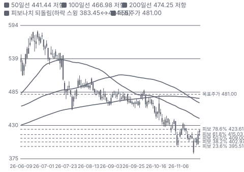

**주봉**

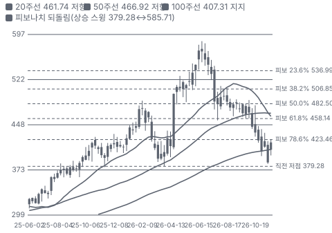

**월봉**

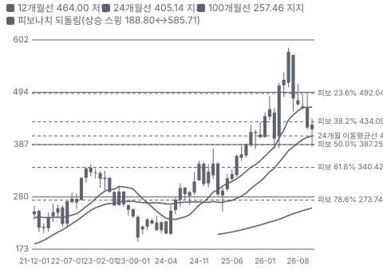

**분기 매출·EPS 실적과 컨센서스**

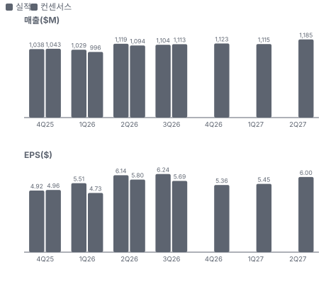

**4Q26 매출 — 지표 추세 vs 가이던스·컨센서스**

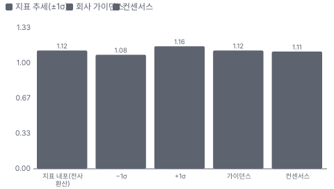

**최근 4개 분기 주가 변화 분석**

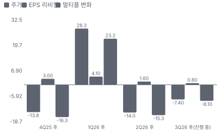

**EPS 리비전**

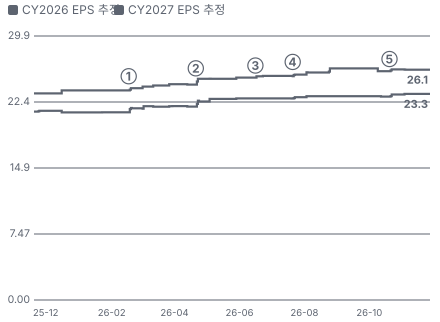

① 26-02-17 4Q25 조정 EPS \$4.92(추정 \$4.95), 당일 −6.6% · EPS 리비전 +2%
② 26-04-21 1Q26 EPS \$5.51(추정 \$4.72), 당일 +11.9% · EPS 리비전 +3%
③ 26-06-16 Investor Day — 2029년 EPS \$35 경로·유틸리티 파이프라인 \$6.7B 제시 · EPS 리비전 +1%
④ 26-07-21 2Q26 EPS \$6.14(추정 \$5.76), 가이던스 상향, 당일 −3.9% · EPS 리비전 +2%
⑤ 26-10-20 3Q26 EPS \$6.24(추정 \$5.70), EPS 가이던스 상향·4분기 마진 둔화 예고, 당일 −0.3% · EPS 리비전 +1%

**멀티플 프리미엄(Fwd 1Y P/E, 최근 4개 분기말 절대값 — 대상 vs 동종 중앙값)**

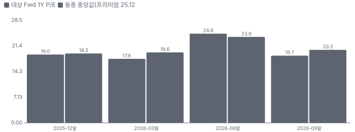

**합리적 멀티플**

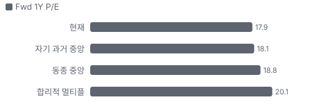

**밸류에이션 주가 시나리오**

**주가별 업사이드**

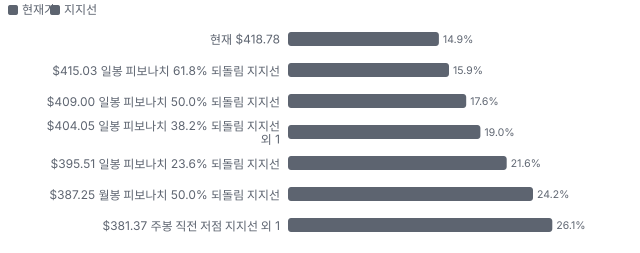
- 제품·서비스 포트폴리오

**공급 병목(10점, 낮을수록 병목)**

**CAPEX의 매출 대비 비중**

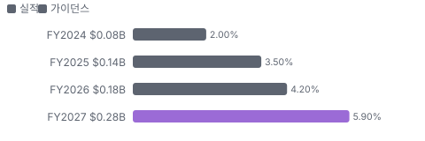

**어닝콜 변화별 주주가치 영향**

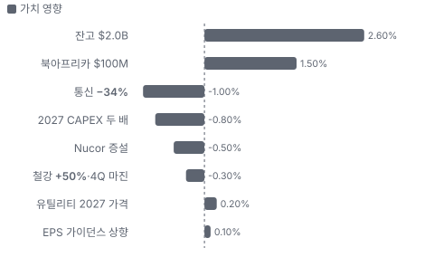

**수주·파이프라인 확실성 사다리**

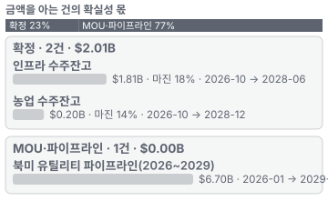

**수주/출하 비율(B/B) × 재고 일수 — 분기별**

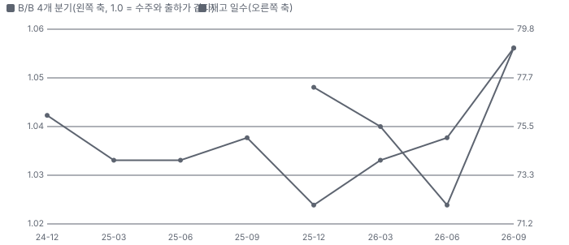

**매출 → 매출총이익 → 영업이익(매출 = 100, 최근 4분기)**

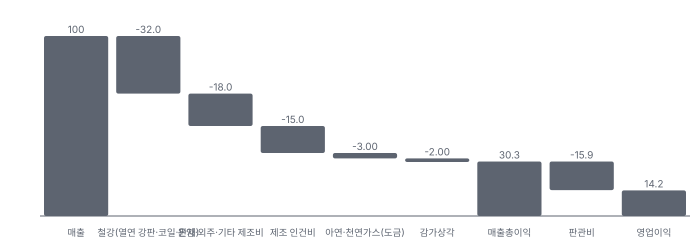

**분기 비용 비중 추이(매출 대비, 공시)**

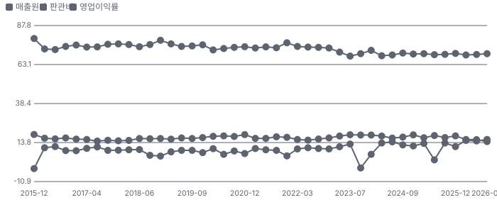

**비용 요인별 매출 대비 비중 1년 변화**

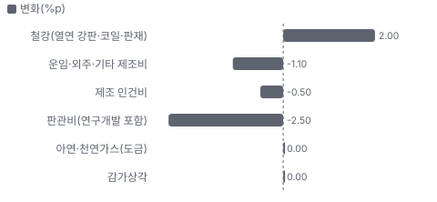

**Infrastructure BOM 원가 몫**

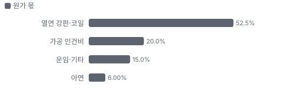

**Agriculture BOM 원가 몫**

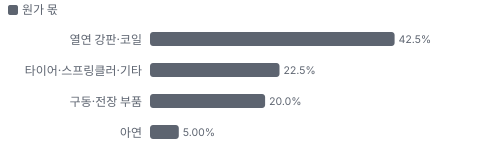

**BOM 항목 가격 +10% 시 OPM 변화**

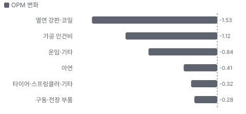

**원가 물가 vs 판매가 물가 — 최근 24개월**

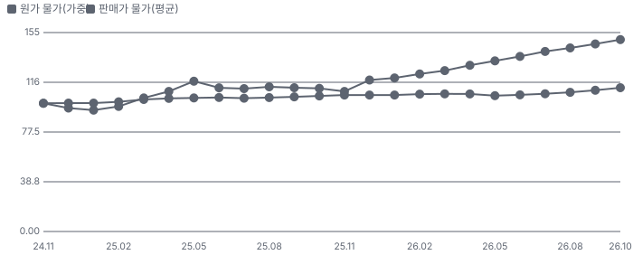

**사업별 매출 vs 물가 — 전년 대비(명목 매출 · 비교 물가 · 실질 = 물량·믹스)**

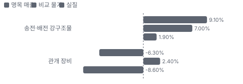

**자산 구성 — 3Q26 분기말 투하자본 \$2,309.0M**

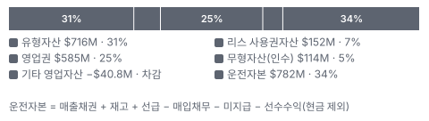

**자산별 변화율 — 최근 12개 분기(4Q23 = 0%) + 다음 4개 분기 추정**

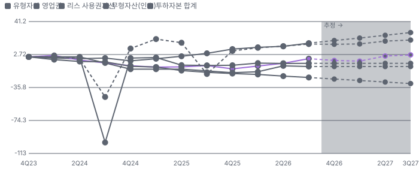

**ROIC 추이 — TTM, 최근 12개 분기 + 다음 4개 분기 추정(컨센서스 NOPAT)**

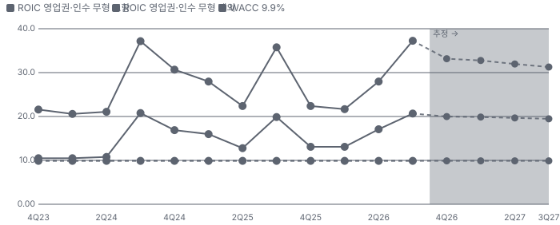

**매출 vs PPI·수출입 — 4Q22 = 100(변화율, 로그 눈금)**

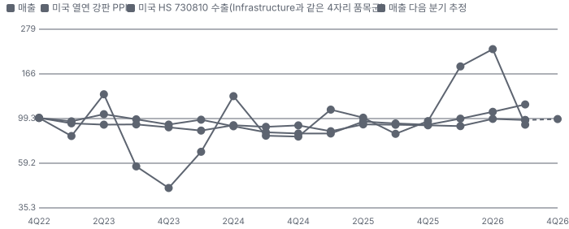

**10년 P·Q 사이클 — 추세(HP 필터) 대비 갭과 8분기 전망**

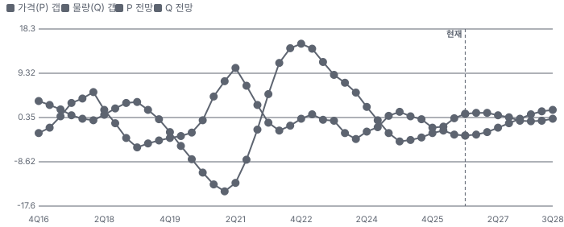

**매출 증가율의 가격·물량 분해와 8분기 전망(전년 대비)**

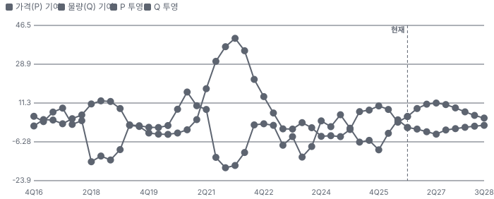

**목표주가 산정 — 시나리오 수정 가중평균(약세 확률 35%→49%), 도달 확률 약 58%**

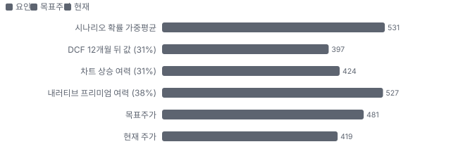

**PEG — 성장 대비 멀티플(낮을수록 성장 대비 쌈)**

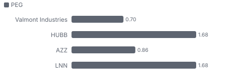

**일별 거래량 분해**

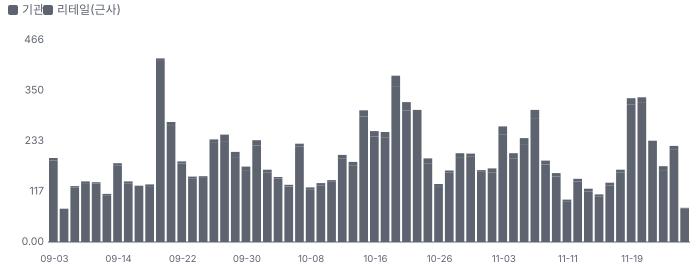

**기관 자금 흐름**

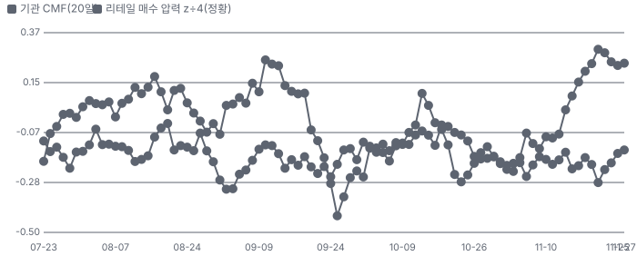

**몬테카를로**

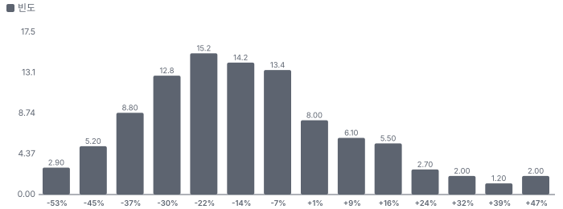

해석: 3,000번 중 727번(24%)에서 가치가 지금 주가 이상이었다. 가정을 흔들어도 지금 주가를 뒷받침하지 못하는 경우가 더 많다. 가운데 값은 0.85배이고, 열 번 중 여덟 번은 0.61~1.17배 사이에 든다.

## 내러티브

> **기업가치를 결정하는 이야기:** 값은 세 가지가 정한다. ① 북미 유틸리티 물량 — 2029 계획 증분 캐파의 20%만 깔렸고 나머지 증설이 매출이 되는 속도 ② 가격 전가 — 철강 지수 연동 계약이 원가 상승분을 2~3개 분기 뒤 회수하는지 ③ 농업 바닥 — 매출의 20%가 저점 이익률(조정 14%대)에서 돌아서는 시점.

> **멀티플·EPS 프리미엄**
> **멀티플:** Fwd 1Y P/E 17.9배 — 지난 36개월 범위 13.3~24.8배의 중간, 동종(Hubbell 19.4배·Lindsay 18.8배·AZZ 16.6배) 중앙값보다 약 5% 낮다. 6월 말 24.8배에서 28% 내려왔다.
> **EPS:** FY2026 EPS 가이던스 \$22.75~23.75(+20% 안팎), 컨센서스 FY2027 \$25.2~26.1·FY2028 \$29.0~30.3. 회사 목표는 2029년 말 \$35.

### 투자자들은 왜 열광했나

4월 1Q 실적에서 북미 유틸리티가 급증하며 하루 +11.9%, 6월 Investor Day에서 2029년 EPS \$35와 유틸리티 파이프라인 \$6.7B를 내놓자 6월 25일 종가 \$583.55까지 올랐다. 식은 계기는 7월 2Q 콜이다 — 철강·운임 원가가 빨라져 하반기 마진이 늘지 않는다고 했고, 10월 3Q 콜은 4분기 마진이 더 눌린다고 했다. 11월 중간선거 뒤 전력 인프라 종목이 함께 밀리며 11월 20일 종가 \$385.66까지 내려갔다.

### 무엇이 기업가치를 바꾸나

> **구조적 체질 변화**
> **변화:** 북미 유틸리티가 연결 매출의 36.5%(3Q25, 계산) → 42.5%(3Q26). 인프라 세그먼트는 77% → 80%. 태양광·접근 시스템 등 저수익 사업은 2025년 손상 처리로 정리했다.
> **증거:** https://www.sec.gov/Archives/edgar/data/102729/000010272926000050/vmi-20260926x10q.htm
> **반증:** 북미 유틸리티 비중이 40% 아래로 내려간다

> **고부가 믹스 확장**
> **변화:** 농업에서 애프터마켓 부품 +12%, 기술 서비스 +7%(3Q). 통신은 가장 수익성 높은 제품군인데 매출이 −33.8%라 믹스에는 역풍.
> **증거:** 3Q26 어닝콜(2026-10-20)
> **반증:** 부품·기술 매출 성장률이 장비 매출보다 낮아진다

> **기술 혁신**
> **변화:** 해당 없음에 가깝다 — 강구조물은 설계·엔지니어링 역량과 납기 신뢰가 차별점이고 제품 기술 변화는 느리다. 관개는 원격 관제·정밀 살수 기술을 얹는다.
> **증거:** https://www.sec.gov/Archives/edgar/data/102729/000010272926000007/vmi-20251227x10k.htm

> **실행 속도**
> **변화:** 업계 리드타임이 60~70주로 늘었다. 회사는 2028년 물량까지 수주하고 있고, 캐파 증설과 함께 공정 흐름·납기 준수를 우선 과제로 둔다. **납품 리드타임 60~70주.** 피어 비교 미확인. 이전 대비 미확인.
> **증거:** 3Q26 어닝콜(2026-10-20)
> **반증:** 납기 지연으로 얼라이언스 고객 물량이 경쟁사로 넘어간다

> **M&A**
> **변화:** 해당 없음(최근 3년 인수는 2026년 1월 RMDS Innovation 잔여 지분 약 \$15M 등 소규모). 자본은 증설과 자사주 매입에 쓴다.
> **증거:** https://www.sec.gov/Archives/edgar/data/102729/000010272926000007/vmi-20251227x10k.htm

> **정책·입법 연관성**
> **재정정책:** 인프라투자법(IIJA)·인플레이션감축법(IRA(인플레이션감축법 — 2022년 미국 청정에너지 세액공제법))이 전력망·도로·청정에너지 투자 재원을 댄다 — 회사 매출과의 연결은 고객(유틸리티·교통 당국) 예산을 거치는 간접 경로이고 회사 몫은 미확인. https://www.sec.gov/Archives/edgar/data/102729/000010272926000007/vmi-20251227x10k.htm 반증: IIJA 재승인(2026년 만료분)이 삭감된다 의회 동의 10/10 — 하원 5/5(IIJA(P.L. 117-58) 하원 본회의 통과·세출 반영) · 상원 5/5(IIJA 상원 본회의 통과).
> **행정명령:** 무역확장법 232조 포고문(2026-04-02·06-01) — 강관주(강판을 다각형으로 접어 만든 송전·배전용 강철 기둥) 등 철강 파생 제품 관세를 미국산 철강 함량(85% 이상이면 10%, 아니면 최대 50%)으로 가른다. 회사는 멕시코 생산 강관주 대부분에 10%가 적용된다고 본다. 미국 내 생산에는 보호막, 멕시코 생산분에는 비용. https://www.sec.gov/Archives/edgar/data/102729/000010272926000050/vmi-20260926x10q.htm 반증: 함량 기준이 다시 올라가거나 세관 평가 문의에서 추가 관세가 확정된다 의회 동의 2/10 — 하원 1/5(대통령 포고문 — 의회 논의 없음) · 상원 1/5(대통령 포고문 — 의회 논의 없음).
> **연관입법:** 해당 없음 — 송전 인허가 개혁 법안은 통과된 것이 없고 단계는 미확인

> **고객의 지출 예산**
> **변화:** 매출의 약 80%가 고객의 설비투자 예산에 걸려 있다.
> **사업별 예산:** **매출의 42%**: 북미 유틸리티 구조물 — 고객 CAPEX(전력 유틸리티 송전·배전·변전 설비투자(요금 기반 자산)) · 동인: 부하 증가·노후 교체·복원력 투자
**매출의 20%**: 농업 관개 — 고객 CAPEX(농가 장비 투자(딜러 경유) — 부품·기술 서비스는 운영비) · 동인: 곡물가·금리·농가 소득, 해외는 식량 안보 프로젝트
**매출의 14%**: 해외 인프라·태양광 — 고객 CAPEX(해외 유틸리티·교통 당국·태양광 개발사 설비투자) · 동인: 각국 전력망·도로 투자
**매출의 12%**: 북미 조명·교통 — 고객 CAPEX(주·지방 교통 당국과 건설사 도로·조명 예산) · 동인: 도로 예산·주거·상업 건설
**매출의 6%**: 북미 코팅 — 고객 혼합(철강 가공 고객의 도금 외주비(프로젝트 원가)) · 동인: 인프라·데이터센터 건설 물량
**매출의 5%**: 북미 통신 — 고객 CAPEX(통신사·타워 회사 기지국 설비투자) · 동인: 5G 이후 주파수·사이트 개조 일정
> **증거:** https://www.sec.gov/Archives/edgar/data/102729/000010272926000050/vmi-20260926x10q.htm
> **반증:** 미국 유틸리티 송배전 투자 계획이 요금 부담 때문에 삭감된다

### 내러티브 근거

> 미국 전력망 증설의 강구조물 1위 공급사라는 이야기는 셀사이드·기관이 모두 받아들였다. 6월 고점 뒤 이야기가 깨진 것이 아니라, 철강 원가가 판매가보다 먼저 올라 생긴 마진 지연과 2027년 투자 확대가 배수를 깎았다. 동종 대비 멀티플 차이 -5% 중 회사 고유 몫은 -11%다. 단계는 컨센서스, 쏠림은 중간이다.

> **전력망 증설 — 송전·배전·변전 구조물** · 강화
> **논리:** 부하 증가(데이터센터·전기화)와 노후 교체로 유틸리티 투자가 여러 해 이어지고, 강구조물은 리드타임 60~70주의 공급 부족 품목이다.
> **숫자:** 3Q26 북미 유틸리티 매출 \$469.6M(+23.0%, 연결 매출의 43%), 인프라 잔고 \$1.81B(1년 전 \$1.63B)
> **반증:** 인프라 잔고가 2개 분기 연속 줄거나 북미 유틸리티 성장률이 한 자릿수로 내려간다
> **출처:** 3Q26 10-Q·3Q26 어닝콜(2026-10-20)

> **2029년 EPS \$35 경로** · 유지
> **논리:** Investor Day 목표(매출 연 7%, 영업이익률 17%, EPS \$35)는 증설 물량과 가격, 자사주 매입으로 간다.
> **숫자:** FY2026 EPS 가이던스 \$22.75~23.75 → 2029년 \$35는 연 14% 성장. 컨센서스 FY2028 \$29.0~30.3
> **반증:** FY2027 가이던스 중간값이 EPS \$25 아래
> **출처:** Investor Day 자료(8-K 2026-06-16)·3Q26 어닝콜(2026-10-20)

> **가격 전가 — 계약 연동과 2~3개 분기 지연** · 약화
> **논리:** 유틸리티 계약은 제3자 철강 지수에 연동돼 원가를 넘기지만 잔고가 길어 반영이 2~3개 분기 늦다. 원가가 멈추면 마진이 회복된다.
> **숫자:** 철강 지수 전년 대비 약 +50%, 3Q 인프라 영업이익률 17.6%(전년 17.8%), 4분기 추가 압박 예고
> **반증:** 철강 지수가 멈춘 뒤 3개 분기가 지나도 인프라 영업이익률이 17%를 넘지 못한다
> **출처:** 3Q26 어닝콜(2026-10-20)

> **농업 바닥 통과와 고마진 부품·기술** · 유지
> **논리:** 관개 장비는 곡물가·금리로 바닥이지만 부품·기술 매출이 늘고 대형 해외 프로젝트가 돌아온다.
> **숫자:** 3Q 농업 매출 −6.4%, 부품 +12%·기술 서비스 +7%, 북아프리카 \$100M(1H27 출하 시작)
> **반증:** 북아프리카 출하가 2027년 하반기로 밀리거나 북미 농업 매출이 다시 감소한다
> **출처:** 3Q26 어닝콜(2026-10-20)

> **반대 — 원가 지연·증설 경쟁·투자 부담** · 강화
> **논리:** 철강이 계속 오르면 마진 회복이 밀리고, Nucor 등 신규 캐파가 2028년 이후 가격을 누르며, 2027년 CAPEX 두 배가 잉여현금흐름을 줄인다.
> **숫자:** Fwd 1Y P/E 24.8배(6월 말) → 17.9배, 4Q26 EPS 추정 −6%, 2027년 CAPEX 컨센서스 \$280M(2026년 \$185M)
> **반증:** 4Q26 인프라 영업이익률이 17% 이상이고 FY2027 가이던스가 EPS \$26 이상
> **출처:** 3Q26 어닝콜(2026-10-20)·컨센서스 변경 이력

### 투자 포인트

> **이익은 올랐고 배수만 깎였다**
> **명제:** 2Q 콜 전부터 지금까지 주가는 −20%인데 FY2027 EPS 추정은 +2.8%다 — 하락의 전부가 배수다.
> **숫자:** 주가 \$525.88 → \$418.78, FY2027 EPS 추정 \$25.37 → \$26.08, Fwd 1Y P/E 24.8배(6월 말) → 17.9배
> **시장과 다른 점:** 시장은 마진 둔화를 수요 문제처럼 할인했다 — 잔고는 같은 기간 \$1.67B에서 \$2.01B로 늘었다
> **증명:** 4Q26 인프라 영업이익률과 FY2027 EPS 가이던스(\$25 이상인지)
> **출처:** 컨센서스 변경 이력·https://www.sec.gov/Archives/edgar/data/102729/000110465926117126/vmi-ex99d1.htm

> **원가 지연은 계약 구조의 시간차다**
> **명제:** 철강 지수 연동 계약은 원가 상승분을 2~3개 분기 뒤 판매가로 회수한다 — 지수가 멈추면 마진이 따라 오른다.
> **숫자:** 철강 지수 전년 대비 약 +50%에도 3Q 인프라 영업이익률 17.6%(전년 17.8%), 북미 유틸리티 가격 기여 약 10%
> **시장과 다른 점:** 4Q26 EPS 추정이 \$5.76에서 \$5.42로 내려가며 마진 둔화가 구조적인 것처럼 읽혔다 — 제 판단으로는 시간차다. 다만 철강이 계속 오르면 시간차가 계속 이어진다
> **증명:** 철강 지수가 멈춘 뒤 2~3개 분기 안에 인프라 영업이익률 18% 이상
> **출처:** 3Q26 어닝콜(2026-10-20)

> **증설의 20%만 깔렸다**
> **명제:** 북미 유틸리티는 캐파가 매출을 정한다 — 2029 계획 증분 캐파의 80%가 아직 남았다.
> **숫자:** 3Q 북미 유틸리티 +23%(물량 과반), 업계 리드타임 60~70주, 2028년 물량까지 수주, 2027년 성장 CAPEX 두 배
> **시장과 다른 점:** 컨센서스 FY2027 매출 성장 7~8%는 회사 장기 목표(연 7%)와 같다 — 증설이 계획보다 빨리 가동되면 위로 열려 있고, Nucor 등 경쟁 증설이 먼저 들어오면 가격이 깎인다
> **증명:** 분기마다 밝히는 증분 캐파 설치 비율과 북미 유틸리티 물량 성장률
> **출처:** 3Q26 어닝콜(2026-10-20)·Investor Day 자료

### 모멘텀 생성·소멸 타임라인

**카탈리스트 달력 — 지난 사건의 주가 반응과 앞으로 확인할 숫자**
| 날짜 | 상태 | 구분 | 사건 | 반응·확인 | 결과에 따라 |
|---|---|---|---|---|---|
| 2026-04-21 | 완료 | 생성 | 1Q26 실적 — EPS \$5.51(추정 \$4.72) | +11.9% |  |
| 2026-06-16 | 완료 | 생성 | Investor Day — 2029년 EPS \$35·유틸리티 파이프라인 \$6.7B | +2.9% |  |
| 2026-07-21 | 완료 | 소멸 | 2Q26 실적 — 가이던스 상향에도 하반기 마진 정체 예고 | −3.9% |  |
| 2026-10-20 | 완료 | 소멸 | 3Q26 실적 — 잔고 \$2.0B, 4분기 마진 둔화 예고 | −0.3% |  |
| 2026-11-05 | 완료 | 매크로 | 중간선거 직후 전력 인프라 종목 약세(원인 미확인) | −5.4% |  |
| 2027-02-16(예상) | 예정 | 확인 | 4Q26 실적·FY2027 가이던스 | FY2027 EPS 가이던스 중간값 \$25 이상, 4Q 인프라 영업이익률 17% 이상, 인프라 잔고 \$1.8B 유지 | 넘으면 기본 시나리오 유지·강세 쪽, EPS \$24 아래면 약세 시나리오 |
| 2027-04-20(예상) | 예정 | 확인 | 1Q27 실적 — 가격 반영 시차 확인 | 인프라 영업이익률이 전 분기보다 오르는지, 북아프리카 출하 시작 여부 | 두 분기 연속 하락이면 마진 회복이 2027년 하반기 이후로 밀린다 |
| 2027-06(예상) | 예정 | 매크로 | 철강 232조 관세·IIJA 재승인 논의 | 미국산 함량 기준 변경과 도로·전력망 예산 규모 | 관세 강화는 멕시코 생산분 원가 상승, 예산 유지는 조명·교통 수요 유지 |

### 언제 사서 언제 팔아야 할까?

**가격·조건 틀 — 가격은 밸류에이션(약세·기본·강세·목표주가)과 차트 지지 구간에서, 조건은 이벤트에서**
| 구간 | 가격 | 목표주가까지 | 약세까지 | 조건·근거 |
|---|---|---|---|---|
| 관찰 구간 | \$415~\$415 | +16% | -16% | 11월 20일 종가 저점(\$385.66)과 3월 말 저점(\$384.03)이 겹치는 구간은 Fwd 1Y P/E 16배대로, 36개월 범위의 아래쪽이다 |
| 확인 뒤 | 지금 \$419 이상에서 조건 확인 | +15% | -17% | 4Q26 실적에서 FY2027 EPS 가이던스 중간값 \$25 이상과 인프라 잔고 \$1.8B 유지 |
| 무효화 | 약세 시나리오 \$347 | - | -17% | FY2027 가이던스가 EPS \$24 아래이거나 인프라 잔고가 2개 분기 연속 줄면 전력망 물량 논리가 무효 |
| 차익 고민 1차 | \$528(기본 시나리오) | +26% | - | 목표주가 근처에서는 배수 정상화가 상당 부분 반영된다 — 그 위는 2029년 목표의 조기 달성이 필요하다 |
| 차익 고민 2차 | \$719(강세 시나리오) | +72% | - | 목표주가 근처에서는 배수 정상화가 상당 부분 반영된다 — 그 위는 2029년 목표의 조기 달성이 필요하다 |

실적일 하루 변동이 −6.6%~+11.9%였다 — 발표 직후 추격은 경계 가격·조건 틀이며 매매·비중 지시가 아니다(투자 권유 아님).

## 포트폴리오

| 제품·서비스 | 구분 | 무엇 | 쓰는 곳 | 돈 버는 방식 | Mix | Mix 변화(전 분기 대비) |
|---|---|---|---|---|---|---|
| Infrastructure(인프라 세그먼트 — 송전·배전 강구조물, 조명·교통 기둥, 통신 구조물, 아연도금) | 제품 | 송전·배전·변전용 강관주와 철 구조물, 도로 조명·신호 기둥, 통신 타워 부품, 아연도금 서비스 | 전력 유틸리티 송배전 선로, 주·지방 도로, 통신 기지국, 외부 철강 가공 고객 | 3Q26 매출의 80%, 영업이익률 17.6% | 80% | +1.3%p |
| Agriculture(농업 세그먼트 — 관개 장비와 부품·기술 서비스) | 제품 | Valley 브랜드 센터 피벗(밭 가운데 축을 중심으로 긴 살수 파이프가 원을 그리며 도는 관개 장비)·리니어 관개(살수 파이프가 밭을 직선으로 이동하며 물을 주는 관개 장비) 장비와 부품, 원격 관제·정밀 살수 기술 | 북미·브라질·중동·아프리카 대규모 경작지 — 딜러 약 650곳 경유 | 3Q26 매출의 20%, 영업이익률 17.9%(일회성 제외 14%대) | 20% | -1.3%p |

**Mix 변화가 가장 큰 쪽은 Infrastructure(+1.3%p, 전 분기 대비).** 계절성 판정: 분기 매출 계절 지수 기준 없음 → 직전 분기와 비교.

## 수주·파이프라인

> **2026-09-26 기준 3건.** 확정 \$2.01B. 공시 수주잔고 \$2.01B. 서로 겹치는 항목은 합계에서 뺐다.

**수주 목록**
| 상태 | 계약 | 계약 총액 | 진척 | 기간 | 비고 |
|---|---|---|---|---|---|
| 확정 | 인프라 수주잔고 | \$1.81B | - | 2026-10 → 2028-06 | 1년 전 \$1.63B, 직전 분기 \$1.58B |
| 확정 | 농업 수주잔고 | \$0.20B | - | 2026-10 → 2028-12 | 직전 분기 \$91.3M. 3분기에 딴 북아프리카 관개 프로젝트 \$100M(1H27 출하 시작, 18~24개월, 마진은 기준보다 약간 낮음)이 증가분의 대부분으로 보인다 — 잔고 편입 여부는 회사가 따로 밝히지 않았다(추정) |
| 파이프라인 | 북미 유틸리티 파이프라인(2026~2029) | \$6.70B | - | 2026-01 → 2029-12 | 주문이 아니다 — 잔고로 전환된 몫만 매출로 본다 (다른 항목과 겹칠 수 있어 합계에서 뺌) |

**실행 속도와 방해 요인**
| 항목 | 상태 | 실행 속도 | 방해 요인 |
|---|---|---|---|
| 인프라 수주잔고 | 확정 | 약 6개월치(계산 — 잔고 ÷ 3Q 인프라 월평균 매출 \$294M) | 강구조물·도금 캐파 · 철강 원가의 가격 반영 지연 |
| 농업 수주잔고 | 확정 | 미확인 | 중동 분쟁·운임 · 브라질 금리 |
| 북미 유틸리티 파이프라인(2026~2029) | 파이프라인 | 미확인 | 유틸리티 인허가·요금 심사 · 장납기 설비·시공 인력 |

## 마진 구조

> **GPM 30.0%, OPM 15.7%.** 3Q25 대비 GPM -0.4%p, OPM +2.1%p. 변동비는 매출의 61%이고, 매출이 10% 늘면 OPM은 +2.1%p 움직인다. 3Q26 매출총이익률 30.0%(전년 30.4%), 영업이익률 15.7%(전년 13.5%). 원가는 철강·아연이 눌렀고 판관비율이 16.9% → 14.4%로 내려가 영업이익률을 올렸다. 3분기에는 IEEPA(국제비상경제권한법 — 미국 대통령이 관세를 매긴 근거 법) 관세 환급 \$7.3M(매출원가 차감)과 농업 회수 약 \$7M이 들어 있다.

> **매출 100 중 매출원가 69.7, 매출총이익 30.3(최근 4분기, 공시).** 매출원가 요인 중 철강(열연 강판·코일·판재)이 매출의 32.0%로 가장 무겁고, 단가가 +10% 오르면 GPM이 -3.20%p 움직인다. 분기 회귀로 매출 1이 늘 때 매출원가는 0.64 늘고, 매출원가의 고정비 몫은 12%다.

**비용 요인 강도 — 비중·추세·충격(+10%)·탄력**
| 비용 | 구분 | 매출 대비 | 1년 변화 | 마진 기여 | 충격 시 마진 | 매출 탄력 | 고정비 몫 |
|---|---|---|---|---|---|---|---|
| 철강(열연 강판·코일·판재) | 매출원가 요인 | 32.0% | +2.0%p | -2.0%p | -3.20%p | 미확인 | 0% |
| 운임·외주·기타 제조비 | 매출원가 요인 | 18.0% | -1.1%p | +1.1%p | -1.80%p | 미확인 | 30% |
| 제조 인건비 | 매출원가 요인 | 15.0% | -0.5%p | +0.5%p | -1.50%p | 미확인 | 40% |
| 아연·천연가스(도금) | 매출원가 요인 | 3.0% | +0.0%p | -0.0%p | -0.30%p | 미확인 | 0% |
| 감가상각 | 매출원가 요인 | 2.0% | +0.0%p | -0.0%p | -0.20%p | 미확인 | 100% |
| 매출원가 | 공시 항목 | 69.7% | +0.0%p | -0.0%p | -6.97%p | 0.64 | 12% |
| 판관비 | 공시 항목 | 15.9% | -1.8%p | +1.8%p | 미확인 | 0.18 | -5% |

매출 탄력 = 분기 비용을 매출에 회귀한 기울기(매출 1당 변동비), 고정비 몫 = 절편 ÷ 평균 비용. 표본이 8분기 미만이면 미확인. 매출원가 요인 비중은 margin 재료의 추정이 섞여 있고, 공시 매출원가와의 차이는 '기타 매출원가'로 둔다.

**GPM에서 OPM까지(GAAP — 분기 손익(13주), 아래는 최근 4개 분기)**
| 기간 | GPM | 연구개발 | 판관비 | 기타 | OPM |
|---|---|---|---|---|---|
| 3Q25 | 30.4% | 0.0% | 16.9% | 0.0% | 13.5% |
| 3Q26 | 30.0% | 0.0% | 14.4% | 0.0% | 15.7% |
| 2025-12 | 29.8% | - | - | - | 11.2% |
| 2026-03 | 30.8% | - | - | - | 15.1% |
| 2026-06 | 30.5% | - | - | - | 14.8% |
| 2026-09 | 30.0% | - | - | - | 15.7% |

**비용을 움직이는 요인**
| 비용 | 요인 |
|---|---|
| 철강(열연 강판·코일·판재, 매출원가) | 열연 강판 지수 — 계약 연동 기준 전년 대비 약 +50% · 근거 추정 |
| 운임·외주·기타 제조비(매출원가) | 경유 가격·증설 램프 비용 · 근거 추정 |
| 제조 인건비(매출원가) | 임금·증설 인력 충원 · 근거 추정 |
| 판관비(연구개발 포함, 판관비) | 인력·성과급·대손(브라질) · 근거 공시 |
| 아연·천연가스(도금, 매출원가) | 아연 가격·가스 요금 · 근거 추정 |
| 감가상각(매출원가) | 증설 설비 가동 · 근거 공시 |

**Infrastructure BOM — 매출의 80%, GPM 30%(세그먼트 매출총이익 미공시 — 전사 매출총이익률 30.0% 대용(세그먼트 영업이익률 17.6%)), 항목 가격 +10% 시**
| 항목 | 원가 몫 | 전가 | 제품 GPM | OPM |
|---|---|---|---|---|
| 열연 강판·코일 | 45~60% | 80% | -1.6%p | -0.93%p |
| 가공 인건비 | 15~25% | 미확인 | -1.4%p | -1.12%p |
| 운임·기타 | 10~20% | 미확인 | -1.1%p | -0.84%p |
| 아연 | 4~8% | 미확인 | -0.4%p | -0.33%p |
| 미분해 | 6% | - | - | - |

**Agriculture BOM — 매출의 20%, GPM 30%(세그먼트 매출총이익 미공시 — 전사 매출총이익률 대용(세그먼트 영업이익률 17.9%)), 항목 가격 +10% 시**
| 항목 | 원가 몫 | 전가 | 제품 GPM | OPM |
|---|---|---|---|---|
| 열연 강판·코일 | 35~50% | 미확인 | -3.0%p | -0.60%p |
| 타이어·스프링클러·기타 | 15~30% | 미확인 | -1.6%p | -0.32%p |
| 구동·전장 부품 | 15~25% | 미확인 | -1.4%p | -0.28%p |
| 아연 | 3~7% | 미확인 | -0.4%p | -0.07%p |
| 미분해 | 10% | - | - | - |

열연 강판·코일 가격이 +10% 오르면 영업이익은 -9.8% 움직인다. 판매가 전가를 모르는 항목은 전가 0%로 계산했다.

**BOM 항목 가격을 움직이는 것**
| 항목 | 요인 |
|---|---|
| 열연 강판·코일 | 강관 몸체의 거의 전부 · 근거 추정 |
| 아연 | 용융 도금 원료 · 근거 추정 |
| 가공 인건비 | 절곡·용접·도금 공정 · 근거 추정 |
| 운임·기타 | 대형 구조물 장거리 운송 · 근거 추정 |
| 열연 강판·코일 | 스팬 파이프·트러스 강재 · 근거 추정 |
| 구동·전장 부품 | 모터·기어박스·제어 패널 · 근거 추정 |
| 아연 | 강관 도금 · 근거 추정 |
| 타이어·스프링클러·기타 | 외부 구매 부품 · 근거 추정 |

> **원가·판매가 물가 격차 -27.9%p** — 판매가 물가가 투입 원가 물가보다 느리게 오른다.

**투입 물가 — 미국 PPI 3·6·12개월(2026-10, 개정 반영)**
| 항목 | 미국 3개월 | 6개월 | 12개월 | 전가 못 할 때 OPM |
|---|---|---|---|---|
| 열연 강판·코일 | +6.7% | +17.0% | +32.9% | - |
| 아연 | +6.1% | +5.6% | +42.7%* | - |

별표는 품목보다 넓은 업종 지수다. 연결한 투입 원가의 미국 PPI(생산자물가지수)는 1년 새 가중 +33.8%이고, 판매가로 넘기지 못하면 GPM -11.8%p·OPM -11.8%p가 움직인다. 송전·배전 강구조물 가격은 +10.0%로 비교 물가(철탑·격자 기둥(송전 구조물) PPI, 2026-10) +9.2%보다 0.8%p 더 올랐다. 물가 지수를 붙이지 못한 매출원가 항목은 제조 인건비, 감가상각, 운임·외주·기타 제조비다(미연결). 송전·배전 강구조물 매출은 2026-09 전년 대비 +9.1%이고 비교 물가 ppi:steel_towers의 변화 +7.0%(2026-09)를 빼면 실질 +1.9% — 성장 대부분이 가격(물가)이다. 관개 장비 매출은 2026-09 전년 대비 -6.3%이고 비교 물가 ppi:irrigation_equipment의 변화 +2.4%(2026-09)를 빼면 실질 -8.6% — 물가를 빼면 줄었다 — 물량이 빠진다.

## 자산 구성

> **3Q26 분기말 투하자본 \$2.31B** — 운전자본 34%, 유형자산 31%. 최근 12개 분기(4Q23 → 3Q26) 가장 크게 늘어난 자산은 유형자산(+16%), 투하자본 합계 +15%. 3Q27 추정 투하자본 \$2.40B(+4%, 컨센서스 매출과 회전 일수·CAPEX 강도 유지 가정). 연율 감가 비율(총액 기준)은 직전 4분기 5.83% → 최근 4분기 5.83%, 직전 비율이면 감가상각이 \$0.1M 더 컸다(영업이익의 0.0%).

**자산·운전자본 항목별 분기말 잔액 — 최근 12개 분기와 다음 4개 분기 추정**
| 항목 | 4Q23 | 3Q25 | 3Q26(최근) | 3Q27 추정 | 12개 분기 변화 | 다음 4개 분기 변화 |
|---|---|---|---|---|---|---|
| 매출채권 | 미확인 | 미확인 | \$651.7M | \$711.9M | 비교 불가 | +9% |
| 재고자산 | \$658.4M | \$591.4M | \$644.8M | \$673.5M | -2% | +4% |
| 선급·기타 유동자산 | \$92.5M | \$95.5M | \$101.2M | \$102.0M | +9% | +1% |
| 매입채무 | \$358.3M | \$377.3M | \$406.5M | \$427.5M | +13% | +5% |
| 미지급비용 | \$146.9M | \$156.7M | \$144.1M | \$172.1M | -2% | +19% |
| 선수수익(계약부채) | \$71.0M | \$81.1M | \$64.9M | \$76.5M | -9% | +18% |
| 유형자산 | \$617.4M | \$642.9M | \$716.3M | \$793.0M | +16% | +11% |
| 리스 사용권자산 | \$171.6M | 미확인 | \$152.2M | \$152.2M | -11% | +0% |
| 영업권 | \$633.0M | \$570.0M | \$584.7M | \$584.7M | -8% | +0% |
| 무형자산(인수) | \$150.7M | \$123.4M | \$114.4M | \$103.7M | -24% | -9% |

**자산 추정 동인 — 최근 4개 분기 평균(재무상태표 동인 모형)**
| 동인 | 값 | 곱하는 기준 |
|---|---|---|
| 매출채권 | 54일 | 매출 |
| 재고자산 | 73일 | 매출원가 |
| 선급·기타 유동자산 | 8일 | 매출 |
| 매입채무 | 47일 | 매출원가 |
| 미지급비용 | 13일 | 매출 |
| 선수수익(계약부채) | 6일 | 매출 |
| CAPEX 강도 | 3.7% | 매출(최근 4개 분기 합) |
| 분기 감가율 | 3.16% | 기초 유형자산 순액(무형 상각 제외 감가상각) |
| 매출원가율 | 69.7% | 매출(최근 4개 분기) |
| 영업권·리스 사용권·기타 | 유지 | 인수·새 리스는 공시 전 모름 |
| 인수 무형자산 | 분기 \$2.7M 상각 | 최근 4개 분기 평균 상각 |

**추정 방법:** 증권사 3표 모델(손익·재무상태표·현금흐름)의 재무상태표 동인 방식이다. 운전자본은 항목별 회전 일수(매출채권·선급·미지급·선수는 매출, 재고·매입채무는 매출원가 기준)를 최근 4개 분기 평균으로 두고 컨센서스 매출에 곱한다. 유형자산은 기초 + CAPEX − 감가상각으로 굴린다(Koller·Goedhart·Wessels 『Valuation』 재무상태표 추정). 매출 경로는 ROIC 절의 컨센서스와 같다.

**유형·무형자산 항목별 가치(2025-12-27 vs 2024-12-28)**
| 구분 | 항목 | 총액 2025-12-27 | 누적상각 | 순액 | 총액 2024-12-28 | 총액 1년 변화 | 공시 내용연수 |
|---|---|---|---|---|---|---|---|
| 유형 | 토지·개량 | \$136.0M | \$0.0M | \$136.0M | \$118.2M | +15.1% | 비상각 |
| 유형 | 건물·개량 | \$430.6M | 총계만 공시 | 총계만 공시 | \$405.7M | +6.1% | 10~30년 |
| 유형 | 기계·장비 | \$804.2M | 총계만 공시 | 총계만 공시 | \$738.3M | +8.9% | 3~15년 |
| 유형 | 운송 장비 | \$31.7M | 총계만 공시 | 총계만 공시 | \$29.8M | +6.5% | 5~10년 |
| 유형 | 사무 가구·장비 | \$133.3M | 총계만 공시 | 총계만 공시 | \$135.3M | -1.5% | 3~7년 |
| 유형 | 건설 중 자산 | \$104.7M | \$0.0M | \$104.7M | \$74.6M | +40.4% | 비상각 |
| 영업권 | 영업권 | \$571.0M | \$0.0M | \$571.0M | \$623.8M | -8.5% | 비상각 |
| 무형 | 고객 관계 | \$219.6M | \$165.5M | \$54.1M | \$230.1M | -4.5% | 미확인 |
| 무형 | 기술(특허·자체 기술) | \$28.2M | \$16.4M | \$11.8M | \$26.2M | +7.4% | 미확인 |
| 무형 | 상표(비상각) | \$55.4M | \$0.0M | \$55.4M | \$57.7M | -4.0% | 비상각 |
| 무형 | 기타(상각 상표 포함) | \$0.6M | \$0.6M | \$0.0M | \$7.3M | -91.6% | 미확인 |
| 유형 합계 | 유형자산 | \$1,640.6M | \$966.7M | \$673.9M | \$1,502.0M | +9.2% | 경과율 69%(상각 대상 기준) |

**내용연수 산식(상각 대상 유형자산 = 총액 − 토지 − 건설중)**
| 기준일 | 연 감가상각 | 상각 대상 총액 | 평균 내용연수 | 경과 연수 | 잔여 연수 | 경과율 |
|---|---|---|---|---|---|---|
| 2025-12-27 | \$77.3M | \$1,399.9M | 18.1년 | 12.5년 | 5.6년 | 69% |
| 2024-12-28 | \$81.2M | \$1,309.2M | 16.1년 | 11.2년 | 4.9년 | 70% |

산식 평균 내용연수는 18.1년이며, 공시 범위의 총액 가중 중간값 12.0년(가중 범위 5.2~18.7년)과 +51% 어긋난다 — 범위가 넓거나 상각을 끝낸 자산이 많으면 생기는 차이라 회사별로 원인을 본다. 1년 전 16.1년 → 지금 18.1년.

**분기 감가 비율(감가상각 ÷ 평균 유형자산 총액)**
| 분기 | 감가상각 | 평균 유형자산(총액) | 분기 비율 | 연율 | 연율의 역수 |
|---|---|---|---|---|---|
| 4Q24 | \$24.9M | \$1,526.9M | 1.63% | 6.51% | 15.4년 |
| 1Q25 | \$21.5M | \$1,518.5M | 1.42% | 5.67% | 17.6년 |
| 2Q25 | \$22.3M | \$1,556.8M | 1.43% | 5.72% | 17.5년 |
| 3Q25 | \$21.6M | \$1,588.0M | 1.36% | 5.45% | 18.3년 |
| 4Q25 | \$23.1M | \$1,619.0M | 1.43% | 5.70% | 17.5년 |
| 1Q26 | \$22.6M | \$1,640.2M | 1.38% | 5.51% | 18.1년 |
| 2Q26 | \$24.2M | \$1,649.3M | 1.47% | 5.88% | 17.0년 |
| 3Q26 | \$26.0M | \$1,675.9M | 1.55% | 6.21% | 16.1년 |

감가상각 기준: 손익계산서 감가상각·상각비(SEC 공시 데이터, 4분기 = 연간 − 1~3분기).

최근 4분기 연율 감가 비율 5.83%, 직전 4분기 5.83%(0%) — 경고 문턱(-10%) 안이다.

미공시·미분해: 유형자산 항목별 누적 감가상각(10-K는 합계만 공시) — 이 칸은 비우고 나머지로 계산했다.

### 해석 — 자산이 어디에 쌓이고 있나

- 같은 기간 4개 분기 매출은 +6% — 매출보다 빨리 늘어난 자산: 유형자산 +16%. 이 자산의 회전율이 떨어지면 ROIC를 희석한다.
- 다음 4개 분기 CAPEX \$169.1M vs 감가상각 \$94.2M(최근 4개 분기 CAPEX 강도·감가율 유지) — 유형자산 3Q26 \$716.3M → 3Q27 \$793.0M. 투자가 감가보다 커서 자산이 쌓이는 국면이다.

## ROIC

> **TTM 3Q26 ROIC는 영업권·인수 무형 포함 20.7%, 제외 37.3%**(NOPAT 마진 11.0% × 투하자본 회전율 1.88회). 최근 12개 분기 4Q23 10.5% → 3Q26 20.7%(고점 3Q24 20.8%). 컨센서스 NOPAT으로 굴리면 3Q27 19.5%(제외 31.3%) — WACC 9.9% 대비 +9.6%p. 1년 변화의 가장 큰 요인은 NOPAT 마진(+6.4%p).

**ROIC 추이(TTM)와 다음 4개 분기 추정 — NOPAT ÷ 평균 투하자본(이번 분기말·4개 분기 전)**
| 분기 | 구분 | TTM 매출 | TTM NOPAT | NOPAT 마진 | 평균 투하자본 | ROIC 포함 | ROIC 제외 |
|---|---|---|---|---|---|---|---|
| 4Q23 | 실적 | \$4,174.6M | \$239.1M | 5.7% | \$2,272.4M | 10.5% | 21.6% |
| 1Q24 | 실적 | \$4,089.9M | \$247.3M | 6.0% | \$2,363.2M | 10.5% | 20.6% |
| 2Q24 | 실적 | \$4,083.4M | \$256.2M | 6.3% | \$2,376.3M | 10.8% | 21.1% |
| 3Q24 | 실적 | \$4,053.3M | \$367.0M | 9.1% | \$1,762.8M | 20.8% | 37.2% |
| 4Q24 | 실적 | \$4,075.0M | \$410.0M | 10.1% | \$2,423.9M | 16.9% | 30.7% |
| 1Q25 | 실적 | \$4,066.5M | \$406.0M | 10.0% | \$2,536.8M | 16.0% | 28.0% |
| 2Q25 | 실적 | \$4,077.3M | \$317.1M | 7.8% | \$2,469.4M | 12.8% | 22.4% |
| 3Q25 | 실적 | \$4,103.1M | \$328.5M | 8.0% | \$1,654.6M | 19.9% | 35.8% |
| 4Q25 | 실적 | \$4,104.1M | \$325.4M | 7.9% | \$2,493.1M | 13.1% | 22.4% |
| 1Q26 | 실적 | \$4,164.0M | \$345.0M | 8.3% | \$2,641.9M | 13.1% | 21.7% |
| 2Q26 | 실적 | \$4,232.1M | \$447.6M | 10.6% | \$2,616.9M | 17.1% | 28.0% |
| 3Q26 | 실적 | \$4,289.9M | \$470.9M | 11.0% | \$2,276.0M | 20.7% | 37.3% |
| 4Q26 | 추정 | \$4,375.0M | \$508.5M | 11.6% | \$2,542.5M | 20.0% | 33.2% |
| 1Q27 | 추정 | \$4,460.8M | \$513.7M | 11.5% | \$2,584.9M | 19.9% | 32.8% |
| 2Q27 | 추정 | \$4,527.1M | \$519.2M | 11.5% | \$2,635.6M | 19.7% | 32.0% |
| 3Q27 | 추정 | \$4,623.3M | \$521.1M | 11.3% | \$2,674.6M | 19.5% | 31.3% |

**다음 4개 분기 NOPAT — 컨센서스(세율 25%, 리스 이자 별도)**
| 분기 | 매출 | EBITA 마진 | EBITA | NOPAT(분기) | 근거 |
|---|---|---|---|---|---|
| 4Q26 | \$1,123.3M | 15.0% | \$168.7M | \$126.5M | 컨센서스 매출 × EBIT 마진 FY2026 |
| 1Q27 | \$1,115.0M | 14.9% | \$165.7M | \$124.3M | 컨센서스 매출 × EBIT 마진 FY2027 |
| 2Q27 | \$1,185.0M | 14.8% | \$175.9M | \$131.9M | 컨센서스 매출 × EBIT 마진 FY2027 |
| 3Q27 | \$1,200.0M | 14.8% | \$178.1M | \$133.6M | 컨센서스 매출 × EBIT 마진 FY2027 |

**추정 방법:** NOPAT은 컨센서스(분기 매출 추정 × 회계연도 EBIT 마진 추정)로 잡고, 조정(비 GAAP) 마진이면 주식보상 몫을 빼서 과거 실적과 같은 기준(영업이익 + 인수 무형 상각)으로 맞췄다. 이미 발표했지만 분기 보고서(10-Q)가 아직 없는 분기는 발표 실적을 쓴다. 투하자본은 자산 구성 절의 재무상태표 동인으로 굴렸다. ROIC는 4개 분기 NOPAT을 이번 분기말과 4개 분기 전 투하자본의 평균으로 나눈다 — 추정 분기의 ROIC에는 이미 나온 실적 분기가 섞여 있다.

**투하자본 항목별 회전율과 ROIC 기여(TTM 3Q26, 평균 잔액)**
| 항목 | 투하자본 | 매출 1달러당 자본 | 회전율(매출 ÷ 항목) | 자본 몫 | 이 항목을 빼면 ROIC |
|---|---|---|---|---|---|
| 운전자본 | \$427.0M | 0.10 | 10.05회 | 19% | 25.5% |
| 유형자산 | \$679.6M | 0.16 | 6.31회 | 30% | 29.5% |
| 리스 사용권자산 | \$76.1M | 0.02 | 56.39회 | 3% | 21.4% |
| 영업권 | \$895.5M | 0.21 | 4.79회 | 39% | 34.1% |
| 무형자산(인수) | \$118.9M | 0.03 | 36.08회 | 5% | 21.9% |
| 기타 영업자산 | \$79.0M | 0.02 | 54.31회 | 3% | 21.5% |

**ROIC 세 가지 판**
| 판 | NOPAT | 투하자본 | ROIC | 무엇을 재나 |
|---|---|---|---|---|
| 영업권·인수 무형 포함 | \$471.4M | \$2,276.0M | 20.7% | 인수 웃돈까지 낸 돈에 대한 수익률 |
| 영업권·인수 무형 제외 | \$471.4M | \$1,261.7M | 37.4% | 본업 운영 수익률(동종 비교용) |
| 무형 자본화 조정(판관비 20%·5년, 연구개발 6년) | \$477.5M | \$2,863.2M | 16.7% | 비용으로 처리한 무형 투자를 자산으로 본 판 |
| 경제적 이익(포함판) | \$245.4M | \$2,276.0M | 자본비용 9.9% | (ROIC − 자본비용) × 투하자본 |

NOPAT = (영업이익 \$611.1M + 인수 무형 상각 + 리스 내재 이자 \$6.1M) × (1 − 세율 25%). 리스 사용권자산을 투하자본에 넣었으므로 임차료 속 이자 몫을 영업이익에 되더했다. 현금은 영업에 필요한 몫을 따로 알 수 없어 투하자본에서 뺐다. SEC 공시 데이터 자동 초안 — 운전자본 = 매출채권 + 재고 + 선급 − (매입채무 + 미지급비용 + 선수수익), 현금 제외. 손상 누계는 공시 데이터 수록분.

**ROIC 1년 변화 분해(포함판, TTM 3Q25 → TTM 3Q26)**
| 요인 | ROIC 기여 |
|---|---|
| NOPAT 마진 | +6.36%p |
| 운전자본 | -3.44%p |
| 유형자산 | -0.26%p |
| 리스 사용권자산 | -0.78%p |
| 영업권 | -2.70%p |
| 무형자산(인수) | +0.20%p |
| 기타 영업자산 | +1.40%p |
| 합계 | +0.78%p |

**무형 자본화 가정별 ROIC(2025년 지출 기준, 포함판에 더함)**
| 투자로 보는 몫 | 상각 연수 | 무형 자산 | NOPAT 조정 | 조정 ROIC |
|---|---|---|---|---|
| 판관비 20% | 2년 | \$372.9M | −\$10.7M | 17.4% |
| 판관비 20% | 5년 | \$587.2M | \$6.1M | 16.7% |
| 판관비 30% | 2년 | \$480.5M | −\$13.2M | 16.6% |
| 판관비 30% | 5년 | \$801.9M | \$12.1M | 15.7% |

### 해석 — 무엇이 수익성을 끌어올리고 희석하나

- 영업권: 투하자본의 39% — 빼면 ROIC 20.7% → 34.1%. 이 자산의 회전율(4.79회)이 수익성을 희석하는 주된 자리다.
- 유형자산: 투하자본의 30% — 빼면 ROIC 20.7% → 29.5%. 이 자산의 회전율(6.31회)이 수익성을 희석하는 주된 자리다.
- 영업권·인수 무형을 빼면 ROIC가 +16.7%p 오른다 — 과거 인수에 치른 웃돈이 주주 수익률을 그만큼 낮춘다(본업 수익률은 제외판, 인수까지 포함한 가치 창출은 포함판으로 본다).
- 1년 ROIC 개선의 최대 요인은 NOPAT 마진(+6.4%p). 반대로 깎은 최대 요인은 운전자본(-3.4%p).
- 비용으로 처리한 무형 투자를 자산으로 보면 ROIC가 -4.0%p 움직인다(무형 자산 \$587.2M). 투자를 늘리는 중이라 NOPAT이 더 커지는 쪽이다.
- 추정 경로 3Q26 20.7% → 3Q27 19.5%: NOPAT 마진 +0.3%p, 투하자본 회전율 -0.16회 — 컨센서스 매출·마진이 맞고 회전 일수·CAPEX 강도가 유지된다는 가정이다. 마진 추정이 내려가거나 재고 일수가 늘면 이 경로가 먼저 틀린다.
- ROIC(포함) − WACC = +10.8%p(3Q26) — 양수면 투하자본을 늘릴수록 가치가 쌓인다.

## 공급망 병목

> **공급망 신뢰성 3.9/10, 병목 심각.** 가장 약한 고리는 아연도금 가공 캐파 3.9점이고, 품목 평균은 3.9점이다. 근거가 부족한 3건(열연 강판·코일 · 아연 · 천연가스·경유)은 점수에서 뺐다. 원재료(열연 강판·아연)는 제철소·서비스센터에서 같은 대륙 조달로 사고 부족 전망은 없다. 병목은 원재료가 아니라 가격 변동과, 업계 전체로 모자란 도금·강관 가공 캐파다.

**병목과 마진 — 품목 가격 +10% 시 OPM**
| 품목 | 점수 | 판정 | 구분 | OPM |
|---|---|---|---|---|
| 아연도금 가공 캐파(필수) | 3.9 | 병목 심각 | 출하 차질 위험 | 미확인 |

> **아연도금 가공 캐파** · 3.9/10
> **왜:** 강관주는 도금을 거쳐야 출하된다. 도금 수요가 업계 공급을 넘는 상태라 품목 자체는 부족하지만, 회사는 자체 코팅 공장망으로 물량을 먼저 확보한다 — 점수는 품목의 공급 여력을 잰 값이고 회사의 내재화는 '물량 확보 방식'에 반영된다
> **병목 요인:** 인증 공급사 2곳 · 캐파 부족 · 리드타임 미확인 · 재인증 미확인 · 1위 점유율 미확인 · 북미(자사 코팅 공장망) 집중 100% · 물량 확보 내재화
> **풀리는 조건:** 코팅 증설 가동 시점 미확인(2027년 성장 CAPEX 대상)

**공급사**
| 품목 | 공급사 | 몫 | 근거 |
|---|---|---|---|
| 열연 강판·코일 | 미공개(제철소·철강 서비스센터, 열연 코일·판재) | 미확인 | 공시 |
| 아연 | 미공개(아연 제련사, 도금용 아연) | 미확인 | 공시 |
| 아연도금 가공 캐파 | 자사 코팅 공장(용융 아연도금(철강을 녹인 아연에 담가 녹을 막는 피막을 입히는 공정)) | 미확인 | 공시 |
| 아연도금 가공 캐파 | 미공개(외부 도금 업체, 용융 아연도금 외주) | 미확인 | 추정 |
| 천연가스·경유 | 미공개(도금로 연료·운송 연료) | 미확인 | 공시 |

**무역 통계로 본 공급 지역**
| 품목 | EU 수입처 | 일본 수입처 | EU 1위 전년비 |
|---|---|---|---|
| 열연 강판·코일 | MY(말레이시아, 국가 코드) 42% · KR(한국, 국가 코드) 23% · JP(일본, 국가 코드) 17% | 大韓民国 78% · 台湾 21% | 미확인 |
| 아연 | KR 50% · JP 50% · US 0% | オーストラリア 42% · 中華人民共和国 41% | +44.2% |

## 생산능력

> **현재 명목 캐파 미확인, 가동률 미확인.** 착공 이상 증설은 0 주요 제조 거점(곳), 발표까지 합치면 0 주요 제조 거점(곳)이다. FY2025 CAPEX는 \$0.14B로 매출의 3.5%다. 회사는 톤·개수 단위 생산능력을 공시하지 않는다. 북미 유틸리티는 캐파가 매출을 정하는 상태이고, 2029 계획에 필요한 증분 강구조물 캐파의 약 20%를 3분기까지 설치·가동했다. 2027년 성장 CAPEX는 2026년의 두 배다.

**생산시설 10곳**(FY2025 10-K Item 2가 이름을 밝힌 주요 소유 제조 거점 10곳 — 전체 제조 시설 수는 미공시(인프라 북미 22개 주·캐나다·멕시코, 해외 15개국)), 소유 10곳. 시설별 생산능력은 공개되지 않았다 — 회사 전체 캐파만 위에 적었다.

**생산시설 10곳 — 명칭·위치·생산능력**
| 시설 | 위치 | 용도 | 생산능력 | 소유·상태 |
|---|---|---|---|---|
| 밸리 공장 | 미국 네브래스카 밸리 | 인프라 강구조물·농업 관개 장비 제조 | 미확인 — 시설별 생산능력 미공시 | 소유 · 가동 |
| 브레넘 공장 | 미국 텍사스 브레넘 | 인프라 구조물 제조 | 미확인 — 시설별 생산능력 미공시 | 소유 · 가동 |
| 털사 공장 | 미국 오클라호마 털사 | 인프라 구조물 제조 | 미확인 — 시설별 생산능력 미공시 | 소유 · 가동 |
| 몬테레이 공장 | 멕시코 몬테레이 | 인프라 강관주 제조(미국 수출 — 232조 관세 10% 대상) | 미확인 — 시설별 생산능력 미공시 | 소유 · 가동 |
| 맥쿡 공장 | 미국 네브래스카 맥쿡 | 농업 관개 장비 제조 | 미확인 — 시설별 생산능력 미공시 | 소유 · 가동 |
| 샤르메유 공장 | 프랑스 샤르메유 | 해외 인프라 구조물 제조 | 미확인 — 시설별 생산능력 미공시 | 소유 · 가동 |
| 상하이 공장 | 중국 상하이 | 해외 인프라 구조물 제조 | 미확인 — 시설별 생산능력 미공시 | 소유 · 가동 |
| 시에들체 공장 | 폴란드 시에들체 | 해외 인프라 구조물 제조 | 미확인 — 시설별 생산능력 미공시 | 소유 · 가동 |
| 우베라바 공장 | 브라질 우베라바 | 농업 관개 장비 제조 | 미확인 — 시설별 생산능력 미공시 | 소유 · 가동 |
| 두바이 공장 | 아랍에미리트 두바이 | 농업 관개 장비 제조(중동·아프리카 프로젝트) | 미확인 — 시설별 생산능력 미공시 — 분쟁으로 가동 낮음(2Q26 콜) | 소유 · 가동 |

**생산능력 확충 계획**
| 계획 | 단계 | 증설 | 가동 시점 | CAPEX |
|---|---|---|---|---|
| 북미 코팅(아연도금) 증설 | 발표 | 미확인 | 미확인 | 미확인 |

남은 계획의 CAPEX 합계는 \$0.00B(금액 미확인 1건 제외)다. 합계는 FY2027 매출의 0%다.

**증설 방해 요인**
| 계획 | 방해 요인 |
|---|---|
| 북미 코팅(아연도금) 증설 | 설비 반입·환경 인허가(단계 미확인) |

**CAPEX와 매출 대비**
| 기간 | CAPEX | 매출 | 매출 대비 | 구분 |
|---|---|---|---|---|
| FY2024 | \$0.08B | \$4.08B | 2.0% | 실적 |
| FY2025 | \$0.14B | \$4.10B | 3.5% | 실적 |
| FY2026 | \$0.18B | \$4.38B | 4.2% | 가이던스 |
| FY2027 | \$0.28B | \$4.72B | 5.9% | 컨센서스 |

## 구루 교차 점검

> **여섯 관점 중 통과 3 · 미달 3 · 미확인 0.** 가장 약한 관점은 성장 여지 — 연결 매출 성장이 한 자릿수라 복리 구간이 길지 않다 — 농업·통신·조명이 유틸리티 성장을 희석한다.

판정은 자체추론이고 숫자는 계산값이다.

> **성장 여지** · 미달
> **질문:** 5년 안에 매출이 2배가 될 자리가 있나, 10년 뒤에도 커지나
> **이유:** 컨센서스 매출 경로는 연 8% 안팎(회사 목표 연 7%)이라 5년 2배에 못 미친다 — 북미 유틸리티만 보면 20%대지만 연결의 43%다.
> **계산한 숫자:** 매출 경로 FY2026→FY2028 연 8.2%, 2배까지 8.8년
> **근거:** 출처 목록

> **해자와 자본수익률** · 통과
> **질문:** 경쟁우위가 무엇이고, 투하자본수익률(ROIC)이 자본비용보다 높으며 유지·상승하나
> **이유:** 투하자본수익률이 약 18%로 자본비용을 넘고 회사는 2029년 21%를 목표로 한다. 얼라이언스 계약(유틸리티와 맺는 3~5년 우선 공급 약정)과 내부 도금이 받치지만 표준 제품이라 증설기에 약해질 수 있다.
> **계산한 숫자:** ROIC 17.8% · 자본비용 9.9%
> **근거:** 3Q26 10-Q·FY2025 10-K

> **재투자 복리** · 미달
> **질문:** 번 돈을 높은 수익률로 다시 넣을 곳이 있나 — 자본 배분(재투자·인수·자사주·희석) 이력은
> **이유:** 번 돈의 큰 몫이 재투자가 아니라 환원으로 간다 — 2026년 9개월 자사주 \$200M에 CAPEX \$116M. 2027년 성장 CAPEX 두 배는 방향이 맞지만 재투자율은 아직 낮다.
> **계산한 숫자:** 설비 재투자율 13.5% · 지속 가능 성장 2.4%(근사) · 넓은 재투자율 16.0%(설비 + 인수 + 연구개발) · 소유주 이익 수익률 5.4%(근사)
> **근거:** 3Q26 10-Q 현금흐름표

> **사람과 문화** · 통과
> **질문:** 경영진이 주주와 같은 배를 탔나 — 창업자·내부자 지분, 기회형 내부자 매수, 문화가 경쟁우위에 기여하나
> **이유:** CEO가 2023년 취임 뒤 저수익 사업을 정리했고 3분기 영업이익률이 1년 새 13.5%에서 15.7%로 올랐으며 2029 목표를 숫자로 공개했다. 반대 근거: 12개월 내부자 매도 \$9.2M에 매수는 CFO \$0.1M 한 건.
> **계산한 숫자:** 최근 12개월 Form 4 43건 — 장내 매수 1건 \$0.1M · 매도 7건 \$9.2M(사전 계획 0건) · 위임장 2026-03-11 · 연차보고서 2026-02-24
> **근거:** 출처 목록

> **변화의 방향** · 통과
> **질문:** 18~24개월 뒤 이익 그림이 지금과 얼마나 다른가, 유동성 국면은 그 변화를 받쳐 주나
> **이유:** 전력 부하 증가와 노후 송배전 교체라는 변화의 한가운데 있고 2년 뒤 EPS 추정이 다음 12개월보다 26% 높다. 반대 근거: 철강 원가와 경쟁 증설.
> **계산한 숫자:** 2년 뒤 EPS +25.7%(다음 12개월 대비) · 유동성 국면 긴축
> **근거:** 출처 목록

> **5배 경로와 시장이 모르는 이유** · 미달
> **질문:** 어떻게 5배 이상이 되나(이익 성장 × 배수 변화), 시장은 왜 아직 값을 안 매기나
> **이유:** 5년 5배는 EPS 약 \$116이 필요해 근거가 없다 — 2배도 2029년 목표 달성 뒤 성장이 이어져야 열린다.
> **계산한 숫자:** 5년에 5배 = 연 38.0% · 10배 = 연 58.5% · Fwd P/E 17.9배
> **근거:** 필요 EPS 계산 — 주가 5배 ÷ 출구 P/E 18배

### 피터 린치 분류 — 크기·이야기 유형·기대 수익

> **대형우량주(Stalwart), 중형.** 린치 표의 기대 수익 2년 +50%, 하방 -20%, 위험 저. 10배 경로가 없는 분류다 — 기대치를 그 분류에 맞춘다.

**분류 근거 — 크기 먼저, 다음은 이야기 유형**
| 항목 | 값 |
|---|---|
| 크기 | 중형(시가총액 \$8.0B) |
| 장기 성장 | 11.7%(컨센서스 EPS 2년 CAGR) |
| 린치 비율((성장% + 배당%) ÷ P/E) | 0.65 — 2 이상 매력, 1 미만 비싸다 |
| PEG(P/E ÷ 성장%) | 1.53 — 1 적정, 0.5 매우 매력, 2 매우 불리 |
| 근거 | 장기 EPS 성장 12% — 중간 성장 구간(6%~18%) |
| 반대 근거 | 없음 |

- 점검: P/E가 자기 과거 범위의 어디인가
- 점검: 본업과 무관한 확장(diworsification)이 있나
- 점검: 장기 성장률이 유지되나
- 점검: 불황에 얼마나 버텼나
- 팔 때(점검 조건, 매매 지시 아님): 30~50% 오르거나 P/E가 과거 범위 위쪽이면 차익을 고민한다 — 2배가 된 뒤 10배를 기대하지 않는다

분류 = 피터 린치·존 로스차일드 『One Up On Wall Street』(1989)·『Beating the Street』(1993)의 6분류와 위험·보상 표를 숫자 규칙으로 옮긴 자체추론이다(config/lynch.yaml).

**배수별로 필요한 연 성장률 — 이익 성장과 배수 변화를 합친 속도**
| 목표 | 5년 | 7년 | 10년 |
|---|---|---|---|
| 2배 | 14.9% | 10.4% | 7.2% |
| 5배 | 38.0% | 25.8% | 17.5% |
| 10배 | 58.5%(희소) | 38.9% | 25.9% |

### 보유 규율 — 가격이 아니라 지표로 유지·종료를 가른다

- 투자 논리 지표: 인프라 수주잔고 · 북미 유틸리티 매출 성장률 · 인프라 영업이익률
- 규칙: 가격만 빠지고 세 지표가 살아 있으면 투자 논리는 유지 — 지표·점검 틀이며 매매·비중 지시가 아니다
- 지금 주가는 일봉 760개 기간의 고점 대비 -28.2%, 그 기간 최대 낙폭은 -33.9%다.

여섯 관점은 베일리 기포드(성장 여지·5배 경로), 워렌 버핏(해자·재투자), 론 바론(사람), 피터 린치(분류·내부자), 스탠리 드러켄밀러(변화의 방향·유동성)의 질문을 옮긴 점검 틀이다. 유동성 국면은 긴축(10년물 20일 -14bp · 하이일드 스프레드 20일 +51bp). 설비 재투자율은 설비투자에서 감가상각을 뺀 몫만 본 근사이고(연구개발·인수·운전자본은 빠진다), 소유주 이익 수익률은 유지 설비투자를 감가상각과 같다고 본 근사다. 점검 틀이며 매매·비중 지시가 아니다.

## 해자

> 해자는 유틸리티 얼라이언스 계약(3~5년, 대개 갱신)과 설계 초기부터 들어가는 엔지니어링, 그리고 강관 제조에 도금까지 묶은 북미 공장망이다. 공급 부족기에는 강하게 작동하지만 표준 강구조물이라 증설이 몰리면 가격 경쟁으로 돌아간다.

> **유틸리티 얼라이언스 계약과 초기 설계 참여** · 강함
> **해자:** 주요 유틸리티와 우선 공급 계약을 3~5년 단위로 맺고 대개 갱신한다. 고객의 다년 계획을 주문 전에 본다.
> **근거:** FY2025 10-K 경쟁 항목: 주요 고객과 3~5년 우선 공급 약정, 대개 갱신 / 3Q26 콜: 얼라이언스 파이프라인이 주문으로 전환돼 인프라 잔고 \$1.8B, 2028년 물량까지 수주
> **숫자:** 인프라 잔고 \$1.81B(연 인프라 매출의 약 6개월치), 10% 초과 단일 고객 없음
> **깨지는 조건:** 얼라이언스 고객이 계약 갱신 때 물량을 복수 공급사로 나눈다

> **강관 제조 + 자체 아연도금 일괄 공장망** · 보통
> **해자:** 북미 22개 주·멕시코에 공장을 두고 도금까지 내부에서 한다. 도금 수요가 업계 공급을 넘는 지금은 납기 우위가 된다.
> **근거:** FY2025 10-K Item 2(주요 소유 공장 Valley·Brenham·Tulsa·Monterrey) / 3Q26 콜: 도금 수요가 업계 공급 초과, 기존 도금 캐파를 내부 물량으로 전환
> **숫자:** 3Q26 북미 코팅 매출 +13.8%, 업계 리드타임 60~70주
> **깨지는 조건:** Nucor·Arcosa 증설이 가동돼 리드타임이 40주 아래로 줄어든다

> **관개 딜러망과 Valley 브랜드** · 보통
> **해자:** 북미 약 250곳·해외 약 400곳 딜러가 설치·부품·서비스를 맡는다. 폭풍 피해 때 교체 수요가 Valley로 왔다.
> **근거:** FY2025 10-K 유통 항목(북미 약 250·해외 약 400 딜러 거점, 60개국 이상) / 3Q26 콜: 폭풍 복구로 북미 농업 +15.8%, 부품 매출 +12%
> **숫자:** 3Q26 농업 영업이익률 17.9%(일회성 약 \$7M 제외 14%대)
> **깨지는 조건:** 북미 관개 점유율이 Lindsay에 밀린다(시장 점유율 공시 없음 — 미확인)

> **가격 결정력(원가 전가)** · 보통
> **해자:** 유틸리티 계약은 철강 지수 연동이라 원가를 넘기지만 2~3개 분기 늦다.
> **근거:** 3Q26 콜: 계약 연동과 추가 가격 조치, 북미 유틸리티 가격 기여 약 10%, 2027년에도 두 자릿수 가격 유지 답변 / 3Q26 매출총이익률 30.0%(전년 30.4%)
> **숫자:** 철강 지수 +50%에도 매출총이익률 −0.4%p
> **깨지는 조건:** 원가 안정 뒤 3개 분기 안에 매출총이익률이 31%를 회복하지 못한다

## 경영진·네트워크

> CEO Avner Applbaum은 2020년 CFO로 들어와 2023년 7월 CEO가 됐고, 사업 재편과 2029 목표를 직접 내놨다. 전 CEO Mogens Bay가 2027년 4월까지 이사회 의장이다. 정계·동문 연결은 공개 자료에 없다.

> **Avner M. Applbaum** · 사장 겸 CEO · 2023-07
> **프로필:** 2020년 3월~2023년 7월 Valmont CFO. 상장 제조업체에서 운영·재무 18년, 공인회계사(비활동)
> **비즈니스:** 미확인
> **정계:** 미확인
> **동문:** 미확인
> **사모임:** 미확인

> **Mogens C. Bay** · 이사회 의장(2027년 4월까지) · 이사 재임 — 2026년 3년 임기 재선임
> **프로필:** 전 Valmont 회장 겸 CEO. 2026년 4월 17,500주(\$8.6M) 장내 매도, 위임장 기준 129,809주 보유
> **비즈니스:** 미확인
> **정계:** 미확인
> **동문:** 미확인
> **사모임:** 미확인

> **John Schwietz** · 부사장 겸 CFO · 2026(취임일 미확인 — 2Q26 콜부터 CFO로 발표)
> **프로필:** 2026년 7월 23일 208주 장내 매수(Form 4)
> **비즈니스:** 미확인
> **정계:** 미확인
> **동문:** 미확인
> **사모임:** 미확인

**네트워크 정량화**
| 연결 | 강도 | 닿는 매출 | 가중 노출 | 매출 대비 | 근거 |
|---|---|---|---|---|---|
| 비즈니스: 사외이사 Richard Lanoha — 건설사 Kiewit 사장 겸 CEO(전력·인프라 시공 업계 연결) | 2/5 | 미확인 | 미확인 | 미확인 | Investor Day 자료의 이사회 소개 — 거래 관계 공시 없음 https://www.sec.gov/Archives/edgar/data/102729/000110465926074241/tm2617542d1_ex99-1.htm |

가중 노출은 연결이 닿는 매출의 크기다. 연결이 그 매출을 만들었다는 뜻이 아니며, 인과는 공개 자료로 입증하지 못한다.

## 약세 논리 및 셀온 조건

| 약세 논리 | 근거 | 가를 자료 |
|---|---|---|
| 원가 지연이 길어진다 | 계약 연동 철강 지수가 전년 대비 약 50% 올랐고, 미국 철강 압연 제품 생산자물가는 10월 +33%다. 가이던스에서 계산한 4분기 EPS 약 \$5.36은 3분기 \$6.24보다 낮다. 재고는 세 분기 연속 늘어 \$645M이다. | 4Q26·1Q27 인프라 영업이익률(2027년 2월·4월) · 월간 철강 생산자물가 |
| 공급 부족의 정점 — 증설 경쟁 | Nucor가 유틸리티 구조물 증설을 발표했고 업계 리드타임은 60~70주다. 회사도 2027년 성장 투자를 두 배로 늘린다. 인프라 수주는 자격을 갖춘 최저가 낙찰이 흔하다(10-K). | 경쟁사 증설 가동 시점 · 2028년 물량 수주 가격 발언(2027년 실적 콜) · 리드타임 추이 |
| 3분기 이익의 질 | 농업 일회성 회수 약 \$7M과 IEEPA 관세 환급 \$7.3M이 들어 있다. 영업현금흐름 \$100.5M 가운데 \$40M은 매출채권 매각이다. 북미 농업 +15.8%는 폭풍 복구가 대부분이다. | 4Q 농업 영업이익률(회사 하반기 기대는 10%대 초반) · 4Q 영업현금흐름 |
| 관세와 멕시코 생산 | 멕시코산 강관주에 232조 관세 10%가 붙는다(미국산 철강 85% 이상일 때). 세관의 관세 평가 문의가 진행 중이다. | FY2026 10-K 우발 주석(2027년 2월) · 미국산 함량 기준 변경 여부 |
| DCF가 지금 가격을 받치지 못한다 | DCF 기본 가치는 지금 주가보다 14% 낮고, 지금 주가는 5년 매출 성장 연 11%를 요구한다(기본 시나리오 7%). | FY2027 가이던스의 매출 성장률과 영업이익률 |

**변이 관점.** 셀사이드 6곳 중 5곳이 매수이고 최저 목표가(\$495)도 지금 주가 위다 — '시장이 못 봤다'고 말할 자리가 아니다. 제가 다르게 보는 곳은 마진 둔화의 성격이다. 수요가 아니라 계약 구조의 시간차로 본다. 가를 자료는 4Q26·1Q27 인프라 영업이익률(2027년 2월·4월)이다.

쟁점에 대한 회사 답변: 마진 회복 시점을 묻자 '원가 흐름에 달렸고 2분기까지 내다보기는 이르다'고 답했다. 2027년에도 두 자릿수 가격이 이어지느냐는 질문에는 '그렇다'고 했고, 경쟁사 증설에는 '증설이 다 들어와도 수요가 공급을 넘는다'고 했다. 2028년 수주 가격에 대해서는 회사 답변 없음.

정책: 중간선거 영향 +0.3/10 — 가장 큰 채널은 청정에너지 세액공제 축소 입법 위험 하락(+0.9)과 전력망 투자 양당 지지(+0.5) · 업종 반응(전력망 ETF 누적 초과수익 −2.1%, t −0.95). 정책 0단계(선거 결과) 가설이다.

> **셀온 조건**
> **조건 1:** FY2027 EPS 가이던스 중간값이 \$24 아래로 나온다(2027년 2월 예상).
> **조건 2:** 인프라 수주잔고가 2개 분기 연속 줄어든다.
> **조건 3:** 인프라 영업이익률이 2개 분기 연속 16% 아래로 내려간다.
> **조건 4:** 북미 유틸리티 매출 성장률이 한 자릿수로 내려간다.
> **조건 5:** 232조 관세의 미국산 함량 기준이 다시 올라가거나 세관 평가 문의에서 추가 관세가 확정된다.
> **조건 6:** 경쟁사 증설 가동 뒤 회사가 유틸리티 판매가 인하를 언급한다.

## 어닝콜 변화

**직전 콜 대비 새로 나오거나 바뀐 내용 → 가치 영향**
| 항목 | 내용 | 직전 콜 | 최신 콜 | 모델 동인 이동 | 확신도 | 가치 영향 |
|---|---|---|---|---|---|---|
| 업데이트 | 수주잔고 | \$1,674.9M(2Q) | \$2,007.8M(3Q) | 1년차 성장률 +1.0% | 1.0 | +2.6% |
| 업데이트 | FY2026 조정 EPS 가이던스 | \$22.25~23.50 | \$22.75~23.75 | 출발 이익률 +0.20% | 0.8 | +0.1% |
| 부정 | 철강 원가와 4분기 마진 | 하반기 인프라 마진은 상반기 수준(2Q) | 4분기 이익·마진은 3분기보다 낮다 — 철강 지수 +50%, 반영 2~3개 분기 | 출발 이익률 -0.50% | 0.8 | -0.3% |
| 신규 | 2027년 성장 CAPEX 두 배 | 2026년 CAPEX \$170~200M | 2027년 성장 투자는 2026년의 두 배 | 매출÷투하자본 -8.0% | 0.8 | -0.8% |
| 신규 | 북아프리카 관개 프로젝트 | 없음 | \$100M, 1H27 출하 시작·18~24개월, 마진은 기준보다 약간 낮음 | 1년차 성장률 +0.60% | 1.0 | +1.5% |
| 업데이트 | 북미 유틸리티 가격·물량 | 2Q +33.9%(가격 주도, 물량 두 자릿수) | 3Q +23.0%(물량 과반, 가격 약 10%) — 2027년에도 두 자릿수 가격 유지 답변 | 장기 성장 수렴값 +0.30% | 0.5 | +0.2% |
| 부정 | 북미 통신 | −26.1%(2Q), 2026년 말까지 부진 | −33.8%, 2027년까지 같은 환경 | 1년차 성장률 -0.40% | 0.8 | -1.0% |
| 신규 | 경쟁사 증설(Nucor) | 언급 없음 | Nucor 증설 발표 — 회사는 수요 초과가 이어진다고 설명 | 목표 이익률 -0.30% | 0.3 | -0.5% |
| **합계** | 단독 합 |  |  | 동시 적용 +1.9% |  | **+1.8%** |

**사건별 EPS 리비전**
| # | 날짜 | 구분 | 사건 | CY2026 EPS 전→후 | CY2027 EPS 전→후 | 리비전 | 주가 반응 |
|---|---|---|---|---|---|---|---|
| ① | 26-02-17 | 실적 | 4Q25 조정 EPS \$4.92(추정 \$4.95), 당일 −6.6% | \$21.25 → \$21.94 | \$23.73 → \$24.16 | +1.8% | -6.6% |
| ② | 26-04-21 | 실적 | 1Q26 EPS \$5.51(추정 \$4.72), 당일 +11.9% | \$21.90 → \$22.77 | \$24.39 → \$25.04 | +2.7% | +11.9% |
| ③ | 26-06-16 | 내러티브 | Investor Day — 2029년 EPS \$35 경로·유틸리티 파이프라인 \$6.7B 제시 | \$22.83 → \$22.83 | \$25.18 → \$25.37 | +0.8% | +2.9% |
| ④ | 26-07-21 | 실적 | 2Q26 EPS \$6.14(추정 \$5.76), 가이던스 상향, 당일 −3.9% | \$22.82 → \$23.08 | \$25.37 → \$25.76 | +1.5% | -3.9% |
| ⑤ | 26-10-20 | 실적 | 3Q26 EPS \$6.24(추정 \$5.70), EPS 가이던스 상향·4분기 마진 둔화 예고, 당일 −0.3% | \$23.03 → \$23.33 | \$25.90 → \$26.09 | +0.7% | -0.3% |

**추정치 수정 폭:** 최근 30일 EPS 추정은 상향 0건·하향 2건으로 **표본 적음**(순 비율 -), 90일은 상향 4건·하향 3건으로 엇갈림(+0.14)이다. 평균이 몇 % 움직였나(리비전 크기)와 달리 몇 번 같은 방향으로 고쳤나를 본다 — 수정 1건은 애널리스트 수가 그대로인 채 컨센서스가 움직인 날(지표별 하루 1건)이라 같은 날 여러 명이 고치면 1건으로 합쳐지고, 상향 + 하향이 3건 미만이면 순 비율을 쓰지 않는다.

**추정치 수정 폭 — 열린 기간(다음 분기들·올해·내년) 컨센서스 수정 건수, 최근 30·90일**
| 지표 | 30일 상향/하향 | 30일 순 비율 | 90일 상향/하향 | 90일 순 비율 | 90일 커버리지 변화 |
|---|---|---|---|---|---|
| EPS | 0 / 2 | - | 4 / 3 | +0.14 | 0 |
| 매출 | 1 / 0 | - | 3 / 0 | +1.00 | 0 |
| EBITDA | 0 / 0 | - | 1 / 2 | -0.33 | 0 |
| EBIT | 1 / 0 | - | 3 / 1 | +0.50 | 0 |
| 전체 | 2 / 2 | +0.00 | 11 / 6 | +0.29 | 0 |

**실적 발표 예상 변동폭:** 지난 4번 실적 발표 때 주가는 하루에 평균 ±5.7%(최대 11.9%, 오른 날 1번) 움직였다.

**실적 발표 예상 변동폭 — 과거 실적 발표 다음 거래일 주가 변화**
| 분기 | 발표일 | 주가 변화 |
|---|---|---|
| 4Q25 | 2026-02-17 | -6.6% |
| 1Q26 | 2026-04-21 | +11.9% |
| 2Q26 | 2026-07-21 | -3.9% |
| 3Q26 | 2026-10-20 | -0.3% |

**해석:** 4개 구간(누적) 주가 -12% = EPS 리비전 +10% × 멀티플 -20%. 더 크게 움직인 쪽은 **멀티플**이다.

## 거시 지표 싱크로율

> **미국 열연 강판 PPI와 Infrastructure 싱크로율 86%(1분기 = 약 3개월 선행, 전년 대비, 표본 12개·t 5.4·유의·신뢰 보통).** 이 지표가 내포하는 4Q26 Infrastructure은 910M(±1σ 871M~949M, 확정)다. 표본 밖 검증(최근 6개 분기)에서 지표 모델 오차는 5.0%p, 기준선(직전 증가율 지속)은 3.9%p다 — **지표가 기준선을 이기지 못해(예측력 없음) 추정은 대부분 기준선이다(지표 가중 38%).** 기준선은 인수·환율 효과의 소멸을 모르므로 회사 가이던스와 차이가 크면 가이던스 쪽 설명을 먼저 본다. 세그먼트 추정에 나머지 사업(직전 증가율 지속)을 더한 전사 매출은 1.12B(1.08B~1.16B)다. 가이던스는 이보다 +0.5%(범위 안), 컨센서스는 -0.7%(범위 안)다. 매출의 80%가 강구조물이라 판매가는 구조용 금속 가공 물가를, 원가는 열연 강판 물가를 따라간다. 농업은 농기계 물가와 맞춘다.

**지표별 싱크로율(상관계수 × 100) — 위 두 줄이 제품 연관성 × 싱크로율로 고른 PPI·수출입 세부 지표**
| 지표 | 비교 대상 | 증가율 기준 | 지표 선행 | 매출(t값) | 영업이익 | 방향 일치 | 표본·신뢰 | 표본 밖 오차(지표/기준선) | 4Q26 추정 매출 |
|---|---|---|---|---|---|---|---|---|---|
| 미국 열연 강판 PPI | Infrastructure | 전년 대비 | 1분기(3개월) | 86%(t 5.4) | 33%(3분기) | 67% | 12·보통 | 5.0/3.9%p ✘ | +11.4% → 910M(확정) |
| 미국 HS(국제 통일 상품 분류 코드) 730810 수출(Infrastructure과 같은 4자리 품목군) | Infrastructure | 전년 대비 | 0분기(0개월) | 56%(t 2.2) | 23%(0분기) | 83% | 12·보통 | 7.1/3.9%p ✘ | +7.6% → 878M(지표 자기회귀 추정) |
| 미국 구조용 금속 가공 PPI | Infrastructure | 전년 대비 | 2분기(6개월) | 84%(t 5.0) | 27%(1분기) | 67% | 12·보통 | 5.8/3.9%p ✘ | +7.2% → 876M(확정) |
| 미국 농기계 PPI | Agriculture | 전년 대비 | 2분기(6개월) | -60%(t -2.3) | 18%(0분기) | 33% | 12·보통 | 10.2/6.4%p ✘ | -7.1% → 206M(확정) |

**지표 후보 27개 — 연관성(제품 품목 일치 × 대용 감점 × 매출 비중) × 싱크로율로 고른다. 후보가 많을수록 최대 상관은 우연히 부풀 수 있다**
| 후보 | 종류 | 연관성 | 매출 분기 일치 | 싱크로율(선행) | 점수 | 출처 |
|---|---|---|---|---|---|---|
| 미국 열연 강판 PPI ✔ | PPI | 1.00 | 100% | 86%(1분기) | 0.86 | 모델 지정 |
| 미국 구조용 금속 가공 PPI | PPI | 1.00 | 100% | 84%(2분기) | 0.84 | 모델 지정 |
| 미국 HS 730810 수출(Infrastructure과 같은 4자리 품목군) ✔ | 수출입 | 0.56 | 100% | 56%(0분기) | 0.25 | 자동 |
| 미국 HS 730840 수출(Infrastructure과 같은 4자리 품목군) | 수출입 | 0.56 | 100% | 56%(4분기) | 0.25 | 자동 |
| 미국 HS 842420 수입(Agriculture과 같은 4자리 품목군) | 수출입 | 0.17 | 100% | 76%(2분기) | 0.13 | 자동 |
| 미국 HS 842430 수입(Agriculture과 같은 4자리 품목군) | 수출입 | 0.17 | 100% | 74%(1분기) | 0.13 | 자동 |
| 미국 HS 842490 수출(Agriculture과 같은 4자리 품목군) | 수출입 | 0.17 | 100% | 59%(1분기) | 0.08 | 자동 |
| 미국 HS 842430 수출(Agriculture과 같은 4자리 품목군) | 수출입 | 0.17 | 100% | 52%(3분기) | 0.07 | 자동 |
| 미국 HS 842420 수출(Agriculture과 같은 4자리 품목군) | 수출입 | 0.17 | 100% | 42%(1분기) | 0.06 | 자동 |
| 미국 HS 842410 수입(Agriculture과 같은 4자리 품목군) | 수출입 | 0.17 | 100% | 37%(3분기) | 0.05 | 자동 |
| 미국 농기계 PPI | PPI | 1.00 | 100% | -60%(2분기) | 0.00 | 모델 지정 |
| 미국 철탑·격자 기둥(송전 구조물) 수출(HS 730820) | 수출입 | 0.80 | 100% | -42%(1분기) | 0.00 | 자동 |

**선행 지표로 본 향후 분기 매출 전망(이미 나온 지표 값 기준, ±1σ)**
| 지표 | 대상 | 분기 | 지표 증가율 | 내포 매출 증가율 | 내포 매출 |
|---|---|---|---|---|---|
| 미국 구조용 금속 가공 PPI | Infrastructure | 4Q26 | +2.6% | +4.2% | 851M(822M~880M) |
| 미국 구조용 금속 가공 PPI | Infrastructure | 1Q27 | +5.4% | +7.1% | 860M(832M~889M) |
| 미국 열연 강판 PPI | Infrastructure | 4Q26 | +24.6% | +15.2% | 940M(913M~968M) |
| 미국 농기계 PPI | Agriculture | 4Q26 | +1.9% | -9.1% | 201M(184M~219M) |
| 미국 농기계 PPI | Agriculture | 1Q27 | +2.6% | -11.4% | 200M(182M~218M) |
| 미국 철탑·격자 기둥(송전 구조물) 수출(HS 730820) | Infrastructure | 4Q26 | +182.5% | -1.4% | 805M(757M~854M) |
| 미국 HS 730830 수출(Infrastructure과 같은 4자리 품목군) | Infrastructure | 4Q26 | -4.2% | +1.4% | 828M(795M~862M) |
| 미국 HS 730840 수출(Infrastructure과 같은 4자리 품목군) | Infrastructure | 4Q26 | -46.9% | -2.5% | 797M(752M~841M) |
| 미국 HS 730840 수출(Infrastructure과 같은 4자리 품목군) | Infrastructure | 1Q27 | -39.5% | -1.2% | 793M(750M~837M) |
| 미국 HS 730840 수출(Infrastructure과 같은 4자리 품목군) | Infrastructure | 2Q27 | -37.3% | -0.8% | 869M(821M~917M) |
| 미국 HS 730840 수출(Infrastructure과 같은 4자리 품목군) | Infrastructure | 3Q27 | -4.9% | +4.7% | 921M(873M~969M) |
| 미국 HS 730890 수출(Infrastructure과 같은 4자리 품목군) | Infrastructure | 4Q26 | +6.0% | +0.4% | 819M(790M~849M) |
| 미국 HS 730810 수입(Infrastructure과 같은 4자리 품목군) | Infrastructure | 4Q26 | +56.5% | +1.5% | 829M(780M~877M) |
| 미국 HS 730830 수입(Infrastructure과 같은 4자리 품목군) | Infrastructure | 4Q26 | -9.8% | +4.3% | 852M(828M~875M) |
| 미국 HS 730830 수입(Infrastructure과 같은 4자리 품목군) | Infrastructure | 1Q27 | -13.2% | +5.2% | 845M(822M~868M) |
| 미국 HS 730840 수입(Infrastructure과 같은 4자리 품목군) | Infrastructure | 4Q26 | +62.3% | -14.3% | 700M(672M~727M) |
| 미국 HS 730890 수입(Infrastructure과 같은 4자리 품목군) | Infrastructure | 4Q26 | -15.8% | +8.2% | 883M(860M~907M) |
| 미국 농업용 관개·살수 기계 수출(HS 842482) | Agriculture | 4Q26 | -15.0% | -1.0% | 219M(199M~240M) |
| 미국 농업용 관개·살수 기계 수입(HS 842482) | Agriculture | 4Q26 | -48.6% | -6.2% | 208M(186M~230M) |
| 미국 농업용 관개·살수 기계 수입(HS 842482) | Agriculture | 1Q27 | -33.5% | -6.8% | 211M(188M~233M) |
| 미국 HS 842410 수출(Agriculture과 같은 4자리 품목군) | Agriculture | 4Q26 | +7.8% | -7.0% | 206M(187M~225M) |
| 미국 HS 842410 수출(Agriculture과 같은 4자리 품목군) | Agriculture | 1Q27 | -6.0% | -2.1% | 221M(202M~240M) |
| 미국 HS 842410 수출(Agriculture과 같은 4자리 품목군) | Agriculture | 2Q27 | -5.1% | -2.4% | 236M(216M~257M) |
| 미국 HS 842410 수출(Agriculture과 같은 4자리 품목군) | Agriculture | 3Q27 | -4.9% | -2.5% | 219M(200M~238M) |
| 미국 HS 842420 수출(Agriculture과 같은 4자리 품목군) | Agriculture | 4Q26 | +3.7% | -5.7% | 209M(189M~229M) |
| 미국 HS 842430 수출(Agriculture과 같은 4자리 품목군) | Agriculture | 4Q26 | -6.2% | -9.4% | 201M(182M~220M) |
| 미국 HS 842430 수출(Agriculture과 같은 4자리 품목군) | Agriculture | 1Q27 | +2.0% | -6.4% | 212M(192M~231M) |
| 미국 HS 842430 수출(Agriculture과 같은 4자리 품목군) | Agriculture | 2Q27 | -1.4% | -7.6% | 224M(203M~244M) |
| 미국 HS 842441 수출(Agriculture과 같은 4자리 품목군) | Agriculture | 4Q26 | -10.4% | -7.8% | 204M(183M~225M) |
| 미국 HS 842449 수출(Agriculture과 같은 4자리 품목군) | Agriculture | 4Q26 | +12.8% | -11.0% | 197M(177M~218M) |
| 미국 HS 842449 수출(Agriculture과 같은 4자리 품목군) | Agriculture | 1Q27 | -10.8% | -9.3% | 205M(184M~226M) |
| 미국 HS 842449 수출(Agriculture과 같은 4자리 품목군) | Agriculture | 2Q27 | -19.5% | -8.7% | 221M(198M~243M) |
| 미국 HS 842449 수출(Agriculture과 같은 4자리 품목군) | Agriculture | 3Q27 | -54.8% | -6.2% | 210M(189M~231M) |
| 미국 HS 842489 수출(Agriculture과 같은 4자리 품목군) | Agriculture | 4Q26 | +22.8% | -14.8% | 189M(173M~204M) |
| 미국 HS 842489 수출(Agriculture과 같은 4자리 품목군) | Agriculture | 1Q27 | -18.0% | -1.3% | 223M(207M~239M) |
| 미국 HS 842489 수출(Agriculture과 같은 4자리 품목군) | Agriculture | 2Q27 | -17.1% | -1.6% | 238M(221M~255M) |
| 미국 HS 842489 수출(Agriculture과 같은 4자리 품목군) | Agriculture | 3Q27 | +8.6% | -10.1% | 202M(186M~217M) |
| 미국 HS 842490 수출(Agriculture과 같은 4자리 품목군) | Agriculture | 4Q26 | +21.0% | +12.7% | 250M(232M~268M) |
| 미국 HS 842410 수입(Agriculture과 같은 4자리 품목군) | Agriculture | 4Q26 | -14.2% | -12.0% | 195M(174M~216M) |
| 미국 HS 842410 수입(Agriculture과 같은 4자리 품목군) | Agriculture | 1Q27 | -1.7% | -10.2% | 203M(182M~224M) |
| 미국 HS 842410 수입(Agriculture과 같은 4자리 품목군) | Agriculture | 2Q27 | +14.6% | -7.8% | 223M(200M~246M) |
| 미국 HS 842420 수입(Agriculture과 같은 4자리 품목군) | Agriculture | 4Q26 | -16.5% | -17.3% | 183M(169M~198M) |
| 미국 HS 842420 수입(Agriculture과 같은 4자리 품목군) | Agriculture | 1Q27 | -8.8% | -14.4% | 194M(179M~208M) |
| 미국 HS 842430 수입(Agriculture과 같은 4자리 품목군) | Agriculture | 4Q26 | +4.6% | -9.7% | 200M(185M~215M) |
| 미국 HS 842441 수입(Agriculture과 같은 4자리 품목군) | Agriculture | 4Q26 | -4.8% | -5.1% | 210M(192M~229M) |
| 미국 HS 842441 수입(Agriculture과 같은 4자리 품목군) | Agriculture | 1Q27 | -64.1% | -0.0% | 226M(207M~245M) |
| 미국 HS 842441 수입(Agriculture과 같은 4자리 품목군) | Agriculture | 2Q27 | -69.2% | +0.4% | 243M(223M~263M) |

지표가 k분기 앞서면 이미 발표된 지표로 k분기 뒤까지의 매출 증가율을 회귀식으로 읽는다. 표본이 작거나 t값이 2 미만이면 전망은 참고용이다.

**지표를 고른 이유**
| 지표 | 이유 |
|---|---|
| 미국 열연 강판 PPI | 핵심 원가 — 계약 연동으로 2~3개 분기 뒤 매출에 반영 |
| 미국 HS 730810 수출(Infrastructure과 같은 4자리 품목군) | Infrastructure 품목 같은 4자리 |
| 미국 구조용 금속 가공 PPI | 강구조물 판매가 흐름(업종 대용) |
| 미국 농기계 PPI | 관개 장비 판매가 흐름(업종 대용) |

다음 분기 추정 = 지표 회귀와 기준선(직전 증가율 지속)을 표본 밖 오차의 역제곱으로 가중 결합한 값이다(예측 결합). 지표가 회귀에 쓴 범위를 벗어나면 범위 끝으로 자르고(외삽 제한), 세그먼트 추정은 나머지 사업을 기준선으로 더해 전사로 바꾼다. 싱크로율은 증가율의 상관계수이며 인과가 아니다. 지표 단위·통화는 원자료 그대로이고 나라끼리 더하지 않는다(EU(유럽연합) 수입만 상대국 합계). ±1σ는 회귀 잔차 표준편차이고, 지표를 예측한 분기는 지표 예측 오차까지 더해 넓혔다.

## P·Q 사이클

> **10년 위치: P형 기업(매출 갭 분산의 100%가 가격) — 가격은 추세 대비 -3.3%(수축, 10년 분위 28%), 물량은 +1.1%(확장, 분위 75%). P 프리미엄 -13%, Q 프리미엄 +1%(매출총이익이 정상(추세) 수준보다 요인별로 이만큼 높거나 낮다).** 전망으로 가격 갭은 4분기 뒤 -0.8%·8분기 뒤 +1.9%, 물량 갭은 +0.4%·+0.1%(물량은 컨센서스 몫 19%를 섞었다).

**10년 P·Q 사이클 위치·프리미엄**
| 항목 | 가격(P) | 물량(Q) |
|---|---|---|
| 추세 대비 갭(현재) | -3.3% | +1.1% |
| 사이클 시계 | 수축 | 확장 |
| 10년 분위 | 28% | 75% |
| 프리미엄(현재) | -13% | +1% |
| 프리미엄 4분기 뒤 | -3% | +0% |
| 프리미엄 8분기 뒤 | +7% | +0% |
| 갭 반감기 | 4분기 | 4분기 |
| 갭 4분기 뒤(80% 범위) | -0.8% (-6.7%~+5.4%) | +0.4% (-3.4%~+4.2%) |
| 갭 8분기 뒤(80% 범위) | +1.9% (-5.9%~+10.3%) | +0.1% (-4.1%~+4.5%) |
| 전망 모형 | 자기회귀모델(과거 2개 시점) 정상성 보정 | 자기회귀모델(과거 2개 시점) + 컨센서스(분기 컨센서스 4개 + 연간 컨센서스 성장률 FY2027→FY2028 +8%, 4분기 뒤 몫 19%) |

방법: P = 가격 지수 4분기 평균(제품 PPI), Q = TTM 매출 ÷ P. 추세는 로그 레벨의 HP(호드릭-프레스콧 필터 — 시계열에서 추세를 떼어 내는 통계 기법) 필터(λ 1600)로 정상(mid-cycle) 수준을 잡는다. 프리미엄 = 요인별 매출총이익 증분 ÷ 정상 매출총이익(정상 GPM 26.0% = 10년 중앙값, 물량 증분 마진 26.0% = 전년 대비 ΔGP÷ΔRev 회귀, 가격은 전액 이익 반영). 표본 40개 TTM 분기. 전망: 가격 갭은 BIC(모형 차수를 고르는 정보 기준)로 차수를 고른 자기회귀모델(정상성 보정), 물량은 통계 갭 자기회귀모델과 컨센서스 매출 ÷ 가격 전망(매출 = P × Q)을 분산 역수로 섞는다(Bates·Granger 1969). 끝점 편향을 줄이려고 전망 경로를 이어 붙인 뒤 HP 필터를 다시 건다(Kaiser·Maravall 1999). 80% 범위는 예측 오차(TTM이 4분기씩 겹쳐 생기는 자기상관을 뉴이·웨스트 장기 분산으로 반영)와 애널리스트 범위에서 낸다. 모형 산출이며 가이던스가 아니다.

> **P 사이클 — 최근 4분기 평균 가격 기여 +6.5%, 물량 기여 -2.1%(전년 대비 로그 증가율).** P 강도 4.9/10, Q 강도 4.9/10, 최근 8분기 중 62%가 같은 요인 우세(순환적). 다만 GPM이 전년보다 -0.4%p로 오르지 않아 원가 전가형 가격 상승일 가능성이 있다. 전망으로는 8분기 안에 전환 신호가 없다(물량은 컨센서스를 섞었다). 회사는 ASP·출하량을 공시하지 않는다 — 가격은 미국 구조용 금속 가공 PPI(업종 대용)로 잰다. 콜에서 밝힌 북미 유틸리티 가격 기여는 약 10%(3Q), 물량은 두 자릿수 성장이다.

**P·Q 사이클 정량**
| 항목 | 가격(P) | 물량(Q) |
|---|---|---|
| 최근 4분기 평균 기여 | +6.5% | -2.1% |
| 강도(0~10, 자기 이력 z) | 4.9 | 4.9 |
| 고유 주기(자기회귀모델 과거 2개 시점일 때) | 14.2분기 | 미확인 |
| 다음 4분기 투영 평균 | +10.3% | -1.5% |
| 4분기 뒤 투영(80% 범위) | +10.6% (-1.6%~+22.7%) | -0.9% (-9.8%~+8.1%) |
| 장기 평균(표본 → 기저율 수축) | +7.9% → +5.6% | -2.2% → +0.1% |
| 투영 모형 | 자기회귀모델(과거 2개 시점) · 4Q26 월간 가격 1개월 반영 | 자기회귀모델(과거 1개 시점) + 컨센서스(분기 컨센서스 4개 + 연간 컨센서스 성장률 FY2027→FY2028 +8%) |

가격 근거: 제품 PPI. PPI를 쓰면 회사 판매가가 아니라 업종 가격 대용이다. 로그 증가율이라 가격·물량 기여의 합이 매출 증가율이다. 전망: 가격은 BIC로 차수를 고른 자기회귀모델에 이미 발표된 월간 가격을 먼저 넣고(나우캐스트), 물량은 자기회귀모델과 '컨센서스 매출 증가율 − 가격 전망'을 분산 역수로 섞는다. 장기 평균은 표본 평균을 장기 기저율(가격 연 2%·물량 연 4%) 쪽으로 줄인다 — 고성장 구간만 담긴 표본이 그 성장을 끝없이 잇지 않게. 범위는 4분기 겹친 표본의 자기상관을 반영한다. 모형 산출이며 가이던스가 아니다.

## 밸류에이션

> **목표주가 \$481, 업사이드 +15%.** 자리는 시나리오 수정 가중평균(약세 확률 35%→49%)이고 도달 확률은 약 58%다. 기본 \$528, 강세 \$719(+72%), 약세 \$347(-17%). DCF 기준 업사이드는 기본 -14%, 강세 -4%, 약세 -25%다(WACC 9.9%).

기본 EPS \$25.7은 컨센서스 두 값(\$25.2, \$26.1)의 사이다. 선정 배수 약 20.5배는 동종 중앙값 18.8배에 해자(+3%)와 수주 가시성(+6%)을 더한 값이고, 기본 주가 \$528은 그 배수를 기본 EPS에 적용한 것이다. 약세 \$347은 EPS \$22.5에 약 15.4배, 강세 \$719는 EPS \$28.0에 약 25.7배다.

**목표주가 \$481.** 세 시나리오의 수정 가중평균이다. 출발 확률은 약세 35%·기본 30%·강세 35%인데, DCF가 지금 주가보다 낮고 차트 여력이 작아 약세 확률이 49%로 올라갔다. 확률을 고치기 전 가중평균(업사이드 +27%)보다 목표주가가 낮은 이유다.

**DCF와의 차이.** DCF 기본 가치는 지금 주가보다 14% 낮다(강세 −4%, 약세 −25%, WACC 9.9%). DCF는 영업이익률을 4년차 16%에서 멈추고 매출 성장을 연 7~8%에서 점차 낮춘다. 시나리오 주가는 FY2027 EPS에 배수를 곱한 12개월 값이라, 2029년 EPS \$35 경로와 자사주 매입(지난 1년 발행 주식 3.7% 감소)을 배수로 받는다. ==차이의 원인은 2027년 이후 이익률 상승과 자사주 매입을 얼마나 인정하느냐다== — DCF는 거의 인정하지 않고 배수는 일부 인정한다.

시나리오 확률: 다음 해 매출 성장 분포로 계산 — 약세 +6.4% 아래·강세 +8.6% 위 확률. 내부 관점(컨센서스 +7.9%, σ 3.0%: 범위 4.3% ÷ d2(6) × 1.5) 70% + 외부 관점(같은 규모 \$1~10B 실제 1년 성장, 중앙값 +5.0%) 30% · 모델 조정: 계산 확률(약세 40·기본 20·강세 40)에서 약세·강세를 5%p씩 줄여 기본에 옮겼다 — 애널리스트 6명의 FY2027 매출 범위가 4.3%p로 좁아 기본 구간이 지나치게 좁게 잡혔고, 회사 장기 목표(연 7% 성장)가 컨센서스와 같은 자리에 있다

> **약세 \$347 (-17%)** · 확률 35%
> **가정:** 15.4배 × EPS \$22.50
> **근거:** 철강 지수가 2027년 상반기까지 계속 올라 가격 반영이 계속 뒤처진다. 인프라 영업이익률 16%대, 농업은 북아프리카 출하가 하반기로 밀린다. FY2026 가이던스 하단(\$22.75)에도 못 미치는 값이고 애널리스트 최저 추정 \$25.09 아래다.

> **기본 \$528 (+26%)** · 확률 30%
> **가정:** 20.5배 × EPS \$25.70
> **근거:** 매출 약 \$4.7B(+7~8%), 영업이익률 15%대. 북미 유틸리티가 물량 두 자릿수·가격 약 10%로 늘고 인프라 마진은 2027년 하반기에 회복한다. 컨센서스 두 값(\$25.2·\$26.1)의 사이다.

> **강세 \$719 (+72%)** · 확률 35%
> **가정:** 25.7배 × EPS \$28.00
> **근거:** 철강 지수가 2027년 초에 멈춰 인프라 영업이익률이 18%를 넘고, 증설 물량이 계획보다 빨리 가동되며, 북아프리카 프로젝트와 북미 농업 회복이 겹친다. 애널리스트 최고 추정 \$26.79를 넘는 값이다.

**멀티플 선정 — Fwd 1Y P/E**
| 단계 | 조정 | 근거 |
|---|---|---|
| 동종 중앙값 | 18.8배 | 범위 16.6~19.4배, 3곳 |
| 펀더멘털 | +0% | 합리적 멀티플 20.1배는 쓰지 않음 — 심리 배율 표본 3곳·동종 중앙값의 1.1배 |
| 해자 | +3% | 유틸리티 얼라이언스 계약과 초기 설계 참여 강함 · 강관 제조 + 자체 아연도금 일괄 공장망 보통 · 관개 딜러망과 Valley 브랜드 보통 · 가격 결정력(원가 전가) 보통 — 점수 8.5%에서 동종 기준 5.5%를 뺌 |
| 반복 매출 | +0% | 재료 없음 |
| 수주 전환·가시성 | +6% | book-to-bill 0.53 · RPO(잔여 이행 의무 — 계약했지만 아직 인식하지 않은 매출)·ACV(연간 계약 가치) 성장 − 매출 성장 0.72 → 가시성 0.62 · 전환 5.5개월(동종 12) |
| 내러티브 | +0% | 단계 컨센서스 |
| 사이클·실행 판단 | +0% | 조정 없음 — 잔고·가격 전가는 배수를 받치고, 4분기~2027년 상반기 마진 지연과 2027년 CAPEX 확대는 깎는다. 두 방향이 비슷해 판단 조정을 얹지 않았다 |
| **선정** | **20.5배** | 지금 17.9배 |

**동종 레인지**
| 회사 | Fwd 1Y P/E | Fwd 2Y P/E | Fwd 3Y P/E | 성장 | 영업이익률 | ROIC |
|---|---|---|---|---|---|---|
| HUBB | 19.4 | 17.4 | 16.1 | 15% | 23% | 13% |
| AZZ | 16.6 | 13.9 | 12.6 | 12% | 17% | 11% |
| LNN | 18.8 | 16.9 | 15.4 | -3% | 11% | 11% |
| **Valmont Industries** | 17.9 | 14.2 | 12.9 |  |  |  |

> **PEG 0.70** — Fwd 1Y P/E 17.9배를 다음 해 EPS 성장 26%로 나눈 값, 동종 중앙 1.68(성장 대비 싸다). 성장률은 Fwd 1Y·2Y P/E에서 역산한 컨센서스라 다음 해 한 해 성장만 반영하고, 성장 지속 기간은 담지 않는다.

**PEG — Fwd 1Y P/E ÷ 다음 해 EPS 성장률**
| 회사 | Fwd 1Y P/E | 다음 해 EPS 성장 | PEG |
|---|---|---|---|
| **Valmont Industries** | 17.9 | +26% | 0.70 |
| HUBB | 19.4 | +12% | 1.68 |
| ACA | - | - | - |
| AZZ | 16.6 | +19% | 0.86 |
| LNN | 18.8 | +11% | 1.68 |
| ATKR | - | - | - |

지금 주가가 요구하는 5년 매출 CAGR 11%, 기본 시나리오 7%. 몬테카를로 중앙값 업사이드 -15%.

> 의사결정 보조(투자자문 아님): ① 매수 매력: 5년 보유 가정 연 기대수익 +6.8% — 주주가 요구하는 수익률(자기자본비용) 10.4%보다 -3.7%p · 요구수익률을 넘을 확률 21% · 안전마진 없음(비관적 경우(하위 10%) 가치가 시총의 61%) → 정량 신호 약함 / ② 위험 예산 지표(이론): 0% — 기대수익이 요구수익률에 못 미친다(켈리 기준 — 수익·손실 확률로 계산한 이론상 최대 노출 — 100%는 참고) · 5년 뒤 나쁜 경우(하위 10%) -1% · 30% 넘게 잃을 확률 1% / ③ 상방(5년): 평균 1.39배 · 2배 이상 확률 5% · 3배 이상 0% · 10배 이상 0% · 잘 풀린 경우(상위 10%) 1.86배 이상

투입 물가 점검: 지난 1년 PPI를 BOM에 넣으면 OPM -5.65%p다(매출원가의 56% 기준).

## 매수 위치(일봉)

> **현재가 \$419는 '지지 근접'(가장 가까운 일봉 지지 \$415에서 ATR 0.3배 위).** 이 자리에서 목표주가까지 +14.9%, 첫 일봉 저항까지 +1.2%, 다음 지지까지 하방 -0.9%, 손익비 15.7배.

**가격대별 업사이드(일봉 기준)**
| 가격대 | 가격 | 목표주가까지 | 첫 저항까지 | 다음 지지까지 | 손익비 | 근거 기법(강도) |
|---|---|---|---|---|---|---|
| 현재가 | \$419 | +14.9% | +1.2% | -0.9% | 15.7 | - |
| 지지 1 | \$415 | +16.0% | +2.1% | -1.4% | 11.4 | 20일선 · 피보 61.8%(1.5) |
| 지지 2 | \$409 | +17.6% | +1.4% | -1.5% | 11.9 | 피보 50.0%(1.0) |
| 지지 3 | \$403 | +19.4% | +1.5% | -1.8% | 11.0 | 피보 38.2%(1.0) |
| 지지 4 | \$396 | +21.5% | +1.8% | 미확인 | 미확인 | 120일 지그재그 저점 · 피보 23.6%(1.8) |

**일봉 저항**
| 저항 | 가격 | 현재가 대비 | 근거 기법(강도) |
|---|---|---|---|
| 저항 1 | \$424 | +1.2% | 피보 78.6%(1.0) |
| 저항 2 | \$435 | +3.8% | 120일 지그재그 고점 · 스윙 고점(1.8) |
| 저항 3 | \$441 | +5.4% | 50일선(1.0) |

일봉만 쓴다(주봉·월봉 제외). 손익비 = 목표주가까지 업사이드 ÷ 다음 지지까지 하방. 가격대별 기대값 참고표이며 매수·매도 시점 지시가 아니다.

## 애널리스트 토론

> **토론 결론 Neutral(규칙 등급 Neutral).** 살아남은 반박은 '일회성 \$14M을 빼도 영업이익이 전년보다 12% 많다'와 '인프라 잔고만으로도 14% 늘었다'이다 — 이익 방향은 다툼이 없다. 그래도 4분기 마진 둔화와 2027년 CAPEX 두 배가 확인되기 전이라 표는 Buy 2·Neutral 2·Sell 1로 갈렸고, 규칙 등급과 같은 Neutral로 모았다.

**패널 — 등급별 자리**
| 자리 | 핵심 논리 | 틀리는 조건 | 최종 투표 |
|---|---|---|---|
| Strong Buy | 잔고는 사상 최대인데 배수만 24.8배에서 17.9배로 깎였다 — 원가 지연은 계약 구조상 회수된다. | FY2027 가이던스가 EPS \$25 아래 | Buy |
| Buy | 2029년 EPS \$35 경로가 살아 있고 지금 배수는 36개월 중간값이다 — 마진 회복 시점만 확인하면 된다. | 2Q27까지 인프라 영업이익률이 17% 미만 | Buy |
| Neutral | 이익은 오르지만 4분기~2027년 상반기는 마진이 눌리고 CAPEX가 두 배라 확인할 것이 많다. | 4Q26 인프라 영업이익률 17.5% 이상 | Neutral |
| Sell | 3분기 이익에는 되풀이되지 않는 것이 섞여 있고, 농업·통신은 바닥을 확인하지 못했다. | 일회성을 뺀 4Q 영업이익률이 15% 이상 | Neutral |
| Strong Sell | 표준 강구조물에 증설이 몰린다 — 가격 결정력의 정점은 지금이다. | 2028년 물량 수주 가격이 2027년보다 높다는 공시 | Sell |

**투표**
| Strong Buy | Buy | Neutral | Sell | Strong Sell |
|---|---|---|---|---|
| 0 | 2 | 2 | 1 | 0 |

> **개회 · Strong Buy**
> **발언:** 잔고가 한 분기에 \$333M 늘었는데 주가는 고점에서 28% 빠졌다. 이익 추정은 오르고 배수만 내렸다.

> **개회 · Buy**
> **발언:** EPS 가이던스를 2분기·3분기 연속 올렸다. 원가 지연은 2~3개 분기 문제이고 2029년 목표는 그대로다.

> **개회 · Neutral**
> **발언:** 4분기 내재 EPS는 \$5.36으로 3분기보다 14% 낮다. 회복 시점을 회사도 못 박지 않았다.

> **개회 · Sell**
> **발언:** 3분기 영업이익 \$172.8M에는 농업 회수 약 \$7M과 관세 환급 \$7.3M이 들어 있다. 빼면 영업이익률은 14%대 중반이다.

> **개회 · Strong Sell**
> **발언:** 리드타임 60~70주와 신규 진입은 사이클 정점에서 같이 나온다. 2028년 가격은 지금 같지 않다.

> **반박1 · Strong Buy → Sell**
> **발언:** 일회성 \$14M을 빼도 영업이익은 \$158M으로 전년 \$141.5M보다 12% 많다. 통신이 −34%인 분기에 낸 숫자다.

> **반박1 · Buy → Strong Sell**
> **발언:** 증설이 다 들어와도 수요가 공급을 넘는다는 것이 회사 답이고, 고객은 얼라이언스로 캐파를 미리 잡는다.

> **반박1 · Neutral → Strong Buy**
> **발언:** 잔고 증가분 \$333M 가운데 \$108M은 농업이고 대부분 마진이 낮은 북아프리카 프로젝트로 보인다.

> **반박1 · Sell → Buy**
> **발언:** 가이던스 상향 폭은 중간값 \$0.375인데 3분기에 추정을 \$0.54 웃돌았다. 4분기 눈높이는 오히려 내려갔다.

> **반박1 · Strong Sell → Buy**
> **발언:** 회사 답은 회사 입장이다. 가격 기여가 2분기 '주도'에서 3분기 약 10%로 이미 내려왔다.

> **반박2 · Strong Buy → Strong Sell**
> **발언:** 가격 기여가 내려온 것이 아니라 물량이 붙은 것이다. 3분기 성장의 과반이 물량이고 증분 캐파는 20%만 깔렸다.

> **반박2 · Buy → Neutral**
> **발언:** 인프라 잔고만 봐도 \$1.58B에서 \$1.81B로 14% 늘었다. 농업을 빼도 결론은 같다.

> **반박2 · Neutral → Sell**
> **발언:** 일회성을 빼도 이익이 느는 것은 맞다. 다만 2027년 CAPEX 두 배로 잉여현금흐름은 줄어든다.

> **반박2 · Sell → Strong Buy**
> **발언:** 물량이 붙는 동안 재고가 세 분기 연속 늘었고 영업현금흐름에는 매출채권 매각 \$40M이 들어 있다.

> **반박2 · Strong Sell → Strong Buy**
> **발언:** 물량 주도 성장은 증설 램프 비용을 먼저 낸다. 마진은 가격이 아니라 가동률이 정하게 된다.

> **최종 · Strong Buy** · Buy
> **발언:** 마진 회복 시점이 불확실하다는 점은 받아들인다. 그래도 배수 17.9배에 잔고 성장 16%는 싸다.

> **최종 · Buy**
> **발언:** 2029년 경로는 유지, 확인은 FY2027 가이던스다.

> **최종 · Neutral**
> **발언:** 일회성을 빼도 이익이 는다는 반박은 살아남았다. 현금흐름과 4분기 마진을 보고 올리겠다.

> **최종 · Sell** · Neutral
> **발언:** 이익 방향은 인정한다. 다만 4분기 숫자가 나오기 전에는 서두를 이유가 없다.

> **최종 · Strong Sell** · Sell
> **발언:** 2028년 가격 위험은 아직 반증되지 않았다.

남은 반대 의견: Strong Sell 쪽 — 리드타임 60~70주에 신규 진입이 겹쳐 2028년 이후 가격 결정력이 약해진다는 주장은 반증되지 않았다

패널은 등급별 논리를 대표하는 자리이고 실존 IB의 의견이 아니다.

## 커뮤니티 반응

통계: 집계 없음.

> **최근 7일·24시간 추적 언급이 없다. 잡히는 신호는 특허 등록과 내부자 거래 공시뿐이고 월간 요약도 없다 — 리테일은 이 종목을 이야기하지 않는다.**

언급 적음 — 풀이할 만한 논지가 모이지 않았다.

**기대가 바뀐 시점:** 해당 없음(언급 적음)

커뮤니티 의견은 시장 기대의 증거이지 사실이 아니며, 관심 급증은 주가·펀더멘털 변화가 아니다.

## 수주·출하·재고 사이클

> **수요가 공급을 앞서고 재고는 건전하다(상향 국면).** 최근 4개 분기 수주/출하 비율(Book-to-Bill, 매출 + 잔고 증가로 계산) 1.06, 이번 분기 1.30 · 재고 일수 79일(2024-12 76일에서) · 재고 전년 대비 +9% vs 매출(4개 분기) +5%.

**수주/출하 비율 × 재고 — 분기별**
| 분기 말 | B/B(분기) | B/B(4분기) | 재고 일수 | 재고 전년 대비 | 매출 전년 대비(4분기) |
|---|---|---|---|---|---|
| 2024-12 | - | - | 76 | -10% | -2% |
| 2025-03 | 1.05 | - | 74 | -13% | -1% |
| 2025-06 | 1.08 | - | 74 | -8% | 0% |
| 2025-09 | 1.15 | - | 75 | -3% | +1% |
| 2025-12 | 0.93 | 1.05 | 72 | -4% | +1% |
| 2026-03 | 1.00 | 1.04 | 74 | +1% | +2% |
| 2026-06 | 1.02 | 1.02 | 75 | +5% | +4% |
| 2026-09 | 1.30 | 1.06 | 79 | +9% | +5% |

B/B가 1을 넘으면 받은 주문이 내보낸 물건보다 많아 잔고가 쌓이고, 재고가 매출보다 빨리 늘면 수요보다 생산이 앞선다는 뜻이다. 둘을 함께 봐야 '주문이 많아 쌓이는 재고'와 '안 팔려 쌓이는 재고'를 가른다.

## 섹터 핵심 지표

> **산업재 틀로 본 구조적 우위 6.5/10.** 잔고가 1년에 16% 늘고 영업이익률이 동종 중앙값보다 2.4%p 높다 — 얼라이언스 계약과 내부 도금이 납기를 받친다. 다만 표준 강구조물이라 증설이 몰리면 우위가 줄어든다

**섹터 핵심 지표(3Q26, 판단 틀 질문 번호 순)**
| 판단 틀 질문 | 지표 | 이 회사 | 동종 | 기간 | 출처 |
|---|---|---|---|---|---|
| 수주잔고는 얼마이고 매출 몇 개월치인가 | 수주잔고 | 2,008\$M | — | 3Q26 | https://www.sec.gov/Archives/edgar/data/102729/000110465926117126/vmi-ex99d1.htm |
| 수주잔고는 얼마이고 매출 몇 개월치인가 | 잔고 ÷ 월평균 매출 | 5.5개월 | — | 3Q26 | 계산 — 잔고 ÷ 3Q 월평균 매출 |
| 잔고의 질 | 매출 10% 초과 고객 수 | 0곳 | — | FY2025 | https://www.sec.gov/Archives/edgar/data/102729/000010272926000007/vmi-20251227x10k.htm |
| 수요의 구조 요인은 무엇인가 | 북미 유틸리티 매출 성장 | 23.0% | — | 3Q26 | https://www.sec.gov/Archives/edgar/data/102729/000110465926117126/vmi-ex99d1.htm |
| 납기·캐파 병목 | 업계 리드타임 | 65주 | — | 3Q26 | 3Q26 어닝콜(2026-10-20) — 60~70주의 중간 |
| 납기·캐파 병목 | 2029 계획 증분 캐파 중 설치 비율 | 20% | — | 3Q26 | 3Q26 어닝콜(2026-10-20) |
| 가격 전가 | 매출총이익률 | 30.0% | — | 3Q26(전년 30.4%) | https://www.sec.gov/Archives/edgar/data/102729/000010272926000050/vmi-20260926x10q.htm |
| 반복 매출 비중 | 반복 매출(부품·서비스) 비중 | 미확인 | — | 3Q26 | 미공시 — 농업 부품 +12%·기술 서비스 +7%만 공개 |
| 동종보다 나은 숫자 1~2개 | 영업이익률(TTM) | 14.2% | 11.8% | TTM 3Q26 | 동종 5곳 중앙값(Hubbell 20.2·AZZ 16.5·Arcosa 11.8·Lindsay 10.5·Atkore 1.3) |

반증: 인프라 잔고가 2개 분기 연속 감소하거나, 철강 지수가 멈춘 뒤 3개 분기 안에 인프라 영업이익률이 17%를 회복하지 못하면 틀렸다(확인: 4Q26 실적 2027-02, 2Q27 실적 2027-07) 미확인 1칸은 빈칸을 채우지 않고 그대로 뒀다.

## 시장 평가

> **셀사이드(IB 애널리스트)**
> **한 줄:** 의견은 거의 전부 매수인데 질문은 원가에 몰렸다 — 수요가 아니라 마진 회복 속도가 쟁점이다.
> **애널리스트 의견:** 매수 5 · 보유 1 · 매도 0 — 커버 6곳 — 표본이 작다
> **목표가:** 평균 \$588(범위 \$495~623) — 현재가 대비 평균 +40% — 실적 뒤 갱신 전 값일 수 있다
> **FY2027 EPS 추정:** \$25.4 → \$26.1(6월 → 11월) — 주가 −20% 동안 추정은 +2.8%
> **4Q26 EPS 추정:** \$5.76 → \$5.42 — 3Q 콜 뒤 −6% — 4분기 마진 둔화 반영
> **3Q 콜 질문 초점:** 철강 원가와 마진 회복 시점, 유틸리티 가격·물량, Nucor 진입 — 5곳 중 3곳이 원가 질문

> **바이사이드(기관 투자자)**
> **한 줄:** 기관은 전력망 논리로 들고 있고 3분기에 순매도는 작았다. 내부자 매수는 소액 1건뿐이라 확신의 증거로 쓰기 어렵다.
> **13F 보유 기관(3Q26):** 604곳 — 늘림 212 · 줄임 224 — 순 −14만 주(발행 주식의 0.7%)
> **3분기 큰 매수:** Southpoint 15만 주 신규, BlackRock +11만 주, Pictet +10만 주 — 하락 구간에서 일부 신규 진입
> **내부자(12개월):** 장내 매수 1건 \$0.1M · 매도 7건 \$9.2M — 매도의 대부분은 4월 이사회 의장 \$8.6M, 7월 CFO 소액 매수
> **펀드 레터(2Q26):** 7건 중 강세 6 · 일부 차익 실현 1 — 논지는 전력망·데이터센터 전력 수요와 정밀 관개

> **언론·업계**
> **한 줄:** 보도는 실적 요약에 머문다. 철강 원가 지연과 232조 관세는 공시 본문에만 있다.
> **주요 보도:** 3Q 실적·EPS 가이던스 상향, 북아프리카 \$100M 수주 — 실적 요약 중심

## 체크리스트

| 시점 | 무엇 | 의미 |
|---|---|---|
| 2027-02-16(예상) | 4Q26 실적·FY2027 가이던스 — EPS 중간값 \$25 이상, 인프라 영업이익률 17% 이상, 인프라 잔고 \$1.8B 유지 | 넘으면 기본~강세, EPS \$24 아래면 약세 |
| 2027-02 하순(예상) | FY2026 10-K — 232조 관세·세관 문의 우발 주석, 구매 약정, 10% 초과 고객 여부 | 관세 비용과 고객 집중 변화 확인 |
| 2027-04-20(예상) | 1Q27 실적 — 인프라 영업이익률이 전 분기보다 오르는지, 북아프리카 출하 시작 | 가격 반영 시차가 맞는지 |
| 매월 중순 | 미국 철강 압연 제품 생산자물가 | 전년 대비 상승률이 꺾이면 2~3개 분기 뒤 마진 회복 |
| 2027년 상반기 | 경쟁사(Nucor·Arcosa) 유틸리티 구조물 증설 가동 발표 | 2028년 가격 결정력 |
| 2027-07(예상) | 2Q27 실적 — 증분 캐파 설치 비율, 2027년 CAPEX 집행 | 물량 성장과 잉여현금흐름 |

## 출처
- 3Q26 실적 보도자료(8-K Item 2.02 EX-99.1, 2026-10-20) https://www.sec.gov/Archives/edgar/data/102729/000110465926117126/vmi-ex99d1.htm
- 3Q26 10-Q(2026-10-27 제출) https://www.sec.gov/Archives/edgar/data/102729/000010272926000050/vmi-20260926x10q.htm
- FY2025 10-K(2026-02-24 제출) https://www.sec.gov/Archives/edgar/data/102729/000010272926000007/vmi-20251227x10k.htm
- 2026 Investor Day 자료(8-K Item 7.01 EX-99.1, 2026-06-16) https://www.sec.gov/Archives/edgar/data/102729/000110465926074241/tm2617542d1_ex99-1.htm
- 2026 위임장(DEF 14A, 2026-03-11) https://www.sec.gov/Archives/edgar/data/102729/000110465926026141/tm261352-2_def14a.htm
- 3Q26 어닝콜(2026-10-20)·2Q26 어닝콜(2026-07-21)
- 타일 대조: 목표주가 \$481·업사이드 +15%·다운사이드 −17%·손익비 4.2·구매 등급 Neutral·Fwd 1Y P/E 17.9배(동종 중앙값 18.8배)·약세 \$347·기본 \$528·강세 \$719·DCF 기본 −14% — 대시보드·시나리오 표와 같은 값
- 산식 대조: \$418.78 ÷ \$583.55 − 1 = −28.2%, \$418.78 ÷ \$525.88 − 1 = −20.4%, FY2027 EPS 추정 \$25.373 → \$26.078(+2.8%), 4분기 EPS = 가이던스 중간 \$23.25 − 1~3분기 \$17.89 = \$5.36, 일회성 제외 영업이익 \$172.8M − \$14.3M = \$158.5M(전년 \$141.5M, +12%), 잔고 \$2,007.8M ÷ \$1,729.9M − 1 = +16.1%, 발행 주식 19,864천 → 19,135천(−3.7%)
- 일봉 대조: TradingView 실측 일봉(NYSE:VMI, 종가 기준) — 6/25 종가 고점 \$583.55(같은 날 장중 고점 \$585.71), 11/20 종가 저점 \$385.66, 2/13 \$475.33 → 2/17 \$443.96(−6.6%), 4/20 \$409.88 → 4/21 \$458.77(+11.9%), 6/15 \$540.62 → 6/16 \$556.51(+2.9%), 7/20 \$525.88 → 7/21 \$505.35(−3.9%), 10/19 \$452.25 → 10/20 \$450.68(−0.3%), 11/4 \$420.73 → 11/5 \$398.05(−5.4%), 11/19 \$409.59 → 11/20 \$385.66(−5.8%)
- 마스터 노션 자료: 미확인 JPM - Tesla (TSLA) - FSD v15 Released, Another Step Toward Robotaxi Scale.pdf (요지만, 외부 공유 금지)
- 마스터 노션 자료: 미확인 JPM - Japan Quant - Market Narrative Radar, Re-Evaluating Machinery_compressed.pdf (요지만, 외부 공유 금지)
- 마스터 노션 자료: 미확인 Bernstein - EU Semis - Electronica 2026 Takeaways, Robots Draw Crowds, Data Centers Set the Agenda.pdf (요지만, 외부 공유 금지)
- 3Q26 실적 보도자료
- 3Q26 실적 보도자료·3Q26 어닝콜(2026-10-20) — 2028년 물량까지 수주
- Investor Day 자료(2026-06-16) \$6.7B · 3Q26 어닝콜(2026-10-20) — 이후 증가했다고만 언급
- 2Q26 콜 — 경유 연초 대비 +45%
- 3Q26 10-Q 감가상각·상각 \$26.0M(매출의 2.4%, 일부는 판관비)
- 3Q26 10-Q 손익 — \$158.6M(전년 \$176.8M)
- FY2025 10-K 원재료
- FY2025 10-K 원재료 — 몫 미공시
- FY2025 10-K 원재료 — 비중 미공시
- FY2025 10-K 원재료(열연 코일·판재·아연) — 비중 미공시, 매출원가에서 다른 항목을 뺀 어림
- 매출원가에서 위 항목을 뺀 나머지
- 미공시
- 직원 10,791명(FY2025 10-K) — 원가 내 인건비 미공시
- SEC 공시 데이터(10-K·10-Q) 자동 초안 — scripts/tenbagger/asset_pack.py · 유형자산 항목·내용연수·무형자산 = FY2025 10-K 주석 https://www.sec.gov/Archives/edgar/data/102729/000010272926000007/vmi-20251227x10k.htm
- 3Q26 어닝콜(2026-10-20)
- FY2025 10-K 경쟁 항목 — 코팅 시장은 소규모 비상장 업체가 많은 분산 시장
- https://www.sec.gov/Archives/edgar/data/102729/000010272926000007/vmi-20251227x10k.htm
- https://www.sec.gov/Archives/edgar/data/102729/000010272926000050/vmi-20260926x10q.htm
- 3Q26 어닝콜(2026-10-20) — 증분 캐파의 약 20% 설치·가동, 나머지는 2029년까지
- 3Q26 어닝콜(2026-10-20) — 증설 프로젝트를 가동하며 내부 물량으로 전환
- https://www.sec.gov/Archives/edgar/data/102729/000110465926026141/tm261352-2_def14a.htm
- https://www.sec.gov/Archives/edgar/data/102729/000110465926074241/tm2617542d1_ex99-1.htm
- https://www.sec.gov/Archives/edgar/data/102729/000110465926117126/vmi-ex99d1.htm

_구매 등급·목표주가 모두 규칙이 계산한 모델 값으로, 개인의 보유 종목·자금 사정을 반영하지 않는다 · 공개 자료 기반 분석이며 투자 권유가 아님 · 1차 판정, 미검증 · Chiip ten-bagger_